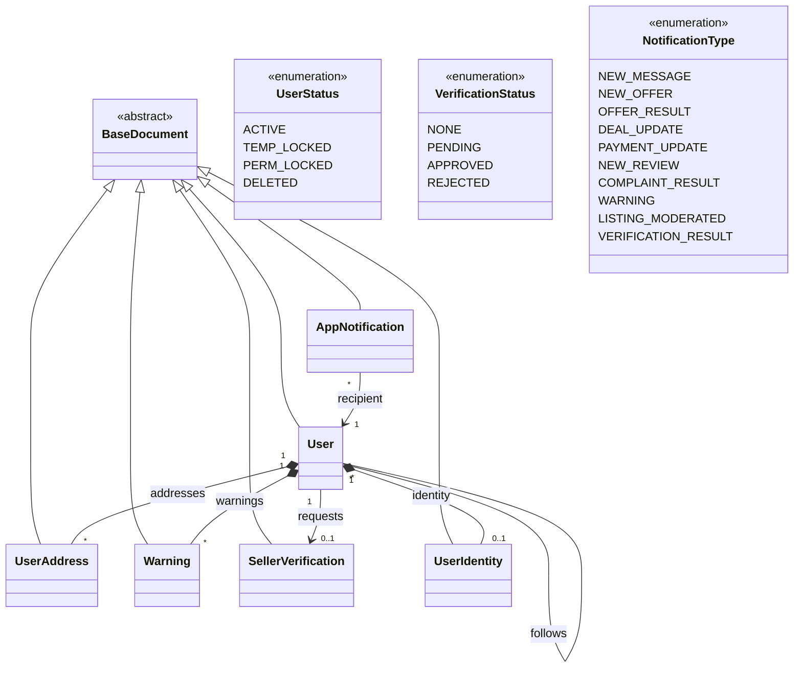
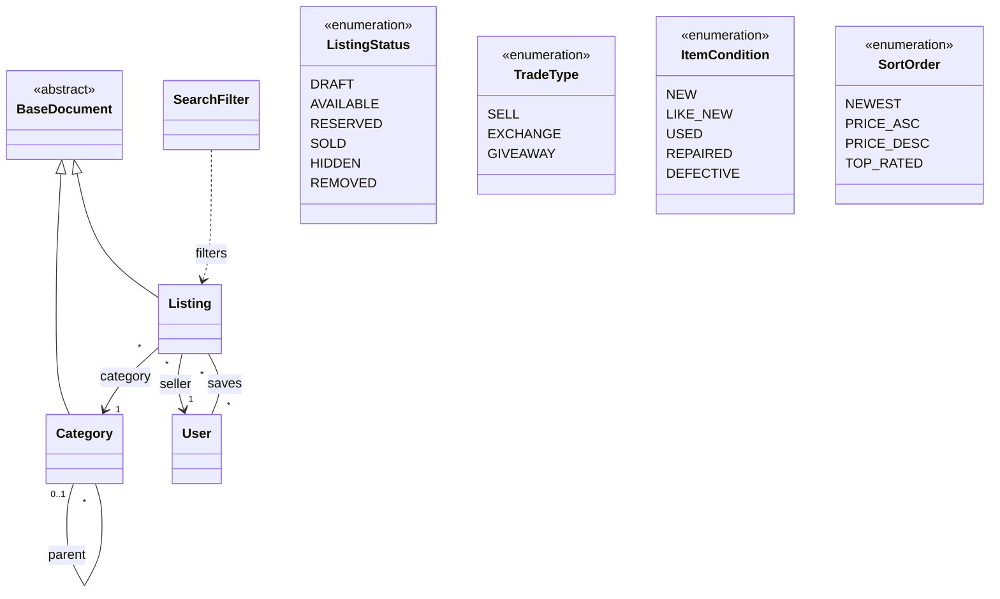
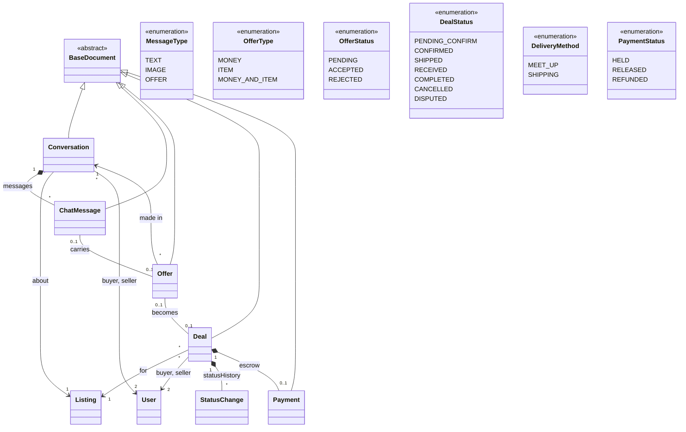
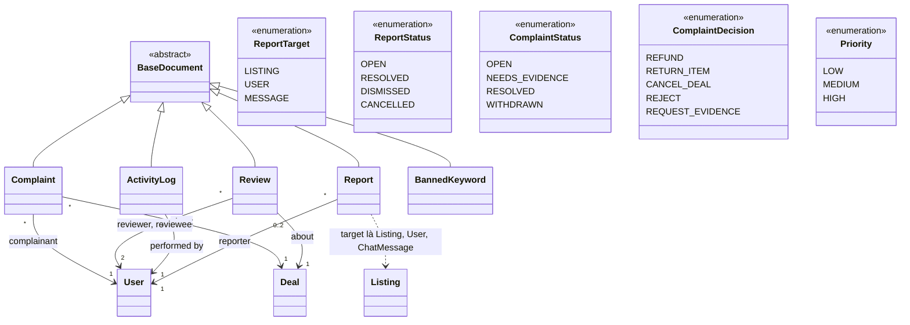
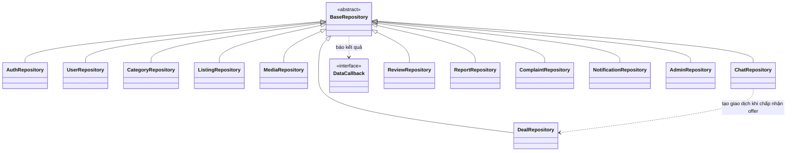
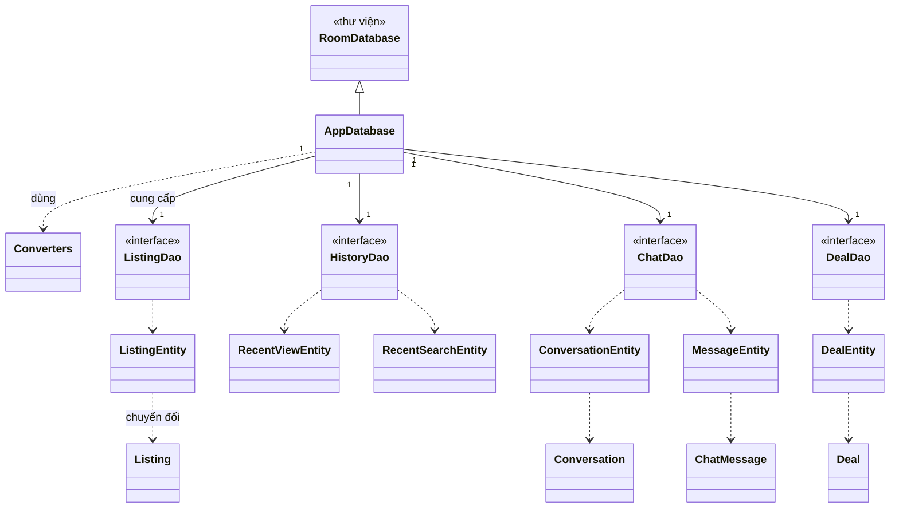

# Đặc tả lớp

Bản chữ đầy đủ của [sơ đồ lớp](../../diagrams/so-do-lop/README.md): mọi lớp, thuộc tính, phương thức và quan hệ. Khi ảnh sơ đồ và tài liệu này khác nhau, sửa cho khớp trong cùng Pull Request; tài liệu chữ là bản để code theo.

Cách mô tả mỗi lớp theo khung "thực thể thiết kế" của IEEE 1016 (Software Design Description), rút gọn cho đồ án: định danh, loại, lưu trữ, trách nhiệm, chức năng liên quan, thuộc tính, phương thức, quan hệ, dùng tới, được dùng bởi.

## Cách đọc

- **Truy cập:** `private`, `public`, `protected` như Java. Thuộc tính trong mô hình miền là `private` kèm getter, setter.
- **Kiểu ngoài:** `Timestamp` là `com.google.firebase.Timestamp`, `GeoPoint` là `com.google.firebase.firestore.GeoPoint`, `Uri` là `android.net.Uri`, `LiveData` là `androidx.lifecycle.LiveData`. Firebase và Room **chưa có trong build** (xem [overview.md](../overview.md)).
- **`DataCallback<T>`:** kết quả bất đồng bộ của repository; `T` ghi ở chữ ký. `Void` nghĩa là chỉ báo xong.
- **STT:** số dòng trong [bảng đặc tả chức năng](../../product/dac-ta-chuc-nang.md). Chỉ chức năng Đợt này.
- **Lớp ngoài danh sách:** `PubgApplication` (lớp `Application` ở gói gốc, khởi tạo `NetworkMonitor`, Room và WorkManager), các Activity, Fragment và Adapter thuộc tầng giao diện, xem [overview.md](../overview.md) mục 5.
- **Lớp trợ giúp giao diện `InAppNotifier`** (gói `ui.notification`, ngoài 93 lớp, issue #382): hiện thông báo hệ thống cho thông báo mới khi ứng dụng đang mở. `public InAppNotifier(Context context)` tạo kênh; `public void onNotificationsChanged(String uid, List<AppNotification> list)` nhận danh sách từ listener sống và hiện những thông báo mới; `static List<AppNotification> takeNew(List<AppNotification> list, String uid, Set<String> seenIds, long sinceMillis)` chọn thông báo chưa thấy, chưa đọc, đúng người nhận, tạo sau lúc bắt đầu theo dõi; `public boolean shouldAskPermission()` và `public void rememberPermissionAsked()` để `MainActivity` hỏi quyền `POST_NOTIFICATIONS` đúng một lần.
- **Quan hệ:** hợp thành nghĩa là phần con nằm trong cha (collection con hoặc mảng lồng) và mất khi cha mất; liên kết nghĩa là lưu mã của bên kia; phụ thuộc nghĩa là dùng tạm thời trong phương thức.

## Theo gói

| Tệp | Gói | Số lớp |
| --- | --- | ---: |
| [model.md](model.md) | `com.nhom3.pubgapp.model` | 23 |
| [enums.md](enums.md) | `com.nhom3.pubgapp.model.enums` | 23 |
| [data.md](data.md) | `com.nhom3.pubgapp.data` | 14 |
| [data-local.md](data-local.md) | `com.nhom3.pubgapp.data.local` | 12 |
| [util.md](util.md) | `com.nhom3.pubgapp.util` | 7 |
| [viewmodel.md](viewmodel.md) | `com.nhom3.pubgapp.viewmodel` | 14 |
| **Tổng** | | **93** |

## Mọi lớp theo thứ tự chữ cái

| Lớp | Gói | Loại |
| --- | --- | --- |
| [`ActivityLog`](model.md#activitylog) | `model` | lớp |
| [`AdminComplaintViewModel`](viewmodel.md#admincomplaintviewmodel) | `viewmodel` | lớp (ViewModel) |
| [`AdminContentViewModel`](viewmodel.md#admincontentviewmodel) | `viewmodel` | lớp (ViewModel) |
| [`AdminDealViewModel`](viewmodel.md#admindealviewmodel) | `viewmodel` | lớp (ViewModel) |
| [`AdminRepository`](data.md#adminrepository) | `data` | lớp (repository) |
| [`AdminUserViewModel`](viewmodel.md#adminuserviewmodel) | `viewmodel` | lớp (ViewModel) |
| [`AppDatabase`](data-local.md#appdatabase) | `data.local` | lớp (Room database) |
| [`AppNotification`](model.md#appnotification) | `model` | lớp |
| [`AuthRepository`](data.md#authrepository) | `data` | lớp (repository) |
| [`AuthViewModel`](viewmodel.md#authviewmodel) | `viewmodel` | lớp (ViewModel) |
| [`AutoReleaseWorker`](util.md#autoreleaseworker) | `util` | lớp (background job) |
| [`BannedKeyword`](model.md#bannedkeyword) | `model` | lớp |
| [`BaseDocument`](model.md#basedocument) | `model` | lớp trừu tượng |
| [`BaseRepository`](data.md#baserepository) | `data` | lớp trừu tượng |
| [`Category`](model.md#category) | `model` | lớp |
| [`CategoryRepository`](data.md#categoryrepository) | `data` | lớp (repository) |
| [`ChatDao`](data-local.md#chatdao) | `data.local` | interface |
| [`ChatMessage`](model.md#chatmessage) | `model` | lớp |
| [`ChatRepository`](data.md#chatrepository) | `data` | lớp (repository) |
| [`ChatViewModel`](viewmodel.md#chatviewmodel) | `viewmodel` | lớp (ViewModel) |
| [`Complaint`](model.md#complaint) | `model` | lớp |
| [`ComplaintDecision`](enums.md#complaintdecision) | `model.enums` | enum |
| [`ComplaintReason`](enums.md#complaintreason) | `model.enums` | enum |
| [`ComplaintRepository`](data.md#complaintrepository) | `data` | lớp (repository) |
| [`ComplaintStatus`](enums.md#complaintstatus) | `model.enums` | enum |
| [`Conversation`](model.md#conversation) | `model` | lớp |
| [`ConversationEntity`](data-local.md#conversationentity) | `data.local` | lớp (entity) |
| [`Converters`](data-local.md#converters) | `data.local` | lớp (type converters) |
| [`DataCallback`](data.md#datacallback) | `data` | interface |
| [`Deal`](model.md#deal) | `model` | lớp |
| [`DealDao`](data-local.md#dealdao) | `data.local` | interface |
| [`DealEntity`](data-local.md#dealentity) | `data.local` | lớp (entity) |
| [`DealRepository`](data.md#dealrepository) | `data` | lớp (repository) |
| [`DemoDataBuilder`](data.md#demodatabuilder) | `data` | lớp |
| [`DemoDataSeeder`](data.md#demodataseeder) | `data` | lớp |
| [`DealStatus`](enums.md#dealstatus) | `model.enums` | enum |
| [`DealViewModel`](viewmodel.md#dealviewmodel) | `viewmodel` | lớp (ViewModel) |
| [`DeliveryMethod`](enums.md#deliverymethod) | `model.enums` | enum |
| [`FeedViewModel`](viewmodel.md#feedviewmodel) | `viewmodel` | lớp (ViewModel) |
| [`FormatUtils`](util.md#formatutils) | `util` | lớp |
| [`Gender`](enums.md#gender) | `model.enums` | enum |
| [`GeoUtils`](util.md#geoutils) | `util` | lớp |
| [`HistoryDao`](data-local.md#historydao) | `data.local` | interface |
| [`ImagePurpose`](enums.md#imagepurpose) | `model.enums` | enum |
| [`ItemCondition`](enums.md#itemcondition) | `model.enums` | enum |
| [`KeywordFilter`](util.md#keywordfilter) | `util` | lớp |
| [`Listing`](model.md#listing) | `model` | lớp |
| [`ListingDao`](data-local.md#listingdao) | `data.local` | interface |
| [`ListingDetailViewModel`](viewmodel.md#listingdetailviewmodel) | `viewmodel` | lớp (ViewModel) |
| [`ListingEntity`](data-local.md#listingentity) | `data.local` | lớp (entity) |
| [`ListingRepository`](data.md#listingrepository) | `data` | lớp (repository) |
| [`ListingStatus`](enums.md#listingstatus) | `model.enums` | enum |
| [`MediaImage`](model.md#mediaimage) | `model` | lớp |
| [`MediaRepository`](data.md#mediarepository) | `data` | lớp (repository) |
| [`MessageEntity`](data-local.md#messageentity) | `data.local` | lớp (entity) |
| [`MessageType`](enums.md#messagetype) | `model.enums` | enum |
| [`NetworkMonitor`](util.md#networkmonitor) | `util` | lớp |
| [`NotificationRepository`](data.md#notificationrepository) | `data` | lớp (repository) |
| [`NotificationType`](enums.md#notificationtype) | `model.enums` | enum |
| [`NotificationViewModel`](viewmodel.md#notificationviewmodel) | `viewmodel` | lớp (ViewModel) |
| [`Offer`](model.md#offer) | `model` | lớp |
| [`OfferStatus`](enums.md#offerstatus) | `model.enums` | enum |
| [`OfferType`](enums.md#offertype) | `model.enums` | enum |
| [`Payment`](model.md#payment) | `model` | lớp |
| [`PaymentMethod`](enums.md#paymentmethod) | `model.enums` | enum |
| [`PaymentStatus`](enums.md#paymentstatus) | `model.enums` | enum |
| [`Priority`](enums.md#priority) | `model.enums` | enum |
| [`ProfileStats`](model.md#profilestats) | `model` | lớp (value object) |
| [`ProfileViewModel`](viewmodel.md#profileviewmodel) | `viewmodel` | lớp (ViewModel) |
| [`RecentSearchEntity`](data-local.md#recentsearchentity) | `data.local` | lớp (entity) |
| [`RecentViewEntity`](data-local.md#recentviewentity) | `data.local` | lớp (entity) |
| [`RecommendationEngine`](util.md#recommendationengine) | `util` | lớp |
| [`Report`](model.md#report) | `model` | lớp |
| [`ReportReason`](enums.md#reportreason) | `model.enums` | enum |
| [`ReportRepository`](data.md#reportrepository) | `data` | lớp (repository) |
| [`ReportStatus`](enums.md#reportstatus) | `model.enums` | enum |
| [`ReportTarget`](enums.md#reporttarget) | `model.enums` | enum |
| [`Review`](model.md#review) | `model` | lớp |
| [`ReviewRepository`](data.md#reviewrepository) | `data` | lớp (repository) |
| [`SearchFilter`](model.md#searchfilter) | `model` | lớp (value object) |
| [`SearchViewModel`](viewmodel.md#searchviewmodel) | `viewmodel` | lớp (ViewModel) |
| [`SellerVerification`](model.md#sellerverification) | `model` | lớp |
| [`SessionManager`](util.md#sessionmanager) | `util` | lớp (singleton) |
| [`ShopViewModel`](viewmodel.md#shopviewmodel) | `viewmodel` | lớp (ViewModel) |
| [`SortOrder`](enums.md#sortorder) | `model.enums` | enum |
| [`StatusChange`](model.md#statuschange) | `model` | lớp (value object) |
| [`TradeType`](enums.md#tradetype) | `model.enums` | enum |
| [`TrustViewModel`](viewmodel.md#trustviewmodel) | `viewmodel` | lớp (ViewModel) |
| [`User`](model.md#user) | `model` | lớp |
| [`UserAddress`](model.md#useraddress) | `model` | lớp |
| [`UserIdentity`](model.md#useridentity) | `model` | lớp |
| [`UserRepository`](data.md#userrepository) | `data` | lớp (repository) |
| [`UserStatus`](enums.md#userstatus) | `model.enums` | enum |
| [`VerificationStatus`](enums.md#verificationstatus) | `model.enums` | enum |
| [`Warning`](model.md#warning) | `model` | lớp |

## Quan hệ giữa các lớp

| Loại | Từ | Bội số | Tới | Bội số | Vai trò | Trang sơ đồ |
| --- | --- | --- | --- | --- | --- | --- |
| kế thừa | `User` |  | `BaseDocument` |  |  | 1. Người dùng |
| kế thừa | `UserAddress` |  | `BaseDocument` |  |  | 1. Người dùng |
| kế thừa | `Warning` |  | `BaseDocument` |  |  | 1. Người dùng |
| kế thừa | `SellerVerification` |  | `BaseDocument` |  |  | 1. Người dùng |
| kế thừa | `AppNotification` |  | `BaseDocument` |  |  | 1. Người dùng |
| hợp thành | `User` | 1 | `UserAddress` | * | addresses | 1. Người dùng |
| hợp thành | `User` | 1 | `Warning` | * | warnings | 1. Người dùng |
| liên kết | `User` | 1 | `SellerVerification` | 0..1 | requests | 1. Người dùng |
| liên kết | `AppNotification` | * | `User` | 1 | recipient | 1. Người dùng |
| liên kết | `User` | * | `User` | * | follows | 1. Người dùng |
| kế thừa | `Category` |  | `BaseDocument` |  |  | 2. Tin đăng, tìm kiếm |
| kế thừa | `Listing` |  | `BaseDocument` |  |  | 2. Tin đăng, tìm kiếm |
| liên kết | `Category` | 0..1 | `Category` | * | parent | 2. Tin đăng, tìm kiếm |
| liên kết | `Listing` | * | `Category` | 1 | category | 2. Tin đăng, tìm kiếm |
| liên kết | `Listing` | * | `User` | 1 | seller | 2. Tin đăng, tìm kiếm |
| liên kết | `User` | * | `Listing` | * | saves | 2. Tin đăng, tìm kiếm |
| phụ thuộc | `SearchFilter` |  | `Listing` |  | filters | 2. Tin đăng, tìm kiếm |
| kế thừa | `Conversation` |  | `BaseDocument` |  |  | 3. Trao đổi, giao dịch |
| kế thừa | `ChatMessage` |  | `BaseDocument` |  |  | 3. Trao đổi, giao dịch |
| kế thừa | `Offer` |  | `BaseDocument` |  |  | 3. Trao đổi, giao dịch |
| kế thừa | `Deal` |  | `BaseDocument` |  |  | 3. Trao đổi, giao dịch |
| kế thừa | `Payment` |  | `BaseDocument` |  |  | 3. Trao đổi, giao dịch |
| hợp thành | `Conversation` | 1 | `ChatMessage` | * | messages | 3. Trao đổi, giao dịch |
| liên kết | `Conversation` | * | `Listing` | 1 | about | 3. Trao đổi, giao dịch |
| liên kết | `Conversation` | * | `User` | 2 | buyer, seller | 3. Trao đổi, giao dịch |
| liên kết | `Offer` | * | `Conversation` | 1 | made in | 3. Trao đổi, giao dịch |
| liên kết | `ChatMessage` | 0..1 | `Offer` | 0..1 | carries | 3. Trao đổi, giao dịch |
| liên kết | `Offer` | 0..1 | `Deal` | 0..1 | becomes | 3. Trao đổi, giao dịch |
| liên kết | `Deal` | * | `Listing` | 1 | for | 3. Trao đổi, giao dịch |
| liên kết | `Deal` | * | `User` | 2 | buyer, seller | 3. Trao đổi, giao dịch |
| hợp thành | `Deal` | 1 | `StatusChange` | * | statusHistory | 3. Trao đổi, giao dịch |
| hợp thành | `Deal` | 1 | `Payment` | 0..1 | escrow | 3. Trao đổi, giao dịch |
| kế thừa | `Review` |  | `BaseDocument` |  |  | 4. Tin cậy, quản trị |
| kế thừa | `Report` |  | `BaseDocument` |  |  | 4. Tin cậy, quản trị |
| kế thừa | `Complaint` |  | `BaseDocument` |  |  | 4. Tin cậy, quản trị |
| kế thừa | `ActivityLog` |  | `BaseDocument` |  |  | 4. Tin cậy, quản trị |
| kế thừa | `BannedKeyword` |  | `BaseDocument` |  |  | 4. Tin cậy, quản trị |
| liên kết | `Complaint` | * | `Deal` | 1 | about | 4. Tin cậy, quản trị |
| liên kết | `Complaint` | * | `User` | 1 | complainant | 4. Tin cậy, quản trị |
| liên kết | `Review` | * | `User` | 2 | reviewer, reviewee | 4. Tin cậy, quản trị |
| liên kết | `Review` | 0..2 | `Deal` | 1 | about | 4. Tin cậy, quản trị |
| liên kết | `ActivityLog` | * | `User` | 1 | performed by | 4. Tin cậy, quản trị |
| liên kết | `Report` | * | `User` | 1 | reporter | 4. Tin cậy, quản trị |
| phụ thuộc | `Report` |  | `Listing` |  | target: Listing, User, ChatMessage | 4. Tin cậy, quản trị |
| kế thừa | `AuthRepository` |  | `BaseRepository` |  |  | 5. Tầng dữ liệu |
| kế thừa | `UserRepository` |  | `BaseRepository` |  |  | 5. Tầng dữ liệu |
| kế thừa | `CategoryRepository` |  | `BaseRepository` |  |  | 5. Tầng dữ liệu |
| kế thừa | `ListingRepository` |  | `BaseRepository` |  |  | 5. Tầng dữ liệu |
| kế thừa | `MediaRepository` |  | `BaseRepository` |  |  | 5. Tầng dữ liệu |
| kế thừa | `ChatRepository` |  | `BaseRepository` |  |  | 5. Tầng dữ liệu |
| kế thừa | `ReviewRepository` |  | `BaseRepository` |  |  | 5. Tầng dữ liệu |
| kế thừa | `ReportRepository` |  | `BaseRepository` |  |  | 5. Tầng dữ liệu |
| kế thừa | `ComplaintRepository` |  | `BaseRepository` |  |  | 5. Tầng dữ liệu |
| kế thừa | `NotificationRepository` |  | `BaseRepository` |  |  | 5. Tầng dữ liệu |
| kế thừa | `AdminRepository` |  | `BaseRepository` |  |  | 5. Tầng dữ liệu |
| kế thừa | `DealRepository` |  | `BaseRepository` |  |  | 5. Tầng dữ liệu |
| phụ thuộc | `BaseRepository` |  | `DataCallback` |  | báo kết quả | 5. Tầng dữ liệu |
| phụ thuộc | `ChatRepository` |  | `DealRepository` |  | tạo giao dịch khi chấp nhận offer | 5. Tầng dữ liệu |
| kế thừa | `AppDatabase` |  | `RoomDatabase` |  |  | 6. Lưu trữ cục bộ (Room) |
| phụ thuộc | `AppDatabase` |  | `Converters` |  | dùng | 6. Lưu trữ cục bộ (Room) |
| liên kết | `AppDatabase` | 1 | `ListingDao` | 1 | cung cấp | 6. Lưu trữ cục bộ (Room) |
| liên kết | `AppDatabase` | 1 | `HistoryDao` | 1 |  | 6. Lưu trữ cục bộ (Room) |
| liên kết | `AppDatabase` | 1 | `ChatDao` | 1 |  | 6. Lưu trữ cục bộ (Room) |
| liên kết | `AppDatabase` | 1 | `DealDao` | 1 |  | 6. Lưu trữ cục bộ (Room) |
| phụ thuộc | `ListingDao` |  | `ListingEntity` |  |  | 6. Lưu trữ cục bộ (Room) |
| phụ thuộc | `HistoryDao` |  | `RecentViewEntity` |  |  | 6. Lưu trữ cục bộ (Room) |
| phụ thuộc | `HistoryDao` |  | `RecentSearchEntity` |  |  | 6. Lưu trữ cục bộ (Room) |
| phụ thuộc | `ChatDao` |  | `ConversationEntity` |  |  | 6. Lưu trữ cục bộ (Room) |
| phụ thuộc | `ChatDao` |  | `MessageEntity` |  |  | 6. Lưu trữ cục bộ (Room) |
| phụ thuộc | `DealDao` |  | `DealEntity` |  |  | 6. Lưu trữ cục bộ (Room) |
| phụ thuộc | `ListingEntity` |  | `Listing` |  | chuyển đổi | 6. Lưu trữ cục bộ (Room) |
| phụ thuộc | `ConversationEntity` |  | `Conversation` |  |  | 6. Lưu trữ cục bộ (Room) |
| phụ thuộc | `MessageEntity` |  | `ChatMessage` |  |  | 6. Lưu trữ cục bộ (Room) |
| phụ thuộc | `DealEntity` |  | `Deal` |  |  | 6. Lưu trữ cục bộ (Room) |
| kế thừa | `AuthViewModel` |  | `ViewModel` |  |  | 7. ViewModel và tiện ích |
| kế thừa | `ProfileViewModel` |  | `ViewModel` |  |  | 7. ViewModel và tiện ích |
| kế thừa | `ShopViewModel` |  | `ViewModel` |  |  | 7. ViewModel và tiện ích |
| kế thừa | `FeedViewModel` |  | `ViewModel` |  |  | 7. ViewModel và tiện ích |
| kế thừa | `SearchViewModel` |  | `ViewModel` |  |  | 7. ViewModel và tiện ích |
| kế thừa | `ListingDetailViewModel` |  | `ViewModel` |  |  | 7. ViewModel và tiện ích |
| kế thừa | `ChatViewModel` |  | `ViewModel` |  |  | 7. ViewModel và tiện ích |
| kế thừa | `DealViewModel` |  | `ViewModel` |  |  | 7. ViewModel và tiện ích |
| kế thừa | `TrustViewModel` |  | `ViewModel` |  |  | 7. ViewModel và tiện ích |
| kế thừa | `NotificationViewModel` |  | `ViewModel` |  |  | 7. ViewModel và tiện ích |
| kế thừa | `AdminUserViewModel` |  | `ViewModel` |  |  | 7. ViewModel và tiện ích |
| kế thừa | `AdminContentViewModel` |  | `ViewModel` |  |  | 7. ViewModel và tiện ích |
| kế thừa | `AdminDealViewModel` |  | `ViewModel` |  |  | 7. ViewModel và tiện ích |
| kế thừa | `AdminComplaintViewModel` |  | `ViewModel` |  |  | 7. ViewModel và tiện ích |
| kế thừa | `AutoReleaseWorker` |  | `Worker` |  |  | 7. ViewModel và tiện ích |
| kế thừa | `UserIdentity` |  | `BaseDocument` |  |  | 1. Người dùng |
| hợp thành | `User` | 1 | `UserIdentity` | 0..1 | identity | 1. Người dùng |

Mã phụ như người xử lý (`handledBy`, `issuedBy`, `reviewedBy`) cũng là liên kết tới `User` nhưng không vẽ để sơ đồ khỏi rối; chúng có trong bảng thuộc tính của từng lớp.

## Sơ đồ dạng chữ (Mermaid)

Mỗi trang của sơ đồ lớp viết lại bằng Mermaid: GitHub vẽ được, công cụ AI đọc được. Chỉ có tên lớp và quan hệ; thành viên xem ở tệp của gói.

### Trang 1. Người dùng

### Trang 2. Tin đăng, tìm kiếm

### Trang 3. Trao đổi, giao dịch

### Trang 4. Tin cậy, quản trị

### Trang 5. Tầng dữ liệu

### Trang 6. Lưu trữ cục bộ (Room)

### Trang 7. ViewModel và tiện ích

```mermaid
classDiagram
    class AuthViewModel
    class ProfileViewModel
    class ShopViewModel
    class FeedViewModel
    class SearchViewModel
    class ListingDetailViewModel
    class ChatViewModel
    class ViewModel {
        <<thư viện>>
    }
    class DealViewModel
    class TrustViewModel
    class NotificationViewModel
    class AdminUserViewModel
    class AdminContentViewModel
    class AdminDealViewModel
    class AdminComplaintViewModel
    class SessionManager
    class NetworkMonitor
    class KeywordFilter
    class RecommendationEngine
    class GeoUtils
    class FormatUtils
    class AutoReleaseWorker
    class Worker {
        <<thư viện>>
    }
    ViewModel <|-- AuthViewModel
    ViewModel <|-- ProfileViewModel
    ViewModel <|-- ShopViewModel
    ViewModel <|-- FeedViewModel
    ViewModel <|-- SearchViewModel
    ViewModel <|-- ListingDetailViewModel
    ViewModel <|-- ChatViewModel
    ViewModel <|-- DealViewModel
    ViewModel <|-- TrustViewModel
    ViewModel <|-- NotificationViewModel
    ViewModel <|-- AdminUserViewModel
    ViewModel <|-- AdminContentViewModel
    ViewModel <|-- AdminDealViewModel
    ViewModel <|-- AdminComplaintViewModel
    Worker <|-- AutoReleaseWorker
```

