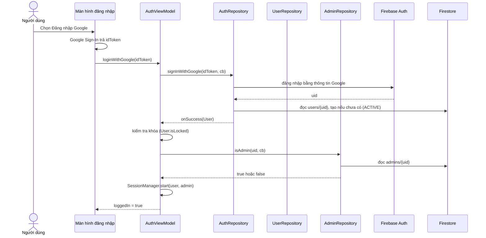
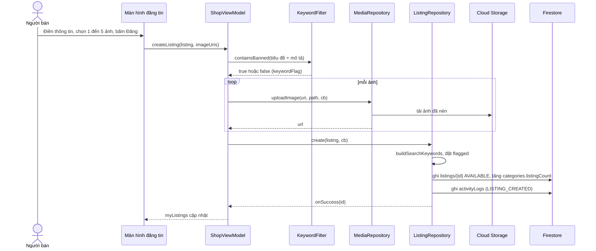
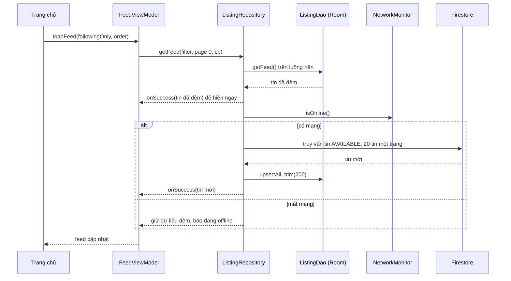
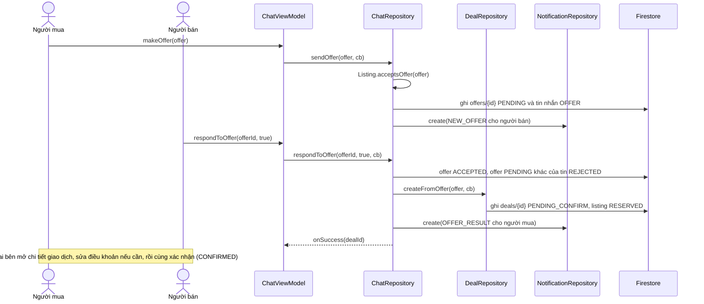
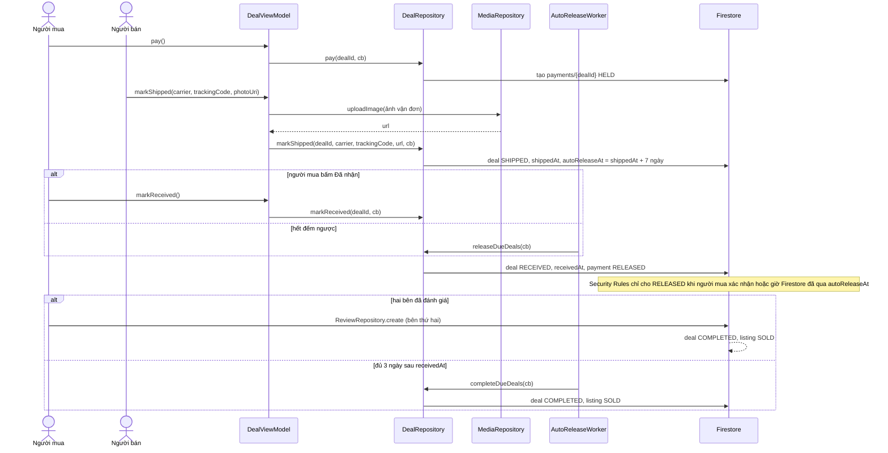
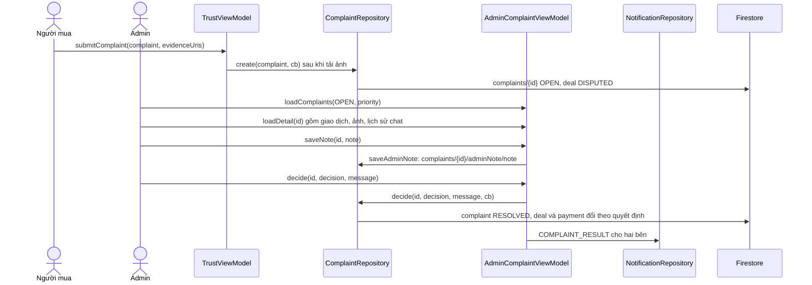

# Luồng xử lý chính

Góc nhìn chạy (mục 6 của khung arc42): các kịch bản quan trọng nhất, đi qua những lớp nào, theo thứ tự nào. Mỗi luồng có sơ đồ tuần tự Mermaid và các bước viết bằng chữ. Tên lớp và phương thức khớp [dac-ta-lop/](dac-ta-lop/README.md); luật chuyển trạng thái ở [trang-thai.md](trang-thai.md).

Quy ước chung cho mọi luồng:

- View (Activity, Fragment) chỉ gọi ViewModel và quan sát LiveData. ViewModel chỉ gọi repository và tiện ích.
- Repository trả kết quả qua `DataCallback<T>`. Firebase tự chạy mạng ngoài luồng chính; mọi thao tác Room chạy trên một luồng nền riêng.
- Lỗi đi theo `onError(message)` với câu tiếng Việt, ViewModel đưa vào LiveData lỗi để màn hình hiện. Không nuốt lỗi.
- "Firestore" trong sơ đồ gồm cả Security Rules: một lần ghi bị Rules từ chối sẽ quay về `onError`.

## 1. Đăng nhập bằng Google (STT 2)

1. Ứng dụng nhận `idToken` từ Google Sign-In rồi đưa cho `AuthViewModel.loginWithGoogle`.
2. `AuthRepository.signInWithGoogle` đăng nhập Firebase Authentication; lần đầu thì tạo `users/{uid}` với trạng thái ACTIVE.
3. Tài khoản đang khóa: hiện lý do và hạn khóa, đăng xuất. Khóa tạm đã hết hạn: ghi lại ACTIVE rồi đi tiếp. Tài khoản DELETED: báo tài khoản đã xóa, đăng xuất.
4. Đọc `admins/{uid}` để biết có hiện giao diện quản trị không. Cờ này chỉ để hiện giao diện; quyền thật do Security Rules kiểm tra ở mỗi lần đọc, ghi.
5. Đăng nhập bằng email đi cùng đường, thay bước 2 bằng `AuthRepository.signIn`; email chưa xác thực thì nhắc xác thực và không cho đăng tin.

Yêu cầu cấu hình: SHA-1 của máy phát triển đăng ký trên Firebase, nếu không Google Sign-In báo lỗi (xem `workflow/docs/workflow/firebase-setup.md`).

## 2. Đăng tin (STT 13, 16 đến 22, 78)

1. Kiểm tra đủ thông tin trước khi tải ảnh; thiếu thì báo ngay, không gọi mạng.
2. Chứa từ khóa cấm thì tin vẫn được đăng nhưng `flagged` là true và người bán được báo trước; admin thấy trong danh sách cần chú ý.
3. Lưu nháp đi cùng đường nhưng gọi `saveDraft`, không kiểm tra đủ thông tin, trạng thái DRAFT.
4. Một ảnh tải lỗi thì dừng, xóa các ảnh đã tải của lần này, báo lỗi; không ghi tin thiếu ảnh.

## 3. Xem bảng tin, có mạng và mất mạng (STT 29, 30, yêu cầu offline của môn học)

1. Luôn hiện dữ liệu Room trước, rồi thay bằng dữ liệu mạng khi có. Callback có thể được gọi hai lần; ViewModel chỉ việc đặt lại LiveData.
2. Mất mạng: màn hình hiện dải "Đang offline, đây là dữ liệu đã xem"; các nút ghi (đăng tin, gửi offer, thanh toán) bị khóa.
3. Chi tiết tin, danh sách chat, tin nhắn đã xem và lịch sử giao dịch dùng cùng cách: đọc Room, gọi mạng, ghi lại Room.
4. Ghi dữ liệu khi offline không được hỗ trợ trong đợt này.

## 4. Offer thành giao dịch (STT 47 đến 52)

1. Offer chỉ gửi được khi tin AVAILABLE, loại offer nằm trong `acceptedOfferTypes`, số tiền không dưới `minOfferPrice`.
2. Các bước ghi khi chấp nhận (offer, offer khác, giao dịch, tin) gom trong một lần ghi theo lô của Firestore để không bị nửa chừng.
3. Sửa điều khoản xóa cả hai cờ xác nhận; giao dịch chỉ sang CONFIRMED khi bên thứ hai xác nhận sau lần sửa cuối.

## 5. Thanh toán, giao hàng, giải ngân, hoàn tất (STT 53 đến 56, 59, 84)

1. Thanh toán chỉ có khi `agreedPrice` lớn hơn 0; đây là ký quỹ mô phỏng, không gọi cổng thanh toán.
2. Thiếu một trong ba bằng chứng vận đơn (đơn vị vận chuyển, mã, ảnh) thì nút Đã giao không bấm được và `Deal.markShipped` từ chối.
3. Màn hình chi tiết giao dịch hiện đồng hồ đếm ngược tới `autoReleaseAt` cho cả hai bên, cả khi offline (`DealEntity.autoReleaseAtMillis`).
4. Gặp trực tiếp (MEET_UP): không có bước SHIPPED và không đếm ngược; người mua bấm Đã nhận ngay từ CONFIRMED.
5. Không có máy chủ nên việc tự động do máy của hai bên làm: `AutoReleaseWorker` chạy nền định kỳ bằng WorkManager, và `DealViewModel.checkAutoRelease` chạy mỗi lần mở ứng dụng. Nếu cả hai máy đều không chạy, việc giải ngân chậm tới lần mở ứng dụng kế tiếp.

## 6. Khiếu nại và quyết định của admin (STT 64 đến 66, 87 đến 91)

Hệ quả từng quyết định: REFUND, RETURN_ITEM, CANCEL_DEAL làm giao dịch CANCELLED và hoàn tiền; REJECT làm giao dịch RECEIVED và giải ngân; REQUEST_EVIDENCE giữ giao dịch DISPUTED, khiếu nại sang NEEDS_EVIDENCE. Chi tiết ở [trang-thai.md](trang-thai.md#3-giao-dịch-dealstatus).

## 7. Cảnh báo theo bậc (STT 70 đến 72, 77)

1. Admin chọn tài khoản, nhập lý do, bấm Cảnh báo: `AdminUserViewModel.warn` gọi `AdminRepository.warnUser`.
2. Repository tăng `User.warningCount`, ghi `users/{uid}/warnings/{id}` với `level` mới, áp `Warning.resultingStatus()`: bậc 1 giữ ACTIVE, bậc 2 TEMP_LOCKED kèm hạn admin chọn, bậc 3 PERM_LOCKED.
3. Bậc 3 thì ViewModel gọi tiếp `AdminRepository.removeAllListingsOf` để gỡ mọi tin của tài khoản.
4. Gửi thông báo WARNING cho người bị cảnh báo; lần đăng nhập kế tiếp của họ bị chặn nếu đang khóa.

## 8. Vô hiệu hóa tài khoản (STT 12)

1. Người dùng bấm Xóa tài khoản, xác nhận lại bằng mật khẩu (tài khoản email) hoặc đăng nhập lại Google.
2. `UserRepository.deactivate` kiểm tra không còn giao dịch nào ở PENDING_CONFIRM, CONFIRMED, SHIPPED, RECEIVED, DISPUTED; còn thì từ chối và nói rõ giao dịch nào.
3. Đặt `status` DELETED, ẩn mọi tin của người này, rồi `AuthRepository.deleteLogin` xóa tài khoản đăng nhập, cuối cùng đăng xuất và xóa Room.
4. Hồ sơ, giao dịch và đánh giá cũ vẫn còn để đối tác xem; hồ sơ hiện "Tài khoản đã xóa".
