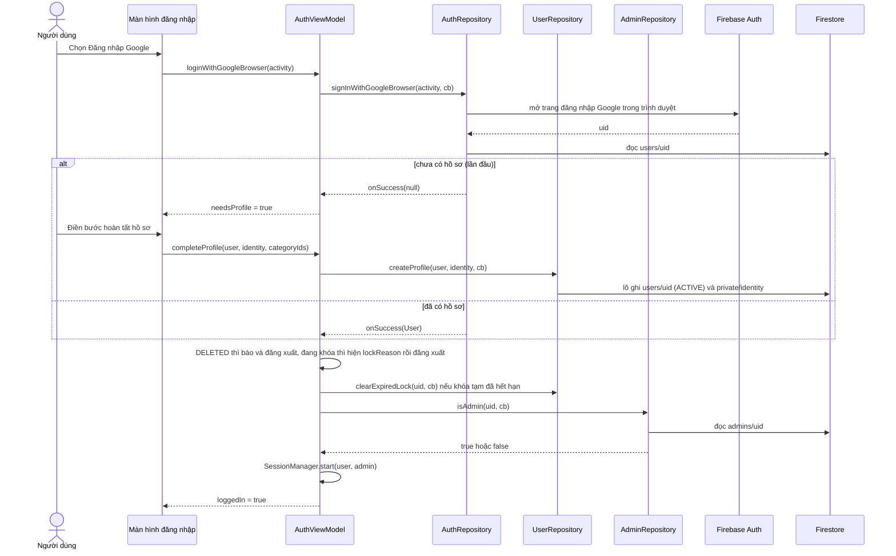
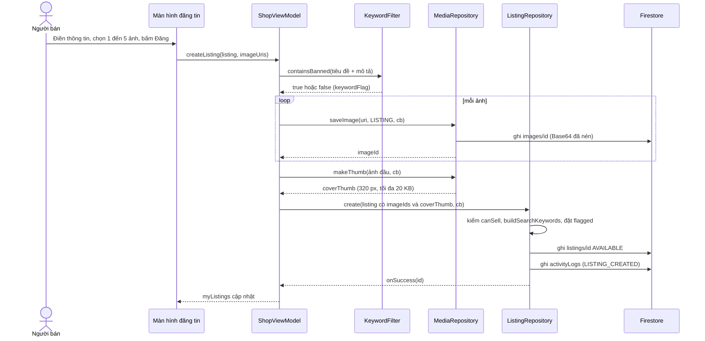
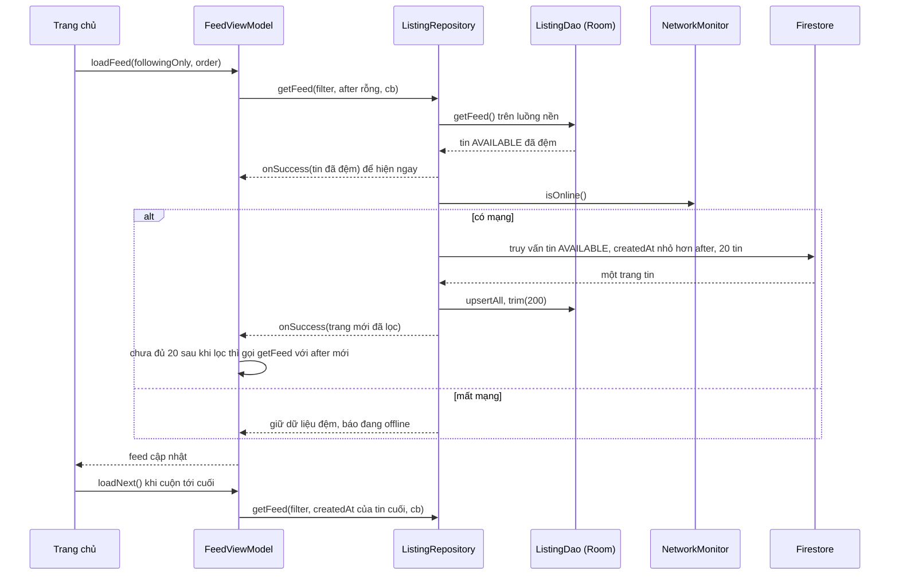
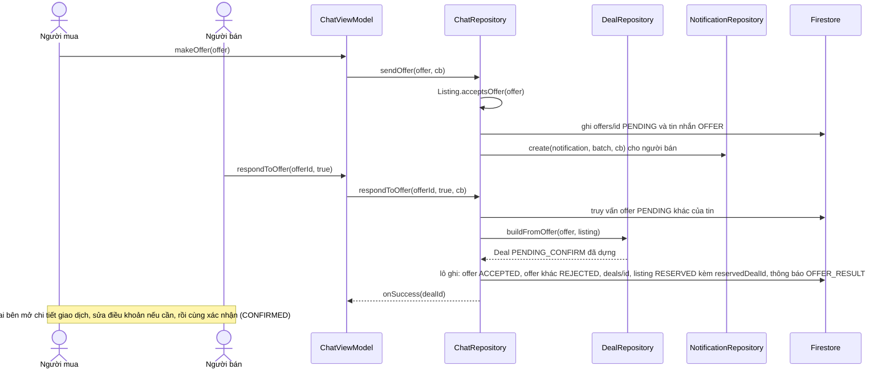
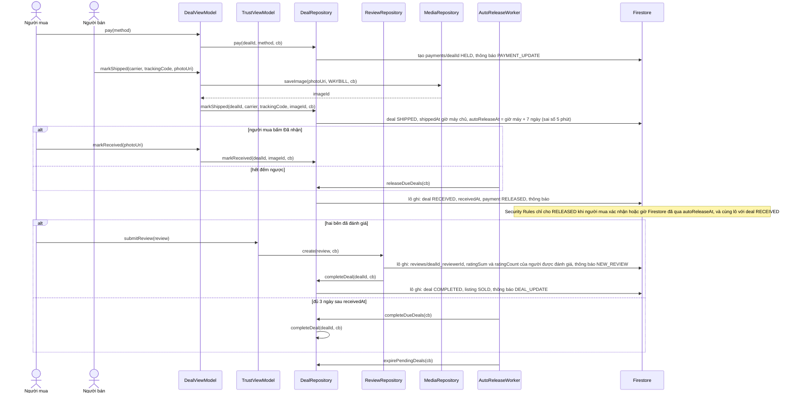
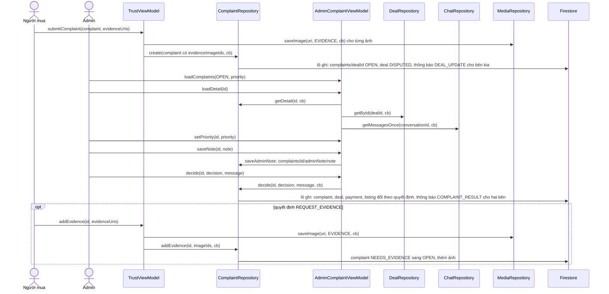
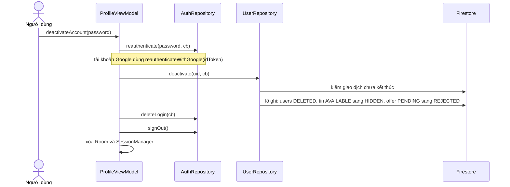

# Luồng xử lý chính

Góc nhìn chạy (mục 6 của khung arc42): các kịch bản quan trọng nhất, đi qua những lớp nào, theo thứ tự nào. Mỗi luồng có sơ đồ tuần tự Mermaid và các bước viết bằng chữ. Tên lớp và phương thức khớp [dac-ta-lop/](dac-ta-lop/README.md); luật chuyển trạng thái ở [trang-thai.md](trang-thai.md); điều kiện Security Rules ở [security-rules.md](../data/security-rules.md).

Quy ước chung cho mọi luồng:

- View (Activity, Fragment) chỉ gọi ViewModel và quan sát LiveData. ViewModel chỉ gọi repository và tiện ích.
- Repository trả kết quả qua `DataCallback<T>`. Firebase tự chạy mạng ngoài luồng chính; mọi thao tác Room chạy trên một luồng nền riêng.
- Lỗi đi theo `onError(message)` với câu tiếng Việt, ViewModel đưa vào LiveData lỗi để màn hình hiện. Không nuốt lỗi.
- "Firestore" trong sơ đồ gồm cả Security Rules: một lần ghi bị Rules từ chối sẽ quay về `onError`.
- Mọi lần ghi kiểm `NetworkMonitor.isOnline()` trước và có thời hạn chờ 15 giây; offline thì nút ghi đã bị khóa, quá hạn thì báo lỗi, không treo màn hình.
- Thông báo do repository làm đổi trạng thái ghi, trong cùng lô ghi với việc đó (xem [trang-thai.md](trang-thai.md) mục 9). ViewModel không gọi `NotificationRepository.create`, nên sơ đồ dưới không vẽ bước đó ở ViewModel.
- Ảnh không đi lên Cloud Storage (gói Spark không có): `MediaRepository.saveImage` nén ảnh, mã hóa Base64 và ghi thành tài liệu `images`, trả mã ảnh.

## 1. Đăng nhập bằng Google và khôi phục phiên (STT 2)

1. Màn hình gọi `AuthViewModel.loginWithGoogleBrowser`. Ứng dụng mở hộp chọn tài khoản Google của hệ thống qua Credential Manager (máy chưa có tài khoản thì hệ thống mời thêm), lấy mã Google rồi đăng nhập Firebase. Chỉ khi Credential Manager lỗi mới mở trang đăng nhập Google trong trình duyệt như cũ. (Đường `loginWithGoogle(idToken)` cho trường hợp đã có mã Google vẫn giữ.)
2. `AuthRepository.signInWithGoogleBrowser` (hoặc `signInWithGoogle` khi đã có mã) đăng nhập Firebase Authentication và đọc `users/{uid}`. Lần đầu chưa có hồ sơ thì trả `null`; ViewModel đặt `needsProfile` và màn hình mở bước hoàn tất hồ sơ (màn đăng ký A02 ở chế độ hoàn tất: điền khu vực, số điện thoại, đồng ý điều khoản, thông tin định danh, danh mục quan tâm). `AuthViewModel.completeProfile` gọi `UserRepository.createProfile`, tạo `users/{uid}` ở ACTIVE và `private/identity` trong một lô ghi. Tài khoản Google có email đã được Google xác thực.
3. Quyết định vào ứng dụng nằm ở ViewModel, không ở repository (`signIn` và `signInWithGoogle` trả `User` kể cả khi đang khóa). Tài khoản DELETED: báo tài khoản đã xóa, đăng xuất. Tài khoản đang khóa: hiện `lockReason` và hạn khóa, đăng xuất. Khóa tạm đã hết hạn: gọi `UserRepository.clearExpiredLock` rồi đi tiếp.
4. Đọc `admins/{uid}` để biết có hiện nút vào khu quản trị không. Cờ này chỉ để hiện giao diện; quyền thật do Security Rules kiểm tra ở mỗi lần đọc, ghi.
5. Đăng nhập bằng email đi cùng đường, thay bước 2 bằng `AuthRepository.signIn`; email chưa xác thực thì nhắc xác thực và không cho đăng tin. Sau khi người dùng xác thực trong hộp thư, ứng dụng gọi `AuthRepository.reloadUser` để cờ `isEmailVerified` được làm mới.
6. **Khôi phục phiên.** Khi mở ứng dụng, nếu Firebase Authentication còn phiên nhưng `SessionManager` trống (ví dụ tiến trình bị hệ thống tắt), `PubgApplication` hoặc màn hình khởi động gọi `AuthViewModel.restoreSession`: đọc lại `users/{uid}`, chạy lại kiểm tra DELETED, khóa và khóa hết hạn như bước 3, đọc lại `admins/{uid}`, rồi `SessionManager.start`. Sau đó chạy `DealViewModel.checkAutoRelease` (luồng 5).

Yêu cầu cấu hình: SHA-1 của máy phát triển đăng ký trên Firebase, nếu không Google Sign-In báo lỗi (xem `workflow/docs/workflow/firebase-setup.md`).

## 2. Đăng tin (STT 13, 16 đến 22, 78)

1. Kiểm đủ thông tin trước khi nén và ghi ảnh; thiếu thì báo ngay, không gọi mạng. Nút Đăng khóa khi offline.
2. Mỗi ảnh được nén (cạnh dài tối đa 1024 px, JPEG, tối đa 300 KB) rồi ghi thành một tài liệu `images` riêng với `ownerId` là người đăng. Tin chỉ lưu mã ảnh (`imageIds`) và một ảnh bìa thu nhỏ (`coverThumb`) để bảng tin không phải đọc ảnh đầy đủ.
3. Chứa từ khóa cấm thì tin vẫn được đăng nhưng `flagged` là true và người bán được báo trước; admin thấy trong danh sách cần chú ý.
4. Lưu nháp đi cùng đường nhưng gọi `saveDraft`, không kiểm đủ thông tin, trạng thái DRAFT. Đăng bản nháp gọi `ListingRepository.publish`, chạy lại các bước của `create`.
5. Một ảnh ghi lỗi thì dừng, xóa các ảnh đã ghi của lần này bằng `MediaRepository.delete`, báo lỗi; không ghi tin thiếu ảnh. Nếu `create` lỗi sau khi ảnh đã ghi, ViewModel cũng xóa các ảnh đó.
6. Không còn bước tăng bộ đếm danh mục: số tin của danh mục đếm bằng `count()` ở màn quản trị danh mục.

## 3. Xem bảng tin, có mạng và mất mạng (STT 29, 30, yêu cầu offline của môn học)

1. Luôn hiện dữ liệu Room trước, rồi thay bằng dữ liệu mạng khi có. Callback có thể được gọi hai lần; ViewModel chỉ việc đặt lại LiveData.
2. **Phân trang theo con trỏ.** Trang đầu có `after` rỗng; trang kế tiếp dùng `createdAt` của tin cuối trang trước. Mỗi trang lấy 20 tin. Chỉ một điều kiện bằng (danh mục hoặc tỉnh) được lọc ở máy chủ; giá, tình trạng, hình thức, bán kính lọc trên máy. Vì lọc trên máy làm trang thiếu, ViewModel tiếp tục gọi `getFeed` với con trỏ mới tới khi đủ 20 tin hoặc hết dữ liệu.
3. Sắp theo giá (PRICE_ASC, PRICE_DESC) làm ở máy chủ nhờ chỉ mục theo `price`. Sắp theo người bán đánh giá tốt (TOP_RATED) làm trên máy, trong phạm vi các tin đã tải, sau khi đọc hồ sơ những người bán đó. Kênh đang theo dõi chỉ dùng 30 người theo dõi đầu tiên (`sellerId in`).
4. Mất mạng: màn hình hiện dải "Đang offline, đây là dữ liệu đã xem"; các nút ghi (đăng tin, gửi offer, thanh toán) bị khóa. Room chỉ đệm ảnh bìa thu nhỏ, nên bảng tin offline vẫn có ảnh.
5. Chi tiết tin, danh sách chat, tin nhắn đã xem và lịch sử giao dịch dùng cùng cách: đọc Room, gọi mạng, ghi lại Room. Ảnh đầy đủ ở chi tiết tin đọc bằng `MediaRepository.getImage` (có bộ nhớ đệm RAM), chỉ khi có mạng.
6. Ghi dữ liệu khi offline không được hỗ trợ trong đợt này.
7. Tin đã lưu được tải từng tin một bằng `getById`; tin nào không còn (hoặc Rules từ chối vì đã bị ẩn) thì bỏ qua và hiện "Tin không còn".

## 4. Offer thành giao dịch (STT 47 đến 52)

1. Offer chỉ gửi được khi tin AVAILABLE, loại offer nằm trong `acceptedOfferTypes`, số tiền không dưới `minOfferPrice` (mức này chỉ áp dụng cho offer có tiền). Security Rules từ chối offer nếu tin không còn AVAILABLE.
2. Việc chấp nhận (offer, các offer khác, giao dịch, tin, thông báo) gom trong **một lô ghi** của Firestore để không bị nửa chừng. `DealRepository.buildFromOffer(offer, listing)` dựng `Deal` (không ghi) (ITEM thành EXCHANGE, MONEY và MONEY_AND_ITEM thành SELL, giá bằng `offer.amount`, `sellerConfirmed` true, chụp tiêu đề và ảnh bìa) rồi `ChatRepository` đưa vào lô, cùng `Listing.reservedDealId`.
3. Tin không còn AVAILABLE lúc chấp nhận thì offer bị từ chối và người bán nhận lỗi rõ ràng.
4. Sửa điều khoản xóa cả hai cờ xác nhận; giao dịch chỉ sang CONFIRMED khi bên thứ hai xác nhận sau lần sửa cuối, và đã chọn phương thức giao nhận. Giao dịch chưa đủ hai xác nhận sau 3 ngày bị hủy tự động (luồng 5).
5. Mỗi cuộc trò chuyện chỉ nghe 50 tin nhắn gần nhất; `ChatRepository.observeMessages` trả `ListenerRegistration` để `ChatViewModel` gỡ ở `onCleared`; tin cũ hơn tải bằng `loadOlder`.

## 5. Thanh toán, giao hàng, giải ngân, hoàn tất (STT 53 đến 56, 59, 84)

1. Thanh toán chỉ có khi `agreedPrice` lớn hơn 0; đây là ký quỹ mô phỏng, không gọi cổng thanh toán.
2. Thiếu một trong ba bằng chứng vận đơn (đơn vị vận chuyển, mã, ảnh) thì nút Đã giao không bấm được và `Deal.markShipped` từ chối. `DealRepository.markShipped` còn kiểm `Payment` đang HELD nếu cần thanh toán. `shippedAt` ghi bằng giờ máy chủ. `autoReleaseAt` ứng dụng ghi bằng giờ máy cộng 7 ngày, vì một lệnh ghi không đọc lại được giờ máy chủ của chính nó; Rules cho sai số 5 phút quanh `request.time` cộng 7 ngày và từ chối nếu lệch hơn.
3. Màn hình chi tiết giao dịch hiện đồng hồ đếm ngược tới `autoReleaseAt` cho cả hai bên, cả khi offline (`DealEntity.autoReleaseAtMillis`).
4. Gặp trực tiếp (MEET_UP): không có bước SHIPPED và không đếm ngược; người mua bấm Đã nhận ngay từ CONFIRMED.
5. **Một nơi hoàn tất.** `DealRepository.completeDeal` là nơi duy nhất đặt COMPLETED và tin SOLD; `ReviewRepository.create` (khi bên thứ hai đánh giá) và `completeDueDeals` (sau 3 ngày) chỉ gọi nó.
6. Không có máy chủ nên việc tự động do máy của hai bên làm: `AutoReleaseWorker` chạy nền mỗi 15 phút bằng WorkManager, và `DealViewModel.checkAutoRelease` chạy mỗi lần mở ứng dụng. Cả hai gọi `releaseDueDeals`, `completeDueDeals` và `expirePendingDeals`. `doWork` là đồng bộ nên Worker chờ từng lời gọi bất đồng bộ bằng `Tasks.await`. Nếu cả hai máy đều không chạy, việc giải ngân chậm tới lần mở ứng dụng kế tiếp.
7. Đánh giá không đổi trạng thái giao dịch trừ khi là đánh giá của bên thứ hai; mỗi bên một đánh giá (mã `dealId_reviewerId`).

## 6. Khiếu nại và quyết định của admin (STT 64 đến 66, 87 đến 91)

Hệ quả từng quyết định: REFUND, RETURN_ITEM, CANCEL_DEAL làm giao dịch CANCELLED và hoàn tiền ngay (RETURN_ITEM không kiểm chứng việc trả hàng); REJECT làm giao dịch RECEIVED và giải ngân; REQUEST_EVIDENCE giữ giao dịch DISPUTED, khiếu nại sang NEEDS_EVIDENCE kèm lời yêu cầu trong `evidenceRequest`. Chi tiết ở [trang-thai.md](trang-thai.md#3-giao-dịch-dealstatus).

1. Mã khiếu nại bằng mã giao dịch: mỗi giao dịch một khiếu nại, rút đơn là cuối cùng. Chỉ mở được khi giao dịch SHIPPED mà chưa qua `autoReleaseAt`, hoặc CONFIRMED khi gặp trực tiếp.
2. `decide` ghi thông báo COMPLAINT_RESULT cho hai bên trong cùng lô; không còn bước thông báo riêng ở ViewModel.
3. Lịch sử chat của admin đọc một lần bằng `ChatRepository.getMessagesOnce`, không mở listener. Ảnh bằng chứng đọc bằng `MediaRepository.getImage`.
4. Người khiếu nại rút đơn bằng `withdraw`: giao dịch về `statusBeforeDispute()` (SHIPPED hoặc CONFIRMED) với `autoReleaseAt` cũ.

## 7. Cảnh báo theo bậc (STT 70 đến 72, 77)

1. Admin chọn tài khoản, nhập lý do, và với bậc 2 chọn hạn khóa tạm, bấm Cảnh báo: `AdminUserViewModel.warn(userId, reason, until)` gọi `AdminRepository.warnUser(id, warning, until)`.
2. Repository, trong một lô ghi, tăng `User.warningCount`, ghi `users/{uid}/warnings/{id}` với `level` mới, áp `Warning.resultingStatus()`: bậc 1 giữ ACTIVE, bậc 2 TEMP_LOCKED kèm hạn `until`, bậc 3 trở lên PERM_LOCKED; ghi `lockReason`; ghi thông báo WARNING cho người bị cảnh báo. Hệ thống **không** tự gỡ tin của tài khoản bị khóa: admin bấm "Gỡ toàn bộ tin" ở màn E03 khi thấy cần (quyết định 2026-10-22).
3. Lần đăng nhập kế tiếp của họ bị chặn nếu đang khóa; nếu họ đang dùng ứng dụng, lần ghi kế tiếp bị Rules từ chối vì tài khoản không còn ACTIVE.

## 8. Vô hiệu hóa tài khoản (STT 12)

1. Người dùng bấm Xóa tài khoản và xác nhận lại bằng mật khẩu (tài khoản email) hoặc đăng nhập lại Google. Xác thực lại phải xong **trước** mọi thay đổi dữ liệu, vì Firebase chỉ cho xóa đăng nhập ngay sau khi vừa xác thực lại.
2. `UserRepository.deactivate` kiểm không còn giao dịch nào ở PENDING_CONFIRM, CONFIRMED, SHIPPED, RECEIVED, DISPUTED; còn thì từ chối và nói rõ giao dịch nào (kiểm phía máy). Nếu không còn, trong một lô ghi: đặt `status` DELETED, ẩn mọi tin AVAILABLE với `statusReason` "Tài khoản đã xóa", từ chối offer PENDING của các tin đó.
3. `AuthRepository.deleteLogin` xóa tài khoản đăng nhập. Phải làm sau Firestore (sau khi xóa đăng nhập không còn quyền ghi) và ngay sau bước xác thực lại. Nếu bước này lỗi, thử lại; tài khoản đã DELETED đăng nhập lại sẽ bị báo "Tài khoản đã xóa" và đăng xuất.
4. Cuối cùng đăng xuất và xóa Room.
5. Hồ sơ, giao dịch và đánh giá cũ vẫn còn để đối tác xem; hồ sơ hiện "Tài khoản đã xóa".
