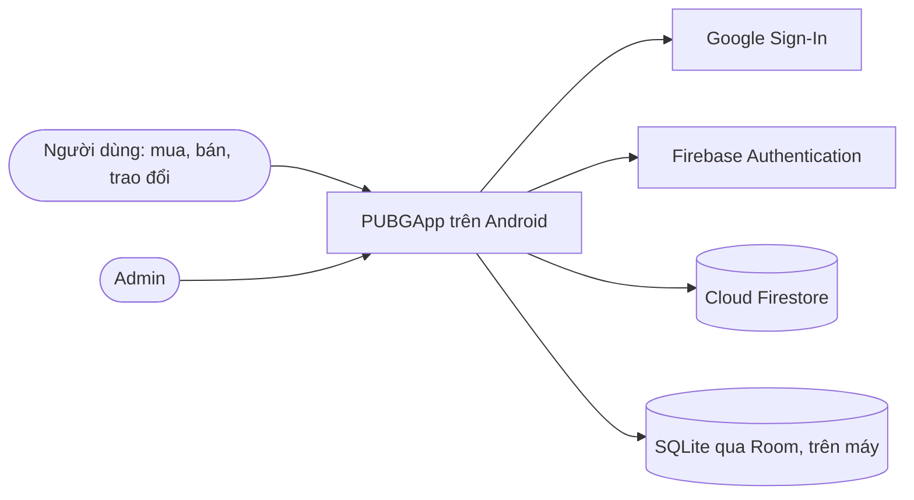

# Kiến trúc ứng dụng

Tài liệu sở hữu chủ đề kiến trúc của PUBGApp. Bố cục theo khung **arc42** (12 mục, rút gọn cho đồ án); góc nhìn ngữ cảnh và thành phần theo **mô hình C4**. Chi tiết nằm ở các tài liệu con:

| Tài liệu | Nội dung | Tương ứng |
| --- | --- | --- |
| [dac-ta-lop/](dac-ta-lop/README.md) | Từng lớp: thuộc tính, phương thức, quan hệ | C4 mức 4 (Code), IEEE 1016 |
| [thanh-phan.md](thanh-phan.md) | ViewModel nào dùng repository nào, repository chạm dữ liệu nào | C4 mức 3 (Component) |
| [trang-thai.md](trang-thai.md) | Máy trạng thái của tin, offer, giao dịch, ký quỹ, báo cáo, khiếu nại, tài khoản; bảng ai ghi thông báo | arc42 mục 8 |
| [luong-xu-ly.md](luong-xu-ly.md) | Các luồng chính bằng sơ đồ tuần tự | arc42 mục 6 |
| [goi-y.md](goi-y.md) | Công thức gợi ý tin, giá tham khảo, mục Dành cho bạn | arc42 mục 8 |
| [../data/firestore-schema.md](../data/firestore-schema.md), [../data/room-schema.md](../data/room-schema.md) | Từ điển dữ liệu | arc42 mục 5 và 8 |
| [../data/security-rules.md](../data/security-rules.md) | Ma trận Security Rules theo từng collection | arc42 mục 8 |

## Trạng thái của tài liệu này

| Mức | Nghĩa | Gồm |
| --- | --- | --- |
| **Đã có trong code** | Có thật trong `PUBGApp/` | Project Android, gói `com.nhom3.pubgapp`, Java 17, XML Views, ViewBinding, minSdk 30, một màn hình mẫu `MainActivity` |
| **Thiết kế đã chốt** | Code theo đúng như ghi | Mọi mục dưới đây không đánh dấu "chưa chốt", kể cả điều hướng và gói giao diện (mục 5) |
| **Chưa chốt** | Chưa được code theo, phải hỏi leader | Số liệu hạn mức gói Spark (mục 2 và 11) phải kiểm lại trên trang Firebase trước khi dựa vào |

**Firebase (Authentication, Firestore), Room và WorkManager chưa có trong build.** Không viết code giả định chúng đã cấu hình cho tới khi một issue `build(deps)` hoặc `chore(deps)` thêm chúng và dòng này được sửa (`AGENTS.md`, mục 2 và luật R5). Dự án dùng **gói Spark, không có Cloud Storage**.

## 1. Giới thiệu và mục tiêu

PUBGApp (Pre-owned Users' Bargain Grounds) là ứng dụng Android mua, bán, trao đổi và cho tặng đồ cũ, kết hợp mạng xã hội (theo dõi, kênh tin) với sàn giao dịch có ký quỹ mô phỏng, đánh giá, báo cáo, khiếu nại và một phần quản trị đơn giản. Phạm vi chức năng: [bảng đặc tả chức năng](../product/dac-ta-chuc-nang.md), chỉ các dòng **Đợt này**.

**Mục tiêu chất lượng**, theo thứ tự ưu tiên:

| # | Mục tiêu | Nghĩa cụ thể |
| --- | --- | --- |
| 1 | Đúng yêu cầu môn học | Firebase; giao diện dùng được khi xoay màn hình; xem lại trang đã xem khi mất mạng bằng SQLite; đăng nhập Google |
| 2 | An toàn dữ liệu | Quyền do Firebase Authentication và Security Rules quyết định, không lấy từ dữ liệu ứng dụng gửi lên |
| 3 | Dễ đọc với sinh viên | Java tường minh, không lambda, lớp nhỏ, một quy tắc chia gói (xem `conventions/android-java.md`) |
| 4 | Chi phí bằng 0 | Gói Spark của Firebase, không gắn thẻ, không máy chủ riêng |

**Các bên liên quan:** 5 thành viên nhóm (code và tài liệu), giảng viên (chấm theo yêu cầu môn học), người dùng cuối (người mua, người bán), admin.

## 2. Ràng buộc

| Ràng buộc | Nguồn |
| --- | --- |
| Java 17; không Kotlin, không Jetpack Compose; XML Views với ViewBinding | `AGENTS.md` mục 2 |
| minSdk 30, compileSdk và targetSdk 37; phiên bản thư viện chỉ ghi ở `PUBGApp/gradle/libs.versions.toml` | `AGENTS.md` mục 2 |
| Backend là Firebase **gói Spark**, không gắn thẻ; không có máy chủ riêng, không viết mã chạy phía máy chủ (Cloud Functions) | `workflow/memory/decisions.md`, 2026-09-25 và 2026-10-12 |
| **Không dùng Cloud Storage.** Ảnh nén rồi lưu dạng Base64 trong Firestore; video trong chat không làm (STT 45 là Phát triển sau) | `workflow/memory/decisions.md`, 2026-10-12 |
| Hạn mức Spark của Firestore: khoảng 1 GiB lưu trữ, 50.000 lượt đọc, 20.000 lượt ghi và 20.000 lượt xóa mỗi ngày, 10 GiB dữ liệu ra mỗi tháng (kiểm lại trên trang Firebase trước khi dựa vào) | Trang giá Firebase |
| Mỗi tài liệu Firestore dưới 1 MiB, nên mỗi ảnh là một tài liệu riêng (mục 8, Media) | Giới hạn Firestore |
| Không có cổng thanh toán thật: ký quỹ là mô phỏng | Bảng đặc tả, STT 56 |
| Chia gói theo tầng; gói giao diện chia theo module `ui.<module>` | `workflow/memory/decisions.md`, 2026-09-27; `workflow/plan/so-huu.md` |

## 3. Ngữ cảnh và phạm vi (C4 mức 1)



| Bên ngoài | Ứng dụng dùng để | Dữ liệu trao đổi |
| --- | --- | --- |
| Google Sign-In | Lấy mã đăng nhập Google | `idToken` |
| Firebase Authentication | Đăng ký, đăng nhập, xác thực email, đặt lại và đổi mật khẩu | `uid`, email |
| Cloud Firestore | Nguồn dữ liệu chính, cập nhật theo thời gian thực bằng snapshot listener cho chat, hồ sơ, giao dịch, thông báo và các hàng chờ của admin (bảng tin và tìm kiếm vẫn đọc theo trang); cũng chứa ảnh Base64 (collection `images`) | 23 collection, xem `data/firestore-schema.md` |
| Room (SQLite) | Bộ nhớ đệm trên máy để xem lại khi mất mạng | 6 bảng, xem `data/room-schema.md` |

Ngoài phạm vi: thông báo đẩy khi ứng dụng đóng, cổng thanh toán, bản đồ, đăng nhập bằng số điện thoại, bản web, gửi video, các chức năng **Phát triển sau**.

## 4. Chiến lược giải pháp

| Vấn đề | Cách giải | Vì sao |
| --- | --- | --- |
| Tách giao diện khỏi dữ liệu, giữ trạng thái khi xoay | MVVM: View, ViewModel với LiveData, Repository | Mẫu được dạy trong môn học; ViewModel sống qua lần xoay màn hình |
| Xem lại khi mất mạng | Repository đọc Room trước, gọi Firestore, ghi lại Room | Yêu cầu môn học; Room chỉ là bộ đệm, Firestore là nguồn chính |
| Không có máy chủ | Quy tắc nghiệp vụ nằm trong lớp mô hình miền (`Deal.canMoveTo`, `Listing.acceptsOffer`); Security Rules chặn ghi sai (ma trận ở `data/security-rules.md`) | Không có chỗ khác để đặt logic |
| Việc theo thời hạn (giải ngân, hoàn tất, hết hạn xác nhận) | `AutoReleaseWorker` (WorkManager, 15 phút) và kiểm tra lúc mở ứng dụng; Rules so với giờ Firestore | Không có tiến trình phía máy chủ |
| Tìm kiếm tiếng Việt | Lưu `searchKeywords` đã bỏ dấu, truy vấn `array-contains` theo từ dài nhất, lọc phần còn lại trên máy; chỉ khớp nguyên từ | Firestore không tìm toàn văn |
| Phân trang | Con trỏ là `createdAt` của tin cuối trang; bộ lọc phía máy làm trang thiếu thì ViewModel tải tiếp tới khi đủ 20 hoặc hết | Firestore không phân trang theo số trang |
| Bán kính, gợi ý, giá tham khảo | Tính trên máy (`GeoUtils`, `RecommendationEngine`, công thức ở `goi-y.md`) | Firestore không truy vấn theo bán kính; quy mô đồ án nhỏ |
| Số liệu hồ sơ (đã bán, người theo dõi, giao dịch, hoàn tất) | Đếm bằng truy vấn tổng hợp `count()` lúc mở hồ sơ, không lưu bộ đếm | Không để người dùng ghi chéo bộ đếm vào tài liệu người khác |
| Ảnh không có Cloud Storage | `MediaRepository` nén ảnh, mã hóa Base64, ghi mỗi ảnh thành một tài liệu `images`; bảng tin chỉ dùng ảnh bìa thu nhỏ nằm sẵn trong tin | Gói Spark; giới hạn 1 MiB mỗi tài liệu; bảng tin không phải tải ảnh lớn |
| Quyền admin | Tài liệu `admins/{uid}`; admin cấp và gỡ quyền cho người khác trong ứng dụng (UC42), tài liệu đầu tiên do leader tạo tay; Rules đọc tài liệu này | Ứng dụng không được tự khai quyền: chỉ người đã là admin mới cấp được, và không cấp hay gỡ cho chính mình (luật R12) |
| Dữ liệu nhạy cảm | Tài liệu con riêng tư: `users/{uid}/private/identity`, `complaints/{id}/adminNote/note` | Rules phân quyền theo tài liệu, không theo trường |

## 5. Góc nhìn khối (C4 mức 2 và 3)

**Container.** Chỉ có một ứng dụng chạy trên máy người dùng; còn lại là dịch vụ của Firebase và cơ sở dữ liệu trên máy.

| Container | Công nghệ | Trách nhiệm |
| --- | --- | --- |
| Ứng dụng Android PUBGApp | Java 17, XML Views, AndroidX | Toàn bộ giao diện và logic nghiệp vụ |
| Cloud Firestore | Firebase, gói Spark | Lưu dữ liệu và ảnh Base64, Security Rules |
| Firebase Authentication | Firebase | Danh tính người dùng |
| Room | AndroidX Room trên SQLite | Bộ nhớ đệm, lịch sử xem và tìm kiếm |

**Bên trong ứng dụng.** Phụ thuộc chỉ đi một chiều, từ trên xuống:

```
View (Activity, Fragment, Adapter)          gói com.nhom3.pubgapp.ui.<module>
  -> viewmodel   14 lớp   trạng thái màn hình bằng LiveData
  -> data        14 lớp   12 repository, BaseRepository, DataCallback
       -> Firebase (Auth, Firestore)
       -> data.local  12 lớp   Room: AppDatabase, Converters, 6 entity, 4 DAO
model (23 lớp), model.enums (23 kiểu), util (7 lớp): mọi tầng đều dùng
PubgApplication (gốc gói, không tính vào 93 lớp): khởi tạo lúc ứng dụng chạy
```

| Gói | Được gọi | Không được |
| --- | --- | --- |
| View | ViewModel | Gọi repository, Firebase, Room trực tiếp; giữ dữ liệu màn hình trong Activity |
| `viewmodel` | Repository, `util`, `model` | Giữ tham chiếu tới Activity, Fragment, View, Context của màn hình; gọi `NotificationRepository.create` |
| `data` | Firebase, DAO, `model`, `util` | Biết tới View hay ViewModel |
| `data.local` | Room | Được gọi từ ngoài `data`; mọi kiểu của `data.local` không đi ra ngoài `data` (lớp `util` và ViewModel chỉ nhận danh sách thường như `List<String>`) |
| `model`, `model.enums` | Không gọi tầng nào | Gọi mạng hay đĩa |
| `util` | `model`, thư viện | Gọi repository. **Ngoại lệ duy nhất:** `AutoReleaseWorker` gọi `DealRepository`, vì việc chạy nền không có ViewModel |

Tổng 93 lớp. Danh sách và đặc tả từng lớp ở [dac-ta-lop/](dac-ta-lop/README.md); ai dùng ai ở [thanh-phan.md](thanh-phan.md).

**Điều hướng (đã chốt).** Ba Activity, mỗi màn hình là một Fragment, dùng Navigation component với một đồ thị lồng cho mỗi module:

| Activity | Nội dung | Ghi chú |
| --- | --- | --- |
| `AuthActivity` | Đăng nhập, đăng ký (cũng là bước hoàn tất hồ sơ khi đăng nhập Google lần đầu), quên mật khẩu | Mở khi chưa có phiên đăng nhập |
| `MainActivity` | Thanh điều hướng dưới có 5 tab: Trang chủ, Tìm kiếm, Đăng tin, Tin nhắn, Cá nhân | Chứa mọi màn hình người dùng; chuyển sang màn hình của module khác bằng hành động toàn cục trong `nav_main.xml` |
| `AdminActivity` | Khu quản trị | Mở từ màn Cá nhân khi `SessionManager.isAdmin()` là true |

Gói giao diện là `com.nhom3.pubgapp.ui.<tên>`: `ui.account`, `ui.notification` (Ngân), `ui.listing` (Tú), `ui.trade` (Hải Long), `ui.profile`, `ui.trust`, `ui.admin.complaint` (Phúc), `ui.admin`, `ui.common`, `ui.main` (Phát). Mỗi module có tiền tố layout, file chuỗi và đồ thị điều hướng riêng; danh sách lớp màn hình, hành động toàn cục và chủ file nằm ở `workflow/plan/so-huu.md`, không nhắc lại ở đây.

**Khởi tạo ứng dụng.** `PubgApplication` (lớp `Application`, đặt ở gốc gói) khởi tạo `NetworkMonitor` (`register`), `AppDatabase` và lên lịch `AutoReleaseWorker` bằng WorkManager. Các lớp đơn (`SessionManager`, `NetworkMonitor`, `AppDatabase`) lấy bằng `getInstance` là phương thức `static`.

## 6. Góc nhìn chạy

Các luồng ở [luong-xu-ly.md](luong-xu-ly.md): đăng nhập Google và khôi phục phiên, đăng tin (ảnh Base64), xem bảng tin có mạng và mất mạng (phân trang theo con trỏ), offer thành giao dịch, thanh toán đến giải ngân và hoàn tất, khiếu nại, cảnh báo theo bậc, vô hiệu hóa tài khoản.

## 7. Góc nhìn triển khai

| Thành phần | Nơi chạy | Ghi chú |
| --- | --- | --- |
| Bản debug của ứng dụng | Điện thoại hoặc máy ảo Android 11 trở lên (API 30) | Build bằng `./gradlew assembleDebug` |
| Firebase project | Google Cloud, **gói Spark** | Một project chung cho cả nhóm; không gắn thẻ; không có bucket Storage |
| `google-services.json` | `PUBGApp/app/`, có commit | Chỉ chứa định danh công khai (luật R11) |
| SHA-1 của từng máy | Đăng ký trên Firebase | Thiếu thì Google Sign-In lỗi |
| Security Rules | Chỉ Firestore, file `firebase/firestore.rules`; chỉ mục ở `firebase/firestore.indexes.json` | Phải viết trước khi có dữ liệu thật; nội dung theo `data/security-rules.md` |

Không có bản phát hành lên cửa hàng ứng dụng. Cách cài đặt: `workflow/docs/workflow/firebase-setup.md`.

## 8. Khái niệm xuyên suốt

**Luồng và bất đồng bộ.** Không làm việc mạng, đĩa hay cơ sở dữ liệu trên luồng chính. Firebase trả kết quả qua listener; Room chạy trên một bộ thực thi nền dùng chung. Repository báo kết quả bằng `DataCallback<T>` (lớp ẩn danh, không lambda). Riêng `AutoReleaseWorker.doWork` là đồng bộ nên chờ kết quả bằng `Tasks.await`.

**Lỗi.** Repository dịch ngoại lệ thành câu tiếng Việt (`BaseRepository.fail`) và gọi `onError`. ViewModel đưa câu đó vào LiveData lỗi; màn hình hiện bằng Snackbar hoặc hộp thoại. Thiếu quyền hoặc mất mạng thì nói rõ, không im lặng. Rules từ chối một lần ghi (ví dụ tài khoản không còn ACTIVE) cũng đi về `onError` với câu rõ ràng.

**Offline.** Room là nguồn đọc khi mất mạng: đọc Room, hiện ngay, gọi Firestore, ghi lại Room. **Không ghi khi offline.** Mọi thao tác ghi kiểm `NetworkMonitor.isOnline()` trước; nút ghi bị khóa và có dải báo offline. Vì Firestore SDK tự xếp hàng lệnh ghi khi mất mạng và chỉ báo xong khi máy chủ xác nhận (kiểm lại), mọi lệnh ghi còn có **thời hạn chờ 15 giây**: quá hạn thì `onError` với câu "Không có kết nối" và màn hình không treo. Room xóa sạch khi đăng xuất. Chi tiết: `data/room-schema.md`.

**Xoay màn hình.** Trạng thái màn hình nằm trong ViewModel (LiveData), kể cả bộ lọc và nội dung đang soạn; Activity chỉ quan sát. Mỗi layout dùng `ConstraintLayout` hoặc có bản `layout-land`.

**Bảo mật.** Danh tính từ Firebase Authentication. Quyền do Security Rules, ma trận ở `data/security-rules.md`: mọi lần ghi đòi tài khoản ghi là ACTIVE; chỉ người trong cuộc đọc dữ liệu của cuộc đó; admin xác định bằng `admins/{uid}`; dữ liệu nhạy cảm ở tài liệu con riêng tư. Khóa tài khoản có hiệu lực cả với người đã đăng nhập: lần ghi kế tiếp của họ bị Rules từ chối.

**Thời gian.** `createdAt`, `updatedAt`, `shippedAt`, `receivedAt` ghi bằng giờ máy chủ (`FieldValue.serverTimestamp()`). `autoReleaseAt` do ứng dụng tính nhưng Rules bắt buộc bằng giờ máy chủ cộng 7 ngày; `lockedUntil` và `autoReleaseAt` được Rules so với `request.time`, nên chỉnh giờ máy không giải ngân sớm hay mở khóa sớm được. Riêng `StatusChange.changedAt` nằm trong mảng nên dùng giờ máy, chỉ để hiển thị. Kiểm tra khóa trên giao diện (`User.isLocked`) dùng giờ máy, chỉ để hiện thông báo; Rules mới là chốt chặn.

**Trạng thái.** Mọi chuyển trạng thái theo `trang-thai.md`; giao dịch ghi lịch sử vào `statusHistory`, chỉ khi trạng thái thật sự đổi.

**Thông báo.** Chỉ trong ứng dụng: ghi tài liệu `notifications` và đọc khi mở. Khi ứng dụng đang chạy, `ui.notification.InAppNotifier` hiện thông báo hệ thống cho mỗi thông báo mới chưa đọc mà listener sống của `NotificationViewModel` nhận được (một kênh, chạm vào mở `MainActivity`, Android 13 trở lên hỏi quyền `POST_NOTIFICATIONS` một lần). Không có thông báo đẩy khi ứng dụng đã đóng, vì việc đó cần Cloud Functions mà gói Spark không có. **Luật sở hữu:** repository thực hiện việc làm đổi trạng thái là nơi duy nhất ghi thông báo, trong cùng lô ghi với việc đó (gọi `NotificationRepository.create`); ViewModel không bao giờ ghi thông báo. Người nhận tắt loại nào trong `notificationPrefs` thì không ghi loại đó. Bảng "ai ghi thông báo nào" ở `trang-thai.md` mục 9.

**Media.** Tối đa 5 ảnh mỗi tin, mỗi ảnh lưu thành một tài liệu `images` (Base64): cạnh dài tối đa 1024 px, JPEG, tối đa 300 KB trước khi mã hóa. Ảnh bìa thu nhỏ 320 px tối đa 20 KB nằm sẵn trong tin (`coverThumb`) và trong giao dịch (`itemThumb`); ảnh đại diện 256 px tối đa 20 KB nằm trong `users.avatarBase64`. Bảng tin và Room chỉ dùng ảnh thu nhỏ; ảnh đầy đủ chỉ đọc ở màn chi tiết, qua `MediaRepository.getImage` có bộ nhớ đệm trong RAM. Ảnh dùng cho tin, chat, vận đơn, bằng chứng; mục đích ghi ở `ImagePurpose`. Quyền tạo và giới hạn dung lượng nằm trong Rules.

**Ánh xạ Firestore (bắt buộc cho lớp `model`).** (1) `BaseDocument.id` gắn `@DocumentId`, không lưu thành trường; (2) mọi phương thức tính toán dạng `isX()` hoặc `getX()` không phải trường gắn `@Exclude`; (3) trường boolean tên bắt đầu bằng `is` (`isDefault`, `isActive`, `isRead`) gắn `@PropertyName` với đúng tên đó ở cả getter và setter; (4) `createdAt` và `updatedAt` ghi bằng `FieldValue.serverTimestamp()`.

**Chuỗi và tên.** Mọi chữ hiển thị là string resource tiếng Việt; tên hằng enum không bao giờ hiện cho người dùng. Tên trường Firestore khai báo một lần thành hằng.

**Ghi nhiều tài liệu cùng lúc.** Các thay đổi phải đi cùng nhau (chấp nhận offer, giải ngân, hủy giao dịch, quyết định khiếu nại, tạo đánh giá kèm tăng điểm) ghi trong một lô ghi (`WriteBatch`) hoặc một transaction của Firestore. Truy vấn cần trước lô (ví dụ liệt kê offer PENDING khác của tin) chạy ngoài lô. Rules có giới hạn số lần `get()` cho mỗi lô (kiểm lại), nên lô phải gọn.

## 9. Quyết định kiến trúc

Ghi đầy đủ ở `workflow/memory/decisions.md`, chỉ thêm, không sửa. Các mục ảnh hưởng tới kiến trúc:

| Ngày | Quyết định |
| --- | --- |
| 2026-09-25 | Java, XML Views, minSdk 30 |
| 2026-09-25 | Firebase làm backend, Room làm bộ đệm offline |
| 2026-09-25 | ~~Ảnh và video ở Cloud Storage trên gói Blaze~~ (thay bằng quyết định 2026-10-12) |
| 2026-09-27 | Chia gói theo tầng, không theo tính năng |
| 2026-10-11 | Một cách đánh số chức năng; dấu "Phát triển sau" |
| 2026-10-11 | Mở rộng mô hình theo mockup |
| 2026-10-11 | Tài khoản, thông tin định danh, kết thúc giao dịch |
| 2026-10-12 | Các quy tắc giao dịch, khiếu nại và tài khoản còn thiếu |
| 2026-10-12 | Gói Spark, không Cloud Storage, ảnh Base64 trong Firestore, bỏ gửi video (STT 45) |
| 2026-10-12 | Điều hướng: `AuthActivity`, `MainActivity` 5 tab, `AdminActivity`; gói `ui.<module>` |
| 2026-10-12 | Kết quả rà soát kiến trúc: bỏ bộ đếm lưu sẵn, chủ sở hữu thông báo, `completeDeal`, hết hạn xác nhận 3 ngày, khiếu nại một lần cho mỗi giao dịch |

## 10. Yêu cầu chất lượng

| Kịch bản | Kết quả mong đợi |
| --- | --- |
| Đang xem chi tiết tin thì xoay màn hình | Không tải lại, không mất ảnh đang xem, không mất nội dung đang soạn |
| Mất mạng rồi mở bảng tin, chi tiết tin đã xem, chat, lịch sử giao dịch | Hiện dữ liệu đã đệm (ảnh thu nhỏ) kèm dải báo offline |
| Mất mạng rồi bấm nút ghi | Nút đã khóa; nếu mạng rớt giữa chừng, sau 15 giây hiện lỗi, không treo |
| Người dùng sửa tay dữ liệu gửi lên để tự giải ngân, tự thành admin hoặc đặt `autoReleaseAt` về quá khứ | Security Rules từ chối |
| Người lạ đọc số CCCD của người khác | Security Rules từ chối |
| Tài khoản bị khóa trong lúc đang dùng ứng dụng | Lần ghi kế tiếp bị từ chối kèm câu rõ ràng; lần mở ứng dụng sau bị chặn |
| Hết đếm ngược mà người mua không mở ứng dụng | Giải ngân ở lần chạy nền (15 phút) hoặc lần mở ứng dụng kế tiếp của một trong hai bên |
| Thao tác mạng thất bại | Hiện câu báo lỗi tiếng Việt, không treo màn hình |

## 11. Rủi ro và nợ kỹ thuật

| Rủi ro | Ảnh hưởng | Cách giảm |
| --- | --- | --- |
| Việc tự động phụ thuộc máy của người dùng | Giải ngân, hoàn tất, hết hạn xác nhận có thể chậm | Chạy cả nền định kỳ (15 phút) và lúc mở ứng dụng; Rules dùng giờ Firestore |
| Điểm đánh giá do ứng dụng người đánh giá ghi vào tài liệu người được đánh giá | Người cố ý có thể ghi sai | Rules chỉ cho tăng `ratingCount` đúng 1 và `ratingSum` đúng bằng điểm của đánh giá ghi cùng lô (đối chiếu bằng `getAfter`) |
| Tìm kiếm chỉ theo từng từ nguyên, lọc thêm trên máy | Chậm khi nhiều tin, trang có thể thiếu | Ghi rõ giới hạn; ViewModel tải tiếp tới khi đủ 20 hoặc hết |
| Truy vấn `in` cho kênh đang theo dõi có giới hạn số giá trị | Theo dõi nhiều người thì không hết | Chỉ dùng 30 người theo dõi đầu tiên (giới hạn `in` kiểm lại khi code) |
| Hạn mức Spark của Firestore (đọc 50.000 và ghi 20.000 mỗi ngày, 1 GiB, 10 GiB dữ liệu ra mỗi tháng; kiểm lại) | Hết hạn mức trong ngày thì thao tác lỗi tới hôm sau | Bảng tin chỉ đọc ảnh thu nhỏ; ảnh đầy đủ đọc ở chi tiết và nhớ trong RAM; chat chỉ nghe 50 tin gần nhất; theo dõi mức dùng trước buổi demo |
| Ảnh Base64 lớn trong Firestore | Tốn dung lượng và lượt đọc; mỗi tin tối đa khoảng 2 MB ảnh | Giới hạn 5 ảnh, 300 KB mỗi ảnh; ảnh bìa thu nhỏ riêng; không đệm ảnh đầy đủ vào Room |
| Hết hạn xác nhận 3 ngày (`expirePendingDeals`) và đếm ngược tự giải ngân chạy trên máy người dùng | Có thể trễ; không có người can thiệp thủ công (STT 85 là Phát triển sau) | Chạy ở cả nền và lúc mở ứng dụng; giao dịch DISPUTED hoặc khiếu nại NEEDS_EVIDENCE mà không ai xử lý sẽ đứng yên, chấp nhận trong đợt này |
| Chỉ mục Firestore còn thiếu | Truy vấn lỗi lần đầu | Firestore báo lỗi kèm đường dẫn tạo chỉ mục; danh sách dự kiến ở `data/firestore-schema.md`, ghi vào `firebase/firestore.indexes.json` |
| **Chấp nhận:** tài liệu `users` công khai cho người đã đăng nhập, lộ `email`, `phone`, `warningCount`, `lockedUntil`, `lockReason` | Người dùng thấy thông tin liên hệ và số lần bị cảnh báo của nhau | Chấp nhận trong đợt này vì Rules phân quyền theo tài liệu, không theo trường; CCCD vẫn nằm ở tài liệu riêng tư |
| **Chấp nhận:** thông báo có thể bị giả mạo (người dùng ghi thông báo cho người khác với nội dung tùy ý) | Người nhận thấy thông báo giả | Rules chỉ kiểm người ghi đã đăng nhập, ACTIVE và `isRead` bằng false; không đối chiếu nội dung |
| **Chấp nhận:** giờ máy lệch ảnh hưởng kiểm tra khóa trên giao diện và `lastActiveAt` | Có thể hiện nhầm thông báo khóa hoặc trạng thái hoạt động | Chỉ ảnh hưởng hiển thị; quyền thật do Rules so với giờ Firestore |
| Tin chỉ ghi nhận cờ `flagged` do máy người đăng tính | Người đăng có thể bỏ cờ | Rules không cho đổi cờ từ true về false; admin xem danh sách tin có cờ |

## 12. Thuật ngữ

Thuật ngữ nghiệp vụ: `workflow/docs/analysis/thuat-ngu.md`. Thuật ngữ kỹ thuật dùng trong tài liệu này:

| Thuật ngữ | Nghĩa |
| --- | --- |
| Ký quỹ mô phỏng | Ứng dụng ghi nhận tiền "được giữ" và "được chuyển" bằng tài liệu `payments`, không có tiền thật đi qua |
| Đếm ngược | 7 ngày từ lúc người bán giao hàng tới `autoReleaseAt` |
| Giải ngân | `Payment` sang RELEASED: tiền ký quỹ chuyển cho người bán |
| Bộ nhớ đệm | Bản sao dữ liệu đã xem trong Room để dùng khi mất mạng |
| Security Rules | Luật trên máy chủ Firebase quyết định ai đọc, ghi được tài liệu nào |
| Spark | Gói miễn phí của Firebase, không gắn thẻ, không có Cloud Storage và Cloud Functions |
| Ảnh Base64 | Ảnh JPEG đã nén, mã hóa thành chuỗi văn bản để lưu trong tài liệu Firestore |
| Con trỏ phân trang | Giá trị `createdAt` của tin cuối trang trước, dùng để lấy trang kế tiếp |
| Lô ghi | `WriteBatch` của Firestore: nhiều lệnh ghi cùng thành công hoặc cùng thất bại |
| LiveData | Dữ liệu quan sát được của AndroidX; màn hình tự cập nhật khi giá trị đổi |
| Phát triển sau | Chức năng giữ làm hướng phát triển, không code trong đợt này |
