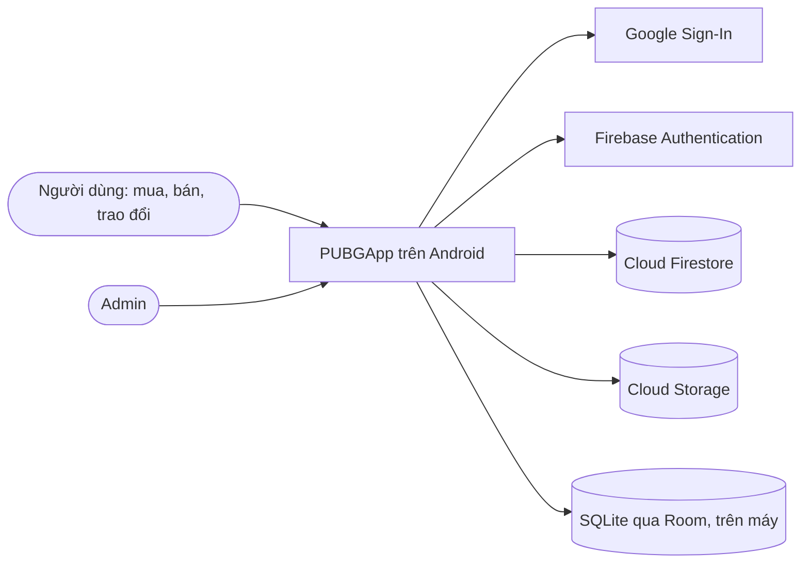

# Kiến trúc ứng dụng

Tài liệu sở hữu chủ đề kiến trúc của PUBGApp. Bố cục theo khung **arc42** (12 mục, rút gọn cho đồ án); góc nhìn ngữ cảnh và thành phần theo **mô hình C4**. Chi tiết nằm ở các tài liệu con:

| Tài liệu | Nội dung | Tương ứng |
| --- | --- | --- |
| [dac-ta-lop/](dac-ta-lop/README.md) | Từng lớp: thuộc tính, phương thức, quan hệ | C4 mức 4 (Code), IEEE 1016 |
| [thanh-phan.md](thanh-phan.md) | ViewModel nào dùng repository nào, repository chạm dữ liệu nào | C4 mức 3 (Component) |
| [trang-thai.md](trang-thai.md) | Máy trạng thái của tin, offer, giao dịch, ký quỹ, báo cáo, khiếu nại, tài khoản | arc42 mục 8 |
| [luong-xu-ly.md](luong-xu-ly.md) | Các luồng chính bằng sơ đồ tuần tự | arc42 mục 6 |
| [../data/firestore-schema.md](../data/firestore-schema.md), [../data/room-schema.md](../data/room-schema.md) | Từ điển dữ liệu | arc42 mục 5 và 8 |

## Trạng thái của tài liệu này

| Mức | Nghĩa | Gồm |
| --- | --- | --- |
| **Đã có trong code** | Có thật trong `PUBGApp/` | Project Android, gói `com.nhom3.pubgapp`, Java 17, XML Views, ViewBinding, minSdk 30, một màn hình mẫu `MainActivity` |
| **Thiết kế đã chốt** | Code theo đúng như ghi | Mọi mục dưới đây không đánh dấu "chưa chốt" |
| **Chưa chốt** | Chưa được code theo, phải hỏi leader | Điều hướng giữa màn hình; gói của tầng giao diện; giới hạn dung lượng ảnh, video |

**Firebase (Authentication, Firestore, Storage), Room và WorkManager chưa có trong build.** Không viết code giả định chúng đã cấu hình cho tới khi một issue `build(deps)` hoặc `chore(deps)` thêm chúng và dòng này được sửa (`AGENTS.md`, mục 2 và luật R5).

## 1. Giới thiệu và mục tiêu

PUBGApp (Pre-owned Users' Bargain Grounds) là ứng dụng Android mua, bán, trao đổi và cho tặng đồ cũ, kết hợp mạng xã hội (theo dõi, kênh tin) với sàn giao dịch có ký quỹ mô phỏng, đánh giá, báo cáo, khiếu nại và một phần quản trị đơn giản. Phạm vi chức năng: [bảng đặc tả chức năng](../product/dac-ta-chuc-nang.md), chỉ các dòng **Đợt này**.

**Mục tiêu chất lượng**, theo thứ tự ưu tiên:

| # | Mục tiêu | Nghĩa cụ thể |
| --- | --- | --- |
| 1 | Đúng yêu cầu môn học | Firebase; giao diện dùng được khi xoay màn hình; xem lại trang đã xem khi mất mạng bằng SQLite; đăng nhập Google |
| 2 | An toàn dữ liệu | Quyền do Firebase Authentication và Security Rules quyết định, không lấy từ dữ liệu ứng dụng gửi lên |
| 3 | Dễ đọc với sinh viên | Java tường minh, không lambda, lớp nhỏ, một quy tắc chia gói (xem `conventions/android-java.md`) |
| 4 | Chi phí bằng 0 | Nằm trong hạn mức miễn phí của Firebase; không máy chủ riêng |

**Các bên liên quan:** 5 thành viên nhóm (code và tài liệu), giảng viên (chấm theo yêu cầu môn học), người dùng cuối (người mua, người bán), admin.

## 2. Ràng buộc

| Ràng buộc | Nguồn |
| --- | --- |
| Java 17; không Kotlin, không Jetpack Compose; XML Views với ViewBinding | `AGENTS.md` mục 2 |
| minSdk 30, compileSdk và targetSdk 37; phiên bản thư viện chỉ ghi ở `PUBGApp/gradle/libs.versions.toml` | `AGENTS.md` mục 2 |
| Backend là Firebase; không có máy chủ riêng và không viết mã chạy phía máy chủ (Cloud Functions) | `workflow/memory/decisions.md`, 2026-09-25 |
| Ảnh và video ở Cloud Storage trên gói Blaze, trong hạn mức miễn phí | `workflow/memory/decisions.md`, 2026-09-25; `workflow/docs/workflow/firebase-setup.md` |
| Không có cổng thanh toán thật: ký quỹ là mô phỏng | Bảng đặc tả, STT 56 |
| Chia gói theo tầng | `workflow/memory/decisions.md`, 2026-09-27 |

## 3. Ngữ cảnh và phạm vi (C4 mức 1)



| Bên ngoài | Ứng dụng dùng để | Dữ liệu trao đổi |
| --- | --- | --- |
| Google Sign-In | Lấy mã đăng nhập Google | `idToken` |
| Firebase Authentication | Đăng ký, đăng nhập, xác thực email, đặt lại và đổi mật khẩu | `uid`, email |
| Cloud Firestore | Nguồn dữ liệu chính, cập nhật theo thời gian thực cho chat | 22 collection, xem `data/firestore-schema.md` |
| Cloud Storage | Ảnh tin, ảnh đại diện, ảnh và video chat, ảnh vận đơn, ảnh bằng chứng | Tệp media, trả về đường dẫn tải |
| Room (SQLite) | Bộ nhớ đệm trên máy để xem lại khi mất mạng | 6 bảng, xem `data/room-schema.md` |

Ngoài phạm vi: thông báo đẩy khi ứng dụng đóng, cổng thanh toán, bản đồ, đăng nhập bằng số điện thoại, bản web, các chức năng **Phát triển sau**.

## 4. Chiến lược giải pháp

| Vấn đề | Cách giải | Vì sao |
| --- | --- | --- |
| Tách giao diện khỏi dữ liệu, giữ trạng thái khi xoay | MVVM: View, ViewModel với LiveData, Repository | Mẫu được dạy trong môn học; ViewModel sống qua lần xoay màn hình |
| Xem lại khi mất mạng | Repository đọc Room trước, gọi Firestore, ghi lại Room | Yêu cầu môn học; Room chỉ là bộ đệm, Firestore là nguồn chính |
| Không có máy chủ | Quy tắc nghiệp vụ nằm trong lớp mô hình miền (`Deal.canMoveTo`, `Listing.acceptsOffer`); Security Rules chặn ghi sai | Không có chỗ khác để đặt logic |
| Việc theo thời hạn (giải ngân, hoàn tất) | `AutoReleaseWorker` (WorkManager) và kiểm tra lúc mở ứng dụng; Rules so với giờ Firestore | Không có tiến trình phía máy chủ |
| Tìm kiếm tiếng Việt | Lưu `searchKeywords` đã bỏ dấu, truy vấn `array-contains`, lọc phần còn lại trên máy | Firestore không tìm toàn văn |
| Bán kính, gợi ý, giá tham khảo | Tính trên máy (`GeoUtils`, `RecommendationEngine`) | Firestore không truy vấn theo bán kính; quy mô đồ án nhỏ |
| Quyền admin | Tài liệu `admins/{uid}` do leader tạo tay; Rules đọc tài liệu này | Ứng dụng không được tự khai quyền (luật R12) |
| Dữ liệu nhạy cảm | Tài liệu con riêng tư: `users/{uid}/private/identity`, `complaints/{id}/adminNote/note` | Rules phân quyền theo tài liệu, không theo trường |

## 5. Góc nhìn khối (C4 mức 2 và 3)

**Container.** Chỉ có một ứng dụng chạy trên máy người dùng; còn lại là dịch vụ của Firebase và cơ sở dữ liệu trên máy.

| Container | Công nghệ | Trách nhiệm |
| --- | --- | --- |
| Ứng dụng Android PUBGApp | Java 17, XML Views, AndroidX | Toàn bộ giao diện và logic nghiệp vụ |
| Cloud Firestore | Firebase | Lưu dữ liệu, Security Rules |
| Cloud Storage | Firebase | Lưu tệp media, Storage Rules |
| Firebase Authentication | Firebase | Danh tính người dùng |
| Room | AndroidX Room trên SQLite | Bộ nhớ đệm, lịch sử xem và tìm kiếm |

**Bên trong ứng dụng.** Phụ thuộc chỉ đi một chiều, từ trên xuống:

```
View (Activity, Fragment, Adapter)          chưa vẽ, gói chưa chốt
  -> viewmodel   14 lớp   trạng thái màn hình bằng LiveData
  -> data        14 lớp   12 repository, BaseRepository, DataCallback
       -> Firebase (Auth, Firestore, Storage)
       -> data.local  12 lớp   Room: AppDatabase, Converters, 6 entity, 4 DAO
model (21 lớp), model.enums (21 kiểu), util (7 lớp): mọi tầng đều dùng
```

| Gói | Được gọi | Không được |
| --- | --- | --- |
| View | ViewModel | Gọi repository, Firebase, Room trực tiếp; giữ dữ liệu màn hình trong Activity |
| `viewmodel` | Repository, `util`, `model` | Giữ tham chiếu tới Activity, Fragment, View, Context của màn hình |
| `data` | Firebase, DAO, `model`, `util` | Biết tới View hay ViewModel |
| `data.local` | Room | Được gọi từ ngoài `data` |
| `model`, `model.enums` | Không gọi tầng nào | Gọi mạng hay đĩa |

Tổng 89 lớp. Danh sách và đặc tả từng lớp ở [dac-ta-lop/](dac-ta-lop/README.md); ai dùng ai ở [thanh-phan.md](thanh-phan.md).

**Chưa chốt:** gói cho tầng giao diện (Activity, Fragment, Adapter) và cách điều hướng (một Activity với nhiều Fragment và thanh điều hướng dưới, hay nhiều Activity). Khi chốt, mỗi nhóm màn hình gắn vào điều hướng qua một điểm đăng ký duy nhất để không nhiều người cùng sửa một file.

## 6. Góc nhìn chạy

Các luồng ở [luong-xu-ly.md](luong-xu-ly.md): đăng nhập Google, đăng tin, xem bảng tin khi có và mất mạng, offer thành giao dịch, thanh toán đến giải ngân và hoàn tất, khiếu nại, cảnh báo theo bậc, vô hiệu hóa tài khoản.

## 7. Góc nhìn triển khai

| Thành phần | Nơi chạy | Ghi chú |
| --- | --- | --- |
| Bản debug của ứng dụng | Điện thoại hoặc máy ảo Android 11 trở lên (API 30) | Build bằng `./gradlew assembleDebug` |
| Firebase project | Google Cloud, gói Blaze | Một project chung cho cả nhóm; bucket Storage ở `us-central1`, `us-east1` hoặc `us-west1` |
| `google-services.json` | `PUBGApp/app/`, có commit | Chỉ chứa định danh công khai (luật R11) |
| SHA-1 của từng máy | Đăng ký trên Firebase | Thiếu thì Google Sign-In lỗi |
| Security Rules | Firestore và Storage | Phải viết trước khi có dữ liệu thật |

Không có bản phát hành lên cửa hàng ứng dụng. Cách cài đặt: `workflow/docs/workflow/firebase-setup.md`.

## 8. Khái niệm xuyên suốt

**Luồng và bất đồng bộ.** Không làm việc mạng, đĩa hay cơ sở dữ liệu trên luồng chính. Firebase trả kết quả qua listener; Room chạy trên một bộ thực thi nền dùng chung. Repository báo kết quả bằng `DataCallback<T>` (lớp ẩn danh, không lambda).

**Lỗi.** Repository dịch ngoại lệ thành câu tiếng Việt (`BaseRepository.fail`) và gọi `onError`. ViewModel đưa câu đó vào LiveData lỗi; màn hình hiện bằng Snackbar hoặc hộp thoại. Thiếu quyền hoặc mất mạng thì nói rõ, không im lặng.

**Offline.** Đọc Room, hiện ngay, gọi Firestore, ghi lại Room. Không ghi khi offline: nút ghi bị khóa và có dải báo offline. Room xóa sạch khi đăng xuất. Chi tiết: `data/room-schema.md`.

**Xoay màn hình.** Trạng thái màn hình nằm trong ViewModel (LiveData), kể cả bộ lọc và nội dung đang soạn; Activity chỉ quan sát. Mỗi layout dùng `ConstraintLayout` hoặc có bản `layout-land`.

**Bảo mật.** Danh tính từ Firebase Authentication. Quyền do Security Rules: chỉ người trong cuộc đọc dữ liệu của cuộc đó; admin xác định bằng `admins/{uid}`; dữ liệu nhạy cảm ở tài liệu con riêng tư. Các luật đã chốt ghi ở `data/firestore-schema.md`.

**Thời gian.** Mốc nghiệp vụ (`autoReleaseAt`, `lockedUntil`) do ứng dụng tính nhưng Rules so với giờ Firestore (`request.time`), nên chỉnh giờ máy không giải ngân sớm được.

**Trạng thái.** Mọi chuyển trạng thái theo `trang-thai.md`; giao dịch ghi lịch sử vào `statusHistory`.

**Thông báo.** Chỉ trong ứng dụng: ghi tài liệu `notifications` và đọc khi mở; không có thông báo đẩy khi ứng dụng đóng. Người nhận tắt loại nào trong `notificationPrefs` thì không ghi loại đó.

**Media.** Tối đa 5 ảnh mỗi tin; ảnh nén trước khi tải. Giới hạn dung lượng ảnh, độ dài video: **chưa chốt**, chốt khi viết Storage Rules.

**Chuỗi và tên.** Mọi chữ hiển thị là string resource tiếng Việt; tên hằng enum không bao giờ hiện cho người dùng. Tên trường Firestore khai báo một lần thành hằng.

**Ghi nhiều tài liệu cùng lúc.** Các thay đổi phải đi cùng nhau (chấp nhận offer, giải ngân, quyết định khiếu nại) ghi trong một lần ghi theo lô hoặc một transaction của Firestore.

## 9. Quyết định kiến trúc

Ghi đầy đủ ở `workflow/memory/decisions.md`, chỉ thêm, không sửa. Các mục ảnh hưởng tới kiến trúc:

| Ngày | Quyết định |
| --- | --- |
| 2026-09-25 | Java, XML Views, minSdk 30 |
| 2026-09-25 | Firebase làm backend, Room làm bộ đệm offline |
| 2026-09-25 | Ảnh và video ở Cloud Storage trên gói Blaze, trong hạn mức miễn phí |
| 2026-09-27 | Chia gói theo tầng, không theo tính năng |
| 2026-10-11 | Một cách đánh số chức năng; dấu "Phát triển sau" |
| 2026-10-11 | Mở rộng mô hình theo mockup |
| 2026-10-11 | Tài khoản, thông tin định danh, kết thúc giao dịch |
| 2026-10-12 | Các quy tắc giao dịch, khiếu nại và tài khoản còn thiếu |

## 10. Yêu cầu chất lượng

| Kịch bản | Kết quả mong đợi |
| --- | --- |
| Đang xem chi tiết tin thì xoay màn hình | Không tải lại, không mất ảnh đang xem, không mất nội dung đang soạn |
| Mất mạng rồi mở bảng tin, chi tiết tin đã xem, chat, lịch sử giao dịch | Hiện dữ liệu đã đệm kèm dải báo offline |
| Người dùng sửa tay dữ liệu gửi lên để tự giải ngân hoặc tự thành admin | Security Rules từ chối |
| Người lạ đọc số CCCD của người khác | Security Rules từ chối |
| Hết đếm ngược mà người mua không mở ứng dụng | Giải ngân ở lần chạy nền hoặc lần mở ứng dụng kế tiếp của một trong hai bên |
| Thao tác mạng thất bại | Hiện câu báo lỗi tiếng Việt, không treo màn hình |

## 11. Rủi ro và nợ kỹ thuật

| Rủi ro | Ảnh hưởng | Cách giảm |
| --- | --- | --- |
| Việc tự động phụ thuộc máy của người dùng | Giải ngân, hoàn tất có thể chậm | Chạy cả nền định kỳ và lúc mở ứng dụng; Rules dùng giờ Firestore |
| Bộ đếm hồ sơ, điểm đánh giá do ứng dụng ghi | Người cố ý có thể ghi sai | Rules chỉ cho tăng đúng 1 và chỉ khi có tài liệu đi kèm (đánh giá, theo dõi) |
| Tìm kiếm chỉ theo từng từ, lọc thêm trên máy | Chậm khi nhiều tin | Đủ cho quy mô đồ án; ghi rõ giới hạn |
| Truy vấn `in` cho kênh đang theo dõi có giới hạn số giá trị | Theo dõi quá nhiều người thì phải chia nhiều truy vấn | Chia nhóm khi code; kiểm tra giới hạn trong tài liệu Firestore lúc đó |
| Thiếu phương thức bổ sung bằng chứng cho khiếu nại NEEDS_EVIDENCE | Quyết định REQUEST_EVIDENCE không có đường đi tiếp | Thêm `ComplaintRepository.addEvidence` khi code STT 89; cần cập nhật sơ đồ lớp cùng Pull Request |
| Hạn mức miễn phí của Storage | Vượt 5 GB phát sinh phí | Storage Rules giới hạn loại và dung lượng tệp, bắt buộc đăng nhập; cảnh báo ngân sách |
| Chỉ mục Firestore còn thiếu | Truy vấn lỗi lần đầu | Firestore báo lỗi kèm đường dẫn tạo chỉ mục; danh sách dự kiến ở `data/firestore-schema.md` |

## 12. Thuật ngữ

Thuật ngữ nghiệp vụ: `workflow/docs/analysis/thuat-ngu.md`. Thuật ngữ kỹ thuật dùng trong tài liệu này:

| Thuật ngữ | Nghĩa |
| --- | --- |
| Ký quỹ mô phỏng | Ứng dụng ghi nhận tiền "được giữ" và "được chuyển" bằng tài liệu `payments`, không có tiền thật đi qua |
| Đếm ngược | Khoảng 7 ngày từ lúc người bán giao hàng tới `autoReleaseAt` |
| Giải ngân | `Payment` sang RELEASED: tiền ký quỹ chuyển cho người bán |
| Bộ nhớ đệm | Bản sao dữ liệu đã xem trong Room để dùng khi mất mạng |
| Security Rules | Luật trên máy chủ Firebase quyết định ai đọc, ghi được tài liệu nào |
| LiveData | Dữ liệu quan sát được của AndroidX; màn hình tự cập nhật khi giá trị đổi |
| Phát triển sau | Chức năng giữ làm hướng phát triển, không code trong đợt này |
