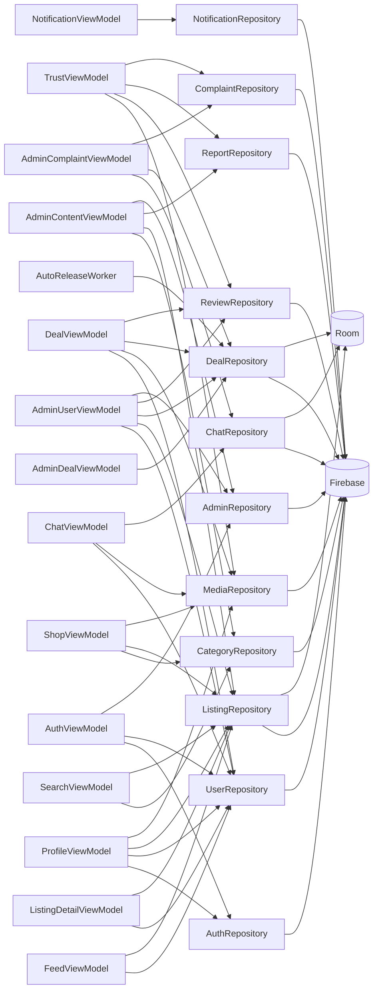

# Góc nhìn thành phần

Mức 3 của mô hình C4 (Component): bên trong ứng dụng Android, ViewModel nào dùng repository nào, repository nào chạm collection nào. Dùng để biết một thay đổi lan tới đâu. Sinh từ cùng nguồn với sơ đồ lớp.

## ViewModel dùng gì

| ViewModel | Repository và tiện ích | Màn hình phục vụ |
| --- | --- | --- |
| [`AuthViewModel`](dac-ta-lop/viewmodel.md#authviewmodel) | AuthRepository, UserRepository, AdminRepository, SessionManager | Đăng ký (kèm đồng ý điều khoản và số CCCD), đăng nhập, quên mật khẩu, đổi mật khẩu, chọn danh mục quan tâm. |
| [`ProfileViewModel`](dac-ta-lop/viewmodel.md#profileviewmodel) | UserRepository, ListingRepository, MediaRepository, AuthRepository | Hồ sơ, ảnh, địa chỉ, thông tin định danh, cài đặt thông báo, theo dõi, danh sách đã lưu, yêu cầu xác minh, xóa tài khoản. |
| [`ShopViewModel`](dac-ta-lop/viewmodel.md#shopviewmodel) | ListingRepository, MediaRepository, CategoryRepository, KeywordFilter | Kệ hàng của người bán: đăng, lưu nháp, sửa, ẩn hoặc hiện, đổi trạng thái, sắp xếp. |
| [`FeedViewModel`](dac-ta-lop/viewmodel.md#feedviewmodel) | ListingRepository, UserRepository, RecommendationEngine, NetworkMonitor | Kênh chung, kênh đang theo dõi, sắp xếp, mục Dành cho bạn. |
| [`SearchViewModel`](dac-ta-lop/viewmodel.md#searchviewmodel) | ListingRepository, CategoryRepository, GeoUtils, FormatUtils | Từ khóa, bộ lọc và lịch sử tìm kiếm. |
| [`ListingDetailViewModel`](dac-ta-lop/viewmodel.md#listingdetailviewmodel) | ListingRepository, UserRepository, RecommendationEngine | Chi tiết tin, người bán, tin tương tự, giá tham khảo, lưu tin. |
| [`ChatViewModel`](dac-ta-lop/viewmodel.md#chatviewmodel) | ChatRepository, MediaRepository, UserRepository | Danh sách chat, trạng thái hoạt động của người đối thoại, gửi chữ, ảnh và offer. |
| [`DealViewModel`](dac-ta-lop/viewmodel.md#dealviewmodel) | DealRepository, ReviewRepository, UserRepository, MediaRepository | Tạo, sửa, xác nhận, thanh toán, giao (kèm vận đơn), nhận, hoàn tất, hủy, đếm ngược và lịch sử giao dịch. |
| [`TrustViewModel`](dac-ta-lop/viewmodel.md#trustviewmodel) | ReviewRepository, ReportRepository, ComplaintRepository, MediaRepository | Đánh giá, báo cáo và khiếu nại phía người dùng. |
| [`NotificationViewModel`](dac-ta-lop/viewmodel.md#notificationviewmodel) | NotificationRepository | Danh sách thông báo và số chưa đọc. |
| [`AdminUserViewModel`](dac-ta-lop/viewmodel.md#adminuserviewmodel) | AdminRepository, UserRepository, ListingRepository, DealRepository, ReviewRepository | Admin: người dùng, hồ sơ, khóa, cảnh báo, xác minh, nhật ký. |
| [`AdminContentViewModel`](dac-ta-lop/viewmodel.md#admincontentviewmodel) | ReportRepository, AdminRepository, CategoryRepository, ListingRepository | Admin: tin bị báo cáo, ẩn và gỡ, từ khóa cấm, danh mục. |
| [`AdminDealViewModel`](dac-ta-lop/viewmodel.md#admindealviewmodel) | DealRepository | Admin: theo dõi danh sách và chi tiết giao dịch. |
| [`AdminComplaintViewModel`](dac-ta-lop/viewmodel.md#admincomplaintviewmodel) | ComplaintRepository, DealRepository, ChatRepository | Admin: xử lý khiếu nại, ra quyết định, ghi chú nội bộ, thông báo. |

## Repository chạm dữ liệu nào

| Repository | Firebase | Room | Được dùng bởi |
| --- | --- | --- | --- |
| [`AuthRepository`](dac-ta-lop/data.md#authrepository) | Firebase Authentication |  | AuthViewModel, ProfileViewModel |
| [`UserRepository`](dac-ta-lop/data.md#userrepository) | users, users/addresses, users/private, users/saved, follows, sellerVerifications |  | AdminUserViewModel, AuthViewModel, ChatViewModel, DealViewModel, FeedViewModel, ListingDetailViewModel, ProfileViewModel |
| [`CategoryRepository`](dac-ta-lop/data.md#categoryrepository) | categories |  | AdminContentViewModel, SearchViewModel, ShopViewModel |
| [`ListingRepository`](dac-ta-lop/data.md#listingrepository) | listings | ListingDao, HistoryDao | AdminContentViewModel, AdminUserViewModel, FeedViewModel, ListingDetailViewModel, ProfileViewModel, SearchViewModel, ShopViewModel |
| [`MediaRepository`](dac-ta-lop/data.md#mediarepository) | images |  | ChatViewModel, DealViewModel, ProfileViewModel, ShopViewModel, TrustViewModel |
| [`ChatRepository`](dac-ta-lop/data.md#chatrepository) | conversations, conversations/messages, offers | ChatDao | AdminComplaintViewModel, ChatViewModel |
| [`DealRepository`](dac-ta-lop/data.md#dealrepository) | deals, payments | DealDao | AdminComplaintViewModel, AdminDealViewModel, AdminUserViewModel, DealViewModel, AutoReleaseWorker |
| [`ReviewRepository`](dac-ta-lop/data.md#reviewrepository) | reviews |  | AdminUserViewModel, DealViewModel, TrustViewModel |
| [`ReportRepository`](dac-ta-lop/data.md#reportrepository) | reports |  | AdminContentViewModel, TrustViewModel |
| [`ComplaintRepository`](dac-ta-lop/data.md#complaintrepository) | complaints, complaints/adminNote |  | AdminComplaintViewModel, TrustViewModel |
| [`NotificationRepository`](dac-ta-lop/data.md#notificationrepository) | notifications |  | NotificationViewModel |
| [`AdminRepository`](dac-ta-lop/data.md#adminrepository) | admins, sellerVerifications, users/warnings, activityLogs, bannedKeywords |  | AdminContentViewModel, AdminUserViewModel, AuthViewModel |

## Ma trận ViewModel và repository

Ô có dấu x nghĩa là ViewModel ở dòng gọi repository ở cột.

| ViewModel | Auth | User | Category | Listing | Media | Chat | Deal | Review | Report | Complaint | Notification | Admin |
| --- | :---: | :---: | :---: | :---: | :---: | :---: | :---: | :---: | :---: | :---: | :---: | :---: |
| AuthViewModel | x | x |  |  |  |  |  |  |  |  |  | x |
| ProfileViewModel | x | x |  | x | x |  |  |  |  |  |  |  |
| ShopViewModel |  |  | x | x | x |  |  |  |  |  |  |  |
| FeedViewModel |  | x |  | x |  |  |  |  |  |  |  |  |
| SearchViewModel |  |  | x | x |  |  |  |  |  |  |  |  |
| ListingDetailViewModel |  | x |  | x |  |  |  |  |  |  |  |  |
| ChatViewModel |  | x |  |  | x | x |  |  |  |  |  |  |
| DealViewModel |  | x |  |  | x |  | x | x |  |  |  |  |
| TrustViewModel |  |  |  |  | x |  |  | x | x | x |  |  |
| NotificationViewModel |  |  |  |  |  |  |  |  |  |  | x |  |
| AdminUserViewModel |  | x |  | x |  |  | x | x |  |  |  | x |
| AdminContentViewModel |  |  | x | x |  |  |  |  | x |  |  | x |
| AdminDealViewModel |  |  |  |  |  |  | x |  |  |  |  |  |
| AdminComplaintViewModel |  |  |  |  |  | x | x |  |  | x |  |  |

## Sơ đồ

