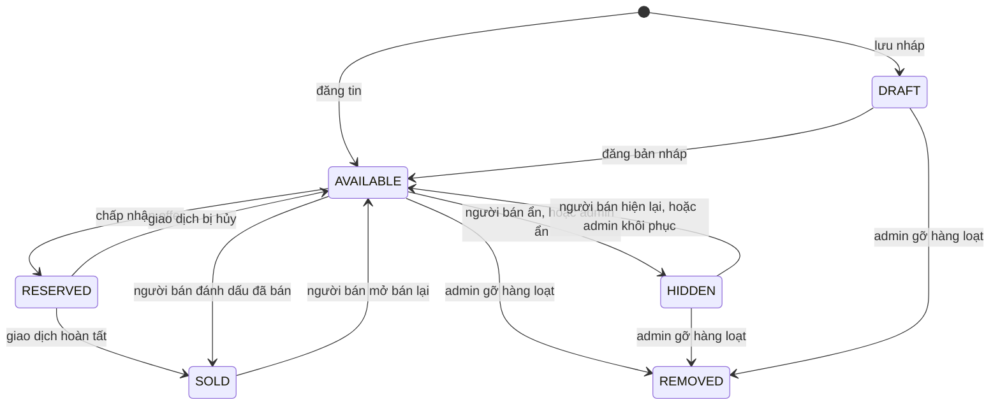
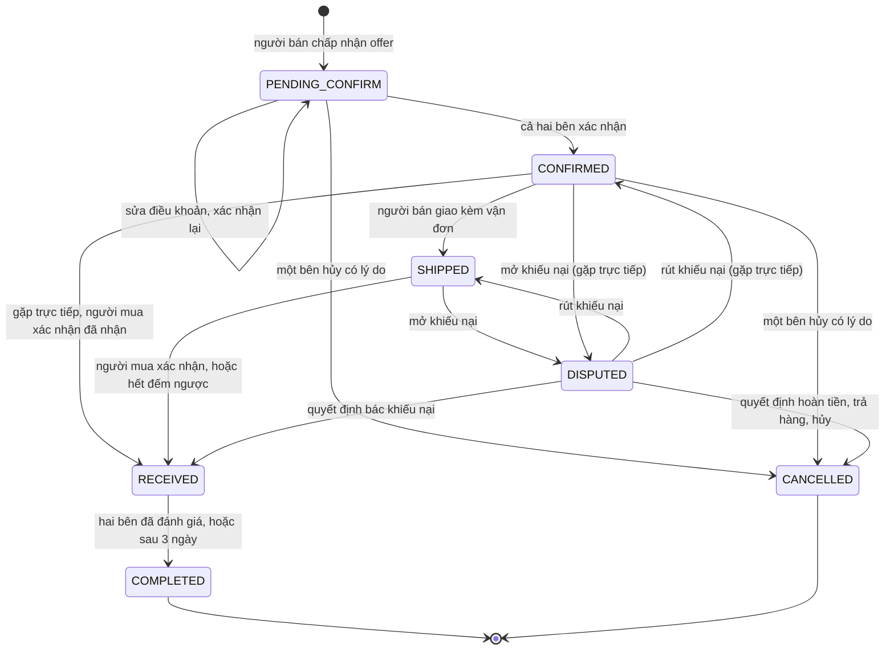

# Máy trạng thái

Mọi trường kiểu trạng thái của PUBGApp: đi từ đâu sang đâu, do sự kiện gì, ai được làm, với điều kiện gì, qua phương thức nào. Bảng ở đây là luật: `Deal.canMoveTo` và Security Rules cài đúng các bảng này; chuyển trạng thái nào không có trong bảng là bị cấm.

Giá trị và nghĩa của từng trạng thái ở [dac-ta-lop/enums.md](dac-ta-lop/enums.md). Số STT là số dòng trong [bảng đặc tả chức năng](../product/dac-ta-chuc-nang.md).

Quy ước chung:

- Mỗi lần giao dịch đổi trạng thái, thêm một `StatusChange` vào `Deal.statusHistory` (người đổi là `system` khi do việc chạy nền).
- Mỗi lần đổi trạng thái mà bên kia cần biết, ghi một `AppNotification` (loại ghi trong cột Thông báo).
- "Ai" là người đang đăng nhập; Security Rules kiểm tra lại, ứng dụng không tự khai quyền (`AGENTS.md`, luật R12).

## 1. Tin đăng: `Listing.status`

| Từ | Sự kiện | Đến | Ai | Điều kiện | Phương thức | STT |
| --- | --- | --- | --- | --- | --- | --- |
| (chưa có) | Lưu nháp | DRAFT | Người bán | Không bắt buộc đủ thông tin | `ListingRepository.saveDraft` | 22 |
| (chưa có) | Đăng tin | AVAILABLE | Người bán | `User.canSell()`; có tiêu đề, danh mục, 1 đến 5 ảnh, ít nhất một hình thức giao dịch | `ListingRepository.create` | 13, 16 đến 21 |
| DRAFT | Đăng bản nháp | AVAILABLE | Người bán | Như trên | `Listing.publish` | 22 |
| AVAILABLE | Người bán chấp nhận một offer | RESERVED | Người bán | Tin đang AVAILABLE | `ChatRepository.respondToOffer` | 48 |
| RESERVED | Giao dịch của tin bị hủy (kể cả do quyết định khiếu nại) | AVAILABLE | Hệ thống | | `DealRepository.cancel`, `ComplaintRepository.decide` | 55, 89 |
| RESERVED | Giao dịch của tin hoàn tất | SOLD | Hệ thống | | `Listing.markSold` | 53 |
| AVAILABLE | Đánh dấu đã bán (bán ngoài ứng dụng) | SOLD | Người bán | Không có giao dịch đang mở | `ShopViewModel.changeStatus` | 13 |
| SOLD | Mở bán lại | AVAILABLE | Người bán | Tin được đánh dấu bán tay, không phải do giao dịch | `ShopViewModel.changeStatus` | 13 |
| AVAILABLE | Người bán tự ẩn | HIDDEN | Người bán | `statusReason` để rỗng | `ListingRepository.setHidden` | 15 |
| HIDDEN | Người bán hiện lại | AVAILABLE | Người bán | Chỉ khi `statusReason` rỗng (tự ẩn). Tin do admin ẩn thì người bán không hiện lại được | `ListingRepository.setHidden` | 15 |
| AVAILABLE | Admin ẩn tin vi phạm | HIDDEN | Admin | Bắt buộc lý do, ghi vào `statusReason`; thông báo LISTING_MODERATED | `AdminRepository.hideListing` | 76 |
| HIDDEN | Admin khôi phục (duyệt oan) | AVAILABLE | Admin | Xóa `statusReason`; thông báo LISTING_MODERATED | `AdminRepository.restoreListing` | 76 |
| DRAFT, AVAILABLE, HIDDEN | Gỡ hàng loạt tin của tài khoản bị khóa | REMOVED | Admin | Tài khoản đang bị khóa | `AdminRepository.removeAllListingsOf` | 77 |
| AVAILABLE | Chủ tài khoản vô hiệu hóa tài khoản | HIDDEN | Chủ tài khoản | `statusReason` ghi "Tài khoản đã xóa" | `UserRepository.deactivate` | 12 |

- REMOVED là trạng thái cuối.
- Xóa hẳn một tin (`ListingRepository.delete`) chỉ được khi tin chưa từng có giao dịch.
- Offer chỉ gửi được khi tin AVAILABLE (`Listing.acceptsOffer`).

## 2. Offer: `Offer.status`

| Từ | Sự kiện | Đến | Ai | Điều kiện | Phương thức | Thông báo | STT |
| --- | --- | --- | --- | --- | --- | --- | --- |
| (chưa có) | Gửi đề nghị | PENDING | Người mua | `Listing.acceptsOffer(offer)`; người mua không phải người đăng | `ChatRepository.sendOffer` | NEW_OFFER | 47 |
| PENDING | Chấp nhận | ACCEPTED | Người bán | Tin còn AVAILABLE. Tạo `Deal`, tin sang RESERVED | `Offer.accept`, `ChatRepository.respondToOffer` | OFFER_RESULT | 48 |
| PENDING | Từ chối | REJECTED | Người bán | | `Offer.reject` | OFFER_RESULT | 49 |
| PENDING | Một offer khác của cùng tin vừa được chấp nhận | REJECTED | Hệ thống | | `ChatRepository.respondToOffer` | OFFER_RESULT | 48 |

Người mua không hủy được offer và không có đề xuất lại (quyết định ngày 2026-10-11). Muốn đổi giá thì đợi người bán từ chối rồi gửi offer mới.

## 3. Giao dịch: `Deal.status`

| Từ | Sự kiện | Đến | Ai | Điều kiện | Phương thức | Hệ quả | STT |
| --- | --- | --- | --- | --- | --- | --- | --- |
| (chưa có) | Người bán chấp nhận offer | PENDING_CONFIRM | Người bán | | `DealRepository.createFromOffer` | Chụp `itemTitle`, `itemImageUrl`; tăng `dealCount` hai bên | 48, 50 |
| PENDING_CONFIRM | Sửa điều khoản | PENDING_CONFIRM | Một trong hai bên | | `DealRepository.updateTerms` | Xóa cả hai cờ xác nhận | 51 |
| PENDING_CONFIRM | Xác nhận | CONFIRMED | Bên thứ hai xác nhận | Cờ xác nhận của bên kia đã bật | `Deal.confirmBy` | Thông báo DEAL_UPDATE | 52 |
| PENDING_CONFIRM, CONFIRMED | Hủy | CANCELLED | Một trong hai bên | Bắt buộc lý do | `Deal.cancel`, `DealRepository.cancel` | Tin về AVAILABLE; `Payment` HELD thì sang REFUNDED | 55 |
| CONFIRMED | Người mua thanh toán | CONFIRMED (không đổi) | Người mua | `needsPayment()`; chưa có `Payment` | `DealRepository.pay` | Tạo `Payment` HELD; thông báo PAYMENT_UPDATE | 56 |
| CONFIRMED | Giao hàng | SHIPPED | Người bán | `deliveryMethod` là SHIPPING; `hasShippingProof()`; nếu `needsPayment()` thì `Payment` đang HELD | `Deal.markShipped` | Đặt `shippedAt`, `autoReleaseAt = shippedAt + 7 ngày`; thông báo DEAL_UPDATE | 54 |
| CONFIRMED | Nhận hàng khi gặp trực tiếp | RECEIVED | Người mua | `deliveryMethod` là MEET_UP; nếu `needsPayment()` thì `Payment` đang HELD | `Deal.markReceived` | Đặt `receivedAt`; `Payment` sang RELEASED | 53 |
| SHIPPED | Người mua xác nhận đã nhận | RECEIVED | Người mua | | `Deal.markReceived` | Đặt `receivedAt`; `Payment` sang RELEASED; thông báo PAYMENT_UPDATE | 53, 84 |
| SHIPPED | Hết đếm ngược | RECEIVED | Hệ thống | Giờ hiện tại đã qua `autoReleaseAt` | `Deal.autoReceive`, `DealRepository.releaseDueDeals` | Như dòng trên; người đổi là `system` | 84 |
| SHIPPED; CONFIRMED khi gặp trực tiếp | Mở khiếu nại | DISPUTED | Một trong hai bên | Chưa có khiếu nại đang mở cho giao dịch | `ComplaintRepository.create` | Đếm ngược dừng (`releaseDueDeals` chỉ xét SHIPPED) | 64 |
| DISPUTED | Admin quyết định REFUND, RETURN_ITEM hoặc CANCEL_DEAL | CANCELLED | Admin | | `ComplaintRepository.decide` | `Payment` HELD sang REFUNDED; tin về AVAILABLE | 89 |
| DISPUTED | Admin quyết định REJECT | RECEIVED | Admin | | `ComplaintRepository.decide` | Đặt `receivedAt`; `Payment` sang RELEASED | 89 |
| DISPUTED | Admin yêu cầu thêm bằng chứng | DISPUTED (không đổi) | Admin | | `ComplaintRepository.decide` | Khiếu nại sang NEEDS_EVIDENCE | 89 |
| DISPUTED | Người khiếu nại rút đơn | Trạng thái trước khi khiếu nại (SHIPPED hoặc CONFIRMED) | Người khiếu nại | Lấy từ `fromStatus` của dòng lịch sử cuối | `ComplaintRepository.withdraw` | `autoReleaseAt` giữ nguyên; nếu đã quá hạn thì lần chạy kế tiếp giải ngân ngay | 66 |
| RECEIVED | Bên thứ hai viết đánh giá | COMPLETED | Hệ thống | Cả hai bên đã có `Review` | `ReviewRepository.create` | Tin sang SOLD; tăng `completedDealCount` hai bên, `soldCount` người bán | 53, 59 |
| RECEIVED | Đủ 3 ngày | COMPLETED | Hệ thống | Đã qua `receivedAt + 3 ngày` | `Deal.complete`, `DealRepository.completeDueDeals` | Như dòng trên | 53 |

- Không hủy được giao dịch từ SHIPPED trở đi; có vấn đề thì mở khiếu nại.
- Người mua nên kiểm tra hàng trước khi bấm Đã nhận: sau RECEIVED tiền đã chuyển, không khiếu nại được nữa (vẫn báo cáo được).
- Đánh giá được viết khi giao dịch ở RECEIVED hoặc COMPLETED, mỗi bên một lần.
- Giao dịch trao đổi hoặc cho tặng có `agreedPrice` bằng 0: không có `Payment`, các điều kiện về tiền bỏ qua.

## 4. Khoản ký quỹ: `Payment.status`

| Từ | Sự kiện | Đến | Ai | Điều kiện | Phương thức |
| --- | --- | --- | --- | --- | --- |
| (chưa có) | Người mua thanh toán | HELD | Người mua | Giao dịch CONFIRMED, `needsPayment()` | `DealRepository.pay` |
| HELD | Giao dịch sang RECEIVED | RELEASED | Người mua, hệ thống hoặc admin (bác khiếu nại) | Security Rules: người mua xác nhận, hoặc giờ Firestore đã qua `deals.autoReleaseAt` và giao dịch còn SHIPPED, hoặc người ghi là admin | `Payment.release` |
| HELD | Giao dịch sang CANCELLED | REFUNDED | Một trong hai bên (hủy) hoặc admin (quyết định khiếu nại) | | `Payment.refund` |

Đây là ký quỹ mô phỏng: không có cổng thanh toán thật, không có số dư ví. RELEASED và REFUNDED là trạng thái cuối.

## 5. Báo cáo: `Report.status`

| Từ | Sự kiện | Đến | Ai | Phương thức | STT |
| --- | --- | --- | --- | --- | --- |
| (chưa có) | Gửi báo cáo | OPEN | Người dùng | `ReportRepository.create` | 61 |
| OPEN | Hủy | CANCELLED | Người báo cáo | `Report.cancel` | 62 |
| OPEN | Xác nhận vi phạm | RESOLVED | Admin | `Report.resolve`, `ReportRepository.closeByTarget` | 75 |
| OPEN | Không vi phạm | DISMISSED | Admin | `Report.dismiss`, `ReportRepository.closeByTarget` | 75 |

Admin xử lý theo đối tượng: đóng một lần mọi báo cáo OPEN của cùng một tin.

## 6. Khiếu nại: `Complaint.status`

| Từ | Sự kiện | Đến | Ai | Điều kiện | Phương thức | STT |
| --- | --- | --- | --- | --- | --- | --- |
| (chưa có) | Gửi khiếu nại | OPEN | Một bên của giao dịch | Giao dịch SHIPPED, hoặc CONFIRMED khi gặp trực tiếp; tối thiểu 1 ảnh | `ComplaintRepository.create` | 64 |
| OPEN | Yêu cầu bổ sung bằng chứng | NEEDS_EVIDENCE | Admin | | `Complaint.decide(REQUEST_EVIDENCE)` | 89 |
| NEEDS_EVIDENCE | Bổ sung bằng chứng | OPEN | Người khiếu nại | | Chưa có phương thức, xem mục Rủi ro trong [overview.md](overview.md#11-rủi-ro-và-nợ-kỹ-thuật) | 89 |
| OPEN, NEEDS_EVIDENCE | Ra quyết định khác REQUEST_EVIDENCE | RESOLVED | Admin | | `Complaint.decide` | 89 |
| OPEN, NEEDS_EVIDENCE | Rút đơn | WITHDRAWN | Người khiếu nại | | `Complaint.withdraw` | 66 |

Hệ quả của từng quyết định lên giao dịch và khoản ký quỹ ở mục 3. Sau khi quyết định, admin gửi thông báo COMPLAINT_RESULT cho hai bên (STT 91).

## 7. Tài khoản: `User.status`

| Từ | Sự kiện | Đến | Ai | Điều kiện | Phương thức | STT |
| --- | --- | --- | --- | --- | --- | --- |
| (chưa có) | Đăng ký hoặc đăng nhập Google lần đầu | ACTIVE | Người dùng | | `AuthViewModel.register`, `AuthRepository.signInWithGoogle` | 1, 2 |
| ACTIVE | Khóa tạm (tay hoặc cảnh báo bậc 2) | TEMP_LOCKED | Admin | Có `lockedUntil` | `AdminRepository.lockUser`, `AdminRepository.warnUser` | 70, 72 |
| ACTIVE, TEMP_LOCKED | Khóa vĩnh viễn (tay hoặc cảnh báo bậc 3) | PERM_LOCKED | Admin | `lockedUntil` rỗng | `AdminRepository.lockUser`, `AdminRepository.warnUser` | 70, 72 |
| TEMP_LOCKED, PERM_LOCKED | Mở khóa | ACTIVE | Admin | | `AdminRepository.unlockUser` | 71 |
| TEMP_LOCKED | Hết hạn khóa | ACTIVE | Chủ tài khoản (ứng dụng tự ghi khi đăng nhập) | Security Rules: chỉ khi giờ Firestore đã qua `lockedUntil` | `UserRepository.updateProfile` | 70 |
| ACTIVE | Xóa tài khoản | DELETED | Chủ tài khoản | Không còn giao dịch chưa kết thúc | `UserRepository.deactivate` | 12 |

- DELETED là trạng thái cuối: tin bị ẩn, đăng nhập bị xóa, lịch sử giao dịch và đánh giá giữ lại cho đối tác.
- Tài khoản đang bị khóa không vào được ứng dụng: sau bước đăng nhập, ứng dụng hiện lý do và hạn khóa rồi đăng xuất. Khóa tạm đã hết hạn thì ứng dụng ghi lại ACTIVE và cho vào bình thường.

**Cảnh báo theo bậc** (STT 72, quy tắc cố định): mỗi lần cảnh báo tăng `User.warningCount` và ghi một `Warning` có `level` bằng số mới. `Warning.resultingStatus()`: bậc 1 giữ ACTIVE, bậc 2 TEMP_LOCKED, bậc 3 PERM_LOCKED. Thời hạn khóa tạm do admin chọn khi cảnh báo; cấu hình thời hạn mặc định là chức năng Phát triển sau.

## 8. Xác minh người bán: `SellerVerification.status` và `User.verificationStatus`

| Từ | Sự kiện | Đến | Ai | Phương thức | STT |
| --- | --- | --- | --- | --- | --- |
| NONE | Gửi yêu cầu | PENDING | Người dùng đã xác thực email | `UserRepository.requestVerification` | 73 |
| PENDING | Duyệt | APPROVED | Admin | `AdminRepository.reviewVerification` | 73 |
| PENDING | Từ chối kèm lý do | REJECTED | Admin | `AdminRepository.reviewVerification` | 73 |
| REJECTED | Gửi lại | PENDING | Người dùng | `UserRepository.requestVerification` | 73 |

Hai trường luôn cùng giá trị: `SellerVerification.status` là yêu cầu, `User.verificationStatus` là bản hiển thị trên hồ sơ. Xác minh chỉ thêm huy hiệu đã xác minh, không phải điều kiện để đăng tin.
