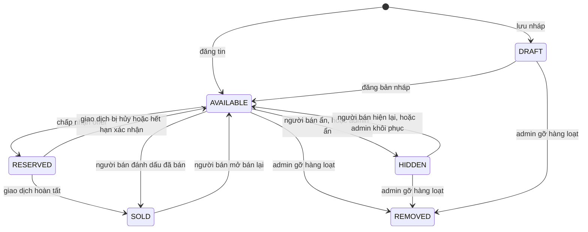
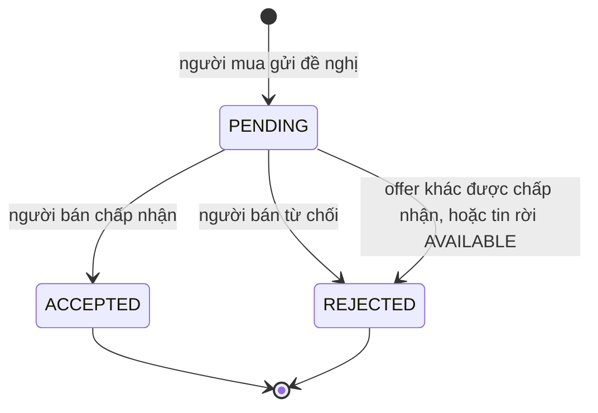
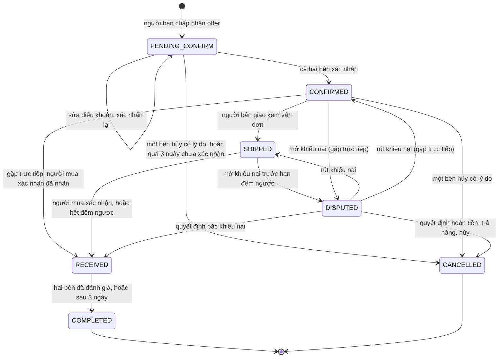
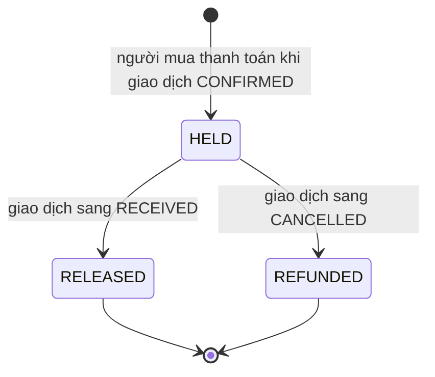
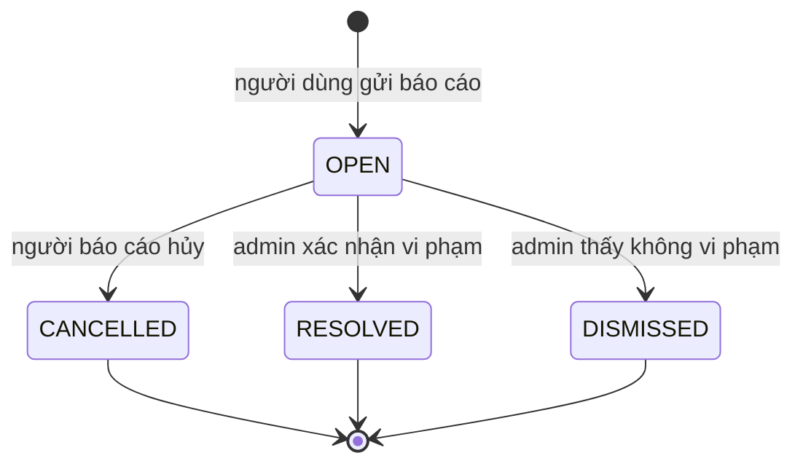
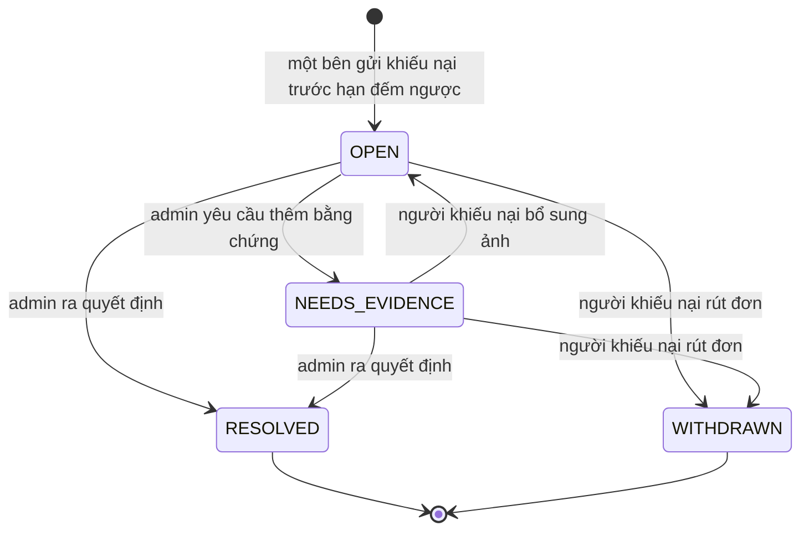
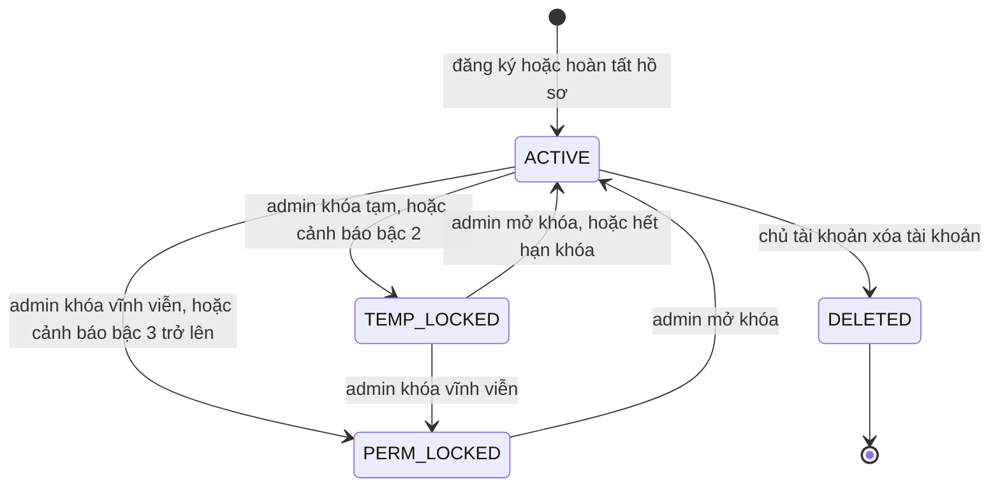
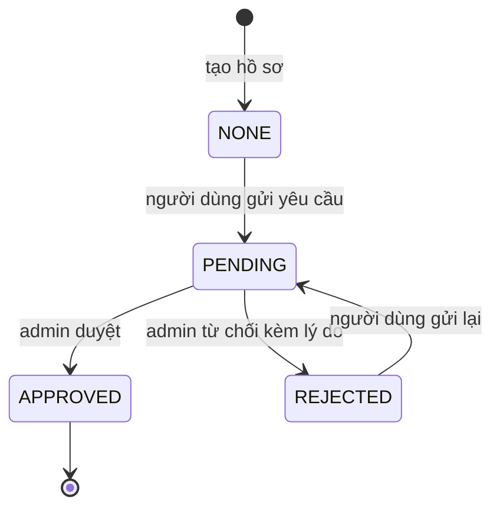

# Máy trạng thái

Mọi trường kiểu trạng thái của PUBGApp: đi từ đâu sang đâu, do sự kiện gì, ai được làm, với điều kiện gì, qua phương thức nào. Bảng ở đây là luật: `Deal.canMoveTo` và Security Rules cài đúng các bảng này; chuyển trạng thái nào không có trong bảng là bị cấm. Điều kiện Rules chi tiết của từng chuyển trạng thái ở [security-rules.md](../data/security-rules.md).

Giá trị và nghĩa của từng trạng thái ở [dac-ta-lop/enums.md](dac-ta-lop/enums.md). Số STT là số dòng trong [bảng đặc tả chức năng](../product/dac-ta-chuc-nang.md).

Quy ước chung:

- Chỉ khi giao dịch **thật sự đổi trạng thái** mới thêm một `StatusChange` vào `Deal.statusHistory` (người đổi là `system` khi do việc chạy nền). Sửa điều khoản, thanh toán, xác nhận một bên, yêu cầu bổ sung bằng chứng không đổi trạng thái giao dịch nên không thêm dòng.
- Mỗi lần đổi trạng thái mà bên kia cần biết, **repository thực hiện việc đó** ghi một `AppNotification` trong cùng lô ghi, bằng cách truyền lô vào `NotificationRepository.create(notification, batch, cb)`; truyền `null` khi ghi lẻ không nằm trong lô nào. ViewModel không ghi thông báo. Bảng đầy đủ ở mục 9.
- "Ai" là người đang đăng nhập; Security Rules kiểm tra lại, ứng dụng không tự khai quyền (`AGENTS.md`, luật R12). Mọi lần ghi còn đòi tài khoản ghi đang ACTIVE (ngoại lệ duy nhất: tự mở khóa khi hết hạn, mục 7).
- Các thay đổi đi cùng nhau (đổi trạng thái giao dịch kèm ký quỹ, tin, thông báo) ghi trong **một lô ghi**.
- Số liệu hồ sơ (đã bán, người theo dõi, giao dịch, hoàn tất) không phải trường lưu sẵn: `UserRepository.getStats` đếm bằng `count()`. Vì vậy không có bước "tăng bộ đếm" ở các bảng dưới.

## 1. Tin đăng: `Listing.status`

| Từ | Sự kiện | Đến | Ai | Điều kiện | Phương thức | STT |
| --- | --- | --- | --- | --- | --- | --- |
| (chưa có) | Lưu nháp | DRAFT | Người bán | Không bắt buộc đủ thông tin | `ListingRepository.saveDraft` | 22 |
| (chưa có) | Đăng tin | AVAILABLE | Người bán | `User.canSell(emailVerified)`, nghĩa là tài khoản ACTIVE, email đã xác thực và `verificationStatus` là APPROVED; có tiêu đề, danh mục, 1 đến 5 ảnh, ít nhất một hình thức giao dịch | `ListingRepository.create` | 13, 16 đến 21 |
| DRAFT | Đăng bản nháp | AVAILABLE | Người bán | Như trên; chạy lại các bước của `create` (gắn cờ từ khóa cấm, `searchKeywords`) | `Listing.publish`, `ListingRepository.publish` | 22 |
| AVAILABLE | Người bán chấp nhận một offer | RESERVED | Người bán | Tin đang AVAILABLE; cùng lô với offer ACCEPTED và việc tạo `Deal` | `Listing.reserve`, `ChatRepository.respondToOffer` | 48 |
| RESERVED | Giao dịch của tin bị hủy (người dùng hủy, hết hạn xác nhận, hoặc quyết định khiếu nại REFUND, RETURN_ITEM, CANCEL_DEAL) | AVAILABLE | Hệ thống (cùng lô với việc hủy giao dịch) | Bỏ qua nếu tin đã không còn | `Listing.release`, `DealRepository.cancel`, `DealRepository.expirePendingDeals`, `Deal.resolveDispute`, `ComplaintRepository.decide` | 55, 89 |
| RESERVED | Giao dịch của tin hoàn tất | SOLD | Hệ thống (cùng lô với `completeDeal`) | | `Listing.markSold`, `DealRepository.completeDeal` | 53 |
| AVAILABLE | Đánh dấu đã bán (bán ngoài ứng dụng) | SOLD | Người bán | Không có giao dịch đang mở. Từ chối offer PENDING của tin cùng lô | `ListingRepository.setStatus` (từ ShopViewModel.changeStatus) | 13 |
| SOLD | Mở bán lại | AVAILABLE | Người bán | Tin chưa có giao dịch COMPLETED (nếu có thì tin SOLD do giao dịch, không mở lại được); kiểm phía máy | `ListingRepository.setStatus` | 13 |
| AVAILABLE | Người bán tự ẩn | HIDDEN | Người bán | `statusReason` để rỗng. Từ chối offer PENDING của tin cùng lô | `ListingRepository.setHidden` | 15 |
| HIDDEN | Người bán hiện lại | AVAILABLE | Người bán | Chỉ khi `statusReason` rỗng (tự ẩn). Tin do admin ẩn thì người bán không hiện lại được | `ListingRepository.setHidden` | 15 |
| AVAILABLE | Admin ẩn tin vi phạm | HIDDEN | Admin | Bắt buộc lý do, ghi vào `statusReason`; từ chối offer PENDING cùng lô; thông báo LISTING_MODERATED | `AdminRepository.hideListing` | 76 |
| HIDDEN | Admin khôi phục (duyệt oan) | AVAILABLE | Admin | Xóa `statusReason`; thông báo LISTING_MODERATED | `AdminRepository.restoreListing` | 76 |
| DRAFT, AVAILABLE, HIDDEN | Admin gỡ một tin | REMOVED | Admin | Bắt buộc lý do, ghi vào `statusReason`; từ chối offer PENDING cùng lô; thông báo LISTING_MODERATED. Nặng hơn ẩn tin: người bán không khôi phục được | `Listing.remove`, `AdminRepository.removeListing` | 76 |
| DRAFT, AVAILABLE, HIDDEN | Gỡ hàng loạt tin của tài khoản bị khóa | REMOVED | Admin | Tài khoản đang bị khóa; từ chối offer PENDING của từng tin đang AVAILABLE | `AdminRepository.removeAllListingsOf` | 77 |
| AVAILABLE | Chủ tài khoản vô hiệu hóa tài khoản | HIDDEN | Chủ tài khoản | `statusReason` ghi "Tài khoản đã xóa"; cùng lô với việc đặt người dùng DELETED; từ chối offer PENDING cùng lô | `UserRepository.deactivate` | 12 |

- REMOVED là trạng thái cuối.
- **Xóa hẳn chỉ áp dụng cho tin DRAFT** (`ListingRepository.delete`). Tin đã đăng muốn bỏ thì ẩn (`setHidden`). Nhờ vậy giao dịch, cuộc trò chuyện, tin đã lưu và báo cáo không bao giờ trỏ vào tin đã biến mất; màn hình vẫn phải chịu được `getById` trả rỗng và hiện "Tin không còn".
- **Mỗi lần tin rời AVAILABLE** (sang SOLD, HIDDEN hoặc REMOVED, không tính sang RESERVED) thì mọi offer PENDING của tin sang REJECTED trong cùng lô ghi, kèm thông báo OFFER_RESULT cho từng người mua (mục 2).
- Offer chỉ gửi được khi tin AVAILABLE (`Listing.acceptsOffer`); Rules cũng kiểm.
- Người bán sửa nội dung tin chỉ khi tin ở DRAFT, AVAILABLE hoặc HIDDEN do mình ẩn.

## 2. Offer: `Offer.status`

| Từ | Sự kiện | Đến | Ai | Điều kiện | Phương thức | Thông báo | STT |
| --- | --- | --- | --- | --- | --- | --- | --- |
| (chưa có) | Gửi đề nghị | PENDING | Người mua | `User.canBuy(emailVerified)`, nghĩa là tài khoản ACTIVE, email đã xác thực và `verificationStatus` là APPROVED; `Listing.acceptsOffer(offer)`; người mua không phải người đăng; tin AVAILABLE. Mức `minOfferPrice` chỉ áp dụng cho offer có tiền (MONEY, MONEY_AND_ITEM) | `ChatRepository.sendOffer` | NEW_OFFER | 47 |
| PENDING | Chấp nhận | ACCEPTED | Người bán | Tin còn AVAILABLE. Tạo `Deal`, tin sang RESERVED, cùng lô | `Offer.accept`, `ChatRepository.respondToOffer` | OFFER_RESULT | 48 |
| PENDING | Từ chối | REJECTED | Người bán | | `Offer.reject`, `ChatRepository.respondToOffer` | OFFER_RESULT | 49 |
| PENDING | Một offer khác của cùng tin vừa được chấp nhận | REJECTED | Hệ thống | Cùng lô với việc chấp nhận | `ChatRepository.respondToOffer` | OFFER_RESULT | 48 |
| PENDING | Tin rời AVAILABLE (người bán ẩn hoặc đánh dấu đã bán, admin ẩn hoặc gỡ, chủ tài khoản vô hiệu hóa) | REJECTED | Hệ thống | Cùng lô với việc đổi trạng thái tin | `ListingRepository.setHidden`, `ListingRepository.setStatus`, `AdminRepository.hideListing`, `AdminRepository.removeAllListingsOf`, `UserRepository.deactivate` | OFFER_RESULT | 13, 15, 76, 77, 12 |

Người mua không hủy được offer và không có đề xuất lại (quyết định ngày 2026-10-11). Muốn đổi giá thì đợi người bán từ chối rồi gửi offer mới. Bước tìm các offer PENDING khác chạy bằng một truy vấn trước lô ghi; Rules chặn offer mới khi tin không còn AVAILABLE nên không lọt thêm offer sau khi tin đã RESERVED.

## 3. Giao dịch: `Deal.status`

| Từ | Sự kiện | Đến | Ai | Điều kiện | Phương thức | Hệ quả | STT |
| --- | --- | --- | --- | --- | --- | --- | --- |
| (chưa có) | Người bán chấp nhận offer | PENDING_CONFIRM | Người bán | Cùng lô với offer ACCEPTED và tin RESERVED; người bán phải điền điều khoản ngay: `deliveryMethod`, `deliveryAddress` (địa chỉ hoặc nơi hẹn, bắt buộc cho cả hai cách giao), `scheduledAt` (không ở quá khứ); `agreedTerms` tùy chọn | `DealRepository.buildFromOffer`, `ChatRepository.respondToOffer` | Chụp `itemTitle`, `itemThumb`; ITEM thành EXCHANGE, MONEY và MONEY_AND_ITEM thành SELL, `agreedPrice` bằng `offer.amount`; ghi điều khoản người bán vừa điền; đặt `sellerConfirmed` true, `buyerConfirmed` false; dòng lịch sử đầu tiên. Người mua chỉ xem điều khoản rồi chấp nhận hoặc nhắn tin để thương lượng | 48, 50 |
| PENDING_CONFIRM | Sửa điều khoản | PENDING_CONFIRM | Chỉ người bán | Điều khoản vẫn đủ (như dòng trên); sang CONFIRMED rồi thì khóa, không ai sửa nữa | `Deal.canEditTermsBy`, `DealRepository.updateTerms` | Xóa cờ `buyerConfirmed`, giữ `sellerConfirmed` true để người mua phải chấp nhận lại; không thêm dòng lịch sử; thông báo DEAL_UPDATE cho người mua | 51 |
| PENDING_CONFIRM | Xác nhận | CONFIRMED | Người mua (chấp nhận điều khoản) | `sellerConfirmed` đã bật (người bán bật khi chấp nhận offer); đã chọn `deliveryMethod`, và có `deliveryAddress` nếu giao qua SHIPPING; ứng dụng hiện hộp xác nhận đếm ngược 5 giây trước khi gửi | `Deal.canConfirmBy`, `Deal.confirmBy`, `DealRepository.confirm` | Thông báo DEAL_UPDATE cho người bán. Người bán không bấm xác nhận lần nữa | 52 |
| PENDING_CONFIRM | Quá 3 ngày kể từ `createdAt` mà chưa đủ hai xác nhận | CANCELLED | Hệ thống (máy của một trong hai bên) | `Deal.isPendingExpired`; giờ máy chủ đã qua `createdAt + 3 ngày` | `DealRepository.expirePendingDeals` | Người đổi là `system`; tin về AVAILABLE; thông báo DEAL_UPDATE cho hai bên | |
| PENDING_CONFIRM, CONFIRMED | Hủy | CANCELLED | Một trong hai bên | Bắt buộc lý do | `Deal.cancel`, `DealRepository.cancel` | Tin về AVAILABLE (bỏ qua nếu tin không còn); `Payment` HELD thì sang REFUNDED cùng lô | 55 |
| CONFIRMED | Người mua thanh toán | CONFIRMED (không đổi) | Người mua | `needsPayment()`; chưa có `Payment` | `DealRepository.pay` | Tạo `Payment` HELD; thông báo PAYMENT_UPDATE cho người bán | 56 |
| CONFIRMED | Giao hàng | SHIPPED | Người bán | `deliveryMethod` là SHIPPING; `hasShippingProof()`; nếu `needsPayment()` thì repository kiểm `Payment` đang HELD | `Deal.markShipped`, `DealRepository.markShipped` | Đặt `shippedAt` bằng giờ máy chủ, `autoReleaseAt` bằng giờ máy cộng 7 ngày (Rules cho sai số 5 phút so với giờ máy chủ cộng 7 ngày); thông báo DEAL_UPDATE cho người mua | 54 |
| CONFIRMED | Nhận hàng khi gặp trực tiếp | RECEIVED | Người mua | `deliveryMethod` là MEET_UP; bắt buộc một ảnh chụp lúc nhận; nếu `needsPayment()` thì repository kiểm `Payment` đang HELD | `Deal.markReceived`, `DealRepository.markReceived` | Đặt `receivedAt` và `receivedImageId`; `Payment` sang RELEASED cùng lô; thông báo PAYMENT_UPDATE cho người bán | 53 |
| SHIPPED | Người mua xác nhận đã nhận | RECEIVED | Người mua | Bắt buộc một ảnh chụp lúc nhận | `Deal.markReceived`, `DealRepository.markReceived` | Như dòng trên; `Payment` RELEASED | 53, 84 |
| SHIPPED | Hết đếm ngược | RECEIVED | Hệ thống (máy của một trong hai bên) | Giờ máy chủ đã qua `autoReleaseAt` | `Deal.autoReceive`, `DealRepository.releaseDueDeals` | Như dòng trên nhưng `receivedImageId` để rỗng vì không ai bấm nhận; người đổi là `system`; thông báo PAYMENT_UPDATE cho người bán, DEAL_UPDATE cho người mua | 84 |
| SHIPPED | Mở khiếu nại | DISPUTED | Một trong hai bên | Giờ máy chủ **chưa** qua `autoReleaseAt`; giao dịch chưa từng có khiếu nại (mã khiếu nại bằng `dealId`) | `Deal.dispute`, `ComplaintRepository.create` | Đếm ngược dừng (`releaseDueDeals` chỉ xét SHIPPED); thông báo DEAL_UPDATE cho bên kia | 64 |
| CONFIRMED (gặp trực tiếp) | Mở khiếu nại | DISPUTED | Một trong hai bên | Giao dịch chưa từng có khiếu nại | `Deal.dispute`, `ComplaintRepository.create` | Như dòng trên | 64 |
| DISPUTED | Admin quyết định REFUND, RETURN_ITEM hoặc CANCEL_DEAL | CANCELLED | Admin | | `Deal.resolveDispute`, `ComplaintRepository.decide` | `Payment` HELD sang REFUNDED cùng lô; tin về AVAILABLE; thông báo COMPLAINT_RESULT cho hai bên. RETURN_ITEM hoàn tiền ngay, việc trả hàng diễn ra ngoài ứng dụng và không được kiểm chứng | 89 |
| DISPUTED | Admin quyết định REJECT | RECEIVED | Admin | | `Deal.resolveDispute`, `ComplaintRepository.decide` | Đặt `receivedAt`; `Payment` sang RELEASED; thông báo COMPLAINT_RESULT cho hai bên | 89 |
| DISPUTED | Admin yêu cầu thêm bằng chứng | DISPUTED (không đổi) | Admin | | `Deal.resolveDispute`, `ComplaintRepository.decide` | Khiếu nại sang NEEDS_EVIDENCE, lời yêu cầu ghi vào `evidenceRequest`; không thêm dòng lịch sử; thông báo COMPLAINT_RESULT cho hai bên | 89 |
| DISPUTED | Người khiếu nại bổ sung bằng chứng | DISPUTED (không đổi) | Người khiếu nại | Khiếu nại đang NEEDS_EVIDENCE | `ComplaintRepository.addEvidence` | Khiếu nại về OPEN; giao dịch giữ nguyên | 64 |
| DISPUTED | Người khiếu nại rút đơn | `Deal.statusBeforeDispute()`: SHIPPED hoặc CONFIRMED | Người khiếu nại | Là `fromStatus` của dòng lịch sử cuối cùng có `toStatus` là DISPUTED | `Deal.resolveDispute`, `ComplaintRepository.withdraw` | `autoReleaseAt` giữ nguyên; nếu đã quá hạn thì lần chạy kế tiếp giải ngân ngay. **Rút là cuối cùng:** giao dịch đó không khiếu nại lại được | 66 |
| RECEIVED | Bên thứ hai viết đánh giá | COMPLETED | Hệ thống | Cả hai bên đã có `Review` | `ReviewRepository.create` gọi `DealRepository.completeDeal` | Xem dòng dưới | 53, 59 |
| RECEIVED | Đủ 3 ngày | COMPLETED | Hệ thống | Giờ máy chủ đã qua `receivedAt + 3 ngày` | `Deal.isAutoCompleteDue`, `DealRepository.completeDueDeals` gọi `completeDeal` | Xem dòng dưới | 53 |

**`DealRepository.completeDeal` là nơi duy nhất chuyển RECEIVED sang COMPLETED.** Trong một lô ghi nó: đặt giao dịch COMPLETED (`Deal.complete`), đặt tin SOLD (`Listing.markSold`), thêm dòng lịch sử, ghi thông báo DEAL_UPDATE cho hai bên. `ReviewRepository` và `completeDueDeals` chỉ gọi nó, không tự ghi `COMPLETED`. Số giao dịch hoàn tất và số món đã bán không lưu mà đếm bằng `count()` từ các giao dịch COMPLETED.

- Không hủy được giao dịch từ SHIPPED trở đi; có vấn đề thì mở khiếu nại trước khi hết đếm ngược. Sau `autoReleaseAt` không khiếu nại được nữa.
- Người mua nên kiểm tra hàng trước khi bấm Đã nhận: sau RECEIVED tiền đã chuyển, không khiếu nại được nữa (vẫn báo cáo được).
- Đánh giá được viết khi giao dịch ở RECEIVED hoặc COMPLETED, mỗi bên một lần (mã đánh giá bằng `dealId_reviewerId`).
- Giao dịch trao đổi hoặc cho tặng có `agreedPrice` bằng 0: không có `Payment`, các điều kiện về tiền bỏ qua.
- Giao dịch DISPUTED mà không có admin xử lý đứng yên; chưa có chức năng can thiệp thủ công (STT 85 là Phát triển sau). Đây là rủi ro được chấp nhận (overview.md mục 11).

## 4. Khoản ký quỹ: `Payment.status`

| Từ | Sự kiện | Đến | Ai | Điều kiện | Phương thức |
| --- | --- | --- | --- | --- | --- |
| (chưa có) | Người mua thanh toán | HELD | Người mua | Giao dịch CONFIRMED, `needsPayment()`, `amount` bằng `agreedPrice`; mã khoản ký quỹ bằng `dealId` | `DealRepository.pay` |
| HELD | Giao dịch sang RECEIVED | RELEASED | Người mua, hệ thống hoặc admin (bác khiếu nại) | Cùng lô với việc giao dịch sang RECEIVED. Security Rules: người mua xác nhận (từ SHIPPED, hoặc từ CONFIRMED khi gặp trực tiếp), hoặc giờ Firestore đã qua `deals.autoReleaseAt` và giao dịch còn SHIPPED, hoặc người ghi là admin với quyết định REJECT | `Payment.release` |
| HELD | Giao dịch sang CANCELLED | REFUNDED | Một trong hai bên (hủy) hoặc admin (quyết định khiếu nại) | Cùng lô với việc giao dịch sang CANCELLED | `Payment.refund` |

Đây là ký quỹ mô phỏng: không có cổng thanh toán thật, không có số dư ví. RELEASED và REFUNDED là trạng thái cuối. Người dùng không tự đặt RELEASED mà không kèm giao dịch sang RECEIVED trong cùng lô: Rules dùng `getAfter` để kiểm.

## 5. Báo cáo: `Report.status`

| Từ | Sự kiện | Đến | Ai | Phương thức | STT |
| --- | --- | --- | --- | --- | --- |
| (chưa có) | Gửi báo cáo | OPEN | Người dùng | `ReportRepository.create` | 61 |
| OPEN | Hủy | CANCELLED | Người báo cáo | `Report.cancel` | 62 |
| OPEN | Xác nhận vi phạm | RESOLVED | Admin | `Report.resolve`, `ReportRepository.closeByTarget` | 75 |
| OPEN | Không vi phạm | DISMISSED | Admin | `Report.dismiss`, `ReportRepository.closeByTarget` | 75 |

Admin xử lý theo đối tượng: đóng một lần mọi báo cáo OPEN của cùng một tin. Báo cáo nhắm vào người dùng hoặc tin nhắn (`targetType` USER, MESSAGE) cũng hiện ở danh sách của màn E04 với bộ lọc loại đối tượng. Gửi báo cáo không sửa tài liệu của người bị báo cáo (số báo cáo đếm bằng truy vấn khi cần).

## 6. Khiếu nại: `Complaint.status`

Mã tài liệu khiếu nại là `dealId`, nên mỗi giao dịch chỉ có tối đa một khiếu nại **trong cả đời giao dịch**: rút đơn là cuối cùng, không mở lại.

| Từ | Sự kiện | Đến | Ai | Điều kiện | Phương thức | STT |
| --- | --- | --- | --- | --- | --- | --- |
| (chưa có) | Gửi khiếu nại | OPEN | Một bên của giao dịch | Giao dịch SHIPPED và giờ máy chủ chưa qua `autoReleaseAt`, hoặc CONFIRMED khi gặp trực tiếp; tối thiểu 1 ảnh (tối đa 5); `priority` mặc định MEDIUM | `Deal.dispute`, `ComplaintRepository.create` | 64 |
| OPEN, NEEDS_EVIDENCE | Admin đặt mức ưu tiên | (không đổi) | Admin | | `ComplaintRepository.setPriority` | 87 |
| OPEN | Yêu cầu bổ sung bằng chứng | NEEDS_EVIDENCE | Admin | Lời yêu cầu ghi vào `evidenceRequest` | `Complaint.decide(REQUEST_EVIDENCE)`, `Deal.resolveDispute`, `ComplaintRepository.decide` | 89 |
| NEEDS_EVIDENCE | Bổ sung bằng chứng | OPEN | Người khiếu nại | Thêm tối đa 5 ảnh mới vào `evidenceImageIds` (chỉ thêm, không xóa ảnh cũ) | `Complaint.addEvidence`, `ComplaintRepository.addEvidence` | 64 |
| OPEN, NEEDS_EVIDENCE | Ra quyết định khác REQUEST_EVIDENCE | RESOLVED | Admin | Lời kết luận ghi vào `resolutionMessage` | `Complaint.decide`, `Deal.resolveDispute`, `ComplaintRepository.decide` | 89 |
| OPEN, NEEDS_EVIDENCE | Rút đơn | WITHDRAWN | Người khiếu nại | Cùng lô với việc giao dịch về `statusBeforeDispute()` | `Complaint.withdraw`, `Deal.resolveDispute`, `ComplaintRepository.withdraw` | 66 |

Hệ quả của từng quyết định lên giao dịch và khoản ký quỹ ở mục 3. `Deal.resolveDispute`, `ComplaintRepository.decide` ghi thông báo COMPLAINT_RESULT cho hai bên trong cùng lô (STT 91); không còn bước riêng "gửi thông báo". Người bị khiếu nại không có chức năng gửi lời giải trình hay ảnh trong đợt này; họ đọc được khiếu nại và kết quả.

## 7. Tài khoản: `User.status`

| Từ | Sự kiện | Đến | Ai | Điều kiện | Phương thức | STT |
| --- | --- | --- | --- | --- | --- | --- |
| (chưa có) | Đăng ký hoặc đăng nhập Google lần đầu (hoàn tất hồ sơ) | ACTIVE | Người dùng | Hồ sơ tạo kèm `termsAcceptedAt`, `verificationStatus` NONE, `ratingSum` và `ratingCount` bằng 0 | `UserRepository.createProfile` (gọi từ `AuthViewModel.completeProfile`, dùng cho cả đăng ký bằng email ở bước 3 và lần đăng nhập Google đầu tiên) | 1, 2 |
| ACTIVE | Khóa tạm (tay hoặc cảnh báo bậc 2) | TEMP_LOCKED | Admin | Có `lockedUntil` và `lockReason` | `AdminRepository.lockUser`, `AdminRepository.warnUser` | 70, 72 |
| ACTIVE, TEMP_LOCKED | Khóa vĩnh viễn (tay hoặc cảnh báo bậc 3 trở lên) | PERM_LOCKED | Admin | `lockedUntil` rỗng, có `lockReason` | `AdminRepository.lockUser`, `AdminRepository.warnUser` | 70, 72 |
| TEMP_LOCKED, PERM_LOCKED | Mở khóa | ACTIVE | Admin | Xóa `lockedUntil` và `lockReason`; **không** đặt lại `warningCount` | `AdminRepository.unlockUser` | 71 |
| TEMP_LOCKED | Hết hạn khóa | ACTIVE | Chủ tài khoản (ứng dụng tự ghi khi đăng nhập hoặc khôi phục phiên) | Security Rules: chỉ khi giờ Firestore đã qua `lockedUntil`; đây là ngoại lệ duy nhất cho luật "người ghi phải ACTIVE" | `UserRepository.clearExpiredLock` | 70 |
| ACTIVE | Xóa tài khoản | DELETED | Chủ tài khoản | Đã xác thực lại; không còn giao dịch chưa kết thúc (kiểm phía máy) | `UserRepository.deactivate` | 12 |

- DELETED là trạng thái cuối: tin bị ẩn, đăng nhập bị xóa, lịch sử giao dịch và đánh giá giữ lại cho đối tác.
- **Thứ tự xóa tài khoản:** (1) xác thực lại (`AuthRepository.reauthenticate` với mật khẩu, hoặc `reauthenticateWithGoogle`); (2) `UserRepository.deactivate` kiểm giao dịch chưa kết thúc rồi, trong một lô, đặt DELETED, ẩn tin AVAILABLE và từ chối offer PENDING; (3) `AuthRepository.deleteLogin` ngay sau bước xác thực lại; (4) đăng xuất và xóa Room. Nếu bước 3 lỗi thì thử lại; tài khoản DELETED đăng nhập lại sẽ bị báo "Tài khoản đã xóa" và đăng xuất.
- Tài khoản đang bị khóa không vào được ứng dụng: sau bước đăng nhập, ứng dụng hiện `lockReason` và hạn khóa rồi đăng xuất. Khóa tạm đã hết hạn thì ứng dụng gọi `clearExpiredLock` rồi cho vào bình thường. Với người đang dùng ứng dụng lúc bị khóa, lần ghi kế tiếp bị Rules từ chối (người ghi không còn ACTIVE); lần mở ứng dụng sau `restoreSession` chặn họ.
- `User.canSell(emailVerified)` và `User.canBuy(emailVerified)` nhận cờ từ `AuthRepository.isEmailVerified()` sau `reloadUser`; Rules kiểm `email_verified` của token đăng nhập (làm mới token sau khi xác thực email, kiểm lại). Từ quyết định ngày 2026-10-22, cả hai còn đòi `verificationStatus` bằng APPROVED (xem mục 8).

**Cảnh báo theo bậc** (STT 72, quy tắc cố định): mỗi lần cảnh báo tăng `User.warningCount` và ghi một `Warning` có `level` bằng số mới. `Warning.resultingStatus()`: bậc 1 giữ ACTIVE, bậc 2 TEMP_LOCKED, bậc 3 trở lên PERM_LOCKED (mở khóa không đặt lại số đếm, nên lần cảnh báo sau khi mở khóa vĩnh viễn vẫn là PERM_LOCKED). Thời hạn khóa tạm do admin chọn và truyền vào `warnUser(id, warning, until)`; cấu hình thời hạn mặc định là chức năng Phát triển sau.

## 8. Xác thực tài khoản: `SellerVerification.status` và `User.verificationStatus`

| Từ | Sự kiện | Đến | Ai | Phương thức | STT |
| --- | --- | --- | --- | --- | --- |
| NONE | Gửi yêu cầu | PENDING | Người dùng đã xác thực email | `UserRepository.requestVerification` (kèm `nationalId` và hai mã ảnh) | 73 |
| PENDING | Duyệt | APPROVED | Admin | `AdminRepository.reviewVerification(id, true, note)` | 73 |
| PENDING | Từ chối kèm lý do (bắt buộc `note`) | REJECTED | Admin | `AdminRepository.reviewVerification(id, false, note)` | 73 |
| REJECTED | Gửi lại | PENDING | Người dùng | `UserRepository.requestVerification`; chỉ khi `SellerVerification.canResubmit()`, mỗi lần tăng `resubmitCount` | 73 |

Hai trường luôn cùng giá trị: `SellerVerification.status` là yêu cầu, `User.verificationStatus` là bản hiển thị trên hồ sơ; hai tài liệu ghi trong cùng một lô. Duyệt hoặc từ chối ghi thông báo VERIFICATION_RESULT cho người gửi.

Người dùng gửi kèm số CCCD (`nationalId`) và hai ảnh (`imageIds`): một ảnh giấy tờ và một ảnh chân dung cầm giấy tờ, `ImagePurpose` là VERIFICATION. Bị từ chối thì sửa và gửi lại tối đa 3 lần (`SellerVerification.MAX_RESUBMIT`); hết lượt thì phải liên hệ admin.

**Xác thực là cửa mở quyền mua bán** (quyết định ngày 2026-10-22, thay cho cách hiểu cũ "chỉ là huy hiệu"). Chỉ tài khoản có `verificationStatus` bằng APPROVED mới đăng tin, gửi đề nghị giá và tạo giao dịch được; `User.canSell` và `User.canBuy` kiểm ở ứng dụng, Security Rules kiểm lại ở `listings`, `offers` và `deals`. Tài khoản NONE, PENDING hoặc REJECTED vẫn xem tin, tìm kiếm, nhắn tin, lưu tin và theo dõi bình thường.

## 9. Ai ghi thông báo

Luật sở hữu: repository làm đổi trạng thái ghi thông báo, trong cùng lô ghi, qua `NotificationRepository.create` (bỏ qua nếu người nhận đã tắt loại đó trong `notificationPrefs`). ViewModel không gọi `NotificationRepository.create`; `NotificationViewModel` chỉ đọc và đánh dấu đã đọc.

| Loại | Repository và phương thức ghi | Gửi cho | Khi nào |
| --- | --- | --- | --- |
| NEW_MESSAGE | `ChatRepository.sendText`, `ChatRepository.sendImage` | Bên còn lại của cuộc trò chuyện | Mỗi tin nhắn mới |
| NEW_OFFER | `ChatRepository.sendOffer` | Người bán | Offer mới ở PENDING |
| OFFER_RESULT | `ChatRepository.respondToOffer`; và các phương thức làm tin rời AVAILABLE (`ListingRepository.setHidden`, `ListingRepository.setStatus`, `AdminRepository.hideListing`, `AdminRepository.removeAllListingsOf`, `UserRepository.deactivate`) | Người mua của từng offer | Offer được chấp nhận, bị từ chối, hoặc bị hệ thống từ chối |
| DEAL_UPDATE | `DealRepository.updateTerms`, `confirm` (bên kia); `markShipped` (người mua); `cancel` (bên kia); `expirePendingDeals` và `completeDeal` (hai bên); `releaseDueDeals` (người mua); `Deal.dispute`, `ComplaintRepository.create`, `Deal.resolveDispute`, `ComplaintRepository.withdraw` (bên kia) | Bên còn lại của giao dịch | Giao dịch đổi trạng thái hoặc điều khoản |
| PAYMENT_UPDATE | `DealRepository.pay` (người bán: tiền đã được giữ); `markReceived`, `releaseDueDeals` (người bán: đã giải ngân); `cancel` khi hoàn tiền (người mua) | Người bán hoặc người mua như ghi trong ngoặc | Khoản ký quỹ giữ, giải ngân hoặc hoàn |
| NEW_REVIEW | `ReviewRepository.create` | Người được đánh giá | Có đánh giá mới |
| COMPLAINT_RESULT | `Deal.resolveDispute`, `ComplaintRepository.decide` | Hai bên của giao dịch | Mọi quyết định, kể cả REQUEST_EVIDENCE |
| WARNING | `AdminRepository.warnUser`, `AdminRepository.lockUser` | Người bị cảnh báo hoặc bị khóa | Cảnh báo hoặc khóa tài khoản |
| LISTING_MODERATED | `AdminRepository.hideListing`, `AdminRepository.restoreListing`, `AdminRepository.removeListing` | Người đăng tin | Admin ẩn, khôi phục hoặc gỡ một tin. `removeAllListingsOf` không ghi thông báo vì tài khoản đang bị khóa |
| VERIFICATION_RESULT | `AdminRepository.reviewVerification` | Người gửi yêu cầu | Duyệt hoặc từ chối xác thực tài khoản |

`AppNotification.targetId` là mã dùng để mở đúng màn hình: cuộc trò chuyện cho NEW_MESSAGE, NEW_OFFER, OFFER_RESULT bị từ chối; giao dịch cho OFFER_RESULT được chấp nhận, DEAL_UPDATE, PAYMENT_UPDATE, NEW_REVIEW, COMPLAINT_RESULT (mã khiếu nại bằng mã giao dịch); tin cho LISTING_MODERATED; người dùng cho WARNING và VERIFICATION_RESULT. Bảng chuyển màn hình chi tiết ở tài liệu giao diện (màn C06).
