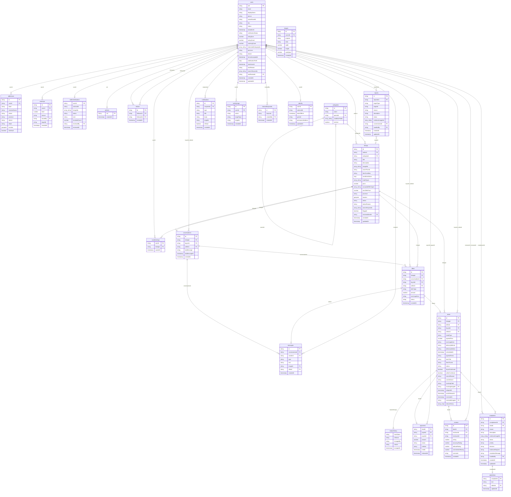

# Cấu trúc dữ liệu Firestore

Từ điển dữ liệu cho Cloud Firestore: mọi collection, trường, kiểu, khóa, ý nghĩa, giá trị cho phép, quan hệ, ai ghi, truy vấn dự kiến và ví dụ. Khớp [ERD](../diagrams/erd/README.md) và [đặc tả lớp](../architecture/dac-ta-lop/README.md). **Firebase chưa được thêm vào build**; đây là thiết kế đã chốt để code theo, không phải dữ liệu đang có.

Quy tắc:

- Đổi collection hoặc trường **đã có ở đây** cần hỏi leader trước (`AGENTS.md`, luật R6), rồi sửa tài liệu này, ERD và sơ đồ lớp trong cùng Pull Request.
- Tên collection: số nhiều, chữ thường. Tên trường: `camelCase`, trùng tên thuộc tính của lớp Java để Firestore tự chuyển đổi. Thời gian dùng kiểu `Timestamp`.
- Trường kiểu liệt kê lưu **tên hằng enum** dưới dạng chuỗi (ví dụ `"SHIPPED"`), chỉ dùng các giá trị ghi ở cột Giá trị cho phép. Nghĩa tiếng Việt của từng giá trị: [enums.md](../architecture/dac-ta-lop/enums.md).
- Tiền là số nguyên, đơn vị đồng. Mọi tài liệu có thêm `createdAt` và `updatedAt` (từ `BaseDocument`) dù bảng dưới không nhắc lại.
- Firestore không có khóa ngoại thật: cột FK là mã tài liệu khác; ứng dụng và Security Rules giữ quan hệ đúng.
- Quyền hạn không bao giờ lấy từ trường do ứng dụng gửi lên; Security Rules quyết định (`AGENTS.md`, luật R12).
- Chuyển trạng thái theo [trang-thai.md](../architecture/trang-thai.md).

## Tổng quan

**23 collection** (kể cả collection con) và **1 mảng lồng** (`deals.statusHistory`).

| Collection | Đường dẫn | Lớp Java | Mục đích |
| --- | --- | --- | --- |
| [`users`](#users) | `users/{uid}` | `User` | Hồ sơ người dùng. |
| [`addresses`](#addresses) | `users/{uid}/addresses/{id}` | `UserAddress` | Địa chỉ giao nhận. |
| [`identity`](#identity) | `users/{uid}/private/identity` | `UserIdentity` | Thông tin định danh riêng tư; Security Rules chỉ cho chủ tài khoản và admin đọc. |
| [`savedListings`](#savedlistings) | `users/{uid}/saved/{listingId}` | (không có lớp riêng) | Tin đã lưu (quan hệ nhiều-nhiều). |
| [`follows`](#follows) | `follows/{followerId_followedId}` | (không có lớp riêng) | Theo dõi (quan hệ nhiều-nhiều tự thân của users). |
| [`sellerVerifications`](#sellerverifications) | `sellerVerifications/{userId}` | `SellerVerification` | Yêu cầu xác thực tài khoản: số CCCD, ảnh giấy tờ và ảnh chân dung cầm giấy tờ. |
| [`warnings`](#warnings) | `users/{uid}/warnings/{id}` | `Warning` | Cảnh báo vi phạm theo bậc. |
| [`admins`](#admins) | `admins/{uid}` | (không có lớp riêng) | Chỉ cần tồn tại: Security Rules dùng nó để nhận diện admin. Từ 2026-10-22 admin thêm và gỡ được tài liệu này ngay trong ứng dụng (UC42). |
| [`categories`](#categories) | `categories/{id}` | `Category` | Danh mục và danh mục con. |
| [`listings`](#listings) | `listings/{id}` | `Listing` | Tin đăng. |
| [`conversations`](#conversations) | `conversations/{listingId_buyerId}` | `Conversation` | Cuộc trò chuyện. |
| [`messages`](#messages) | `conversations/{id}/messages/{id}` | `ChatMessage` | Tin nhắn. |
| [`offers`](#offers) | `offers/{id}` | `Offer` | Offer một chạm. |
| [`deals`](#deals) | `deals/{id}` | `Deal` | Giao dịch. |
| [`statusHistory`](#statushistory) | `deals/{id}.statusHistory[ ]` | `StatusChange` | Mảng nhúng trong deals, không phải collection riêng. |
| [`payments`](#payments) | `payments/{dealId}` | `Payment` | Khoản thanh toán mô phỏng do hệ thống giữ, không có ngân hàng. |
| [`reviews`](#reviews) | `reviews/{id}` | `Review` | Đánh giá đối tác. |
| [`reports`](#reports) | `reports/{id}` | `Report` | Báo cáo vi phạm. |
| [`complaints`](#complaints) | `complaints/{id}` | `Complaint` | Khiếu nại. |
| [`adminNote`](#adminnote) | `complaints/{id}/adminNote/note` | (không có lớp riêng) | Ghi chú nội bộ ở tài liệu con để người dùng không đọc được. |
| [`notifications`](#notifications) | `notifications/{id}` | `AppNotification` | Thông báo. |
| [`activityLogs`](#activitylogs) | `activityLogs/{id}` | `ActivityLog` | Nhật ký hoạt động. |
| [`bannedKeywords`](#bannedkeywords) | `bannedKeywords/{id}` | `BannedKeyword` | Từ khóa cấm. |
| [`images`](#images) | `images/{id}` | `MediaImage` | Ảnh đã nén dạng Base64 (tin đăng, chat, vận đơn, bằng chứng). Mỗi tài liệu dưới 1 MiB. |

## Quan hệ

Đọc: một tài liệu bên trái ứng với bao nhiêu tài liệu bên phải. `0..1` là không hoặc một, `0..n` là không hoặc nhiều.

| Bên trái | Bội số | Bên phải | Bội số | Qua trường | Trang ERD |
| --- | --- | --- | --- | --- | --- |
| `users` | 1 | `addresses` | 0..n | `addresses.userId` | 1. Người dùng, danh mục, tin đăng |
| `users` | 1 | `warnings` | 0..n | `warnings.userId` | 1. Người dùng, danh mục, tin đăng |
| `users` | 1 | `sellerVerifications` | 0..1 | `sellerVerifications.userId` | 1. Người dùng, danh mục, tin đăng |
| `users` | 1 | `admins` | 0..1 | `admins.uid` | 1. Người dùng, danh mục, tin đăng |
| `users` | 1 | `follows` | 0..n | `follows.followerId` | 1. Người dùng, danh mục, tin đăng |
| `users` | 1 | `follows` | 0..n | `follows.followedId` | 1. Người dùng, danh mục, tin đăng |
| `users` | 1 | `savedListings` | 0..n | `savedListings.userId` | 1. Người dùng, danh mục, tin đăng |
| `users` | 1 | `listings` | 0..n | `listings.sellerId` | 1. Người dùng, danh mục, tin đăng |
| `listings` | 1 | `savedListings` | 0..n | `savedListings.listingId` | 1. Người dùng, danh mục, tin đăng |
| `categories` | 1 | `listings` | 0..n | `listings.categoryId` | 1. Người dùng, danh mục, tin đăng |
| `categories` | 0..1 | `categories` | 0..n | `categories.parentId` | 1. Người dùng, danh mục, tin đăng |
| `conversations` | 1 | `messages` | 0..n | `messages.conversationId` | 2. Chat và offer |
| `offers` | 1 | `messages` | 0..1 | `messages.offerId` | 2. Chat và offer |
| `conversations` | 1 | `offers` | 0..n | `offers.conversationId` | 2. Chat và offer |
| `listings` | 1 | `conversations` | 0..n | `conversations.listingId` | 2. Chat và offer |
| `users` | 1 | `conversations` | 0..n | `conversations.buyerId`, `conversations.sellerId` | 2. Chat và offer |
| `users` | 1 | `messages` | 0..n | `messages.senderId` | 2. Chat và offer |
| `users` | 1 | `offers` | 0..n | `offers.buyerId`, `offers.sellerId` | 2. Chat và offer |
| `listings` | 1 | `offers` | 0..n | `offers.listingId` | 2. Chat và offer |
| `offers` | 1 | `deals` | 0..1 | `deals.offerId` | 3. Giao dịch, thanh toán, đánh giá |
| `listings` | 1 | `deals` | 0..n | `deals.listingId` | 3. Giao dịch, thanh toán, đánh giá |
| `users` | 1 | `deals` | 0..n | `deals.buyerId`, `deals.sellerId` | 3. Giao dịch, thanh toán, đánh giá |
| `deals` | 1 | `statusHistory` | 1..n | `deals.statusHistory` (mảng lồng) | 3. Giao dịch, thanh toán, đánh giá |
| `deals` | 1 | `payments` | 0..1 | `payments.dealId` | 3. Giao dịch, thanh toán, đánh giá |
| `deals` | 1 | `reviews` | 0..n | `reviews.dealId` | 3. Giao dịch, thanh toán, đánh giá |
| `users` | 1 | `payments` | 0..n | `payments.payerId`, `payments.payeeId` | 3. Giao dịch, thanh toán, đánh giá |
| `users` | 1 | `reviews` | 0..n | `reviews.reviewerId`, `reviews.revieweeId` | 3. Giao dịch, thanh toán, đánh giá |
| `users` | 1 | `reports` | 0..n | `reports.reporterId` | 4. Tin cậy, quản trị |
| `reports` | 0..n | `listings` | 0..1 | `targetId` (tham chiếu đa hình theo `targetType`) | 4. Tin cậy, quản trị |
| `users` | 1 | `complaints` | 0..n | `complaints.complainantId` | 4. Tin cậy, quản trị |
| `deals` | 1 | `complaints` | 0..n | `complaints.dealId` | 4. Tin cậy, quản trị |
| `complaints` | 1 | `adminNote` | 0..1 | `adminNote.complaintId` | 4. Tin cậy, quản trị |
| `users` | 1 | `notifications` | 0..n | `notifications.recipientId` | 4. Tin cậy, quản trị |
| `users` | 1 | `activityLogs` | 0..n | `activityLogs.userId` | 4. Tin cậy, quản trị |
| `users` | 1 | `bannedKeywords` | 0..n | `bannedKeywords.createdBy` | 4. Tin cậy, quản trị |
| `users` | 1 | `identity` | 0..1 | `identity.userId` | 1. Người dùng, danh mục, tin đăng |

Sơ đồ dạng chữ:



## users

- **Đường dẫn:** `users/{uid}`
- **Lớp Java:** `User`
- **Mục đích:** Hồ sơ người dùng.
- **Ai ghi:** `UserRepository` (tạo hồ sơ, sửa hồ sơ, mở khóa đã hết hạn, vô hiệu hóa), `AdminRepository` (khóa, cảnh báo, xác thực tài khoản), `ReviewRepository` (`ratingSum`, `ratingCount` của người được đánh giá)
- **Quyền đã chốt:** Lúc tạo: `status` ACTIVE, `verificationStatus` NONE, `ratingSum` và `ratingCount` bằng 0. Chủ tài khoản không tự đổi `status` trừ hai trường hợp: sang DELETED, hoặc từ TEMP_LOCKED về ACTIVE khi giờ Firestore đã qua `lockedUntil`; chỉ đổi `verificationStatus` từ NONE hoặc REJECTED sang PENDING.

| Trường | Kiểu | Khóa | Ý nghĩa | Giá trị cho phép, tham chiếu |
| --- | --- | --- | --- | --- |
| `uid` | string | PK | Mã tài liệu, bằng `uid` của Firebase Authentication. |  |
| `email` | string |  | Email đăng nhập, lấy từ Firebase Authentication. |  |
| `displayName` | string |  | Họ tên hiển thị. |  |
| `phone` | string |  | Số điện thoại liên hệ. Không dùng để đăng nhập. |  |
| `avatarBase64` | string |  | Ảnh đại diện 256 px, JPEG dạng Base64, tối đa 20 KB. Nằm luôn trong tài liệu người dùng để danh sách và chat hiện ngay. Tài khoản Google chưa có ảnh thì lấy ảnh Google khi bắt đầu phiên đăng nhập; không ghi đè ảnh người dùng đã đặt. |  |
| `bio` | string |  | Đoạn giới thiệu ngắn trên trang cá nhân. |  |
| `status` | string |  | Trạng thái tài khoản. Admin đổi giữa ACTIVE và hai mức khóa; chính chủ chỉ được đổi sang DELETED khi vô hiệu hóa. | một trong: ACTIVE, TEMP_LOCKED, PERM_LOCKED, DELETED |
| `lockedUntil` | timestamp |  | Hạn khóa tạm. Rỗng khi không khóa hoặc khóa vĩnh viễn. |  |
| `verificationStatus` | string |  | Trạng thái xác thực tài khoản; chỉ APPROVED mới đăng tin, gửi đề nghị và tạo giao dịch được, và hồ sơ mới có nhãn Tài khoản đã xác thực. | một trong: NONE, PENDING, APPROVED, REJECTED |
| `ratingSum` | number |  | Tổng điểm sao tổng thể đã nhận; điểm trung bình = `ratingSum / ratingCount`. Tăng bằng `FieldValue.increment` cùng lô với `Review`. |  |
| `ratingCount` | number |  | Số đánh giá đã nhận, tăng 1 cùng lô với `Review`. |  |
| `warningCount` | number |  | Số lần bị cảnh báo; bậc của lần cảnh báo kế tiếp là `warningCount + 1`. Mở khóa không đặt lại số này. |  |
| `interestedCategoryIds` | array<string> |  | Danh mục quan tâm chọn lúc đăng ký; nguồn của gợi ý. | tham chiếu categories |
| `province` | string |  | Tỉnh hoặc thành phố. |  |
| `district` | string |  | Quận hoặc huyện. |  |
| `termsAcceptedAt` | timestamp |  | Lúc đồng ý Điều khoản sử dụng và Chính sách bảo mật khi đăng ký. |  |
| `notificationPrefs` | map |  | Bật hoặc tắt từng loại thông báo. Khóa là tên hằng `NotificationType`, thiếu khóa nghĩa là bật. |  |
| `lastActiveAt` | timestamp |  | Lần cuối ứng dụng của người này hoạt động; dùng cho trạng thái hoạt động trong chat. |  |
| `lockReason` | string |  | Lý do khóa gần nhất do admin ghi; hiện cho người bị khóa khi đăng nhập. |  |
| `searchKeywords` | array<string> |  | Các từ đã bỏ dấu, viết thường của `displayName`, để truy vấn `array-contains` khi người dùng tìm nhau. Tạo lại mỗi lần `displayName` đổi; tối đa 20 từ. |  |
| `lastReviewId` | string | FK | Mã tài liệu `reviews` của lần đánh giá gần nhất đã cộng vào `ratingSum` và `ratingCount`. Security Rules dùng nó để kiểm lần cộng điểm có kèm một đánh giá thật hay không, và để chặn cộng hai lần bằng cùng một đánh giá; ứng dụng không hiển thị trường này. | tham chiếu reviews |
| `createdAt` | timestamp |  |  |  |
| `updatedAt` | timestamp |  |  |  |

Truy vấn dự kiến:

| Phương thức | Điều kiện | Chỉ mục |
| --- | --- | --- |
| `UserRepository.getProfile` | Đọc theo mã | Không cần |
| `AdminRepository.listUsers` | Tùy chọn `status ==` và `province ==`, `createdAt` trong khoảng, sắp `createdAt` giảm | Ghép: `status`, `createdAt`; `province`, `createdAt`; `status`, `province`, `createdAt` |
| `UserRepository.getStats` | Bốn truy vấn tổng hợp `count()` trên `deals` và `follows` | Dùng chỉ mục của `deals` và `follows` |
| `UserRepository.searchUsers` | `searchKeywords array-contains` từ dài nhất trong ô tìm kiếm (đã bỏ dấu), `status == ACTIVE`, sắp `ratingCount` giảm, trang 20 người | Ghép: `searchKeywords` (array-contains), `status`, `ratingCount` |
| `AdminRepository.findUserByEmail` | `email ==` và `status == ACTIVE`, lấy một tài liệu; dùng khi admin cấp quyền admin (UC42) | Ghép: `email`, `status` |

Ví dụ một tài liệu (thời gian ghi dạng chữ cho dễ đọc, trên Firestore là `Timestamp`; `null` là chưa có giá trị):

```json
{
  "uid": "u_an01",
  "email": "an.nguyen@example.com",
  "displayName": "Nguyễn An",
  "phone": "0901234567",
  "avatarBase64": "/9j/4AAQSkZJRg...(Base64, tối đa 20 KB)",
  "bio": "Thích đồ công nghệ cũ",
  "status": "ACTIVE",
  "lockedUntil": null,
  "verificationStatus": "APPROVED",
  "ratingSum": 58,
  "ratingCount": 12,
  "warningCount": 0,
  "interestedCategoryIds": [
    "interestedCategory_01"
  ],
  "province": "TP.HCM",
  "district": "Quận 1",
  "termsAcceptedAt": "2026-10-12T09:30:00+07:00",
  "notificationPrefs": {
    "NEW_MESSAGE": true,
    "NEW_OFFER": true,
    "DEAL_UPDATE": true
  },
  "lastActiveAt": "2026-10-12T09:30:00+07:00",
  "lockReason": "",
  "searchKeywords": [],
  "lastReviewId": "lastReview_01",
  "createdAt": "2026-10-12T09:30:00+07:00",
  "updatedAt": "2026-10-12T09:30:00+07:00"
}
```

## addresses

- **Đường dẫn:** `users/{uid}/addresses/{id}`
- **Lớp Java:** `UserAddress`
- **Mục đích:** Địa chỉ giao nhận.
- **Ai ghi:** `UserRepository`

| Trường | Kiểu | Khóa | Ý nghĩa | Giá trị cho phép, tham chiếu |
| --- | --- | --- | --- | --- |
| `id` | string | PK | Mã tài liệu Firestore (tự sinh, trừ khi đường dẫn ghi khác). |  |
| `userId` | string | FK | Chủ địa chỉ. | tham chiếu users |
| `label` | string |  | Nhãn do người dùng đặt, ví dụ Nhà, Công ty. |  |
| `receiverName` | string |  | Tên người nhận. |  |
| `phone` | string |  | Số điện thoại người nhận. |  |
| `province` | string |  | Tỉnh hoặc thành phố. |  |
| `district` | string |  | Quận hoặc huyện. |  |
| `detail` | string |  | Số nhà, đường, phường. |  |
| `location` | geopoint |  | Tọa độ, dùng cho lọc theo bán kính. Có thể rỗng. |  |
| `isDefault` | boolean |  | Địa chỉ mặc định; mỗi người chỉ một địa chỉ có giá trị true. |  |

Truy vấn dự kiến:

| Phương thức | Điều kiện | Chỉ mục |
| --- | --- | --- |
| `UserRepository.getAddresses` | Cả collection con, sắp `isDefault` giảm | Không cần |

Ví dụ một tài liệu (thời gian ghi dạng chữ cho dễ đọc, trên Firestore là `Timestamp`; `null` là chưa có giá trị):

```json
{
  "id": "addresse_01",
  "userId": "user_01",
  "label": "Nhà",
  "receiverName": "Nguyễn An",
  "phone": "0901234567",
  "province": "TP.HCM",
  "district": "Quận 1",
  "detail": "12 Lê Lợi, phường Bến Nghé",
  "location": {
    "latitude": 10.7769,
    "longitude": 106.7009
  },
  "isDefault": false
}
```

## identity

- **Đường dẫn:** `users/{uid}/private/identity`
- **Lớp Java:** `UserIdentity`
- **Mục đích:** Thông tin định danh riêng tư; Security Rules chỉ cho chủ tài khoản và admin đọc.
- **Ai ghi:** `UserRepository`
- **Quyền đã chốt:** Chính chủ tài khoản đọc và ghi; admin chỉ đọc (màn E03, khi duyệt xác thực tài khoản). Không hiển thị công khai.

| Trường | Kiểu | Khóa | Ý nghĩa | Giá trị cho phép, tham chiếu |
| --- | --- | --- | --- | --- |
| `userId` | string | PK,FK | Chủ thông tin định danh, trùng mã tài liệu cha. | tham chiếu users |
| `nationalId` | string |  | Số căn cước công dân, 12 chữ số. Không hiển thị công khai. |  |
| `dateOfBirth` | timestamp |  | Ngày sinh. |  |
| `gender` | string |  | Giới tính. | một trong: MALE, FEMALE, OTHER |
| `permanentAddress` | string |  | Địa chỉ thường trú. |  |
| `updatedAt` | timestamp |  |  |  |

Truy vấn dự kiến:

| Phương thức | Điều kiện | Chỉ mục |
| --- | --- | --- |
| `UserRepository.getIdentity` | Đọc theo đường dẫn | Không cần |

Ví dụ một tài liệu (thời gian ghi dạng chữ cho dễ đọc, trên Firestore là `Timestamp`; `null` là chưa có giá trị):

```json
{
  "userId": "user_01",
  "nationalId": "079200001234",
  "dateOfBirth": "2026-10-12T09:30:00+07:00",
  "gender": "MALE",
  "permanentAddress": "12 Lê Lợi, Quận 1, TP.HCM",
  "updatedAt": "2026-10-12T09:30:00+07:00"
}
```

## savedListings

- **Đường dẫn:** `users/{uid}/saved/{listingId}`
- **Lớp Java:** không có lớp riêng
- **Mục đích:** Tin đã lưu (quan hệ nhiều-nhiều).
- **Ai ghi:** `UserRepository`

| Trường | Kiểu | Khóa | Ý nghĩa | Giá trị cho phép, tham chiếu |
| --- | --- | --- | --- | --- |
| `userId` | string | PK,FK |  | tham chiếu users |
| `listingId` | string | PK,FK |  | tham chiếu listings |
| `savedAt` | timestamp |  |  |  |

Truy vấn dự kiến:

| Phương thức | Điều kiện | Chỉ mục |
| --- | --- | --- |
| `UserRepository.getSavedIds` | Cả collection con, sắp `savedAt` giảm; rồi đọc từng tin, bỏ qua tin không còn hoặc không được xem | Không cần |

Ví dụ một tài liệu (thời gian ghi dạng chữ cho dễ đọc, trên Firestore là `Timestamp`; `null` là chưa có giá trị):

```json
{
  "userId": "user_01",
  "listingId": "listing_01",
  "savedAt": "2026-10-12T09:30:00+07:00"
}
```

## follows

- **Đường dẫn:** `follows/{followerId_followedId}`
- **Lớp Java:** không có lớp riêng
- **Mục đích:** Theo dõi (quan hệ nhiều-nhiều tự thân của users).
- **Ai ghi:** `UserRepository`

| Trường | Kiểu | Khóa | Ý nghĩa | Giá trị cho phép, tham chiếu |
| --- | --- | --- | --- | --- |
| `id` | string | PK |  |  |
| `followerId` | string | FK |  | tham chiếu users |
| `followedId` | string | FK |  | tham chiếu users |
| `createdAt` | timestamp |  |  |  |

Truy vấn dự kiến:

| Phương thức | Điều kiện | Chỉ mục |
| --- | --- | --- |
| `UserRepository.getFollowingIds` | `followerId == uid` | Không cần (một trường) |

Ví dụ một tài liệu (thời gian ghi dạng chữ cho dễ đọc, trên Firestore là `Timestamp`; `null` là chưa có giá trị):

```json
{
  "id": "follow_01",
  "followerId": "follower_01",
  "followedId": "followed_01",
  "createdAt": "2026-10-12T09:30:00+07:00"
}
```

## sellerVerifications

- **Đường dẫn:** `sellerVerifications/{userId}`
- **Lớp Java:** `SellerVerification`
- **Mục đích:** Yêu cầu xác thực tài khoản: số CCCD, ảnh giấy tờ và ảnh chân dung cầm giấy tờ.
- **Ai ghi:** `UserRepository` (gửi), `AdminRepository` (duyệt)

| Trường | Kiểu | Khóa | Ý nghĩa | Giá trị cho phép, tham chiếu |
| --- | --- | --- | --- | --- |
| `userId` | string | PK,FK | Người gửi yêu cầu; cũng là mã tài liệu. | tham chiếu users |
| `nationalId` | string |  | Số CCCD 12 chữ số người gửi khai trong yêu cầu; admin đối chiếu với ảnh giấy tờ. |  |
| `imageIds` | array<string> |  | Hai mã tài liệu `images`: ảnh giấy tờ và ảnh chân dung cầm giấy tờ, `purpose` là VERIFICATION. | tham chiếu images |
| `status` | string |  | Trạng thái yêu cầu. | một trong: NONE, PENDING, APPROVED, REJECTED |
| `note` | string |  | Lý do từ chối do admin ghi. |  |
| `resubmitCount` | number |  | Số lần đã gửi lại sau khi bị từ chối; tối đa `MAX_RESUBMIT`. |  |
| `reviewedBy` | string | FK | Admin đã xử lý. | tham chiếu users |
| `reviewedAt` | timestamp |  | Lúc xử lý. |  |

Truy vấn dự kiến:

| Phương thức | Điều kiện | Chỉ mục |
| --- | --- | --- |
| `AdminRepository.getVerificationRequests` | `status == PENDING`, sắp `createdAt` | Ghép: `status`, `createdAt` |

Ví dụ một tài liệu (thời gian ghi dạng chữ cho dễ đọc, trên Firestore là `Timestamp`; `null` là chưa có giá trị):

```json
{
  "userId": "user_01",
  "nationalId": "079201001234",
  "imageIds": [
    "image_verify_01",
    "image_verify_02"
  ],
  "status": "PENDING",
  "note": "",
  "resubmitCount": 0,
  "reviewedBy": null,
  "reviewedAt": null
}
```

## warnings

- **Đường dẫn:** `users/{uid}/warnings/{id}`
- **Lớp Java:** `Warning`
- **Mục đích:** Cảnh báo vi phạm theo bậc.
- **Ai ghi:** `AdminRepository`

| Trường | Kiểu | Khóa | Ý nghĩa | Giá trị cho phép, tham chiếu |
| --- | --- | --- | --- | --- |
| `id` | string | PK | Mã tài liệu Firestore (tự sinh, trừ khi đường dẫn ghi khác). |  |
| `userId` | string | FK | Người bị cảnh báo. | tham chiếu users |
| `level` | number |  | Bậc cảnh báo: 1, 2 hoặc 3, bằng `User.warningCount` sau khi cộng. |  |
| `reason` | string |  | Lý do cảnh báo, admin ghi. |  |
| `issuedBy` | string | FK | Admin đã cảnh báo. | tham chiếu users |
| `targetId` | string |  | Tin, báo cáo hoặc khiếu nại dẫn tới cảnh báo. Có thể rỗng. |  |
| `createdAt` | timestamp |  |  |  |

Truy vấn dự kiến:

| Phương thức | Điều kiện | Chỉ mục |
| --- | --- | --- |
| `AdminRepository.getWarnings` | Cả collection con, sắp `createdAt` giảm | Không cần |

Ví dụ một tài liệu (thời gian ghi dạng chữ cho dễ đọc, trên Firestore là `Timestamp`; `null` là chưa có giá trị):

```json
{
  "id": "warning_01",
  "userId": "user_01",
  "level": 1,
  "reason": "Đăng hàng giả nhiều lần",
  "issuedBy": "",
  "targetId": "target_01",
  "createdAt": "2026-10-12T09:30:00+07:00"
}
```

## admins

- **Đường dẫn:** `admins/{uid}`
- **Lớp Java:** không có lớp riêng
- **Mục đích:** Chỉ cần tồn tại: Security Rules dùng nó để nhận diện admin. Từ 2026-10-22 admin thêm và gỡ được tài liệu này ngay trong ứng dụng (UC42).
- **Ai ghi:** `AdminRepository` (cấp và gỡ quyền admin, UC42); leader vẫn tạo được tài liệu admin đầu tiên trên Firebase Console
- **Quyền đã chốt:** Admin cấp và gỡ quyền admin cho người khác ngay trong ứng dụng (UC42, quyết định 2026-10-22); không ai tự cấp quyền cho chính mình. Tài liệu admin đầu tiên do leader tạo tay trên Firebase Console. Security Rules đọc tài liệu này để biết ai là admin.

| Trường | Kiểu | Khóa | Ý nghĩa | Giá trị cho phép, tham chiếu |
| --- | --- | --- | --- | --- |
| `uid` | string | PK,FK |  | tham chiếu users |
| `createdAt` | timestamp |  |  |  |

Truy vấn dự kiến:

| Phương thức | Điều kiện | Chỉ mục |
| --- | --- | --- |
| `AdminRepository.isAdmin` | Đọc `admins/{uid}`, chỉ xem có tồn tại | Không cần |
| `AdminRepository.listAdmins` | Cả collection, sắp `createdAt`; rồi đọc hồ sơ từng admin | Không cần |

Ví dụ một tài liệu (thời gian ghi dạng chữ cho dễ đọc, trên Firestore là `Timestamp`; `null` là chưa có giá trị):

```json
{
  "uid": "u_an01",
  "createdAt": "2026-10-12T09:30:00+07:00"
}
```

## categories

- **Đường dẫn:** `categories/{id}`
- **Lớp Java:** `Category`
- **Mục đích:** Danh mục và danh mục con.
- **Ai ghi:** `CategoryRepository` (chỉ admin)

| Trường | Kiểu | Khóa | Ý nghĩa | Giá trị cho phép, tham chiếu |
| --- | --- | --- | --- | --- |
| `id` | string | PK | Mã tài liệu Firestore (tự sinh, trừ khi đường dẫn ghi khác). |  |
| `name` | string |  | Tên danh mục. |  |
| `parentId` | string | FK | Danh mục cha. Rỗng nghĩa là danh mục gốc. Chỉ có hai cấp. | tham chiếu categories |
| `conditionFields` | array<string> |  | Tên các thuộc tính tình trạng riêng của danh mục, ví dụ Dung lượng pin, Bảo hành. |  |
| `isActive` | boolean |  | Danh mục còn dùng; false thì ẩn khỏi lựa chọn khi đăng tin. |  |

Truy vấn dự kiến:

| Phương thức | Điều kiện | Chỉ mục |
| --- | --- | --- |
| `CategoryRepository.getAll` | `isActive == true` | Không cần |
| `CategoryRepository.getAllForAdmin` | Cả collection | Không cần |
| `CategoryRepository.getChildren` | `parentId == id` | Không cần |

Ví dụ một tài liệu (thời gian ghi dạng chữ cho dễ đọc, trên Firestore là `Timestamp`; `null` là chưa có giá trị):

```json
{
  "id": "categorie_01",
  "name": "Điện thoại",
  "parentId": "parent_01",
  "conditionFields": [],
  "isActive": false
}
```

## listings

- **Đường dẫn:** `listings/{id}`
- **Lớp Java:** `Listing`
- **Mục đích:** Tin đăng.
- **Ai ghi:** `ListingRepository`, `ChatRepository` (RESERVED), `DealRepository` (AVAILABLE khi hủy, SOLD khi hoàn tất), `ComplaintRepository` (AVAILABLE khi quyết định hủy), `AdminRepository` (ẩn, khôi phục, gỡ), `UserRepository` (ẩn khi vô hiệu hóa)

| Trường | Kiểu | Khóa | Ý nghĩa | Giá trị cho phép, tham chiếu |
| --- | --- | --- | --- | --- |
| `id` | string | PK | Mã tài liệu Firestore (tự sinh, trừ khi đường dẫn ghi khác). |  |
| `sellerId` | string | FK | Người đăng. | tham chiếu users |
| `categoryId` | string | FK | Danh mục, phải là danh mục con hoặc danh mục gốc không có con. | tham chiếu categories |
| `title` | string |  | Tiêu đề tin. |  |
| `description` | string |  | Mô tả món đồ và yêu cầu của người đăng. |  |
| `imageIds` | array<string> |  | Mã 1 đến 5 tài liệu `images` (ảnh đầy đủ). Chỉ màn chi tiết tin mới đọc các ảnh này. | tham chiếu images |
| `coverThumb` | string |  | Ảnh bìa thu nhỏ 320 px, JPEG Base64, tối đa 20 KB, lấy từ ảnh đầu tiên. Bảng tin và bộ nhớ đệm chỉ dùng ảnh này. |  |
| `itemCondition` | string |  | Tình trạng chung của món đồ. | một trong: NEW, LIKE_NEW, USED, REPAIRED, DEFECTIVE |
| `conditionValues` | map |  | Giá trị của từng thuộc tính tình trạng; khóa lấy từ `Category.conditionFields`. |  |
| `tradeTypes` | array<string> |  | Các hình thức chấp nhận, chọn được nhiều. Có GIVEAWAY thì giá bằng 0. | mỗi phần tử là một trong: SELL, EXCHANGE, GIVEAWAY |
| `price` | number |  | Giá đăng, đơn vị đồng. 0 khi chỉ trao đổi hoặc cho tặng. |  |
| `acceptedOfferTypes` | array<string> |  | Các loại offer người bán nhận. | mỗi phần tử là một trong: MONEY, ITEM, MONEY_AND_ITEM |
| `minOfferPrice` | number |  | Mức tiền offer tối thiểu, 0 là không giới hạn. |  |
| `province` | string |  | Tỉnh hoặc thành phố, dùng cho lọc khu vực. |  |
| `location` | geopoint |  | Tọa độ món đồ, dùng cho lọc bán kính và sắp theo khoảng cách. |  |
| `status` | string |  | Trạng thái tin, xem `trang-thai.md` mục 1. | một trong: DRAFT, AVAILABLE, RESERVED, SOLD, HIDDEN, REMOVED |
| `statusReason` | string |  | Lý do admin ẩn hoặc gỡ tin, hiển thị cho người đăng. |  |
| `searchKeywords` | array<string> |  | Các từ đã bỏ dấu, viết thường của tiêu đề và mô tả, để truy vấn `array-contains`. |  |
| `flagged` | boolean |  | Bị gắn cờ vì chứa từ khóa cấm. Người đăng chỉ đổi được từ false sang true (khi sửa tin); chỉ admin bỏ cờ (`AdminRepository.clearFlag`). |  |
| `reservedDealId` | string | FK | Giao dịch đang giữ chỗ tin khi tin RESERVED; rỗng ở trạng thái khác. Security Rules dùng nó để cho người mua của giao dịch đó trả tin về AVAILABLE khi hủy, hoặc chuyển sang SOLD khi hoàn tất. | tham chiếu deals |
| `createdAt` | timestamp |  |  |  |
| `updatedAt` | timestamp |  |  |  |

Truy vấn dự kiến:

| Phương thức | Điều kiện | Chỉ mục |
| --- | --- | --- |
| `ListingRepository.getFeed` | `status == AVAILABLE`, có thể thêm `categoryId ==` hoặc `province ==`, sắp `createdAt` giảm, 20 tin một trang | Ghép: `status`, `createdAt`; `status`, `categoryId`, `createdAt`; `status`, `province`, `createdAt` |
| `ListingRepository.getFeed` (kênh đang theo dõi) | `status == AVAILABLE`, `sellerId in [...]`, sắp `createdAt` giảm | Ghép: `status`, `sellerId`, `createdAt` |
| `ListingRepository.search` | `searchKeywords array-contains <từ đầu>`, `status == AVAILABLE`, sắp `createdAt` giảm; giá, tình trạng, hình thức, bán kính lọc trên máy | Ghép: `searchKeywords` (array-contains), `status`, `createdAt` |
| `ListingRepository.getFeed` (sắp theo giá) | `status == AVAILABLE`, có thể thêm `categoryId ==`, sắp `price` tăng hoặc giảm | Ghép: `status`, `price`; `status`, `categoryId`, `price` |
| `ListingRepository.getBySeller` (chính chủ) | `sellerId ==`, sắp `createdAt` giảm | Ghép: `sellerId`, `createdAt` |
| `ListingRepository.getBySeller` (người khác xem) | `sellerId ==`, `status in [AVAILABLE, RESERVED, SOLD]`, sắp `createdAt` giảm | Ghép: `sellerId`, `status`, `createdAt` |
| `ListingRepository.getSimilar` | `status == AVAILABLE`, `categoryId ==`, 20 tin | Dùng chỉ mục của getFeed |

Ví dụ một tài liệu (thời gian ghi dạng chữ cho dễ đọc, trên Firestore là `Timestamp`; `null` là chưa có giá trị):

```json
{
  "id": "listing_01",
  "sellerId": "seller_01",
  "categoryId": "category_01",
  "title": "iPhone 12 128GB",
  "description": "Máy đẹp, pin 85%",
  "imageIds": [
    "image_listing_01",
    "image_listing_02"
  ],
  "coverThumb": "/9j/4AAQSkZJRg...(Base64, tối đa 20 KB)",
  "itemCondition": "NEW",
  "conditionValues": {
    "Dung lượng pin": "85%"
  },
  "tradeTypes": [
    "SELL",
    "EXCHANGE"
  ],
  "price": 6500000,
  "acceptedOfferTypes": [
    "MONEY",
    "MONEY_AND_ITEM"
  ],
  "minOfferPrice": 5000000,
  "province": "TP.HCM",
  "location": {
    "latitude": 10.7769,
    "longitude": 106.7009
  },
  "status": "AVAILABLE",
  "statusReason": "",
  "searchKeywords": [
    "iphone",
    "12",
    "128gb",
    "may",
    "dep"
  ],
  "flagged": false,
  "reservedDealId": "reservedDeal_01",
  "createdAt": "2026-10-12T09:30:00+07:00",
  "updatedAt": "2026-10-12T09:30:00+07:00"
}
```

## conversations

- **Đường dẫn:** `conversations/{listingId_buyerId}`
- **Lớp Java:** `Conversation`
- **Mục đích:** Cuộc trò chuyện.
- **Ai ghi:** `ChatRepository`

| Trường | Kiểu | Khóa | Ý nghĩa | Giá trị cho phép, tham chiếu |
| --- | --- | --- | --- | --- |
| `id` | string | PK | Mã tài liệu Firestore (tự sinh, trừ khi đường dẫn ghi khác). |  |
| `listingId` | string | FK | Tin đang được bàn. Mã tài liệu là `listingId_buyerId` nên mỗi người mua chỉ có một cuộc trò chuyện cho một tin. | tham chiếu listings |
| `buyerId` | string | FK | Người hỏi mua. | tham chiếu users |
| `sellerId` | string | FK | Người đăng tin. | tham chiếu users |
| `lastMessage` | string |  | Bản xem trước tin nhắn cuối, hiện ở danh sách chat. |  |
| `lastMessageAt` | timestamp |  | Lúc có tin nhắn cuối, dùng để sắp danh sách chat. |  |
| `createdAt` | timestamp |  |  |  |

Truy vấn dự kiến:

| Phương thức | Điều kiện | Chỉ mục |
| --- | --- | --- |
| `ChatRepository.getConversations` | Hai truy vấn: `buyerId == uid` và `sellerId == uid`, mỗi truy vấn sắp `lastMessageAt` giảm, rồi gộp | Ghép: `buyerId`, `lastMessageAt`; `sellerId`, `lastMessageAt` |

Ví dụ một tài liệu (thời gian ghi dạng chữ cho dễ đọc, trên Firestore là `Timestamp`; `null` là chưa có giá trị):

```json
{
  "id": "conversation_01",
  "listingId": "listing_01",
  "buyerId": "buyer_01",
  "sellerId": "seller_01",
  "lastMessage": "Bạn để 6 triệu được không?",
  "lastMessageAt": "2026-10-12T09:30:00+07:00",
  "createdAt": "2026-10-12T09:30:00+07:00"
}
```

## messages

- **Đường dẫn:** `conversations/{id}/messages/{id}`
- **Lớp Java:** `ChatMessage`
- **Mục đích:** Tin nhắn.
- **Ai ghi:** `ChatRepository`

| Trường | Kiểu | Khóa | Ý nghĩa | Giá trị cho phép, tham chiếu |
| --- | --- | --- | --- | --- |
| `id` | string | PK | Mã tài liệu Firestore (tự sinh, trừ khi đường dẫn ghi khác). |  |
| `conversationId` | string | FK | Cuộc trò chuyện chứa tin nhắn. | tham chiếu conversations |
| `senderId` | string | FK | Người gửi. | tham chiếu users |
| `type` | string |  | Loại tin nhắn. | một trong: TEXT, IMAGE, OFFER |
| `text` | string |  | Nội dung chữ khi type là TEXT. |  |
| `imageId` | string | FK | Mã tài liệu `images` khi type là IMAGE. | tham chiếu images |
| `offerId` | string | FK | Offer được gửi khi type là OFFER. | tham chiếu offers |
| `createdAt` | timestamp |  |  |  |

Truy vấn dự kiến:

| Phương thức | Điều kiện | Chỉ mục |
| --- | --- | --- |
| `ChatRepository.observeMessages` | Lắng nghe cả collection con, sắp `createdAt` tăng | Không cần |

Ví dụ một tài liệu (thời gian ghi dạng chữ cho dễ đọc, trên Firestore là `Timestamp`; `null` là chưa có giá trị):

```json
{
  "id": "message_01",
  "conversationId": "conversation_01",
  "senderId": "sender_01",
  "type": "TEXT",
  "text": "Bạn để 6 triệu được không?",
  "imageId": null,
  "offerId": null,
  "createdAt": "2026-10-12T09:30:00+07:00"
}
```

## offers

- **Đường dẫn:** `offers/{id}`
- **Lớp Java:** `Offer`
- **Mục đích:** Offer một chạm.
- **Ai ghi:** `ChatRepository`

| Trường | Kiểu | Khóa | Ý nghĩa | Giá trị cho phép, tham chiếu |
| --- | --- | --- | --- | --- |
| `id` | string | PK | Mã tài liệu Firestore (tự sinh, trừ khi đường dẫn ghi khác). |  |
| `listingId` | string | FK | Tin được đề nghị. | tham chiếu listings |
| `conversationId` | string | FK | Cuộc trò chuyện chứa offer. | tham chiếu conversations |
| `buyerId` | string | FK | Người đề nghị. | tham chiếu users |
| `sellerId` | string | FK | Người nhận đề nghị. | tham chiếu users |
| `offerType` | string |  | Loại đề nghị; phải nằm trong `Listing.acceptedOfferTypes`. | một trong: MONEY, ITEM, MONEY_AND_ITEM |
| `amount` | number |  | Số tiền đề nghị, đơn vị đồng; 0 khi chỉ đổi vật. |  |
| `exchangeItem` | string |  | Mô tả món đồ đem đổi khi có vật. |  |
| `status` | string |  | Trạng thái offer. | một trong: PENDING, ACCEPTED, REJECTED |
| `createdAt` | timestamp |  |  |  |

Truy vấn dự kiến:

| Phương thức | Điều kiện | Chỉ mục |
| --- | --- | --- |
| `ChatRepository.respondToOffer` | `listingId ==`, `status == PENDING` để từ chối các offer còn lại | Chỉ so bằng: thường không cần chỉ mục ghép |

Ví dụ một tài liệu (thời gian ghi dạng chữ cho dễ đọc, trên Firestore là `Timestamp`; `null` là chưa có giá trị):

```json
{
  "id": "offer_01",
  "listingId": "listing_01",
  "conversationId": "conversation_01",
  "buyerId": "buyer_01",
  "sellerId": "seller_01",
  "offerType": "MONEY",
  "amount": 6000000,
  "exchangeItem": "",
  "status": "PENDING",
  "createdAt": "2026-10-12T09:30:00+07:00"
}
```

## deals

- **Đường dẫn:** `deals/{id}`
- **Lớp Java:** `Deal`
- **Mục đích:** Giao dịch.
- **Ai ghi:** `DealRepository` (kể cả COMPLETED qua `completeDeal`), `ComplaintRepository` (DISPUTED và hệ quả quyết định)

| Trường | Kiểu | Khóa | Ý nghĩa | Giá trị cho phép, tham chiếu |
| --- | --- | --- | --- | --- |
| `id` | string | PK | Mã tài liệu Firestore (tự sinh, trừ khi đường dẫn ghi khác). |  |
| `listingId` | string | FK | Tin của giao dịch. | tham chiếu listings |
| `offerId` | string | FK | Offer đã được chấp nhận để tạo giao dịch. | tham chiếu offers |
| `buyerId` | string | FK | Người mua hoặc người nhận đổi. | tham chiếu users |
| `sellerId` | string | FK | Người bán hoặc người đăng tin. | tham chiếu users |
| `tradeType` | string |  | Hình thức của giao dịch này. | một trong: SELL, EXCHANGE, GIVEAWAY |
| `agreedPrice` | number |  | Số tiền thống nhất, đơn vị đồng; 0 thì không cần thanh toán. |  |
| `exchangeItem` | string |  | Món đồ đem đổi, nếu có. |  |
| `deliveryMethod` | string |  | Gặp trực tiếp hoặc gửi qua đơn vị vận chuyển. | một trong: MEET_UP, SHIPPING |
| `deliveryAddress` | string |  | Địa chỉ giao hoặc điểm hẹn, dạng chữ. |  |
| `scheduledAt` | timestamp |  | Thời gian hẹn giao nhận. |  |
| `agreedTerms` | string |  | Điều kiện khác hai bên thống nhất. |  |
| `itemTitle` | string |  | Bản chụp tiêu đề tin lúc tạo giao dịch, để lịch sử không đổi khi tin bị sửa hoặc gỡ. | bản chụp từ tin đăng lúc tạo giao dịch |
| `itemThumb` | string |  | Bản chụp `Listing.coverThumb` lúc tạo giao dịch. | bản chụp từ tin đăng lúc tạo giao dịch |
| `status` | string |  | Trạng thái giao dịch, xem `trang-thai.md`. | một trong: PENDING_CONFIRM, CONFIRMED, SHIPPED, RECEIVED, COMPLETED, CANCELLED, DISPUTED |
| `buyerConfirmed` | boolean |  | Người mua đã chấp nhận điều khoản. Người bán sửa điều khoản thì về false. |  |
| `sellerConfirmed` | boolean |  | Người bán đã xác nhận điều khoản; bật ngay khi chấp nhận offer và luôn true từ đó. |  |
| `cancelReason` | string |  | Lý do hủy, bắt buộc khi hủy. |  |
| `carrierName` | string |  | Tên đơn vị vận chuyển. |  |
| `trackingCode` | string |  | Mã vận đơn. |  |
| `trackingImageId` | string | FK | Mã tài liệu `images` của ảnh vận đơn. | tham chiếu images |
| `shippedAt` | timestamp |  | Lúc người bán xác nhận đã giao, ghi bằng giờ máy chủ. |  |
| `autoReleaseAt` | timestamp |  | Hạn đếm ngược: `shippedAt + AUTO_RELEASE_DAYS`. Hết hạn mà người mua chưa xác nhận thì tự sang RECEIVED. |  |
| `receivedAt` | timestamp |  | Lúc sang RECEIVED (người mua xác nhận hoặc hết đếm ngược); tiền được giải ngân lúc này. |  |
| `receivedImageId` | string | FK | Mã tài liệu `images` của ảnh người mua chụp lúc nhận hàng (`purpose` RECEIVED); rỗng khi giao dịch tự sang RECEIVED vì hết đếm ngược. | tham chiếu images |
| `statusHistory` | array<map> |  | Lịch sử chuyển trạng thái. Chỉ thêm khi trạng thái thật sự đổi (sửa điều khoản không thêm dòng). | mảng lồng, mỗi phần tử theo mục statusHistory |

Truy vấn dự kiến:

| Phương thức | Điều kiện | Chỉ mục |
| --- | --- | --- |
| `DealRepository.getMyDeals` | Hai truy vấn `buyerId == uid` và `sellerId == uid`, sắp `updatedAt` giảm, rồi gộp | Ghép: `buyerId`, `updatedAt`; `sellerId`, `updatedAt` |
| `DealRepository.releaseDueDeals` | `buyerId == uid` (và lần nữa với `sellerId`), `status == SHIPPED`, `autoReleaseAt <= bây giờ` | Ghép: `buyerId`, `status`, `autoReleaseAt`; `sellerId`, `status`, `autoReleaseAt` |
| `DealRepository.completeDueDeals` | `buyerId == uid` (và `sellerId`), `status == RECEIVED`, `receivedAt <= bây giờ - 3 ngày` | Ghép: `buyerId`, `status`, `receivedAt`; `sellerId`, `status`, `receivedAt` |
| `DealRepository.expirePendingDeals` | `buyerId == uid` (và `sellerId`), `status == PENDING_CONFIRM`, `createdAt <= bây giờ - 3 ngày` | Ghép: `buyerId`, `status`, `createdAt`; `sellerId`, `status`, `createdAt` |
| `DealRepository.listAll` | `status ==` (tùy chọn), sắp `updatedAt` giảm | Ghép: `status`, `updatedAt` |

Ví dụ một tài liệu (thời gian ghi dạng chữ cho dễ đọc, trên Firestore là `Timestamp`; `null` là chưa có giá trị):

```json
{
  "id": "deal_01",
  "listingId": "listing_01",
  "offerId": "offer_01",
  "buyerId": "buyer_01",
  "sellerId": "seller_01",
  "tradeType": "SELL",
  "agreedPrice": 6000000,
  "exchangeItem": "",
  "deliveryMethod": "SHIPPING",
  "deliveryAddress": "12 Lê Lợi, Quận 1, TP.HCM",
  "scheduledAt": null,
  "agreedTerms": "Kèm sạc zin",
  "itemTitle": "iPhone 12 128GB",
  "itemThumb": "/9j/4AAQSkZJRg...(Base64, tối đa 20 KB)",
  "status": "SHIPPED",
  "buyerConfirmed": true,
  "sellerConfirmed": true,
  "cancelReason": "",
  "carrierName": "Giao Hàng Nhanh",
  "trackingCode": "GHN123456789",
  "trackingImageId": "image_waybill_01",
  "shippedAt": "2026-10-12T09:30:00+07:00",
  "autoReleaseAt": "2026-10-19T09:30:00+07:00",
  "receivedAt": null,
  "receivedImageId": "receivedImage_01",
  "statusHistory": [
    {
      "fromStatus": null,
      "toStatus": "PENDING_CONFIRM",
      "changedBy": "seller_01",
      "reason": "",
      "changedAt": "2026-10-10T20:00:00+07:00"
    },
    {
      "fromStatus": "PENDING_CONFIRM",
      "toStatus": "CONFIRMED",
      "changedBy": "buyer_01",
      "reason": "",
      "changedAt": "2026-10-11T08:15:00+07:00"
    },
    {
      "fromStatus": "CONFIRMED",
      "toStatus": "SHIPPED",
      "changedBy": "seller_01",
      "reason": "",
      "changedAt": "2026-10-12T09:30:00+07:00"
    }
  ]
}
```

## statusHistory

- **Đường dẫn:** `deals/{id}.statusHistory[ ]` (mảng lồng trong tài liệu `deals`, không phải collection riêng)
- **Lớp Java:** `StatusChange`
- **Mục đích:** Mảng nhúng trong deals, không phải collection riêng.
- **Ai ghi:** Mọi nơi đổi `deals.status`

| Trường | Kiểu | Khóa | Ý nghĩa | Giá trị cho phép, tham chiếu |
| --- | --- | --- | --- | --- |
| `fromStatus` | string |  | Trạng thái trước; rỗng ở phần tử đầu tiên. | một trong: PENDING_CONFIRM, CONFIRMED, SHIPPED, RECEIVED, COMPLETED, CANCELLED, DISPUTED |
| `toStatus` | string |  | Trạng thái sau. | một trong: PENDING_CONFIRM, CONFIRMED, SHIPPED, RECEIVED, COMPLETED, CANCELLED, DISPUTED |
| `changedBy` | string |  | Người làm thay đổi; `system` khi do việc chạy nền. | mã người dùng thực hiện lần chuyển |
| `reason` | string |  | Lý do, nếu có (hủy, khiếu nại). |  |
| `changedAt` | timestamp |  | Lúc thay đổi theo giờ máy (trong mảng không dùng được giờ máy chủ); chỉ để hiển thị, Security Rules không dựa vào. |  |

Truy vấn dự kiến:

| Phương thức | Điều kiện | Chỉ mục |
| --- | --- | --- |
| `AdminDealViewModel.loadDetail` | Đọc cùng tài liệu `deals` | Không cần |

Ví dụ một tài liệu (thời gian ghi dạng chữ cho dễ đọc, trên Firestore là `Timestamp`; `null` là chưa có giá trị):

```json
{
  "fromStatus": "PENDING_CONFIRM",
  "toStatus": "PENDING_CONFIRM",
  "changedBy": "",
  "reason": "Đăng hàng giả nhiều lần",
  "changedAt": "2026-10-12T09:30:00+07:00"
}
```

## payments

- **Đường dẫn:** `payments/{dealId}`
- **Lớp Java:** `Payment`
- **Mục đích:** Khoản thanh toán mô phỏng do hệ thống giữ, không có ngân hàng.
- **Ai ghi:** `DealRepository`, `ComplaintRepository` (hoàn hoặc giải ngân theo quyết định)
- **Quyền đã chốt:** Tạo (HELD) chỉ bởi người mua, khi giao dịch CONFIRMED, `amount` bằng `deals.agreedPrice`. Sang RELEASED chỉ cùng lô với việc giao dịch sang RECEIVED: người mua xác nhận (từ SHIPPED, hoặc từ CONFIRMED khi gặp trực tiếp), hoặc giờ Firestore đã qua `deals.autoReleaseAt` và giao dịch còn SHIPPED, hoặc admin bác khiếu nại. Sang REFUNDED chỉ cùng lô với việc giao dịch sang CANCELLED. Danh sách này trùng `trang-thai.md` mục 4.

| Trường | Kiểu | Khóa | Ý nghĩa | Giá trị cho phép, tham chiếu |
| --- | --- | --- | --- | --- |
| `dealId` | string | PK,FK | Giao dịch; cũng là mã tài liệu nên mỗi giao dịch có tối đa một khoản ký quỹ. | tham chiếu deals |
| `payerId` | string | FK | Người trả tiền (người mua). | tham chiếu users |
| `payeeId` | string | FK | Người nhận tiền khi giải ngân (người bán). | tham chiếu users |
| `amount` | number |  | Số tiền, bằng `Deal.agreedPrice`. |  |
| `status` | string |  | Trạng thái khoản ký quỹ. | một trong: HELD, RELEASED, REFUNDED |
| `method` | string |  | Phương thức người mua chọn ở màn thanh toán mô phỏng; chỉ để hiện lại trên biên lai. | một trong: CARD, E_WALLET, BANK_TRANSFER |
| `heldAt` | timestamp |  | Lúc người mua thanh toán và tiền bắt đầu được giữ. |  |
| `releasedAt` | timestamp |  | Lúc giải ngân hoặc hoàn tiền. |  |

Truy vấn dự kiến:

| Phương thức | Điều kiện | Chỉ mục |
| --- | --- | --- |
| `DealRepository.getPayments` | Hai truy vấn `payerId == uid` và `payeeId == uid`, sắp `heldAt` giảm | Ghép: `payerId`, `heldAt`; `payeeId`, `heldAt` |

Ví dụ một tài liệu (thời gian ghi dạng chữ cho dễ đọc, trên Firestore là `Timestamp`; `null` là chưa có giá trị):

```json
{
  "dealId": "deal_01",
  "payerId": "payer_01",
  "payeeId": "payee_01",
  "amount": 6000000,
  "status": "HELD",
  "method": "E_WALLET",
  "heldAt": "2026-10-12T09:30:00+07:00",
  "releasedAt": null
}
```

## reviews

- **Đường dẫn:** `reviews/{id}`
- **Lớp Java:** `Review`
- **Mục đích:** Đánh giá đối tác.
- **Ai ghi:** `ReviewRepository`; mã tài liệu `{dealId}_{reviewerId}` nên mỗi bên chỉ một đánh giá

| Trường | Kiểu | Khóa | Ý nghĩa | Giá trị cho phép, tham chiếu |
| --- | --- | --- | --- | --- |
| `id` | string | PK | Mã tài liệu Firestore (tự sinh, trừ khi đường dẫn ghi khác). |  |
| `dealId` | string | FK | Giao dịch được đánh giá. | tham chiếu deals |
| `reviewerId` | string | FK | Người viết đánh giá. | tham chiếu users |
| `revieweeId` | string | FK | Người được đánh giá. | tham chiếu users |
| `rating` | number |  | Sao tổng thể, 1 đến 5. |  |
| `accuracyRating` | number |  | Sao cho độ chính xác thông tin, 1 đến 5. |  |
| `attitudeRating` | number |  | Sao cho thái độ giao dịch, 1 đến 5. |  |
| `commitmentRating` | number |  | Sao cho đúng cam kết, 1 đến 5. |  |
| `comment` | string |  | Nhận xét bằng chữ, có thể rỗng. |  |
| `createdAt` | timestamp |  |  |  |

Truy vấn dự kiến:

| Phương thức | Điều kiện | Chỉ mục |
| --- | --- | --- |
| `ReviewRepository.getReceived` | `revieweeId == uid`, sắp `createdAt` giảm | Ghép: `revieweeId`, `createdAt` |
| `ReviewRepository.getGiven` | `reviewerId == uid`, sắp `createdAt` giảm | Ghép: `reviewerId`, `createdAt` |
| `ReviewRepository.create` | `dealId ==`, `reviewerId ==` để chặn đánh giá lần hai | Chỉ so bằng: thường không cần chỉ mục ghép |

Ví dụ một tài liệu (thời gian ghi dạng chữ cho dễ đọc, trên Firestore là `Timestamp`; `null` là chưa có giá trị):

```json
{
  "id": "review_01",
  "dealId": "deal_01",
  "reviewerId": "reviewer_01",
  "revieweeId": "reviewee_01",
  "rating": 5,
  "accuracyRating": 5,
  "attitudeRating": 4,
  "commitmentRating": 5,
  "comment": "Giao nhanh, đúng mô tả",
  "createdAt": "2026-10-12T09:30:00+07:00"
}
```

## reports

- **Đường dẫn:** `reports/{id}`
- **Lớp Java:** `Report`
- **Mục đích:** Báo cáo vi phạm.
- **Ai ghi:** `ReportRepository`

| Trường | Kiểu | Khóa | Ý nghĩa | Giá trị cho phép, tham chiếu |
| --- | --- | --- | --- | --- |
| `id` | string | PK | Mã tài liệu Firestore (tự sinh, trừ khi đường dẫn ghi khác). |  |
| `reporterId` | string | FK | Người báo cáo. | tham chiếu users |
| `targetType` | string |  | Loại đối tượng bị báo cáo. | một trong: LISTING, USER, MESSAGE |
| `targetId` | string |  | Mã tin, người dùng hoặc tin nhắn bị báo cáo, tùy `targetType`. | tham chiếu listings / users / messages |
| `reason` | string |  | Lý do chọn sẵn. | một trong: FAKE_ITEM, MISLEADING_INFO, SCAM, INAPPROPRIATE, OTHER |
| `description` | string |  | Mô tả thêm của người báo cáo. |  |
| `status` | string |  | Trạng thái báo cáo. | một trong: OPEN, RESOLVED, DISMISSED, CANCELLED |
| `evidenceImageIds` | array<string> |  | Mã các ảnh người báo cáo đính kèm, tối đa 3, `ImagePurpose` là EVIDENCE; rỗng khi không đính kèm. | tham chiếu images |
| `conversationId` | string | FK | Mã cuộc trò chuyện chứa tin nhắn bị báo cáo; chỉ có khi `targetType` là MESSAGE. | tham chiếu conversations |
| `handledBy` | string | FK | Admin đã xử lý. | tham chiếu users |
| `createdAt` | timestamp |  |  |  |
| `updatedAt` | timestamp |  | Lần sửa gần nhất; Security Rules đòi giờ máy chủ ở mọi nhánh sửa (hủy báo cáo, admin xử lý). |  |

Truy vấn dự kiến:

| Phương thức | Điều kiện | Chỉ mục |
| --- | --- | --- |
| `ReportRepository.getMyReports` | `reporterId == uid`, sắp `createdAt` giảm | Ghép: `reporterId`, `createdAt` |
| `ReportRepository.getByStatus` | `status ==`, `targetType ==` (tùy chọn), sắp `createdAt` | Ghép: `status`, `createdAt`; `targetType`, `status`, `createdAt` |
| `ReportRepository.countByTarget` | `targetId ==`, `status == OPEN`, đếm bằng truy vấn tổng hợp | Chỉ so bằng: thường không cần chỉ mục ghép |

Ví dụ một tài liệu (thời gian ghi dạng chữ cho dễ đọc, trên Firestore là `Timestamp`; `null` là chưa có giá trị):

```json
{
  "id": "report_01",
  "reporterId": "reporter_01",
  "targetType": "LISTING",
  "targetId": "target_01",
  "reason": "Đăng hàng giả nhiều lần",
  "description": "Ảnh lấy trên mạng",
  "status": "OPEN",
  "evidenceImageIds": [
    "evidenceImage_01"
  ],
  "conversationId": "conversation_01",
  "handledBy": null,
  "createdAt": "2026-10-12T09:30:00+07:00",
  "updatedAt": "2026-10-12T09:30:00+07:00"
}
```

## complaints

- **Đường dẫn:** `complaints/{id}`
- **Lớp Java:** `Complaint`
- **Mục đích:** Khiếu nại.
- **Ai ghi:** `ComplaintRepository`; mã tài liệu là `dealId` nên mỗi giao dịch tối đa một khiếu nại

| Trường | Kiểu | Khóa | Ý nghĩa | Giá trị cho phép, tham chiếu |
| --- | --- | --- | --- | --- |
| `id` | string | PK | Mã tài liệu Firestore (tự sinh, trừ khi đường dẫn ghi khác). |  |
| `complainantId` | string | FK | Người khiếu nại, là một bên của giao dịch. | tham chiếu users |
| `dealId` | string | FK | Giao dịch bị khiếu nại. | tham chiếu deals |
| `reason` | string |  | Lý do chọn sẵn. | một trong: NOT_AS_DESCRIBED, NOT_RECEIVED, DAMAGED, OTHER |
| `description` | string |  | Mô tả của người khiếu nại. |  |
| `evidenceImageIds` | array<string> |  | Mã tài liệu `images` của ảnh bằng chứng, 1 đến 5 lúc tạo, bổ sung thêm tối đa 5. | tham chiếu images |
| `status` | string |  | Trạng thái khiếu nại. | một trong: OPEN, NEEDS_EVIDENCE, RESOLVED, WITHDRAWN |
| `priority` | string |  | Mức ưu tiên do admin đặt; mặc định MEDIUM. | một trong: LOW, MEDIUM, HIGH |
| `decision` | string |  | Quyết định của admin; rỗng khi chưa xử lý. | một trong: REFUND, RETURN_ITEM, CANCEL_DEAL, REJECT, REQUEST_EVIDENCE |
| `evidenceRequest` | string |  | Lời admin yêu cầu bổ sung bằng chứng (quyết định REQUEST_EVIDENCE); khác `resolutionMessage` là lời kết luận cuối. |  |
| `resolutionMessage` | string |  | Lời giải thích kết quả gửi cho hai bên. |  |
| `handledBy` | string | FK | Admin đã xử lý. | tham chiếu users |
| `createdAt` | timestamp |  |  |  |
| `updatedAt` | timestamp |  | Lần sửa gần nhất; Security Rules đòi giờ máy chủ ở cả năm nhánh sửa của khiếu nại. |  |

Truy vấn dự kiến:

| Phương thức | Điều kiện | Chỉ mục |
| --- | --- | --- |
| `ComplaintRepository.getMyComplaints` | `complainantId == uid`, sắp `createdAt` giảm | Ghép: `complainantId`, `createdAt` |
| `ComplaintRepository.getByStatus` | `status ==`, `priority ==` (tùy chọn), sắp `createdAt` | Ghép: `status`, `createdAt`; `status`, `priority`, `createdAt` |

Ví dụ một tài liệu (thời gian ghi dạng chữ cho dễ đọc, trên Firestore là `Timestamp`; `null` là chưa có giá trị):

```json
{
  "id": "complaint_01",
  "complainantId": "complainant_01",
  "dealId": "deal_01",
  "reason": "Đăng hàng giả nhiều lần",
  "description": "Máy không lên nguồn khi nhận",
  "evidenceImageIds": [
    "image_evidence_01"
  ],
  "status": "OPEN",
  "priority": "MEDIUM",
  "decision": null,
  "evidenceRequest": "",
  "resolutionMessage": "",
  "handledBy": null,
  "createdAt": "2026-10-12T09:30:00+07:00",
  "updatedAt": "2026-10-12T09:30:00+07:00"
}
```

## adminNote

- **Đường dẫn:** `complaints/{id}/adminNote/note`
- **Lớp Java:** không có lớp riêng
- **Mục đích:** Ghi chú nội bộ ở tài liệu con để người dùng không đọc được.
- **Ai ghi:** `ComplaintRepository.saveAdminNote`
- **Quyền đã chốt:** Chỉ admin đọc, ghi. Người dùng không đọc được, kể cả người khiếu nại.

| Trường | Kiểu | Khóa | Ý nghĩa | Giá trị cho phép, tham chiếu |
| --- | --- | --- | --- | --- |
| `complaintId` | string | PK,FK |  | tham chiếu complaints |
| `text` | string |  |  |  |
| `adminId` | string | FK |  | tham chiếu users |
| `updatedAt` | timestamp |  |  |  |

Truy vấn dự kiến:

| Phương thức | Điều kiện | Chỉ mục |
| --- | --- | --- |
| `AdminComplaintViewModel.loadDetail` | Đọc `complaints/{id}/adminNote/note` | Không cần |

Ví dụ một tài liệu (thời gian ghi dạng chữ cho dễ đọc, trên Firestore là `Timestamp`; `null` là chưa có giá trị):

```json
{
  "complaintId": "complaint_01",
  "text": "Bạn để 6 triệu được không?",
  "adminId": "admin_01",
  "updatedAt": "2026-10-12T09:30:00+07:00"
}
```

## notifications

- **Đường dẫn:** `notifications/{id}`
- **Lớp Java:** `AppNotification`
- **Mục đích:** Thông báo.
- **Ai ghi:** Repository làm đổi trạng thái gọi `NotificationRepository.create` (ghi cho người khác); người nhận chỉ đổi `isRead`

| Trường | Kiểu | Khóa | Ý nghĩa | Giá trị cho phép, tham chiếu |
| --- | --- | --- | --- | --- |
| `id` | string | PK | Mã tài liệu Firestore (tự sinh, trừ khi đường dẫn ghi khác). |  |
| `recipientId` | string | FK | Người nhận. | tham chiếu users |
| `type` | string |  | Loại thông báo; quyết định biểu tượng và màn hình mở ra khi chạm. | một trong: NEW_MESSAGE, NEW_OFFER, OFFER_RESULT, DEAL_UPDATE, PAYMENT_UPDATE, NEW_REVIEW, COMPLAINT_RESULT, WARNING, LISTING_MODERATED, VERIFICATION_RESULT |
| `title` | string |  | Tiêu đề ngắn. |  |
| `body` | string |  | Nội dung. |  |
| `targetId` | string |  | Mã đối tượng liên quan (giao dịch, offer, khiếu nại, tin) để mở đúng màn hình. |  |
| `isRead` | boolean |  | Đã đọc hay chưa. |  |
| `createdAt` | timestamp |  |  |  |

Truy vấn dự kiến:

| Phương thức | Điều kiện | Chỉ mục |
| --- | --- | --- |
| `NotificationRepository.getForUser` | `recipientId == uid`, sắp `createdAt` giảm, 50 thông báo | Ghép: `recipientId`, `createdAt` |

Ví dụ một tài liệu (thời gian ghi dạng chữ cho dễ đọc, trên Firestore là `Timestamp`; `null` là chưa có giá trị):

```json
{
  "id": "notification_01",
  "recipientId": "recipient_01",
  "type": "NEW_MESSAGE",
  "title": "iPhone 12 128GB",
  "body": "Người bán đã giao hàng, còn 7 ngày để xác nhận",
  "targetId": "target_01",
  "isRead": false,
  "createdAt": "2026-10-12T09:30:00+07:00"
}
```

## activityLogs

- **Đường dẫn:** `activityLogs/{id}`
- **Lớp Java:** `ActivityLog`
- **Mục đích:** Nhật ký hoạt động.
- **Ai ghi:** `BaseRepository.logActivity`

| Trường | Kiểu | Khóa | Ý nghĩa | Giá trị cho phép, tham chiếu |
| --- | --- | --- | --- | --- |
| `id` | string | PK | Mã tài liệu Firestore (tự sinh, trừ khi đường dẫn ghi khác). |  |
| `userId` | string | FK | Tài khoản thực hiện hành động. | tham chiếu users |
| `action` | string |  | Tên hành động, ví dụ `LISTING_CREATED`, `DEAL_CANCELLED`. |  |
| `targetType` | string |  | Loại đối tượng bị tác động. |  |
| `targetId` | string |  | Mã đối tượng bị tác động. |  |
| `createdAt` | timestamp |  |  |  |

Truy vấn dự kiến:

| Phương thức | Điều kiện | Chỉ mục |
| --- | --- | --- |
| `AdminRepository.getActivityLogs` | `userId ==`, sắp `createdAt` giảm | Ghép: `userId`, `createdAt` |

Ví dụ một tài liệu (thời gian ghi dạng chữ cho dễ đọc, trên Firestore là `Timestamp`; `null` là chưa có giá trị):

```json
{
  "id": "activityLog_01",
  "userId": "user_01",
  "action": "LISTING_CREATED",
  "targetType": "",
  "targetId": "target_01",
  "createdAt": "2026-10-12T09:30:00+07:00"
}
```

## bannedKeywords

- **Đường dẫn:** `bannedKeywords/{id}`
- **Lớp Java:** `BannedKeyword`
- **Mục đích:** Từ khóa cấm.
- **Ai ghi:** `AdminRepository`

| Trường | Kiểu | Khóa | Ý nghĩa | Giá trị cho phép, tham chiếu |
| --- | --- | --- | --- | --- |
| `id` | string | PK | Mã tài liệu Firestore (tự sinh, trừ khi đường dẫn ghi khác). |  |
| `keyword` | string |  | Từ khóa cấm, lưu dạng đã bỏ dấu và viết thường. |  |
| `createdBy` | string | FK | Admin đã thêm. | tham chiếu users |
| `createdAt` | timestamp |  |  |  |

Truy vấn dự kiến:

| Phương thức | Điều kiện | Chỉ mục |
| --- | --- | --- |
| `AdminRepository.getKeywords` | Cả collection | Không cần |

Ví dụ một tài liệu (thời gian ghi dạng chữ cho dễ đọc, trên Firestore là `Timestamp`; `null` là chưa có giá trị):

```json
{
  "id": "bannedKeyword_01",
  "keyword": "hang gia",
  "createdBy": "",
  "createdAt": "2026-10-12T09:30:00+07:00"
}
```

## images

- **Đường dẫn:** `images/{id}`
- **Lớp Java:** `MediaImage`
- **Mục đích:** Ảnh đã nén dạng Base64 (tin đăng, chat, vận đơn, bằng chứng). Mỗi tài liệu dưới 1 MiB.
- **Ai ghi:** `MediaRepository`; chỉ người tải lên ghi và xóa
- **Quyền đã chốt:** Ai đã đăng nhập cũng đọc được; chỉ người tải lên tạo và xóa; `ownerId` phải là người ghi; chuỗi `data` dài dưới 600.000 ký tự.

| Trường | Kiểu | Khóa | Ý nghĩa | Giá trị cho phép, tham chiếu |
| --- | --- | --- | --- | --- |
| `id` | string | PK | Mã tài liệu Firestore (tự sinh, trừ khi đường dẫn ghi khác). |  |
| `ownerId` | string | FK | Người tải ảnh lên; chỉ người này ghi và xóa được. | tham chiếu users |
| `purpose` | string |  | Ảnh dùng cho việc gì. | một trong: LISTING, CHAT, WAYBILL, RECEIVED, EVIDENCE, VERIFICATION |
| `data` | string |  | Ảnh JPEG mã hóa Base64. Cạnh dài tối đa 1024 px, tối đa 300 KB trước khi mã hóa (khoảng 400 KB sau khi mã hóa), dưới giới hạn 1 MiB mỗi tài liệu. |  |
| `width` | number |  | Chiều rộng sau khi nén, tính bằng px. |  |
| `height` | number |  | Chiều cao sau khi nén, tính bằng px. |  |
| `sizeBytes` | number |  | Số byte ảnh JPEG trước khi mã hóa Base64. |  |
| `createdAt` | timestamp |  |  |  |

Truy vấn dự kiến:

| Phương thức | Điều kiện | Chỉ mục |
| --- | --- | --- |
| `MediaRepository.getImage` | Đọc theo mã, có bộ nhớ đệm trong RAM | Không cần |

Ví dụ một tài liệu (thời gian ghi dạng chữ cho dễ đọc, trên Firestore là `Timestamp`; `null` là chưa có giá trị):

```json
{
  "id": "image_01",
  "ownerId": "owner_01",
  "purpose": "LISTING",
  "data": "/9j/4AAQSkZJRg...(Base64, tối đa khoảng 400 KB)",
  "width": 1024,
  "height": 768,
  "sizeBytes": 245760,
  "createdAt": "2026-10-12T09:30:00+07:00"
}
```

## Chỉ mục ghép dự kiến

Gom từ các bảng Truy vấn dự kiến ở trên. Khi một truy vấn thiếu chỉ mục, Firestore trả lỗi kèm đường dẫn tạo chỉ mục; tạo xong thì ghi vào đây. Truy vấn chỉ so bằng thường không cần chỉ mục ghép.

| Collection | Các trường |
| --- | --- |
| `users` | `status`, `createdAt` |
| `users` | `province`, `createdAt` |
| `users` | `status`, `province`, `createdAt` |
| `users` | `searchKeywords` (array-contains), `status`, `ratingCount` |
| `users` | `email`, `status` |
| `sellerVerifications` | `status`, `createdAt` |
| `listings` | `status`, `createdAt` |
| `listings` | `status`, `categoryId`, `createdAt` |
| `listings` | `status`, `province`, `createdAt` |
| `listings` | `status`, `sellerId`, `createdAt` |
| `listings` | `searchKeywords` (array-contains), `status`, `createdAt` |
| `listings` | `status`, `price` |
| `listings` | `status`, `categoryId`, `price` |
| `listings` | `sellerId`, `createdAt` |
| `listings` | `sellerId`, `status`, `createdAt` |
| `conversations` | `buyerId`, `lastMessageAt` |
| `conversations` | `sellerId`, `lastMessageAt` |
| `deals` | `buyerId`, `updatedAt` |
| `deals` | `sellerId`, `updatedAt` |
| `deals` | `buyerId`, `status`, `autoReleaseAt` |
| `deals` | `sellerId`, `status`, `autoReleaseAt` |
| `deals` | `buyerId`, `status`, `receivedAt` |
| `deals` | `sellerId`, `status`, `receivedAt` |
| `deals` | `buyerId`, `status`, `createdAt` |
| `deals` | `sellerId`, `status`, `createdAt` |
| `deals` | `status`, `updatedAt` |
| `payments` | `payerId`, `heldAt` |
| `payments` | `payeeId`, `heldAt` |
| `reviews` | `revieweeId`, `createdAt` |
| `reviews` | `reviewerId`, `createdAt` |
| `reports` | `reporterId`, `createdAt` |
| `reports` | `status`, `createdAt` |
| `reports` | `targetType`, `status`, `createdAt` |
| `complaints` | `complainantId`, `createdAt` |
| `complaints` | `status`, `createdAt` |
| `complaints` | `status`, `priority`, `createdAt` |
| `notifications` | `recipientId`, `createdAt` |
| `activityLogs` | `userId`, `createdAt` |

## Quyền đọc và ghi

Ma trận đầy đủ cho từng collection (ai tạo, sửa, xóa; được đổi trường nào; kiểm tra gì) nằm ở [security-rules.md](security-rules.md). Nguyên tắc chung: phải đăng nhập; mọi lần ghi đòi tài khoản ACTIVE; chỉ người trong cuộc (hai bên của giao dịch, cuộc trò chuyện, đơn khiếu nại) đọc dữ liệu của cuộc đó; admin xác định bằng `admins/{uid}`. Không lưu bộ đếm do người dùng ghi chéo vào tài liệu của người khác, trừ `ratingSum` và `ratingCount` (tăng cùng lô với đánh giá).
