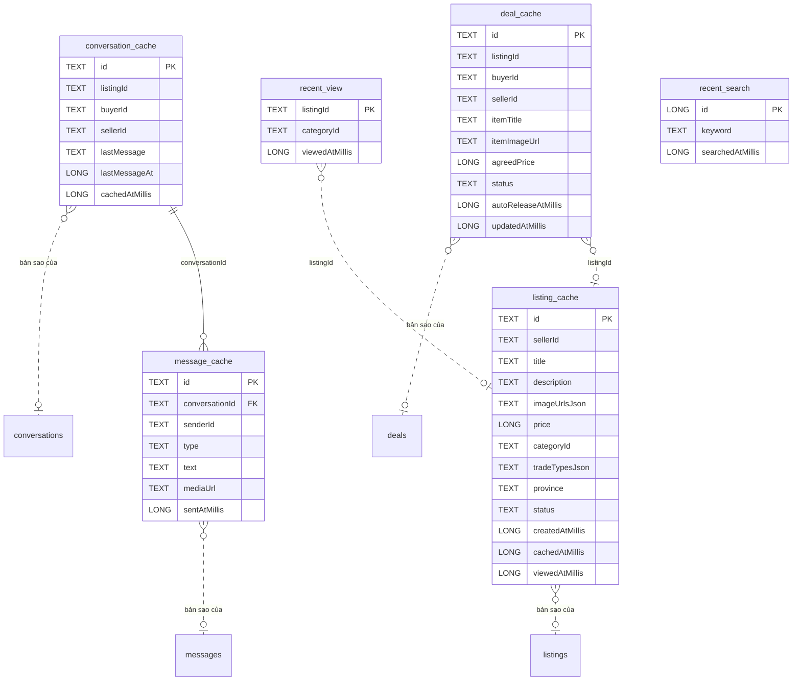

# Cấu trúc dữ liệu cục bộ (Room, SQLite)

Từ điển dữ liệu cho bộ nhớ đệm trên máy, khớp trang Room của [ERD](../diagrams/erd/README.md) và gói `data.local` trong [đặc tả lớp](../architecture/dac-ta-lop/data-local.md). **Room chưa được thêm vào build**; đây là thiết kế đã chốt.

Quy tắc:

- Room chỉ là **bộ nhớ đệm** để xem lại trang đã xem khi mất mạng; nguồn dữ liệu chính là Firestore. Repository đọc Room trước, gọi Firebase, rồi ghi lại vào Room. Không ghi thay đổi của người dùng vào Room để gửi sau.
- Chỉ repository được dùng DAO; mọi lệnh Room chạy ngoài luồng chính.
- Toàn bộ cơ sở dữ liệu bị xóa sạch khi đăng xuất.
- Enum lưu bằng tên hằng (chuỗi); danh sách lưu bằng chuỗi JSON qua `Converters`; thời gian lưu bằng mili giây.
- Đổi bảng hoặc cột đã có cần hỏi leader trước (R6), tăng phiên bản cơ sở dữ liệu và viết migration.

## Phiên bản cơ sở dữ liệu

Phiên bản **1** (thiết kế ban đầu). Tên tệp: hằng `AppDatabase.DB_NAME`.

## Tổng quan

| Bảng | Entity | Sao lưu từ | Mục đích | Chính sách giữ |
| --- | --- | --- | --- | --- |
| [`listing_cache`](#listing_cache) | `ListingEntity` | `listings` | Bản sao tin đăng. | Giữ 200 tin đệm mới nhất (`trim(200)` sau mỗi lần ghi). |
| [`conversation_cache`](#conversation_cache) | `ConversationEntity` | `conversations` | Bản sao cuộc trò chuyện. | Ghi đè mỗi lần tải danh sách chat. |
| [`message_cache`](#message_cache) | `MessageEntity` | `conversations/messages` | Bản sao tin nhắn. | Ghi tin nhắn mới nhận khi đang mở cuộc trò chuyện. |
| [`deal_cache`](#deal_cache) | `DealEntity` | `deals` | Bản sao giao dịch. | Ghi đè mỗi lần tải lịch sử giao dịch. |
| [`recent_view`](#recent_view) | `RecentViewEntity` | (chỉ trên máy) | Lịch sử xem, chỉ ở trên máy. | Mỗi tin một dòng; xem lại thì cập nhật thời điểm. Đọc 50 dòng mới nhất. |
| [`recent_search`](#recent_search) | `RecentSearchEntity` | (chỉ trên máy) | Lịch sử tìm kiếm, chỉ ở trên máy. | Mỗi lần tìm một dòng. Đọc 20 dòng mới nhất. |

## Quan hệ

| Bên trái | Bội số | Bên phải | Bội số | Qua cột |
| --- | --- | --- | --- | --- |
| `conversation_cache` | 1 | `message_cache` | 0..n | conversationId |
| `recent_view` | 0..n | `listing_cache` | 0..1 | listingId |
| `deal_cache` | 0..n | `listing_cache` | 0..1 | listingId |
| `conversation_cache` | 0..n | `conversations` | 0..1 | bản sao của |
| `message_cache` | 0..n | `messages` | 0..1 | bản sao của |
| `listing_cache` | 0..n | `listings` | 0..1 | bản sao của |
| `deal_cache` | 0..n | `deals` | 0..1 | bản sao của |

Chỉ `message_cache.conversationId` là khóa ngoại thật trong SQLite; các dòng "bản sao của" là quan hệ với Firestore, không phải khóa ngoại.

## listing_cache

- **Entity:** `ListingEntity`
- **Sao lưu từ:** listings
- **Chính sách giữ:** Giữ 200 tin đệm mới nhất (`trim(200)` sau mỗi lần ghi).

| Cột | Kiểu SQLite | Khóa | Ý nghĩa | Ghi chú |
| --- | --- | --- | --- | --- |
| `id` | TEXT | PK | Khóa chính, bằng mã tài liệu Firestore. |  |
| `sellerId` | TEXT |  | Bản sao `Listing.sellerId`. |  |
| `title` | TEXT |  | Bản sao `Listing.title`. |  |
| `description` | TEXT |  | Bản sao `Listing.description`. |  |
| `imageUrlsJson` | TEXT |  | Danh sách ảnh dạng chuỗi JSON. | danh sách lưu dạng chuỗi JSON (qua `Converters`) |
| `price` | LONG |  | Bản sao `Listing.price`. |  |
| `categoryId` | TEXT |  | Bản sao `Listing.categoryId`. |  |
| `tradeTypesJson` | TEXT |  | Danh sách hình thức giao dịch dạng chuỗi JSON. | danh sách lưu dạng chuỗi JSON (qua `Converters`) |
| `province` | TEXT |  | Bản sao `Listing.province`. |  |
| `status` | TEXT |  | Bản sao `Listing.status`. |  |
| `createdAtMillis` | LONG |  | Bản sao `Listing.createdAt`. | thời gian dạng mili giây |
| `cachedAtMillis` | LONG |  | Lúc ghi vào bộ nhớ đệm. | thời gian dạng mili giây |
| `viewedAtMillis` | LONG |  | Lúc người dùng mở chi tiết tin gần nhất; 0 nếu chỉ thấy trong bảng tin. | thời gian dạng mili giây |

## conversation_cache

- **Entity:** `ConversationEntity`
- **Sao lưu từ:** conversations
- **Chính sách giữ:** Ghi đè mỗi lần tải danh sách chat.

| Cột | Kiểu SQLite | Khóa | Ý nghĩa | Ghi chú |
| --- | --- | --- | --- | --- |
| `id` | TEXT | PK | Khóa chính, bằng mã tài liệu Firestore. |  |
| `listingId` | TEXT |  | Bản sao `Conversation.listingId`. |  |
| `buyerId` | TEXT |  | Bản sao `Conversation.buyerId`. |  |
| `sellerId` | TEXT |  | Bản sao `Conversation.sellerId`. |  |
| `lastMessage` | TEXT |  | Bản sao `Conversation.lastMessage`. |  |
| `lastMessageAt` | LONG |  | Bản sao `Conversation.lastMessageAt`. |  |
| `cachedAtMillis` | LONG |  |  | thời gian dạng mili giây |

## message_cache

- **Entity:** `MessageEntity`
- **Sao lưu từ:** conversations/messages
- **Chính sách giữ:** Ghi tin nhắn mới nhận khi đang mở cuộc trò chuyện.

| Cột | Kiểu SQLite | Khóa | Ý nghĩa | Ghi chú |
| --- | --- | --- | --- | --- |
| `id` | TEXT | PK | Khóa chính, bằng mã tài liệu Firestore. |  |
| `conversationId` | TEXT | FK | Bản sao `ChatMessage.conversationId`. | tham chiếu conversation_cache |
| `senderId` | TEXT |  | Bản sao `ChatMessage.senderId`. |  |
| `type` | TEXT |  | Bản sao `ChatMessage.type`. |  |
| `text` | TEXT |  | Bản sao `ChatMessage.text`. |  |
| `mediaUrl` | TEXT |  | Bản sao `ChatMessage.mediaUrl`. |  |
| `sentAtMillis` | LONG |  | Bản sao `ChatMessage.createdAt`. | thời gian dạng mili giây |

## deal_cache

- **Entity:** `DealEntity`
- **Sao lưu từ:** deals
- **Chính sách giữ:** Ghi đè mỗi lần tải lịch sử giao dịch.

| Cột | Kiểu SQLite | Khóa | Ý nghĩa | Ghi chú |
| --- | --- | --- | --- | --- |
| `id` | TEXT | PK | Khóa chính, bằng mã tài liệu Firestore. |  |
| `listingId` | TEXT |  | Bản sao `Deal.listingId`. |  |
| `buyerId` | TEXT |  | Bản sao `Deal.buyerId`. |  |
| `sellerId` | TEXT |  | Bản sao `Deal.sellerId`. |  |
| `itemTitle` | TEXT |  | Bản sao `Deal.itemTitle`. |  |
| `itemImageUrl` | TEXT |  | Bản sao `Deal.itemImageUrl`. |  |
| `agreedPrice` | LONG |  | Bản sao `Deal.agreedPrice`. |  |
| `status` | TEXT |  | Bản sao `Deal.status`. |  |
| `autoReleaseAtMillis` | LONG |  | Hạn đếm ngược, để hiện đồng hồ cả khi offline. | thời gian dạng mili giây |
| `updatedAtMillis` | LONG |  | Bản sao `Deal.updatedAt`. | thời gian dạng mili giây |

## recent_view

- **Entity:** `RecentViewEntity`
- **Sao lưu từ:** (chỉ trên máy)
- **Chính sách giữ:** Mỗi tin một dòng; xem lại thì cập nhật thời điểm. Đọc 50 dòng mới nhất.

| Cột | Kiểu SQLite | Khóa | Ý nghĩa | Ghi chú |
| --- | --- | --- | --- | --- |
| `listingId` | TEXT | PK |  |  |
| `categoryId` | TEXT |  |  |  |
| `viewedAtMillis` | LONG |  |  | thời gian dạng mili giây |

## recent_search

- **Entity:** `RecentSearchEntity`
- **Sao lưu từ:** (chỉ trên máy)
- **Chính sách giữ:** Mỗi lần tìm một dòng. Đọc 20 dòng mới nhất.

| Cột | Kiểu SQLite | Khóa | Ý nghĩa | Ghi chú |
| --- | --- | --- | --- | --- |
| `id` | LONG | PK |  |  |
| `keyword` | TEXT |  |  |  |
| `searchedAtMillis` | LONG |  |  | thời gian dạng mili giây |

## Truy vấn của DAO

| DAO | Phương thức | Câu lệnh |
| --- | --- | --- |
| `ListingDao` | `upsertAll(List<ListingEntity>): void` | `@Insert(onConflict = OnConflictStrategy.REPLACE)` |
| `ListingDao` | `getFeed(): List<ListingEntity>` | `SELECT * FROM listing_cache ORDER BY cachedAtMillis DESC` |
| `ListingDao` | `getById(String): ListingEntity` | `SELECT * FROM listing_cache WHERE id = :id` |
| `ListingDao` | `trim(int): void` | `DELETE FROM listing_cache WHERE id NOT IN (SELECT id FROM listing_cache ORDER BY cachedAtMillis DESC LIMIT :keep)` |
| `ChatDao` | `upsertConversations(List<ConversationEntity>): void` | `@Insert(onConflict = OnConflictStrategy.REPLACE)` |
| `ChatDao` | `getConversations(): List<ConversationEntity>` | `SELECT * FROM conversation_cache ORDER BY lastMessageAt DESC` |
| `ChatDao` | `upsertMessages(List<MessageEntity>): void` | `@Insert(onConflict = OnConflictStrategy.REPLACE)` |
| `ChatDao` | `getMessages(String): List<MessageEntity>` | `SELECT * FROM message_cache WHERE conversationId = :id ORDER BY sentAtMillis ASC` |
| `DealDao` | `upsertAll(List<DealEntity>): void` | `@Insert(onConflict = OnConflictStrategy.REPLACE)` |
| `DealDao` | `getMyDeals(String): List<DealEntity>` | `SELECT * FROM deal_cache WHERE buyerId = :uid OR sellerId = :uid ORDER BY updatedAtMillis DESC` |
| `HistoryDao` | `insertView(RecentViewEntity): void` | `@Insert(onConflict = OnConflictStrategy.REPLACE)` |
| `HistoryDao` | `getRecentViews(int): List<RecentViewEntity>` | `SELECT * FROM recent_view ORDER BY viewedAtMillis DESC LIMIT :limit` |
| `HistoryDao` | `insertSearch(RecentSearchEntity): void` | `@Insert` |
| `HistoryDao` | `getRecentSearches(int): List<RecentSearchEntity>` | `SELECT * FROM recent_search ORDER BY searchedAtMillis DESC LIMIT :limit` |
| `HistoryDao` | `clearAll(): void` | Hai câu `DELETE FROM recent_view` và `DELETE FROM recent_search`, chạy trong một transaction |
