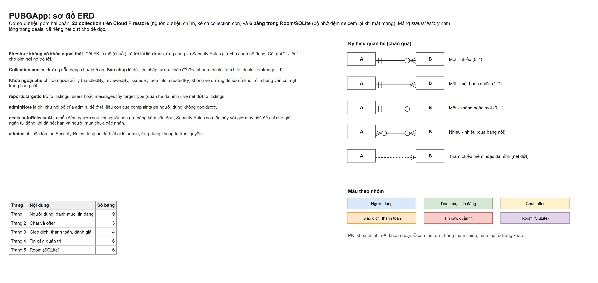
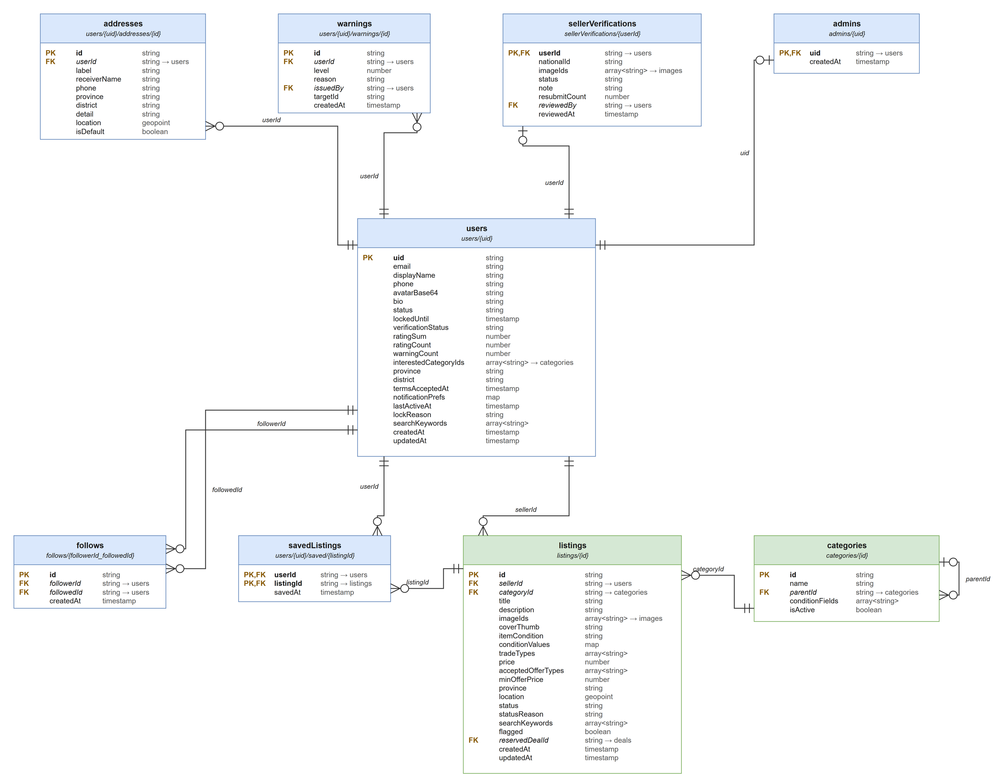
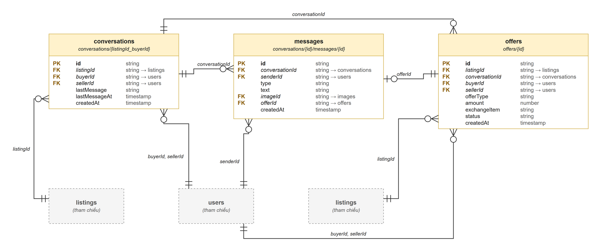
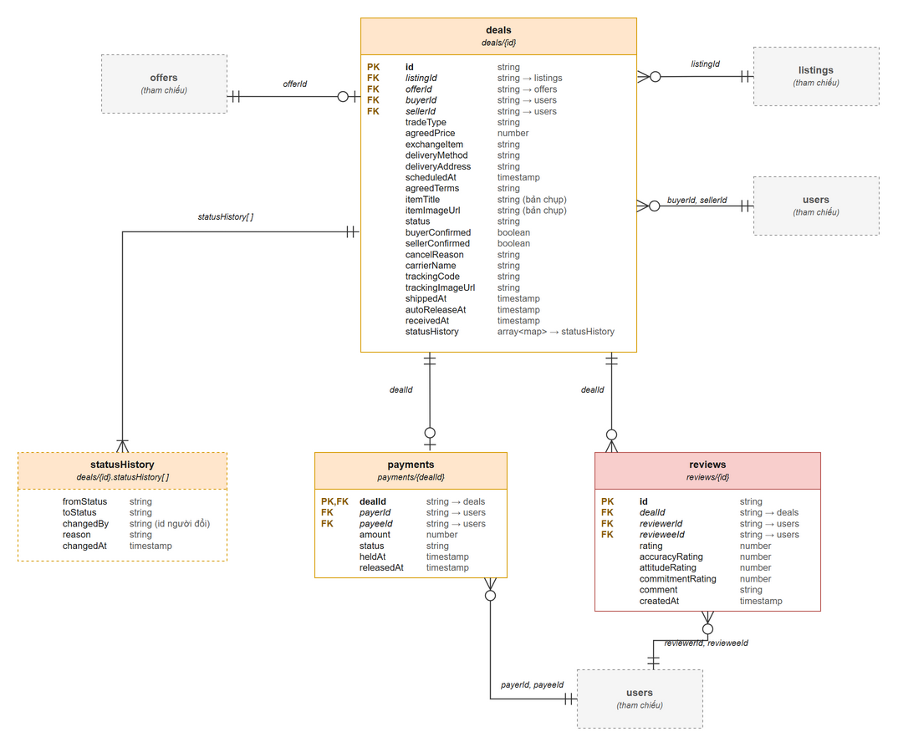
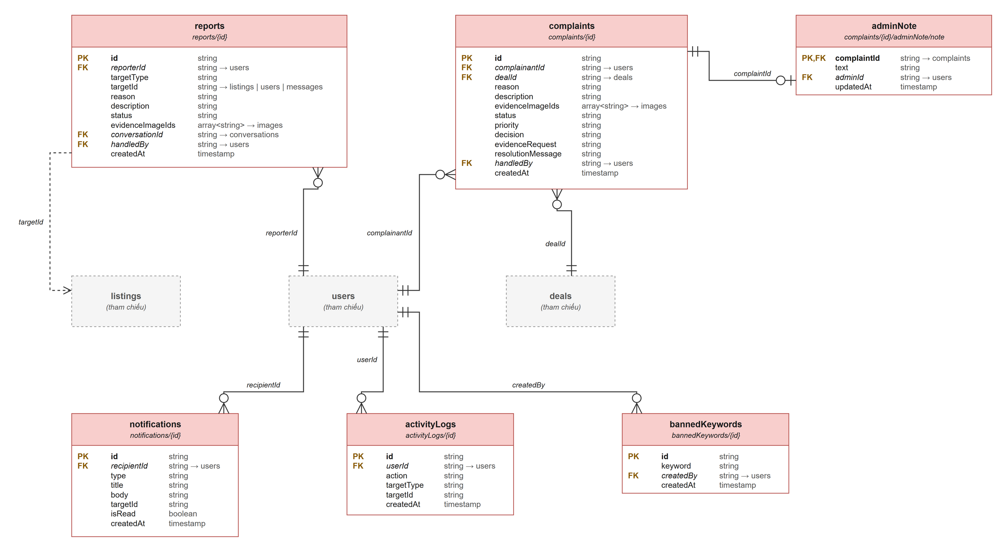
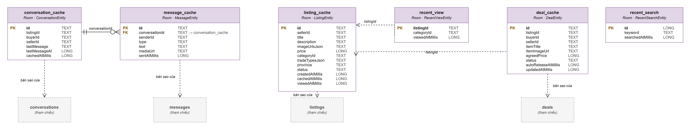

# Sơ đồ quan hệ thực thể (ERD)

Mô hình dữ liệu cho Cloud Firestore và Room (SQLite cục bộ), khớp các lớp ở [`../so-do-lop/`](../so-do-lop/README.md). Chi tiết từng trường nằm ở [`../../data/firestore-schema.md`](../../data/firestore-schema.md) và [`../../data/room-schema.md`](../../data/room-schema.md): đó là **bản chữ** của sơ đồ này, kèm quan hệ có bội số, ý nghĩa từng trường, truy vấn dự kiến và sơ đồ Mermaid. Khi code, đọc bản chữ; ảnh để người xem nhanh.

| Mục | Số lượng |
| --- | ---: |
| Collection Firestore (kể cả collection con) | 23 |
| Mảng lồng (`deals.statusHistory`) | 1 |
| Bảng Room | 6 |

Firestore không có khóa ngoại thật: cột FK là mã tài liệu khác, ứng dụng và Security Rules giữ quan hệ đúng. Hộp xám nét đứt trên sơ đồ là bảng tham chiếu, nằm thật ở trang khác.

## Trang 0. Tổng quan và chú giải

## Trang 1. Người dùng, danh mục, tin đăng

| Bảng | Đường dẫn | Mục đích |
| --- | --- | --- |
| `addresses` | `users/{uid}/addresses/{id}` | Địa chỉ giao nhận. |
| `warnings` | `users/{uid}/warnings/{id}` | Cảnh báo vi phạm theo bậc. |
| `sellerVerifications` | `sellerVerifications/{userId}` | Yêu cầu xác thực tài khoản: số CCCD, ảnh giấy tờ và ảnh chân dung cầm giấy tờ. |
| `admins` | `admins/{uid}` | Chỉ cần tồn tại: Security Rules dùng nó để nhận diện admin. Từ 2026-10-22 admin thêm và gỡ được tài liệu này ngay trong ứng dụng (UC42). |
| `users` | `users/{uid}` | Hồ sơ người dùng. |
| `follows` | `follows/{followerId_followedId}` | Theo dõi (quan hệ nhiều-nhiều tự thân của users). |
| `savedListings` | `users/{uid}/saved/{listingId}` | Tin đã lưu (quan hệ nhiều-nhiều). |
| `listings` | `listings/{id}` | Tin đăng. |
| `categories` | `categories/{id}` | Danh mục và danh mục con. |

| Khóa ngoại | Trỏ tới |
| --- | --- |
| `addresses.userId` | users |
| `warnings.userId` | users |
| `warnings.issuedBy` | users |
| `sellerVerifications.userId` | users |
| `sellerVerifications.reviewedBy` | users |
| `admins.uid` | users |
| `users.lastReviewId` | reviews |
| `follows.followerId` | users |
| `follows.followedId` | users |
| `savedListings.userId` | users |
| `savedListings.listingId` | listings |
| `listings.sellerId` | users |
| `listings.categoryId` | categories |
| `listings.reservedDealId` | deals |
| `categories.parentId` | categories |

## Trang 2. Chat và offer

| Bảng | Đường dẫn | Mục đích |
| --- | --- | --- |
| `conversations` | `conversations/{listingId_buyerId}` | Cuộc trò chuyện. |
| `messages` | `conversations/{id}/messages/{id}` | Tin nhắn. |
| `offers` | `offers/{id}` | Offer một chạm. |

| Khóa ngoại | Trỏ tới |
| --- | --- |
| `conversations.listingId` | listings |
| `conversations.buyerId` | users |
| `conversations.sellerId` | users |
| `messages.conversationId` | conversations |
| `messages.senderId` | users |
| `messages.imageId` | images |
| `messages.offerId` | offers |
| `offers.listingId` | listings |
| `offers.conversationId` | conversations |
| `offers.buyerId` | users |
| `offers.sellerId` | users |

## Trang 3. Giao dịch, thanh toán, đánh giá

| Bảng | Đường dẫn | Mục đích |
| --- | --- | --- |
| `deals` | `deals/{id}` | Giao dịch. |
| `statusHistory` | `deals/{id}.statusHistory[ ]` | Mảng nhúng trong deals, không phải collection riêng. |
| `payments` | `payments/{dealId}` | Khoản thanh toán mô phỏng do hệ thống giữ, không có ngân hàng. |
| `reviews` | `reviews/{id}` | Đánh giá đối tác. |

| Khóa ngoại | Trỏ tới |
| --- | --- |
| `deals.listingId` | listings |
| `deals.offerId` | offers |
| `deals.buyerId` | users |
| `deals.sellerId` | users |
| `deals.trackingImageId` | images |
| `deals.receivedImageId` | images |
| `payments.dealId` | deals |
| `payments.payerId` | users |
| `payments.payeeId` | users |
| `reviews.dealId` | deals |
| `reviews.reviewerId` | users |
| `reviews.revieweeId` | users |

## Trang 4. Tin cậy, quản trị

| Bảng | Đường dẫn | Mục đích |
| --- | --- | --- |
| `reports` | `reports/{id}` | Báo cáo vi phạm. |
| `complaints` | `complaints/{id}` | Khiếu nại. |
| `adminNote` | `complaints/{id}/adminNote/note` | Ghi chú nội bộ ở tài liệu con để người dùng không đọc được. |
| `notifications` | `notifications/{id}` | Thông báo. |
| `activityLogs` | `activityLogs/{id}` | Nhật ký hoạt động. |
| `bannedKeywords` | `bannedKeywords/{id}` | Từ khóa cấm. |

| Khóa ngoại | Trỏ tới |
| --- | --- |
| `reports.reporterId` | users |
| `reports.conversationId` | conversations |
| `reports.handledBy` | users |
| `complaints.complainantId` | users |
| `complaints.dealId` | deals |
| `complaints.handledBy` | users |
| `adminNote.complaintId` | complaints |
| `adminNote.adminId` | users |
| `notifications.recipientId` | users |
| `activityLogs.userId` | users |
| `bannedKeywords.createdBy` | users |

## Trang 5. Room (SQLite)

| Bảng | Đường dẫn | Mục đích |
| --- | --- | --- |
| `conversation_cache` | `Room · ConversationEntity` | Bản sao cuộc trò chuyện. |
| `message_cache` | `Room · MessageEntity` | Bản sao tin nhắn. |
| `listing_cache` | `Room · ListingEntity` | Bản sao tin đăng. |
| `recent_view` | `Room · RecentViewEntity` | Lịch sử xem, chỉ ở trên máy. |
| `deal_cache` | `Room · DealEntity` | Bản sao giao dịch. |
| `recent_search` | `Room · RecentSearchEntity` | Lịch sử tìm kiếm, chỉ ở trên máy. |

| Khóa ngoại | Trỏ tới |
| --- | --- |
| `message_cache.conversationId` | conversation_cache |
