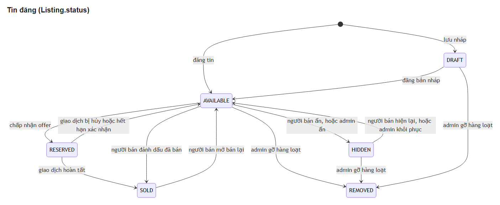
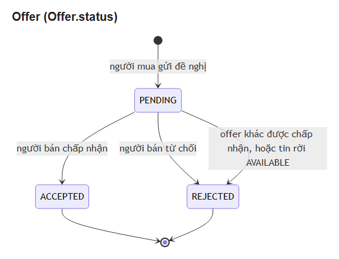
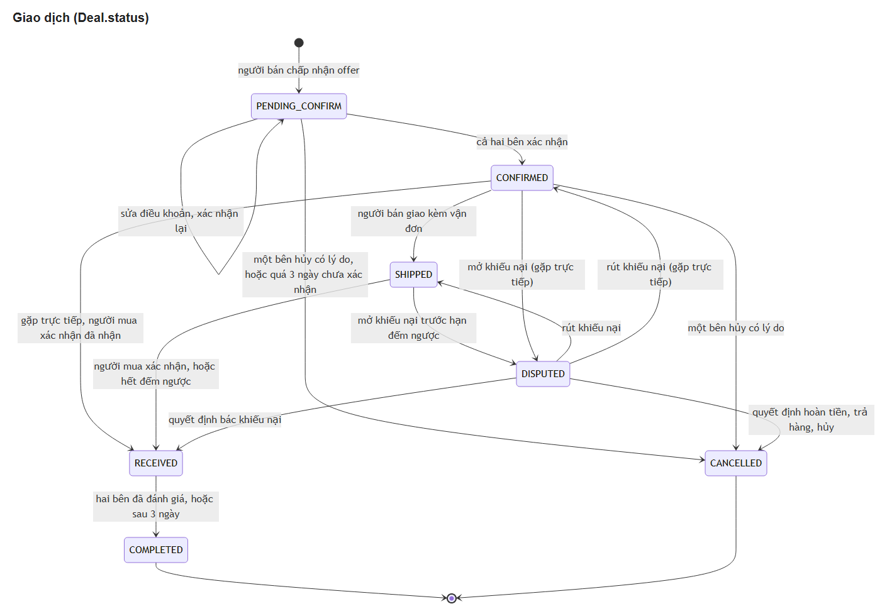
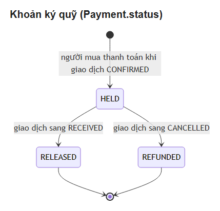
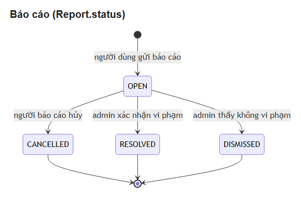
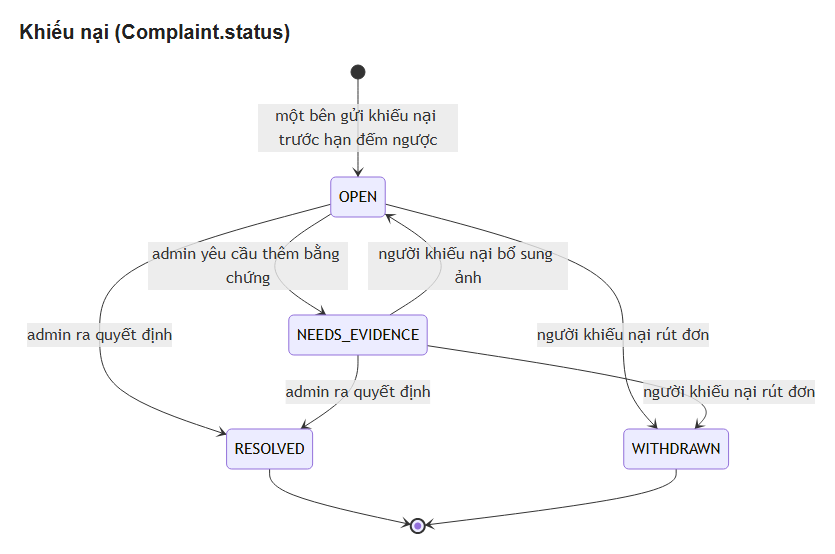
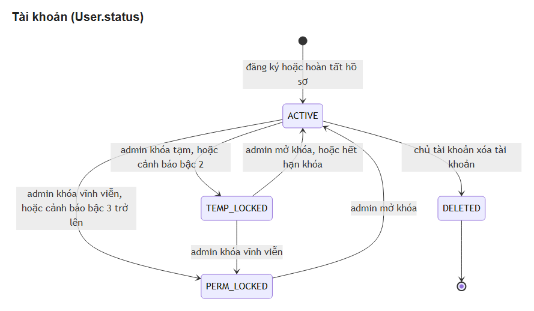
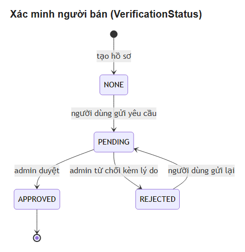

# Sơ đồ máy trạng thái

Tám đối tượng có trạng thái trong PUBGApp. Ảnh dưới đây vẽ từ các khối Mermaid trong [`../../architecture/trang-thai.md`](../../architecture/trang-thai.md); bảng chuyển trạng thái đầy đủ (ai, điều kiện, phương thức, hệ quả) nằm ở đó và là bản để code theo. Sửa trạng thái thì sửa tệp đó rồi vẽ lại ảnh.

| Đối tượng | Trường | Mục trong trang-thai.md |
| --- | --- | --- |
| Tin đăng | `Listing.status` | mục 1 |
| Offer | `Offer.status` | mục 2 |
| Giao dịch | `Deal.status` | mục 3 |
| Khoản ký quỹ | `Payment.status` | mục 4 |
| Báo cáo | `Report.status` | mục 5 |
| Khiếu nại | `Complaint.status` | mục 6 |
| Tài khoản | `User.status` | mục 7 |
| Xác thực tài khoản | `SellerVerification.status và User.verificationStatus` | mục 8 |

## Tin đăng

## Offer

## Giao dịch

## Khoản ký quỹ

## Báo cáo

## Khiếu nại

## Tài khoản

## Xác thực tài khoản

