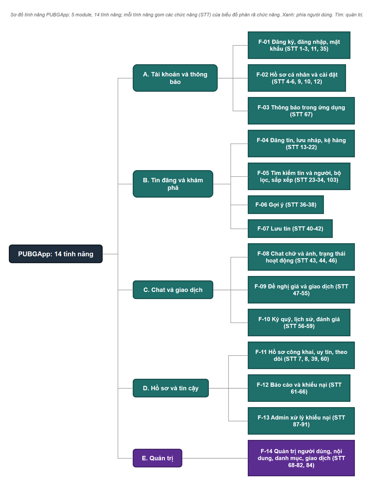

# Sơ đồ chức năng và sơ đồ tính năng

Hai góc nhìn khác nhau, vẽ riêng để không lẫn:

- **Biểu đồ phân rã chức năng** (`function-diagram`): hệ thống được chia thành phân hệ, nhóm chức năng, rồi chức năng. Mọi nút là một việc hệ thống làm, viết bằng cụm động từ. Mỗi lá là đúng một dòng Đợt này của [bảng đặc tả chức năng](../../product/dac-ta-chuc-nang.md), số đầu lá là STT.
- **Sơ đồ tính năng** (`feature-diagram`): 14 tính năng F-01 đến F-14 của [sổ tính năng](../../product/features.md), mỗi tính năng là một gói chức năng giao cho một người làm.

Không vẽ chức năng Phát triển sau. Tệp: `function-diagram.drawio`, `function-diagram.png`, `function-diagram.pdf`, `feature-diagram.drawio`, `feature-diagram.png`.

## Biểu đồ phân rã chức năng

| Phân hệ | Nhóm chức năng | Chức năng (STT) |
| --- | --- | --- |
| Phân hệ Người dùng | Quản lý tài khoản | 1. Đăng ký tài khoản; 2. Đăng nhập; 3. Đặt lại mật khẩu; 35. Chọn danh mục quan tâm; 11. Đổi mật khẩu; 12. Xóa tài khoản; 104. Đăng xuất |
| Phân hệ Người dùng | Quản lý hồ sơ cá nhân | 4. Sửa thông tin cá nhân; 5. Đổi ảnh đại diện; 6. Quản lý địa chỉ giao nhận; 9. Khai báo thông tin định danh; 10. Cài đặt thông báo; 7. Xem điểm đánh giá của mình; 8. Xem số liệu hồ sơ |
| Phân hệ Người dùng | Quản lý tin đăng | 16. Soạn nội dung và tình trạng món đồ; 17. Thêm ảnh cho tin; 18. Chọn hình thức giao dịch; 19. Đặt giá; 20. Cài đặt loại đề nghị và mức tối thiểu; 21. Chọn danh mục cho tin; 22. Lưu nháp tin; 13. Cập nhật tin trên kệ hàng; 14. Sắp xếp kệ hàng; 15. Ẩn hoặc hiện lại tin |
| Phân hệ Người dùng | Tìm kiếm | 23. Tìm tin theo từ khóa; 24. Lọc theo danh mục; 25. Lọc theo khoảng giá; 26. Lọc theo tình trạng; 27. Lọc theo khu vực và bán kính; 28. Lọc theo hình thức giao dịch; 31. Sắp xếp giá tăng dần; 32. Sắp xếp giá giảm dần; 33. Sắp xếp tin mới nhất; 34. Sắp xếp theo đánh giá người bán; 103. Tìm người dùng theo tên |
| Phân hệ Người dùng | Xem kênh tin và gợi ý | 29. Xem kênh chung; 30. Xem kênh đang theo dõi; 36. Xem tin tương tự; 37. Xem giá tham khảo; 38. Xem mục Dành cho bạn |
| Phân hệ Người dùng | Theo dõi và lưu tin | 39. Theo dõi người dùng khác; 40. Lưu tin; 41. Xem danh sách tin đã lưu; 42. Bỏ lưu tin |
| Phân hệ Người dùng | Nhắn tin và đề nghị giá | 43. Gửi tin nhắn chữ; 44. Gửi ảnh trong chat; 46. Xem trạng thái hoạt động; 47. Gửi đề nghị giá; 48. Chấp nhận đề nghị; 49. Từ chối đề nghị |
| Phân hệ Người dùng | Thực hiện giao dịch | 50. Xem chi tiết giao dịch; 51. Sửa điều khoản giao dịch; 52. Xác nhận giao dịch; 56. Thanh toán ký quỹ; 54. Xác nhận đã giao hàng; 53. Xác nhận đã nhận hàng; 55. Hủy giao dịch; 57. Xem lịch sử giao dịch; 58. Xem lịch sử thanh toán |
| Phân hệ Người dùng | Đánh giá và bảo vệ giao dịch | 59. Đánh giá đối tác; 60. Xem lịch sử đánh giá; 61. Báo cáo vi phạm; 62. Hủy báo cáo; 63. Xem và xuất lịch sử báo cáo; 64. Tạo khiếu nại; 65. Theo dõi khiếu nại; 66. Rút khiếu nại |
| Phân hệ Người dùng | Nhận thông báo | 67. Xem và đánh dấu thông báo |
| Phân hệ Quản trị | Quản lý người dùng | 68. Tìm và lọc người dùng; 69. Xem hồ sơ người dùng; 70. Khóa tài khoản; 71. Mở khóa tài khoản; 72. Cảnh báo theo bậc; 73. Duyệt xác thực tài khoản; 74. Xem nhật ký hoạt động |
| Phân hệ Quản trị | Kiểm duyệt nội dung | 75. Xem tin bị báo cáo; 76. Ẩn hoặc khôi phục tin; 77. Gỡ hàng loạt tin; 78. Quản lý từ khóa cấm |
| Phân hệ Quản trị | Quản lý danh mục | 79. Thêm, sửa, xóa danh mục; 80. Cấu hình thuộc tính tình trạng |
| Phân hệ Quản trị | Giám sát giao dịch | 81. Xem danh sách giao dịch; 82. Xem chi tiết giao dịch; 84. Theo dõi giải ngân tự động |
| Phân hệ Quản trị | Quản trị hệ thống | 106. Đăng nhập khu vực quản trị; 105. Thêm, gỡ quyền admin |
| Phân hệ Quản trị | Xử lý khiếu nại | 87. Xem danh sách khiếu nại; 88. Xem hồ sơ khiếu nại; 89. Ra quyết định xử lý; 90. Ghi chú nội bộ; 91. Gửi thông báo kết quả |

| Mục | Giá trị |
| --- | --- |
| Số chức năng được vẽ | 91 |
| Số chức năng Phát triển sau, không vẽ | 15 (STT 45, 83, 85, 86, 92, 93, 94, 95, 96, 97, 98, 99, 100, 101, 102) |

## Sơ đồ tính năng

