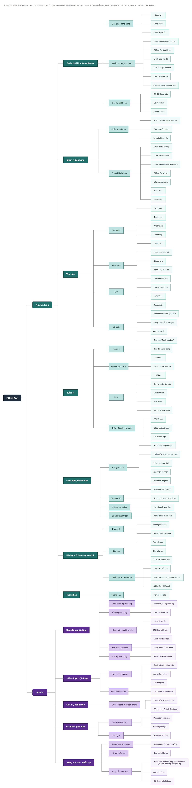

# Sơ đồ chức năng

Cây chức năng toàn hệ thống, vẽ ngang từ trái sang phải: PUBGApp, Người dùng và Admin, Module, Tên chức năng, Chức năng con. Sinh từ [bảng đặc tả chức năng](../../product/dac-ta-chuc-nang.md), chỉ vẽ chức năng **Đợt này**.

- `function-diagram.drawio`: file gốc, mở bằng draw.io.
- `function-diagram.png`: ảnh để xem nhanh.
- `function-diagram.pdf`: bản in chất lượng cao, dạng vector.

| Mục | Giá trị |
| --- | --- |
| Số chức năng được vẽ | 88 |
| Số chức năng phát triển sau, không vẽ | 14 (STT 83, 85, 86, 92 đến 102) |
| Nguồn đối chiếu | `product/dac-ta-chuc-nang.md` |
