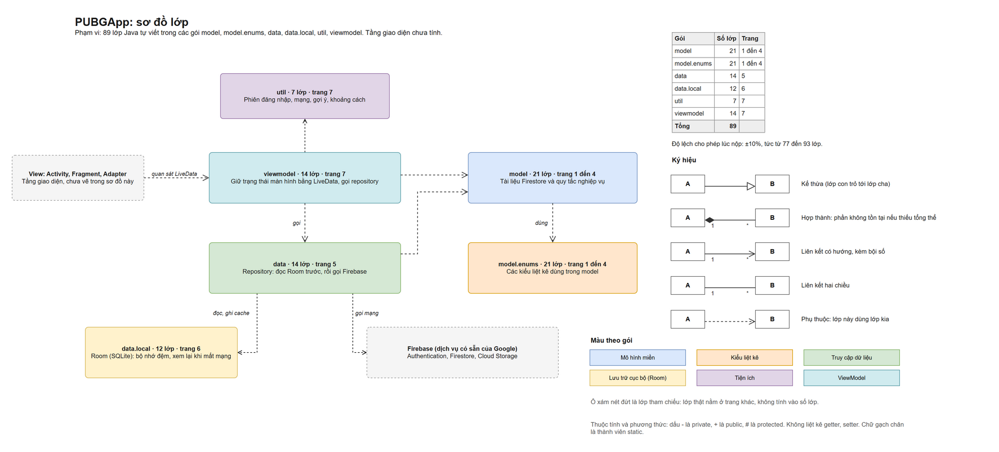
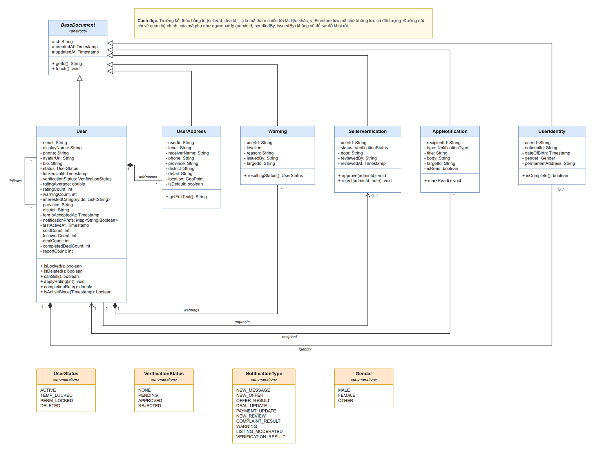
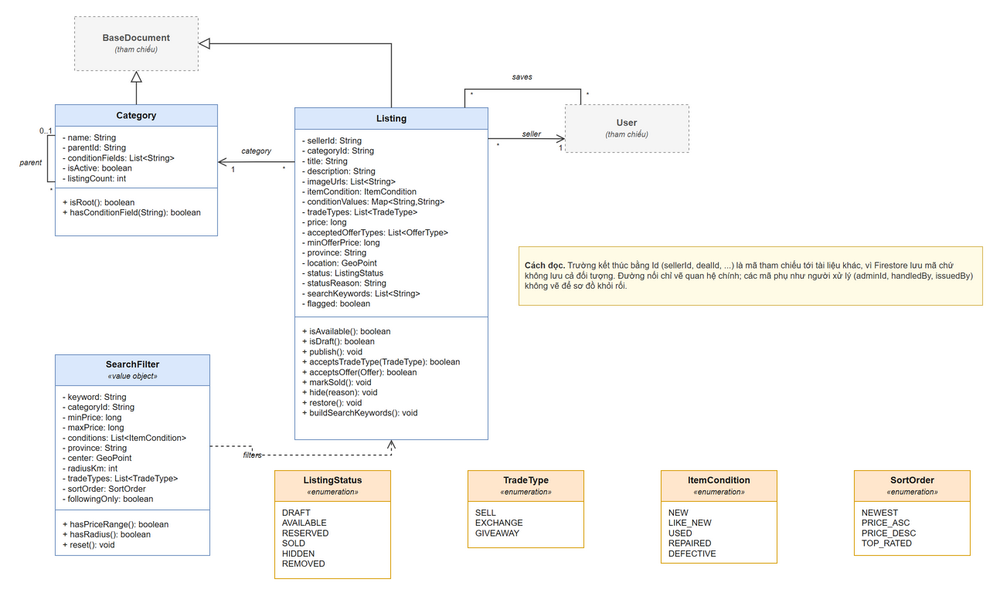
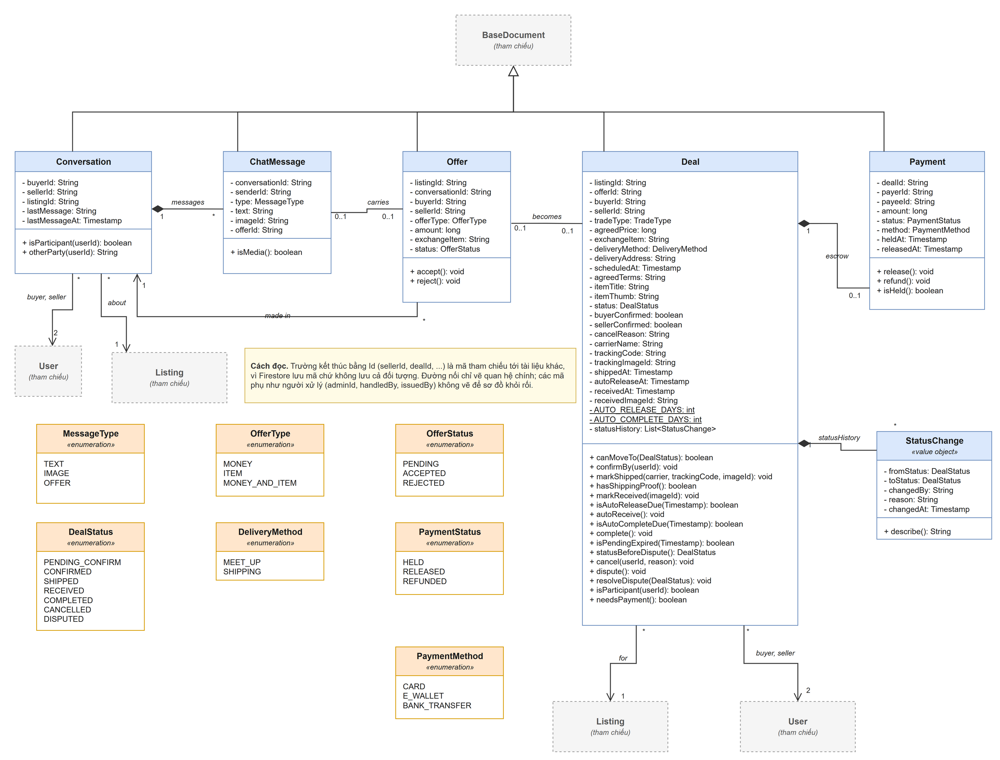
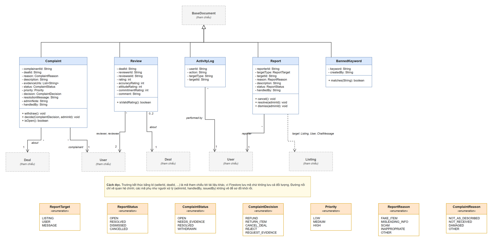
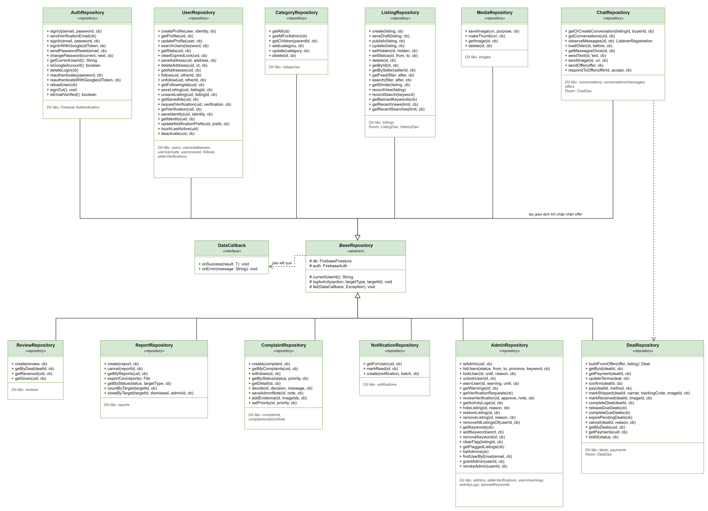
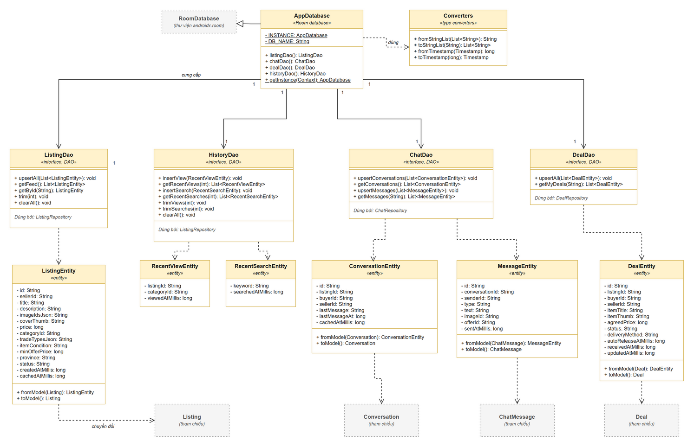
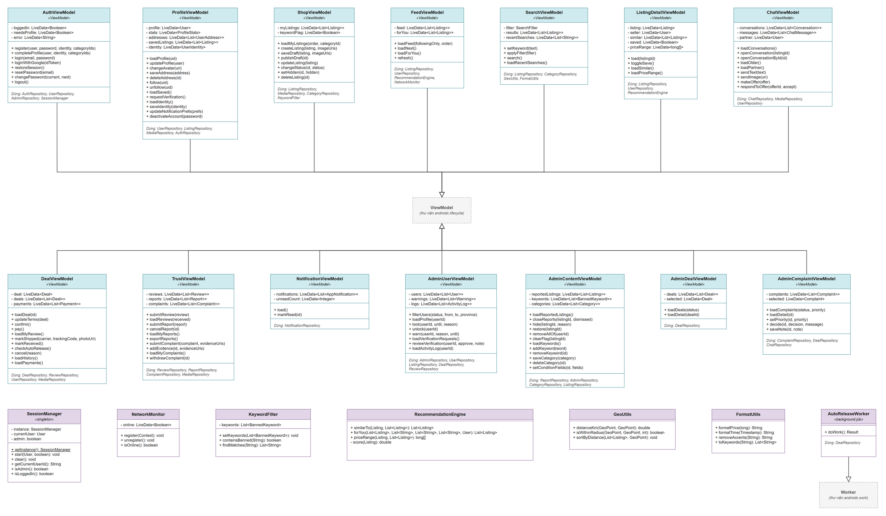

# Sơ đồ lớp

Sơ đồ lớp của PUBGApp: **89 lớp Java tự viết**, chia gói theo tầng (`AGENTS.md` mục 7). File gốc `class-diagram.drawio` mở bằng draw.io, mỗi trang là một tab ở đáy màn hình. Danh sách lớp kèm trách nhiệm và chức năng liên quan nằm ở [`../../analysis/du-kien-lop.md`](../../analysis/du-kien-lop.md).

**Bản chữ của sơ đồ này** (mọi thuộc tính, phương thức, quan hệ, sơ đồ Mermaid) ở [`../../architecture/dac-ta-lop/`](../../architecture/dac-ta-lop/README.md); máy trạng thái ở [`../../architecture/trang-thai.md`](../../architecture/trang-thai.md). Khi code, đọc bản chữ; ảnh để người xem nhanh.

Số chức năng nhắc trong tài liệu này là số STT của [bảng đặc tả chức năng](../../product/dac-ta-chuc-nang.md).

## 1. Kiến trúc: MVVM kết hợp Repository

Ứng dụng chỉ viết phần client (Android, Java); backend là Firebase. Phụ thuộc đi một chiều:

```
View (Activity, Fragment)  ->  ViewModel  ->  Repository  ->  Firebase (mạng)
                                                          ->  Room (bộ nhớ đệm SQLite)
model, model.enums, util: mọi tầng đều dùng
```

| Tầng | Gói | Số lớp | Vai trò |
| --- | --- | ---: | --- |
| View | (chưa vẽ) | 0 | Activity, Fragment, Adapter; vẽ ở giai đoạn code |
| ViewModel | `viewmodel` | 14 | Giữ trạng thái màn hình bằng LiveData, sống qua lần xoay màn hình, gọi repository |
| Truy cập dữ liệu | `data` | 14 | 12 repository kế thừa `BaseRepository`, cùng `BaseRepository` và `DataCallback`; đọc Room trước rồi gọi Firebase |
| Lưu trữ cục bộ | `data.local` | 12 | Room: cơ sở dữ liệu, bộ chuyển kiểu, 6 entity, 4 DAO |
| Mô hình miền | `model` | 21 | Tài liệu Firestore và quy tắc nghiệp vụ |
| Kiểu liệt kê | `model.enums` | 21 | Giá trị cố định của trạng thái, loại, lý do |
| Tiện ích | `util` | 7 | Phiên đăng nhập, mạng, lọc từ khóa, gợi ý, khoảng cách, định dạng, việc chạy nền |
| **Tổng** | | **89** | |

## 2. Các trang sơ đồ

### Trang 0. Tổng quan



### Trang 1. Người dùng



### Trang 2. Tin đăng, tìm kiếm



### Trang 3. Trao đổi, giao dịch



### Trang 4. Tin cậy, quản trị



### Trang 5. Tầng dữ liệu



### Trang 6. Lưu trữ cục bộ (Room)



### Trang 7. ViewModel và tiện ích



## 3. Thể hiện OOP

- **Kế thừa:** 18 lớp tài liệu kế thừa `BaseDocument`; 12 repository kế thừa `BaseRepository`; 14 ViewModel kế thừa `ViewModel` của AndroidX; `AppDatabase` kế thừa `RoomDatabase`; `AutoReleaseWorker` kế thừa `Worker`.
- **Đóng gói:** thuộc tính private; quy tắc nghiệp vụ nằm trong chính lớp (`Deal.canMoveTo`, `Warning.resultingStatus`, `Listing.acceptsOffer`, `User.completionRate`).
- **Trừu tượng hóa:** `DataCallback<T>` thay cho lambda theo luật viết code của nhóm; các DAO là interface.
- **Quan hệ:** hợp thành (`User` với `UserAddress`, `Warning`, `UserIdentity`; `Deal` với `StatusChange`, `Payment`; `Conversation` với `ChatMessage`), liên kết có bội số, phụ thuộc giữa các tầng.
- **Không tạo lớp thừa:** theo dõi và lưu tin chỉ là cặp mã nên là quan hệ nhiều-nhiều (ERD vẫn có bảng nối); `ChatMessage` dùng `MessageType` thay cho lớp con từng loại tin.

## 4. Luồng hoạt động chính

**Đăng tin.** `ShopViewModel` tạo `Listing` (hoặc lưu nháp với trạng thái `DRAFT`, đăng sau bằng `publish`), `KeywordFilter` gắn cờ nếu chứa từ khóa cấm, `MediaRepository` tải ảnh (tối đa 5), `ListingRepository` ghi Firestore. Người bán tự ẩn hoặc hiện lại tin bằng `setHidden`, dùng chung trạng thái `HIDDEN` với việc admin ẩn tin.

**Tìm kiếm và gợi ý.** Người mua tìm bằng `SearchFilter`; Firestore không tìm toàn văn nên từ khóa được bỏ dấu và lưu trong `searchKeywords`, còn bán kính do `GeoUtils` tính trên máy. `RecommendationEngine` tính tin tương tự, mục Dành cho bạn và khoảng giá tham khảo, hoàn toàn trên máy.

**Offer và giao dịch.** Người mua gửi `Offer` (tiền, vật, hoặc cả hai) trong `Conversation`; offer chỉ được chấp nhận hoặc từ chối. Người bán chấp nhận thì `DealRepository.createFromOffer` tạo `Deal`. Trạng thái: `PENDING_CONFIRM`, `CONFIRMED`, `SHIPPED`, `RECEIVED`, `COMPLETED`, cùng hai nhánh `CANCELLED` và `DISPUTED`; mỗi lần chuyển ghi một `StatusChange`.

**Gửi hàng kèm bằng chứng vận đơn.** `DealViewModel.markShipped(carrier, trackingCode, photoUri)` tải ảnh mã vận đơn lên qua `MediaRepository`, rồi `DealRepository.markShipped` ghi `carrierName`, `trackingCode`, `trackingImageUrl` và `shippedAt`. Thiếu một trong ba thứ thì `Deal.hasShippingProof()` sai và giao dịch không sang `SHIPPED`. Cùng lúc `autoReleaseAt = shippedAt + AUTO_RELEASE_DAYS` được đặt: mốc đếm ngược hiển thị cho cả hai bên.

**Nhận hàng, giải ngân và hoàn tất.** Sau khi giao dịch được xác nhận, người mua thanh toán và `Payment` ở trạng thái `HELD` (giao dịch không có tiền thì bỏ bước này; gặp trực tiếp thì không có bước giao và đếm ngược, xem `trang-thai.md`). Giao dịch sang `RECEIVED` theo một trong hai đường, đều tự động, admin không duyệt tay; `Payment` sang `RELEASED` ngay lúc đó:

1. Người mua bấm đã nhận hàng: `DealRepository.markReceived`.
2. Hết đếm ngược mà người mua chưa xác nhận: `DealRepository.releaseDueDeals` gọi `Deal.autoReceive()`.

Từ `RECEIVED`, giao dịch sang `COMPLETED` khi cả hai bên đã đánh giá, hoặc sau `AUTO_COMPLETE_DAYS` (3 ngày) kể từ `receivedAt` (`DealRepository.completeDueDeals`). Hủy trước khi giao hoặc khiếu nại được hoàn tiền thì `Payment` sang `REFUNDED`. Mở khiếu nại trước khi hết đếm ngược thì giao dịch sang `DISPUTED` và đếm ngược dừng. Đây là ký quỹ mô phỏng: không có cổng thanh toán thật, không có số dư ví.

**Vì sao có `AutoReleaseWorker`.** Đồ án không có máy chủ nên không ai chạy lệnh đúng lúc hết hạn. `AutoReleaseWorker` (WorkManager, chạy nền định kỳ) và bước kiểm tra khi mở ứng dụng (`DealViewModel.checkAutoRelease`) cùng gọi `releaseDueDeals` và `completeDueDeals`. Security Rules chặn phía máy chủ: chỉ cho giải ngân khi giờ của Firestore đã qua `autoReleaseAt`. Giới hạn: nếu không máy nào của hai bên chạy, việc giải ngân chậm tới lần mở ứng dụng kế tiếp.

**Tài khoản.** Đăng nhập bằng email và mật khẩu hoặc Google, không đăng nhập bằng số điện thoại. Thông tin định danh (số CCCD, ngày sinh, giới tính, địa chỉ thường trú) nằm ở `UserIdentity`, tài liệu con riêng tư chỉ chủ tài khoản và admin đọc được. Xóa tài khoản là vô hiệu hóa (`UserStatus.DELETED`): ẩn hồ sơ và tin, giữ lịch sử giao dịch và đánh giá cho đối tác.

**Tin cậy.** Mỗi bên đánh giá một lần sau giao dịch (`Review`: sao tổng thể và 3 tiêu chí). Báo cáo (`Report`) nhắm vào tin, người hoặc tin nhắn, có lý do chọn sẵn (`ReportReason`). Khiếu nại (`Complaint`) có lý do chọn sẵn (`ComplaintReason`), tối thiểu 1 ảnh bằng chứng, mức ưu tiên và quyết định của admin; ghi chú nội bộ `adminNote` nằm ở tài liệu con để người dùng không đọc được. Cảnh báo 3 bậc: `Warning.resultingStatus` cho bậc 1 chỉ cảnh báo, bậc 2 khóa tạm, bậc 3 khóa vĩnh viễn; quy tắc cố định, không cấu hình được.

**Quản trị.** Admin là người dùng có tài liệu trong `admins/{uid}`; Security Rules kiểm tra tài liệu này, ứng dụng không tự khai quyền. Mọi admin có cùng quyền.

## 5. Bảng truy vết: chức năng tới lớp

Mỗi chức năng **Đợt này** có ít nhất một lớp hoặc thành viên đáp ứng; mỗi lớp trỏ về ít nhất một chức năng hoặc thuộc nhóm hạ tầng ở mục 6. Chức năng **Phát triển sau** không có trong bảng này.

| STT | Chức năng | Lớp và thành viên |
| --- | --- | --- |
| 1 đến 3 | Đăng ký, đăng nhập, quên mật khẩu (kèm xác thực email và Google) | `AuthViewModel.register`, `AuthViewModel.login`, `AuthViewModel.loginWithGoogle`, `AuthViewModel.resetPassword`, `AuthRepository.signUp`, `AuthRepository.sendVerificationEmail`, `AuthRepository.signIn`, `AuthRepository.signInWithGoogle`, `AuthRepository.sendPasswordReset`, `SessionManager`, `User`, `User.termsAcceptedAt`, `UserIdentity.nationalId` |
| 4 | Chỉnh sửa thông tin cá nhân | `ProfileViewModel.updateProfile`, `UserRepository.updateProfile`, `User`, `User.province`, `User.district` |
| 5 | Chỉnh sửa ảnh hồ sơ | `ProfileViewModel.changeAvatar`, `MediaRepository.uploadImage`, `User.avatarUrl` |
| 6 | Chỉnh sửa địa chỉ | `ProfileViewModel.saveAddress`, `ProfileViewModel.deleteAddress`, `UserRepository.saveAddress`, `UserRepository.deleteAddress`, `UserAddress` |
| 7 | Xem đánh giá cá nhân công khai | `User.ratingAverage`, `User.ratingCount`, `ProfileViewModel.loadProfile`, `ReviewRepository.create` |
| 8 | Xem số liệu hồ sơ: Hiển thị số món đã bán, số người theo dõi, số giao dịch và tỷ lệ hoàn tất | `User.soldCount`, `User.followerCount`, `User.dealCount`, `User.completedDealCount`, `User.completionRate`, `ProfileViewModel.loadProfile` |
| 9 | Khai báo thông tin định danh: Khai báo số CCCD, ngày sinh, giới tính, địa chỉ thường trú để xác minh danh tính | `UserIdentity`, `Gender`, `ProfileViewModel.loadIdentity`, `ProfileViewModel.saveIdentity`, `UserRepository.saveIdentity`, `UserRepository.getIdentity` |
| 10 | Cài đặt thông báo: Bật hoặc tắt từng loại thông báo: tin nhắn mới, đề nghị giá mới, cập nhật giao dịch | `User.notificationPrefs`, `ProfileViewModel.updateNotificationPrefs`, `UserRepository.updateNotificationPrefs` |
| 11 | Đổi mật khẩu: Đổi mật khẩu sau khi nhập lại mật khẩu hiện tại | `AuthViewModel.changePassword`, `AuthRepository.changePassword` |
| 12 | Xóa tài khoản: Vô hiệu hóa tài khoản: ẩn hồ sơ và tin đăng, xóa thông tin đăng nhập, giữ lịch sử giao dịch và đánh giá cho đối tác | `ProfileViewModel.deactivateAccount`, `UserRepository.deactivate`, `AuthRepository.deleteLogin`, `User.isDeleted`, `UserStatus` |
| 13 | Quản lý kệ hàng: CRUD tin và trạng thái | `ShopViewModel.createListing`, `ShopViewModel.updateListing`, `ShopViewModel.changeStatus`, `ShopViewModel.deleteListing`, `ListingRepository.create`, `ListingRepository.update`, `ListingRepository.delete`, `Listing.markSold`, `ListingStatus` |
| 14 | Sắp xếp sản phẩm trên kệ theo danh mục, thời gian | `ShopViewModel.loadMyListings`, `ListingRepository.getBySeller`, `SortOrder` |
| 15 | Ẩn hoặc hiện lại tin: Người bán tạm ẩn tin của mình khỏi kênh xem và hiện lại khi muốn | `ShopViewModel.setHidden`, `ListingRepository.setHidden`, `Listing.hide`, `Listing.restore` |
| 16 | Chỉnh sửa nội dung bài đăng | `Listing.description`, `Listing.itemCondition`, `Listing.conditionValues`, `ItemCondition` |
| 17 | Thêm hình ảnh chụp từ phần mềm | `Listing.imageUrls`, `MediaRepository.uploadImage`, `ShopViewModel.createListing` |
| 18 | Hình thức giao dịch bán, trao đổi, cho tặng (kết hợp được) | `Listing.tradeTypes`, `Listing.acceptsTradeType`, `TradeType` |
| 19 | Chỉnh sửa giá cả | `Listing.price` |
| 20 | Offer mong muốn và giới hạn mức deal | `Listing.acceptedOfferTypes`, `Listing.minOfferPrice`, `Listing.acceptsOffer`, `OfferType` |
| 21 | Chọn danh mục cho món đồ | `Listing.categoryId`, `Category`, `CategoryRepository.getAll` |
| 22 | Lưu nháp: Lưu tin đang soạn dưới dạng nháp, chưa hiển thị cho người khác, đăng sau | `ShopViewModel.saveDraft`, `ShopViewModel.publishDraft`, `ListingRepository.saveDraft`, `Listing.isDraft`, `Listing.publish`, `ListingStatus` |
| 23 | Tìm kiếm theo từ khóa | `SearchViewModel.setKeyword`, `SearchViewModel.search`, `ListingRepository.search`, `Listing.searchKeywords`, `Listing.buildSearchKeywords`, `FormatUtils.removeAccents`, `FormatUtils.toKeywords`, `SearchFilter.keyword` |
| 24 | Lọc theo danh mục | `SearchFilter.categoryId`, `CategoryRepository.getChildren` |
| 25 | Lọc theo khoảng giá | `SearchFilter.minPrice`, `SearchFilter.maxPrice`, `SearchFilter.hasPriceRange` |
| 26 | Lọc theo tình trạng (nhiều lựa chọn) | `SearchFilter.conditions`, `ItemCondition` |
| 27 | Lọc theo khu vực và bán kính, ưu tiên bài gần | `SearchFilter.province`, `SearchFilter.center`, `SearchFilter.radiusKm`, `SearchFilter.hasRadius`, `GeoUtils.distanceKm`, `GeoUtils.isWithinRadius`, `GeoUtils.sortByDistance`, `Listing.location` |
| 28 | Lọc theo hình thức giao dịch | `SearchFilter.tradeTypes` |
| 29 | Kênh chung có đề xuất phù hợp | `FeedViewModel.loadFeed`, `FeedViewModel.loadNext`, `ListingRepository.getFeed`, `RecommendationEngine.forYou` |
| 30 | Kênh đang theo dõi | `SearchFilter.followingOnly`, `UserRepository.getFollowingIds`, `FeedViewModel.loadFeed` |
| 31 đến 34 | Sắp xếp giá thấp đến cao, cao đến thấp, mới đăng, đánh giá tốt | `SortOrder`, `SearchFilter.sortOrder`, `User.ratingAverage` |
| 35 | Chọn danh mục quan tâm khi đăng ký | `User.interestedCategoryIds`, `AuthViewModel.register` |
| 36 | Gợi ý sản phẩm tương tự | `RecommendationEngine.similarTo`, `ListingDetailViewModel.loadSimilar`, `ListingRepository.getSimilar` |
| 37 | Giá tham khảo: Hiển thị khoảng giá tham khảo khi xem chi tiết tin, tính từ các tin tương tự cùng danh mục và tình trạng | `ListingDetailViewModel.loadPriceRange`, `RecommendationEngine.priceRange` |
| 38 | Mục Dành cho bạn từ lịch sử xem, tìm kiếm, tin đã lưu | `FeedViewModel.loadForYou`, `RecommendationEngine.forYou`, `RecentViewEntity`, `RecentSearchEntity`, `HistoryDao`, `ListingRepository.recordView`, `ListingRepository.recordSearch`, `SearchViewModel.loadRecentSearches` |
| 39 | Theo dõi người dùng khác | `ProfileViewModel.follow`, `ProfileViewModel.unfollow`, `UserRepository.follow`, `UserRepository.unfollow` |
| 40 đến 42 | Lưu tin, xem danh sách đã lưu, bỏ lưu | `ListingDetailViewModel.toggleSave`, `ProfileViewModel.loadSaved`, `UserRepository.saveListing`, `UserRepository.unsaveListing`, `UserRepository.getSavedIds` |
| 43 đến 45 | Chat: gửi chữ, ảnh, video | `ChatViewModel.sendText`, `ChatViewModel.sendImage`, `ChatViewModel.sendVideo`, `ChatRepository.sendText`, `ChatRepository.sendMedia`, `ChatMessage`, `Conversation`, `MessageType`, `MediaRepository.uploadVideo`, `ChatDao`, `ConversationEntity`, `MessageEntity` |
| 46 | Trạng thái hoạt động: Hiển thị người đối thoại đang hoạt động hay thời điểm hoạt động gần nhất | `ChatViewModel.loadPartner`, `User.lastActiveAt`, `User.isActiveSince`, `UserRepository.touchLastActive` |
| 47 đến 49 | Offer một chạm: đề nghị, chấp nhận, từ chối | `ChatViewModel.makeOffer`, `ChatViewModel.respondToOffer`, `ChatRepository.sendOffer`, `ChatRepository.respondToOffer`, `Offer.accept`, `Offer.reject`, `OfferStatus`, `NotificationType` |
| 50 | Tạo giao dịch và xem thông tin giao dịch | `DealRepository.createFromOffer`, `DealViewModel.loadDeal`, `Deal`, `DeliveryMethod`, `Deal.itemTitle`, `Deal.agreedTerms` |
| 51 | Chỉnh sửa thông tin giao dịch | `DealViewModel.updateTerms`, `DealRepository.updateTerms` |
| 52 | Xác nhận giao dịch | `DealViewModel.confirm`, `DealRepository.confirm`, `Deal.confirmBy`, `Deal.canMoveTo`, `DealStatus` |
| 53 | Xác nhận đã nhận (giải ngân tự động cho người bán) | `DealViewModel.markReceived`, `DealRepository.markReceived`, `Deal.markReceived`, `Deal.receivedAt`, `Payment.release`, `Deal.isAutoCompleteDue`, `Deal.complete`, `Deal.AUTO_COMPLETE_DAYS`, `DealRepository.completeDueDeals` |
| 54 | Xác nhận đã giao, kèm ảnh mã vận đơn và thông tin đơn vị vận chuyển; bắt đầu đếm ngược | `DealViewModel.markShipped`, `DealRepository.markShipped`, `Deal.markShipped`, `Deal.carrierName`, `Deal.trackingCode`, `Deal.trackingImageUrl`, `Deal.shippedAt`, `Deal.autoReleaseAt`, `Deal.hasShippingProof`, `Deal.AUTO_RELEASE_DAYS`, `MediaRepository.uploadImage` |
| 55 | Hủy giao dịch có lý do (hoàn tiền nếu đang giữ) | `DealViewModel.cancel`, `DealRepository.cancel`, `Deal.cancel`, `Deal.cancelReason`, `Payment.refund` |
| 56 | Thanh toán qua bên thứ ba (ký quỹ mô phỏng) | `DealViewModel.pay`, `DealRepository.pay`, `Payment`, `PaymentStatus`, `Deal.needsPayment` |
| 57 | Lịch sử giao dịch | `DealViewModel.loadHistory`, `DealRepository.getMyDeals`, `DealDao`, `DealEntity` |
| 58 | Lịch sử thanh toán | `DealViewModel.loadPayments`, `DealRepository.getPayments` |
| 59 | Đánh giá đối tác | `TrustViewModel.submitReview`, `ReviewRepository.create`, `Review`, `Review.isValidRating`, `Review.accuracyRating`, `Review.attitudeRating`, `Review.commitmentRating`, `User.applyRating` |
| 60 | Xem lịch sử đánh giá đã nhận và đã cho | `TrustViewModel.loadReviews`, `ReviewRepository.getReceived`, `ReviewRepository.getGiven` |
| 61 | Tạo báo cáo | `TrustViewModel.submitReport`, `ReportRepository.create`, `Report`, `ReportTarget`, `Report.reason`, `ReportReason`, `Report.description` |
| 62 | Hủy báo cáo | `TrustViewModel.cancelReport`, `ReportRepository.cancel`, `Report.cancel`, `ReportStatus` |
| 63 | Xem và xuất lịch sử báo cáo | `TrustViewModel.loadMyReports`, `TrustViewModel.exportReports`, `ReportRepository.getMyReports`, `ReportRepository.exportCsv` |
| 64 | Tạo đơn khiếu nại kèm bằng chứng | `TrustViewModel.submitComplaint`, `ComplaintRepository.create`, `Complaint`, `Complaint.evidenceUrls`, `Complaint.reason`, `ComplaintReason` |
| 65 | Theo dõi tình trạng khiếu nại | `TrustViewModel.loadMyComplaints`, `ComplaintRepository.getMyComplaints`, `ComplaintStatus` |
| 66 | Gỡ bỏ đơn khiếu nại | `TrustViewModel.withdrawComplaint`, `ComplaintRepository.withdraw`, `Complaint.withdraw` |
| 67 | Xem thông báo: Xem danh sách thông báo về đề nghị giá, giao dịch, tin nhắn, đánh giá, khiếu nại, cảnh báo; đánh dấu đã đọc | `NotificationViewModel.load`, `NotificationViewModel.markRead`, `NotificationRepository.getForUser`, `NotificationRepository.markRead`, `AppNotification`, `NotificationType` |
| 68 | Admin: danh sách và lọc người dùng | `AdminUserViewModel.filterUsers`, `AdminRepository.listUsers`, `UserStatus` |
| 69 | Admin: xem hồ sơ người dùng | `AdminUserViewModel.loadProfile`, `AdminRepository.getWarnings` |
| 70, 71 | Admin: khóa và mở khóa tài khoản | `AdminUserViewModel.lock`, `AdminUserViewModel.unlock`, `AdminRepository.lockUser`, `AdminRepository.unlockUser`, `User.isLocked`, `User.lockedUntil` |
| 72 | Admin: cảnh báo theo bậc | `AdminUserViewModel.warn`, `AdminRepository.warnUser`, `Warning`, `Warning.resultingStatus`, `User.warningCount` |
| 73 | Admin: duyệt yêu cầu xác minh người bán | `AdminUserViewModel.loadVerificationRequests`, `AdminUserViewModel.reviewVerification`, `AdminRepository.getVerificationRequests`, `AdminRepository.reviewVerification`, `SellerVerification`, `VerificationStatus`, `User.canSell`, `UserRepository.requestVerification`, `ProfileViewModel.requestVerification` |
| 74 | Admin: nhật ký hoạt động của một tài khoản | `AdminUserViewModel.loadActivityLog`, `AdminRepository.getActivityLogs`, `ActivityLog`, `BaseRepository.logActivity` |
| 75 | Admin: xử lý tin bị báo cáo | `AdminContentViewModel.loadReportedListings`, `AdminContentViewModel.closeReports`, `ReportRepository.getByStatus`, `ReportRepository.countByTarget`, `ReportRepository.closeByTarget`, `Report.resolve`, `Report.dismiss` |
| 76 | Admin: ẩn, gỡ và khôi phục tin | `AdminContentViewModel.hide`, `AdminContentViewModel.restore`, `AdminRepository.hideListing`, `AdminRepository.restoreListing`, `Listing.hide`, `Listing.restore`, `Listing.statusReason` |
| 77 | Admin: gỡ hàng loạt tin của tài khoản bị khóa | `AdminContentViewModel.removeAllOf`, `AdminRepository.removeAllListingsOf` |
| 78 | Admin: lọc từ khóa cấm | `AdminContentViewModel.addKeyword`, `AdminContentViewModel.removeKeyword`, `AdminRepository.addKeyword`, `AdminRepository.removeKeyword`, `AdminRepository.getKeywords`, `BannedKeyword`, `KeywordFilter`, `Listing.flagged`, `ShopViewModel.createListing` |
| 79 | Admin: quản lý danh mục và danh mục con | `AdminContentViewModel.saveCategory`, `AdminContentViewModel.deleteCategory`, `CategoryRepository.add`, `CategoryRepository.update`, `CategoryRepository.delete`, `Category.parentId`, `Category.isRoot`, `Category.listingCount` |
| 80 | Admin: cấu hình thuộc tính tình trạng theo danh mục | `AdminContentViewModel.setConditionFields`, `Category.conditionFields`, `Category.hasConditionField`, `Listing.conditionValues` |
| 81 | Admin: theo dõi danh sách giao dịch theo trạng thái | `AdminDealViewModel.loadDeals`, `DealRepository.listAll` |
| 82 | Admin: chi tiết giao dịch kèm statusHistory | `AdminDealViewModel.loadDetail`, `Deal.statusHistory`, `StatusChange` |
| 84 | Giải ngân tự động: khi người mua nhận hàng, hoặc khi hết thời hạn đếm ngược mà người mua chưa xác nhận | `Payment.release`, `DealRepository.markReceived`, `DealRepository.releaseDueDeals`, `Deal.isAutoReleaseDue`, `Deal.autoReceive`, `DealViewModel.checkAutoRelease`, `AutoReleaseWorker`, `PaymentStatus`, `DealEntity.autoReleaseAtMillis` |
| 87 | Admin: danh sách khiếu nại, phân loại ưu tiên | `AdminComplaintViewModel.loadComplaints`, `ComplaintRepository.getByStatus`, `Complaint.priority`, `Priority` |
| 88 | Admin: hồ sơ khiếu nại (chat, bằng chứng, giao dịch) | `AdminComplaintViewModel.loadDetail`, `ComplaintRepository.getDetail` |
| 89 | Admin: ra quyết định xử lý khiếu nại | `AdminComplaintViewModel.decide`, `ComplaintRepository.decide`, `Complaint.decide`, `ComplaintDecision`, `Complaint.decision` |
| 90 | Admin: ghi chú nội bộ không hiện cho người dùng | `AdminComplaintViewModel.saveNote`, `ComplaintRepository.saveAdminNote`, `Complaint.adminNote` |
| 91 | Gửi thông báo kết quả cho các bên | `AdminComplaintViewModel.notifyParties`, `NotificationRepository.create`, `NotificationViewModel.load`, `NotificationViewModel.markRead`, `NotificationRepository.getForUser`, `NotificationRepository.markRead`, `AppNotification` |

## 6. Lớp hạ tầng (không gắn riêng một chức năng)

| Lớp | Lý do tồn tại |
| --- | --- |
| `BaseDocument` | Lớp cha chung của 18 lớp tài liệu (mã, thời điểm tạo và sửa). |
| `BaseRepository` | Lớp cha chung của 12 repository (kết nối Firebase, nhật ký, xử lý lỗi). |
| `DataCallback` | Giao diện gọi lại dùng chung thay cho lambda (luật viết code của nhóm). |
| `AppDatabase` | Điểm vào Room, bắt buộc để có bộ nhớ đệm SQLite (yêu cầu môn học). |
| `Converters` | Bắt buộc để Room lưu danh sách và thời gian. |
| `NetworkMonitor` | Cho biết đang online hay offline để chọn nguồn dữ liệu (yêu cầu offline của môn học). |
| `ListingDao` | Truy vấn bảng cache tin đăng. |
| `ChatDao` | Truy vấn bảng cache chat. |
| `ListingEntity` | Bảng cache tin đăng. |

## 7. Giới hạn đã biết

- Tầng giao diện (Activity, Fragment, Adapter) chưa nằm trong sơ đồ, vẽ ở giai đoạn code.
- Các chức năng **Phát triển sau** sẽ thêm lớp khi làm: phân quyền admin, bảng số liệu, tham số vận hành, nội dung tĩnh, phiên đăng nhập admin.
- Không có máy chủ riêng nên không có thông báo đẩy khi ứng dụng đóng.
- Điểm đánh giá, bộ đếm hồ sơ và giải ngân do ứng dụng kích hoạt, chỉ được bảo vệ bằng Security Rules.
- Tìm kiếm chỉ khớp theo từng từ; bán kính tính trên máy nên chỉ hợp quy mô đồ án.
