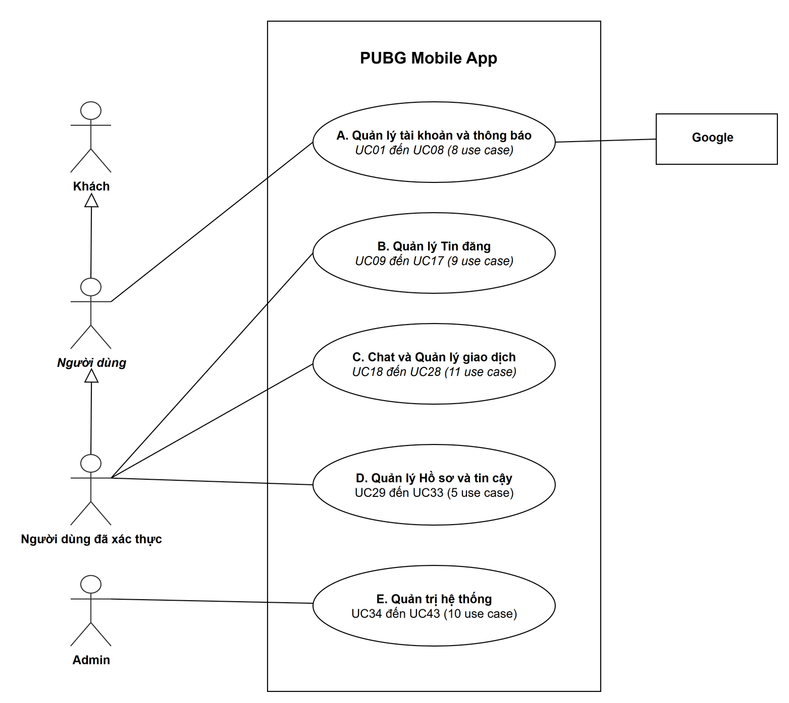
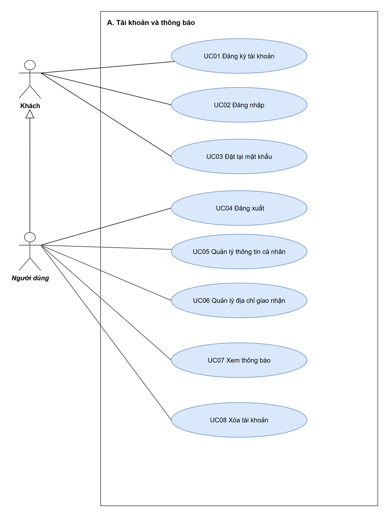
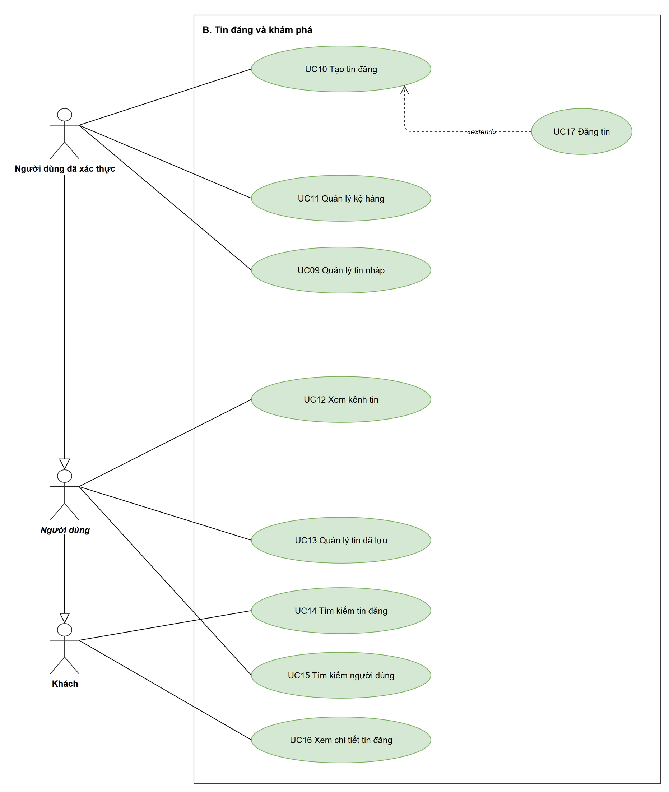
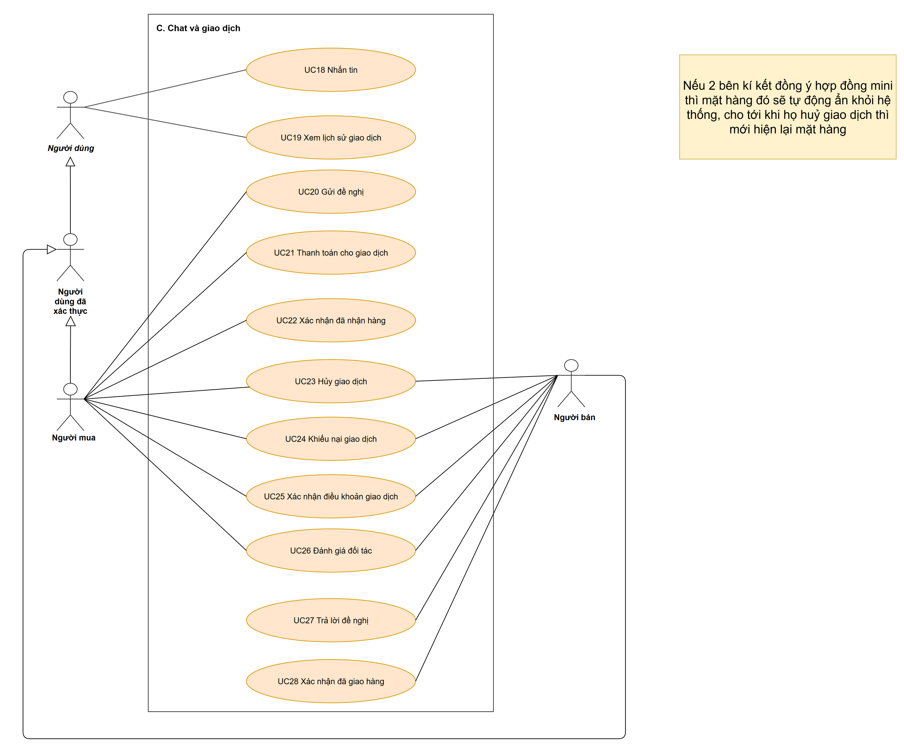
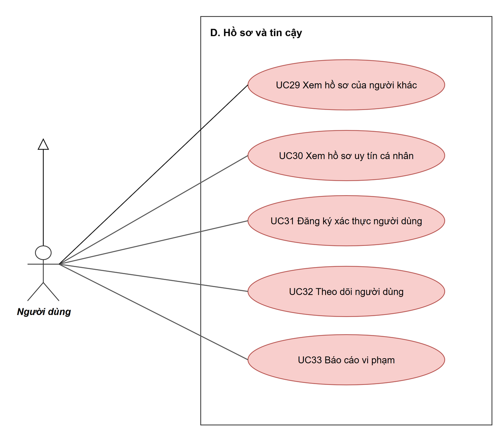
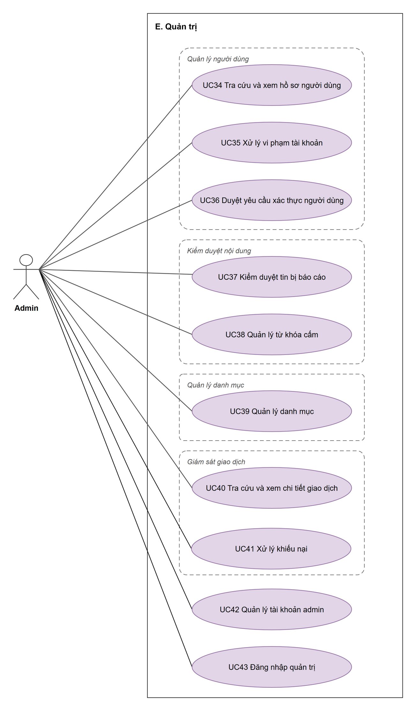

# Sơ đồ use case

Sơ đồ use case UML của PUBGApp: 1 trang tổng quan và 5 trang theo module, 43 use case. Bản chữ (danh sách, tác nhân, đặc tả từng use case) ở [`../../product/use-case/`](../../product/use-case/README.md); khi code, đọc bản chữ.

**Sơ đồ này do nhóm vẽ tay bằng draw.io, không sinh tự động.** Tệp gốc là `local/USE CASE DIAGRAM/USE CASE.drawio.xml`; sửa ở đó rồi xuất lại ảnh, đừng sửa bản sao trong thư mục này. Đừng chạy `build_uc.py` hay `run_uc.py`: hai script đó dựng lại sơ đồ từ đầu và làm mất bố cục.

- `use-case-diagram.drawio`: tệp gốc, mở bằng draw.io.
- Ảnh từng trang bên dưới.

## 0. Tổng quan: tác nhân và năm module

## A. Tài khoản và thông báo

## B. Tin đăng và khám phá

## C. Chat và giao dịch

## D. Hồ sơ và tin cậy

## E. Quản trị

