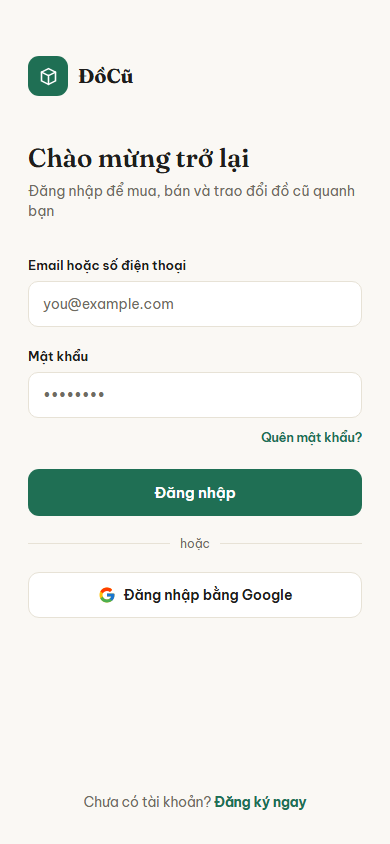
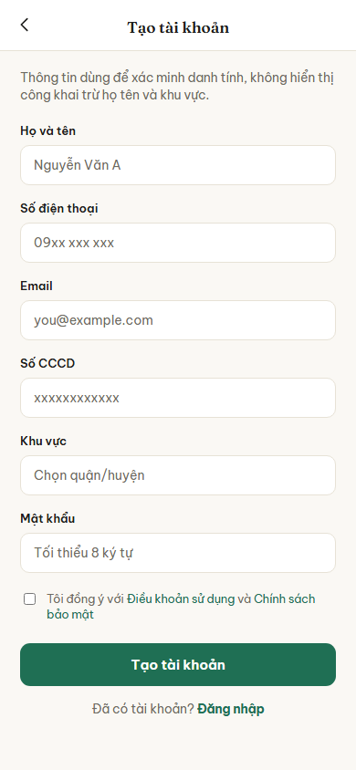
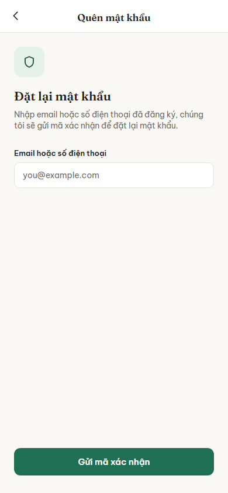
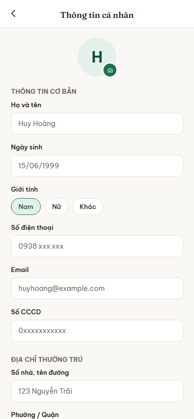
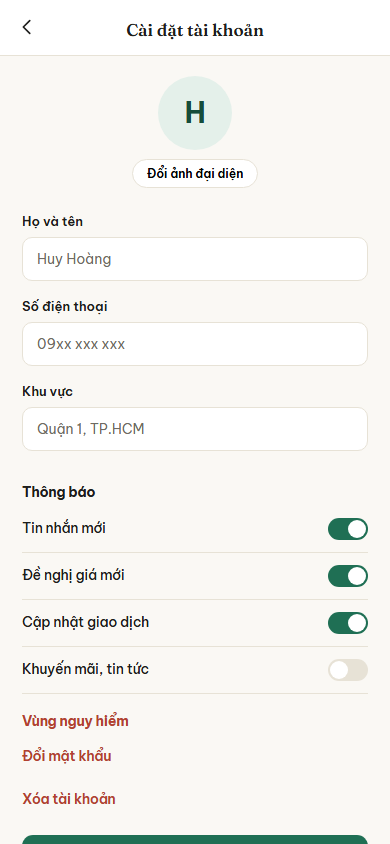
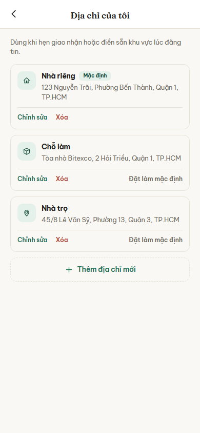

# Nhóm A: Tài khoản và thông tin cá nhân

6 màn hình, nộp theo 3 đợt: đợt 1 một màn (A01), đợt 2 hai màn (A02, A03), đợt 3 ba màn (A04, A05, A06). Số trong tài liệu là STT của [bảng đặc tả chức năng](../../product/dac-ta-chuc-nang.md). Điều hướng chung ở [README giao diện](../README.md#điều-hướng).

## A01. Đăng nhập

**Ảnh:** 

**Lớp:** `LoginFragment` trong `AuthActivity`. Không có thanh điều hướng dưới.

**Mục đích:** Cho người dùng đã có tài khoản vào ứng dụng, bằng email và mật khẩu, hoặc bằng tài khoản Google. Không đăng nhập bằng số điện thoại.

**Thành phần chính:**
- Logo và tên ứng dụng ĐồCũ
- Tiêu đề "Chào mừng trở lại" và một dòng giới thiệu ngắn
- Ô nhập "Email"
- Ô nhập "Mật khẩu", có thể ẩn hiện ký tự
- Liên kết "Quên mật khẩu?" nằm dưới ô mật khẩu, canh phải
- Nút "Đăng nhập" là nút chính
- Đường kẻ phân cách với chữ "hoặc"
- Nút "Đăng nhập bằng Google" có biểu tượng Google
- Dòng cuối trang: "Chưa có tài khoản? Đăng ký ngay"

**Hành động và điều hướng:**
- Bấm "Đăng nhập" khi đúng thông tin: vào `MainActivity`, màn B01 Trang chủ. Tài khoản admin cũng vào B01; khu vực quản trị mở từ D01
- Bấm "Đăng nhập bằng Google": chọn tài khoản Google. Nếu đã có hồ sơ thì vào B01. Nếu là lần đầu (chưa có hồ sơ) thì sang A02 ở chế độ "hoàn tất hồ sơ"
- Bấm "Quên mật khẩu?": sang A03 Quên mật khẩu
- Bấm "Đăng ký ngay": sang A02 Đăng ký

**Chức năng liên quan:** STT 1, 2, 3 (đăng ký, đăng nhập kèm đăng nhập Google, quên mật khẩu).

**Trạng thái đặc biệt:**
- Sai email hoặc mật khẩu: hiện dòng báo lỗi màu đỏ ngay dưới ô nhập sai, không chuyển màn
- Tài khoản đang bị khóa (khóa tạm hoặc vĩnh viễn): sau khi đăng nhập, hiện thông báo nêu rõ lý do và thời hạn khóa rồi đăng xuất. Khóa tạm đã hết hạn thì cho vào bình thường
- Tài khoản đã xóa (DELETED): không vào được
- Đang gửi yêu cầu: nút "Đăng nhập" chuyển sang trạng thái chờ, không bấm lại được
- Chưa xác thực email: nhắc người dùng mở hộp thư để xác thực trước khi vào

**Khác với ảnh:**
- Ảnh vẽ ô "Email hoặc số điện thoại". Đúng là chỉ "Email" (STT 2: không đăng nhập bằng số điện thoại).

## A02. Đăng ký

**Ảnh:** 

**Lớp:** `RegisterFragment` trong `AuthActivity`. Không có thanh điều hướng dưới. Cũng là màn hình "hoàn tất hồ sơ" sau lần đăng nhập Google đầu tiên.

**Mục đích:** Cho phép người dùng chưa có tài khoản tạo tài khoản mới bằng email, khai báo hồ sơ và đồng ý điều khoản. Chia làm hai bước trên cùng một lớp (bước 1 như ảnh, bước 2 chưa có ảnh).

**Thành phần chính, bước 1 (tài khoản, như ảnh):**
- Tiêu đề "Đăng ký" và một dòng hướng dẫn ngắn
- Ô nhập "Tên hiển thị"
- Ô nhập "Email"
- Ô nhập "Mật khẩu", có thể ẩn hiện ký tự
- Ô nhập "Xác nhận mật khẩu", có thể ẩn hiện ký tự
- Nút "Tiếp tục" (trong ảnh là nút "Đăng ký")
- Đường kẻ phân cách với chữ "hoặc"
- Nút "Đăng nhập bằng Google" có biểu tượng Google
- Dòng cuối trang: "Đã có tài khoản? Đăng nhập"

**Thành phần chính, bước 2 (hồ sơ, chưa có ảnh):**
- Ô nhập "Số điện thoại" (liên hệ, không dùng để đăng nhập)
- Chọn "Tỉnh hoặc thành phố" và "Quận hoặc huyện"
- Khối "Thông tin định danh": số CCCD 12 chữ số, ngày sinh, giới tính (Nam, Nữ, Khác), địa chỉ thường trú. Ghi chú: thông tin này được cất riêng tư, chỉ bạn và admin xem được
- Chọn nhiều "Danh mục quan tâm" (STT 35), dùng để gợi ý tin
- Ô đánh dấu "Tôi đồng ý Điều khoản sử dụng và Chính sách bảo mật", hai liên kết mở văn bản tĩnh trong ứng dụng
- Nút "Hoàn tất đăng ký"

**Chế độ hoàn tất hồ sơ (sau lần đăng nhập Google đầu tiên):** bỏ bước 1 vì email và tên đã lấy từ Google (tên điền sẵn, sửa được); vào thẳng bước 2. Hoàn tất thì sang B01.

**Hành động và điều hướng:**
- Bấm "Tiếp tục" khi bước 1 hợp lệ: sang bước 2
- Bấm "Hoàn tất đăng ký" khi bước 2 hợp lệ: tạo tài khoản, hiển thị thông báo yêu cầu xác thực email, sau đó sang A01 Đăng nhập
- Bấm "Đăng nhập bằng Google": chọn tài khoản. Lần đầu thì sang bước 2 ở chế độ hoàn tất hồ sơ; đã có hồ sơ thì vào B01
- Bấm "Đăng nhập": trở về A01 Đăng nhập

**Chức năng liên quan:** STT 1, 2 (đăng ký, đăng nhập Google), STT 9 (khai báo định danh), STT 35 (danh mục quan tâm).

**Trạng thái đặc biệt:**
- Email đã tồn tại: hiện dòng báo lỗi màu đỏ ngay dưới ô email
- Mật khẩu không khớp: hiện báo lỗi dưới ô xác nhận mật khẩu
- Mật khẩu quá yếu: hiện báo lỗi (ít nhất 8 ký tự, gồm chữ và số)
- Số CCCD không đủ 12 chữ số, thiếu ngày sinh hoặc giới tính: báo lỗi dưới ô tương ứng
- Chưa đánh dấu đồng ý điều khoản: nút "Hoàn tất đăng ký" chưa bấm được
- Đang gửi yêu cầu: nút chính chuyển sang trạng thái chờ, không bấm lại được

**Khác với ảnh:**
- Ảnh chỉ vẽ bước 1. Bước 2 (số điện thoại, tỉnh và quận, định danh, danh mục quan tâm, điều khoản) vẫn phải làm.
- Nút chính trong ảnh là "Đăng ký"; trong spec bước 1 là "Tiếp tục".
- Ảnh không có chế độ hoàn tất hồ sơ cho người đăng nhập Google lần đầu.

## A03. Quên mật khẩu

**Ảnh:** 

**Lớp:** `ForgotPasswordFragment` trong `AuthActivity`. Không có thanh điều hướng dưới.

**Mục đích:** Hỗ trợ người dùng lấy lại quyền truy cập khi quên mật khẩu bằng cách gửi liên kết đặt lại mật khẩu qua email (không gửi mã qua SMS).

**Thành phần chính:**
- Nút mũi tên quay lại ở góc trái trên
- Tiêu đề "Quên mật khẩu" và dòng giải thích "Nhập email của bạn để nhận liên kết đặt lại mật khẩu"
- Ô nhập "Email"
- Nút "Gửi liên kết" là nút chính
- Dòng cuối trang: "Nhớ mật khẩu? Đăng nhập"

**Hành động và điều hướng:**
- Bấm "Gửi liên kết" khi email hợp lệ: thông báo thành công và quay về A01 Đăng nhập
- Bấm nút quay lại hoặc "Đăng nhập": trở về A01 Đăng nhập

**Chức năng liên quan:** STT 3 (quên mật khẩu).

**Trạng thái đặc biệt:**
- Email chưa được đăng ký hoặc sai định dạng: báo lỗi màu đỏ dưới ô nhập
- Đang gửi yêu cầu: nút "Gửi liên kết" chuyển trạng thái chờ
- Đã gửi quá nhiều yêu cầu: thông báo tạm khóa chức năng này trong vài phút

## A04. Quản lý thông tin cá nhân

**Ảnh:** 

**Lớp:** `PersonalInfoFragment` trong `MainActivity`. Màn hình chi tiết: có nút quay lại, ẩn thanh điều hướng dưới. Mở từ nút cài đặt trên D01 (hành động toàn cục `action_global_personal_info`).

**Mục đích:** Trung tâm quản lý các tùy chọn thiết lập, thông tin cá nhân và tài khoản của người dùng.

**Thành phần chính:**
- Nút mũi tên quay lại góc trái trên, tiêu đề "Quản lý thông tin"
- Nhóm "Thông tin cá nhân":
  - Thông tin hồ sơ (tên hiển thị, ảnh đại diện, giới thiệu, số điện thoại, khu vực)
  - Quản lý địa chỉ
  - Thông tin định danh (chưa có ảnh)
- Nhóm "Tài khoản và ứng dụng":
  - Đổi mật khẩu
  - Cài đặt thông báo (chưa có ảnh)
  - Xóa tài khoản (chưa có ảnh)
- Nút "Đăng xuất" màu đỏ nổi bật ở cuối danh sách

**Hành động và điều hướng:**
- Bấm "Thông tin hồ sơ": sang A05 `EditProfileFragment`
- Bấm "Quản lý địa chỉ": sang A06 Quản lý địa chỉ
- Bấm "Thông tin định danh", "Đổi mật khẩu", "Cài đặt thông báo" hoặc "Xóa tài khoản": sang A05 `AccountSettingsFragment` (mỗi mục là một phần của màn hình đó, xem A05)
- Bấm "Đăng xuất": hỏi xác nhận, đồng ý thì xóa phiên đăng nhập và chuyển về A01 Đăng nhập (`AuthActivity`)
- Bấm nút quay lại: về D01 Hồ sơ cá nhân

**Chức năng liên quan:** STT 4, 5, 6 (chỉnh sửa thông tin cá nhân, ảnh hồ sơ, địa chỉ), STT 9 (khai báo định danh), STT 10 (cài đặt thông báo), STT 11 (đổi mật khẩu), STT 12 (xóa tài khoản).

**Trạng thái đặc biệt:**
- Bấm Đăng xuất: hiện hộp thoại xác nhận "Bạn có chắc chắn muốn đăng xuất?" trước khi thực hiện
- Chưa khai báo thông tin định danh: mục "Thông tin định danh" ghi "Chưa khai báo"

**Khác với ảnh:**
- Ảnh vẽ "Số điện thoại liên kết", "Email liên kết" (chữ "Chưa liên kết") và "Ngôn ngữ". Không làm: số điện thoại là một ô của hồ sơ (sửa ở A05), email là email đăng nhập và luôn có, không có chọn ngôn ngữ.
- Ảnh không vẽ "Thông tin định danh" và "Xóa tài khoản"; vẫn phải làm.
- Nút quay lại trong ảnh dẫn về D02; đúng là về D01.

## A05. Chỉnh sửa hồ sơ và cài đặt tài khoản

**Ảnh:**  (chỉ vẽ `EditProfileFragment`)

**Lớp:** `EditProfileFragment` (như ảnh) và `AccountSettingsFragment` (chưa có ảnh), cả hai trong `MainActivity`, màn hình chi tiết, ẩn thanh dưới.

**Mục đích:** `EditProfileFragment` cho người dùng cập nhật thông tin hiển thị với công chúng. `AccountSettingsFragment` gom các thiết lập riêng tư của tài khoản.

**Thành phần chính của `EditProfileFragment`:**
- Nút quay lại góc trái trên, tiêu đề "Chỉnh sửa hồ sơ"
- Nút "Lưu" ở góc phải trên
- Khu vực ảnh đại diện: hình tròn lớn kèm nút bấm thay đổi ảnh (icon camera)
- Ô nhập "Tên hiển thị" (có giới hạn ký tự)
- Ô nhập "Giới thiệu ngắn" (bio) cho người dùng khác xem
- Ô nhập "Số điện thoại" (chưa có ảnh)
- Chọn "Tỉnh hoặc thành phố" và "Quận hoặc huyện" (chưa có ảnh)

**Thành phần chính của `AccountSettingsFragment` (chưa có ảnh):**
- Phần "Thông tin định danh": số CCCD 12 chữ số, ngày sinh, giới tính, địa chỉ thường trú; nút "Lưu". Chỉ chủ tài khoản và admin xem được
- Phần "Đổi mật khẩu": ô "Mật khẩu hiện tại", ô "Mật khẩu mới", ô "Xác nhận mật khẩu mới"; nút "Đổi mật khẩu"
- Phần "Cài đặt thông báo": công tắc bật hoặc tắt từng loại: tin nhắn mới, đề nghị giá mới, cập nhật giao dịch. Mục khuyến mãi và tin tức không làm
- Phần "Xóa tài khoản": mô tả hậu quả (ẩn hồ sơ và tin đăng, xóa thông tin đăng nhập, giữ lịch sử giao dịch và đánh giá cho đối tác), nút "Xóa tài khoản" màu đỏ

**Hành động và điều hướng:**
- Bấm icon camera: mở thư viện ảnh máy hoặc camera để đổi ảnh đại diện (ảnh được nén trước khi lưu)
- Bấm "Lưu": lưu các thay đổi và quay về màn đã gọi (A04 hoặc D02)
- Bấm nút quay lại: quay về màn đã gọi (A04 hoặc D02), không lưu thay đổi
- "Đổi mật khẩu": nhập lại mật khẩu hiện tại cùng mật khẩu mới, hợp lệ thì đổi và báo thành công
- "Xóa tài khoản": hộp thoại xác nhận, yêu cầu nhập lại mật khẩu (tài khoản Google thì đăng nhập lại bằng Google). Đồng ý thì vô hiệu hóa tài khoản, đăng xuất, về A01

**Chức năng liên quan:** STT 4, 5 (`EditProfileFragment`), STT 9, 10, 11, 12 (`AccountSettingsFragment`).

**Trạng thái đặc biệt:**
- Quá giới hạn ký tự: ô nhập hiện viền đỏ và báo chữ nhỏ bên dưới
- Thoát khi chưa lưu: hiện thông báo "Bạn có thay đổi chưa lưu. Bạn có muốn thoát?"
- Đang tải ảnh: hiển thị vòng xoay tải (loading spinner) trên ảnh đại diện
- Mật khẩu hiện tại sai: báo lỗi dưới ô mật khẩu hiện tại
- Xóa tài khoản khi còn giao dịch chưa kết thúc: không cho xóa, nêu rõ lý do

**Khác với ảnh:**
- Ảnh chỉ vẽ `EditProfileFragment` với ảnh đại diện, tên và giới thiệu. Số điện thoại, tỉnh và quận vẫn phải làm.
- `AccountSettingsFragment` (định danh, đổi mật khẩu, cài đặt thông báo, xóa tài khoản) chưa có ảnh.

## A06. Quản lý địa chỉ

**Ảnh:** 

**Lớp:** `AddressListFragment` (như ảnh) và `AddressEditFragment` (form thêm hoặc sửa, chưa có ảnh), trong `MainActivity`, màn hình chi tiết, ẩn thanh dưới.

**Mục đích:** Quản lý danh sách các địa chỉ dùng để giao dịch, mua bán hoặc nhận hàng. Địa chỉ mặc định cũng cho tọa độ của tin đăng (xem B04).

**Thành phần chính:**
- Nút quay lại góc trái trên, tiêu đề "Quản lý địa chỉ"
- Nút "Thêm địa chỉ mới" nổi bật
- Danh sách các thẻ địa chỉ đã lưu, mỗi thẻ hiển thị:
  - Nhãn (Nhà, Công ty...), tên người nhận và số điện thoại
  - Chi tiết địa chỉ (số nhà, đường, phường hoặc xã, quận hoặc huyện, tỉnh hoặc thành)
  - Badge "Mặc định" cho địa chỉ chính
  - Nút "Sửa" và "Xóa"

**Hành động và điều hướng:**
- Bấm "Thêm địa chỉ mới": sang `AddressEditFragment` với các ô nhãn, tên người nhận, số điện thoại, tỉnh, quận, chi tiết, công tắc "Đặt làm mặc định"
- Bấm "Sửa" trên thẻ: sang `AddressEditFragment` của địa chỉ tương ứng
- Bấm "Xóa" trên thẻ: hộp thoại xác nhận, đồng ý thì xóa
- Bấm nút quay lại: quay về A04 Quản lý thông tin cá nhân (hoặc màn đã gọi)

**Chức năng liên quan:** STT 6 (chỉnh sửa địa chỉ, chọn một địa chỉ mặc định).

**Trạng thái đặc biệt:**
- Danh sách trống: hiển thị hình minh họa trống và dòng chữ "Bạn chưa có địa chỉ nào"
- Xóa địa chỉ: bật hộp thoại xác nhận xóa
- Chỉ có 1 địa chỉ: ẩn hoặc làm mờ nút xóa. Mỗi người có đúng một địa chỉ mặc định

**Khác với ảnh:**
- Ảnh không vẽ form thêm hoặc sửa địa chỉ (`AddressEditFragment`); các ô của form lấy theo mô hình `UserAddress`.
