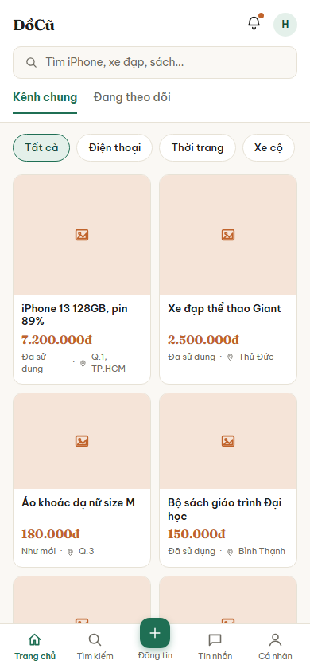
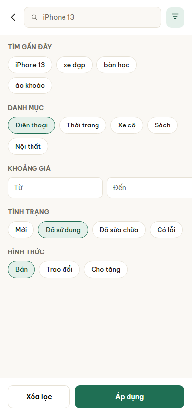
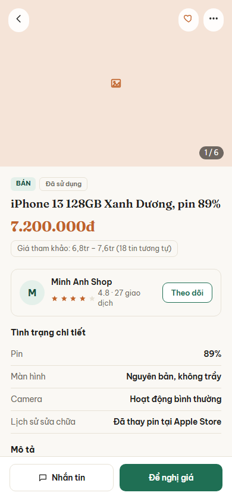
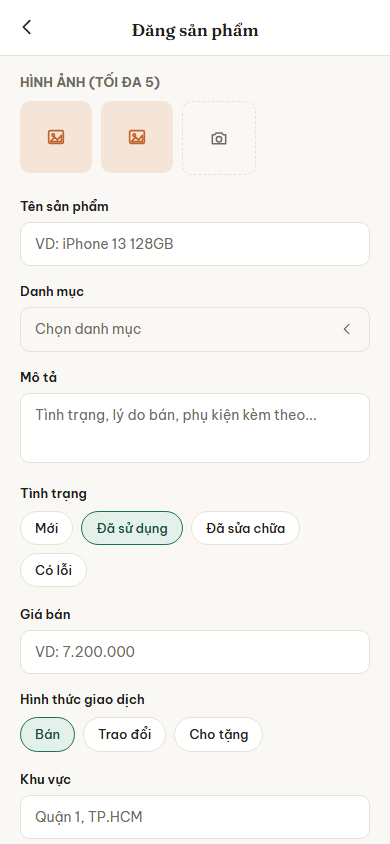
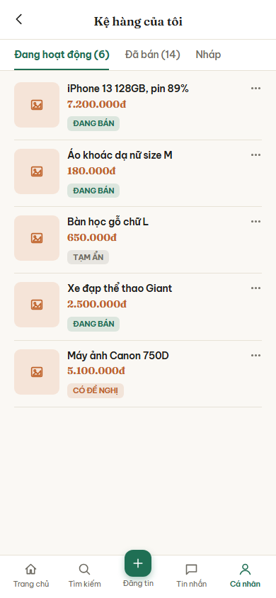
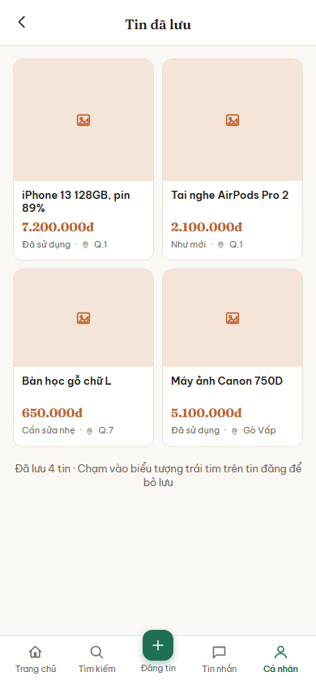

# Nhóm B: Khám phá và tin đăng

6 màn hình, nộp theo 3 đợt: đợt 1 một màn (B01), đợt 2 hai màn (B02, B03), đợt 3 ba màn (B04, B05, B06). Số trong tài liệu là STT của [bảng đặc tả chức năng](../../product/dac-ta-chuc-nang.md). Điều hướng chung ở [README giao diện](../README.md#điều-hướng). Khách (chưa đăng nhập) chỉ xem được B01, B02 và B03; các màn hình còn lại cần đăng nhập. Đăng tin, gửi đề nghị và tạo giao dịch còn cần tài khoản đã được admin duyệt xác thực (xem B03, B04, B05).

## B01. Trang chủ

**Ảnh:** 

**Lớp:** `HomeFragment` trong `MainActivity`, tab Trang chủ. Hiện thanh điều hướng dưới. Mở được cả khi chưa đăng nhập (chế độ khách).

**Mục đích:** Màn hình chính sau khi đăng nhập, và là màn hình đầu tiên Khách thấy khi mở ứng dụng. Người dùng lướt xem tin đăng mới và tìm nhanh món đồ mình cần.

**Thành phần chính:**
- Thanh trên cùng: tên ứng dụng ĐồCũ, chuông thông báo có chấm đỏ khi có thông báo chưa đọc, ảnh đại diện người dùng
- Ô tìm kiếm với gợi ý "Tìm iPhone, xe đạp, sách..."
- Hai thẻ chuyển kênh: "Kênh chung" và "Đang theo dõi"
- Hàng "Dành cho bạn" (chưa có ảnh): dải ngang các tin gợi ý theo lịch sử xem, lịch sử tìm kiếm, tin đã lưu và danh mục quan tâm (hai nguồn sau chỉ có khi đã đăng nhập)
- Hàng lọc nhanh theo danh mục: Tất cả và các danh mục gốc (ví dụ Điện thoại, Thời trang, Xe cộ)
- Lưới tin đăng hai cột, mỗi thẻ có ảnh, tên món đồ, giá, tình trạng và khu vực
- Thanh điều hướng dưới cùng 5 tab: Trang chủ, Tìm kiếm, Đăng tin (nút tròn nổi ở giữa), Tin nhắn, Cá nhân

**Hành động và điều hướng:**
- Bấm ô tìm kiếm: sang tab Tìm kiếm, B02
- Bấm một thẻ tin đăng: sang B03 Chi tiết tin đăng
- Bấm tab "Đăng tin": sang B04. Bấm tab "Tin nhắn": C01. Bấm tab "Cá nhân": D01
- Bấm chuông thông báo: sang C06 Thông báo
- Bấm ảnh đại diện: sang tab Cá nhân, D01
- Chuyển thẻ "Đang theo dõi": vẫn ở màn này, lưới chỉ còn tin của người đang theo dõi
- Chọn một danh mục ở hàng lọc nhanh: lưới chỉ còn tin của danh mục đó
- Khách bấm nút "Đăng nhập" ở thanh trên: sang A01 (từ A01 có lối sang A02 Đăng ký)

**Chức năng liên quan:** STT 29, 30 (kênh chung, kênh đang theo dõi), STT 24 (lọc theo danh mục), STT 38 (mục "Dành cho bạn"), STT 23 (ô tìm kiếm), STT 67 (chuông thông báo).

**Trạng thái đặc biệt:**
- Chưa có tin nào khớp bộ lọc: hiện dòng chữ báo trống thay cho lưới
- Đang tải thêm khi cuộn xuống: hiện các ô xám mờ ở cuối lưới
- Mất mạng: hiện lại các tin đã xem gần đây lấy từ bộ nhớ đệm, kèm dải báo đang xem ngoại tuyến
- Thẻ "Đang theo dõi" khi chưa theo dõi ai: gợi ý người dùng tìm và theo dõi người bán
- Chưa có lịch sử xem, lịch sử tìm kiếm, danh mục quan tâm hay tin đã lưu để gợi ý: ẩn hàng "Dành cho bạn"
- Khách (chưa đăng nhập): thanh trên cùng hiện nút "Đăng nhập" thay cho chuông và ảnh đại diện. Khách vẫn thấy thẻ "Kênh chung", hàng "Dành cho bạn" (khi máy đã có lịch sử xem hoặc tìm kiếm), hàng lọc danh mục và lưới tin, bấm vào được ô tìm kiếm và từng thẻ tin
- Khách bấm thẻ "Đang theo dõi": hiện hộp thoại "Vui lòng đăng nhập để xem bài đăng từ những người bạn theo dõi" với hai nút "Hủy" và "Đăng nhập" (nút "Đăng nhập" sang A01), vẫn ở thẻ "Kênh chung"
- Thanh dưới ở chế độ khách: vẫn hiện 5 tab nhưng chỉ Trang chủ và Tìm kiếm dùng được. Khách bấm Đăng tin, Tin nhắn hoặc Cá nhân thì được đưa tới A01, không vào màn hình đó

**Khác với ảnh:**
- Ảnh không vẽ hàng "Dành cho bạn"; vẫn phải làm (STT 38).
- Ảnh vẽ thanh dưới 5 mục; theo quy tắc điều hướng thanh này hiện ở B01.
- Ảnh không vẽ trạng thái khách (nút "Đăng nhập" thay chuông và ảnh đại diện, hộp thoại khi bấm "Đang theo dõi", ba tab bị chặn); vẫn phải làm.

## B02. Tìm kiếm và bộ lọc

**Ảnh:** 

**Lớp:** `SearchFragment` trong `MainActivity`, tab Tìm kiếm. Hiện thanh điều hướng dưới. Mở được cả khi chưa đăng nhập (chế độ khách).

**Mục đích:** Hỗ trợ người dùng tra cứu tin đăng bằng từ khóa và thu hẹp phạm vi kết quả theo các tiêu chí. Kết quả hiện ngay trên màn hình này, phía dưới khu vực tiêu chí.

**Thành phần chính:**
- Hai tab ở đầu màn hình: "Tin đăng" (mặc định, nội dung các mục bên dưới) và "Người dùng" (ảnh chưa vẽ, vẫn phải làm)
- Tab "Người dùng": ô tìm theo tên hiển thị; danh sách kết quả là các thẻ ngang gồm ảnh đại diện, tên hiển thị và khu vực. Chỉ hiện tài khoản đang hoạt động, không có email hay số điện thoại
- Tab "Tin đăng", thanh trên cùng: ô nhập từ khóa tìm kiếm (đang nhập "iPhone 13") và nút mở hoặc đóng bảng bộ lọc
- Khu vực Tìm gần đây: các thẻ từ khóa lịch sử (iPhone 13, xe đạp, bàn học, áo khoác), lưu trên máy
- Khu vực chọn tiêu chí lọc:
  - Danh mục
  - Khoảng giá (Từ, Đến) kèm các mốc gợi ý nhanh
  - Tình trạng, chọn nhiều trong 5 giá trị: Mới, Như mới, Đã sử dụng, Đã sửa chữa, Có lỗi
  - Hình thức (Bán, Trao đổi, Cho tặng), chọn một hoặc kết hợp nhiều
  - Khu vực (ảnh chưa vẽ, vẫn phải làm): chọn tỉnh hoặc thành phố; bán kính quanh vị trí hiện tại 1 km, 3 km hoặc 5 km
  - Sắp xếp (ảnh chưa vẽ, vẫn phải làm): Mới đăng, Giá thấp đến cao, Giá cao đến thấp, Người bán đánh giá tốt
- Thanh dưới cùng của bảng lọc: nút "Xóa lọc" và nút "Áp dụng"

**Hành động và điều hướng:**
- Bấm tab "Người dùng": đổi sang ô tìm người dùng, vẫn ở B02
- Tab "Người dùng": gõ tên hiển thị rồi bấm phím "Tìm kiếm" trên bàn phím, hiện danh sách tài khoản khớp
- Bấm một kết quả ở tab "Người dùng": sang D02 Trang cá nhân của người đó
- Bấm vào một thẻ lịch sử tìm kiếm: điền ngay từ khóa đó vào ô tìm kiếm và tìm
- Bấm chọn các thẻ tiêu chí: thẻ đổi màu biểu thị trạng thái đang được chọn
- Chọn bán kính: lần đầu hỏi quyền vị trí; không cấp quyền thì không lọc theo bán kính
- Bấm "Xóa lọc": bỏ chọn toàn bộ tiêu chí lọc hiện tại
- Bấm "Áp dụng": đóng bảng lọc, hiện kết quả đã lọc trên chính B02
- Bấm một thẻ kết quả: sang B03
- Bấm nút mở hoặc đóng bảng lọc: ẩn hiện bảng tiêu chí

**Chức năng liên quan:** STT 23 (từ khóa), 24 (danh mục), 25 (khoảng giá), 26 (tình trạng), 27 (khu vực, bán kính), 28 (hình thức giao dịch), STT 31 đến 34 (bốn cách sắp xếp), STT 38 (lịch sử tìm kiếm), STT 103 (tab "Người dùng": tìm người dùng theo tên).

**Trạng thái đặc biệt:**
- Nhập giá "Đến" thấp hơn giá "Từ": hiển thị lỗi màu đỏ nhắc nhở ngay dưới ô giá
- Không có từ khóa tìm kiếm gần đây: ẩn khu vực "TÌM GẦN ĐÂY"
- Tin không có tọa độ: không xuất hiện khi lọc theo bán kính
- Không có kết quả: hiện dòng báo trống
- Khách (chưa đăng nhập): dùng được toàn bộ tìm kiếm tin đăng (từ khóa, tìm gần đây lưu trên máy, mọi tiêu chí lọc và sắp xếp), bấm một thẻ kết quả sang B03. Khách không tìm được người dùng: Khách bấm tab "Người dùng" thì được đưa tới A01, vẫn ở tab "Tin đăng"
- Tab "Người dùng", chưa nhập tên hoặc chưa tìm: ô nhập và dòng hướng dẫn nhập tên hiển thị
- Tab "Người dùng", không có kết quả: hiện dòng báo "Không tìm thấy người dùng nào phù hợp"
- Tab "Người dùng", mất mạng: báo "Không có kết nối mạng. Vui lòng kiểm tra lại kết nối rồi thử lại"
- Thanh dưới ở chế độ khách: như B01, chỉ Trang chủ và Tìm kiếm dùng được

**Khác với ảnh:**
- Ảnh có 4 tình trạng; đúng là 5, thêm "Như mới" (STT 26).
- Ảnh chưa vẽ tab "Người dùng" cạnh tab tin đăng (STT 103); vẫn phải làm.
- Ảnh không vẽ bộ lọc khu vực và bán kính (STT 27) và bốn cách sắp xếp (STT 31 đến 34); vẫn phải làm.
- Ảnh vẽ nút quay lại và nút "Áp dụng" trở về B01. Đúng là B02 là tab gốc, không có nút quay lại, và kết quả hiện ngay tại B02.

## B03. Chi tiết tin đăng

**Ảnh:** 

**Lớp:** `ListingDetailFragment` trong `MainActivity`. Màn hình chi tiết: có nút quay lại, ẩn thanh dưới. Mở được cả khi chưa đăng nhập (chế độ khách).

**Mục đích:** Hiển thị thông tin đầy đủ nhất về một món đồ, đồng thời cung cấp điểm chạm để người mua liên hệ người bán hoặc gửi đề nghị giá.

**Thành phần chính:**
- Khu vực ảnh phía trên: băng chuyền ảnh, đếm số ảnh (ví dụ 1/5, tối đa 5 ảnh), nút quay lại, nút thả tim (Lưu tin) và nút ba chấm (menu phụ)
- Khối thông tin cốt lõi: nhãn hình thức giao dịch (BÁN, TRAO ĐỔI, CHO TẶNG; có thể nhiều nhãn), tình trạng (một trong 5 giá trị), tên sản phẩm, giá tiền, và dải "Giá tham khảo" tính trên máy từ các tin tương tự cùng danh mục và tình trạng (ẩn khi không có tin tương tự)
- Thẻ người bán: ảnh đại diện, tên, điểm đánh giá sao, số giao dịch, nhãn "Tài khoản đã xác thực" (khi tài khoản đã được admin duyệt xác thực), nút "Theo dõi" và liên kết "Xem đánh giá"
- Khu vực "Tình trạng chi tiết": liệt kê các thông số do người bán nhập theo thuộc tính của danh mục (ví dụ Pin, Màn hình, Camera)
- Mục "Tin tương tự" (ảnh chưa vẽ): dải ngang tin cùng danh mục, tình trạng, khoảng giá
- Thanh hành động dưới cùng cố định: nút "Nhắn tin" và nút "Đề nghị giá" nổi bật

**Hành động và điều hướng:**
- Bấm nút quay lại: trở về màn hình đã gọi
- Bấm nút thả tim: lưu hoặc bỏ lưu tin, biểu tượng tim đổi màu
- Bấm nút "Theo dõi" ở thẻ người bán: theo dõi hoặc bỏ theo dõi người bán
- Bấm thẻ người bán (tên hoặc ảnh): sang D02 Trang cá nhân của người bán
- Bấm liên kết "Xem đánh giá": sang D03 Hồ sơ uy tín của người bán
- Bấm nút ba chấm: mở menu phụ có "Báo cáo tin", sang D04 với đối tượng là tin này
- Bấm một tin trong "Tin tương tự": sang B03 của tin đó
- Bấm "Nhắn tin": sang C02 với người bán, gắn tin đăng này
- Bấm "Đề nghị giá": mở biểu mẫu đề nghị (dạng bảng trượt lên) gồm loại đề nghị chỉ gồm các loại người bán chấp nhận (Tiền, Vật trao đổi, Tiền và vật), ô số tiền (không thấp hơn mức tối thiểu của tin), ô mô tả món đồ trao đổi khi có vật. Gửi xong sang C02, thẻ đề nghị hiện trong cuộc trò chuyện

**Chức năng liên quan:** STT 36 (tin tương tự), 37 (giá tham khảo), 39 (theo dõi người bán), 40 và 42 (lưu tin, bỏ lưu), 43 (nhắn tin), 47 (gửi đề nghị), 61 (báo cáo tin), 13 và 15 (với tin của chính mình).

**Trạng thái đặc biệt:**
- Tin đăng của chính mình: nút "Nhắn tin" và "Đề nghị giá" biến thành "Chỉnh sửa" (sang B04 ở chế độ sửa) và "Đã bán"
- Tin đang giữ chỗ (RESERVED): hiện nhãn "ĐANG GIỮ CHỖ", nút "Đề nghị giá" bị làm xám; "Nhắn tin" vẫn dùng được
- Tin đã bán (SOLD): hiện nhãn "ĐÃ BÁN" đè lên ảnh, cả hai nút bị làm xám
- Đề nghị chỉ gửi được khi tin đang bán (AVAILABLE), người gửi không phải người đăng và tài khoản đã được admin duyệt xác thực
- Tài khoản chưa được duyệt xác thực bấm "Đề nghị giá": không mở biểu mẫu, báo cần xác thực tài khoản trước khi mua bán, kèm lối sang D01 để gửi yêu cầu xác thực. "Nhắn tin" vẫn dùng được
- Khách (chưa đăng nhập): xem được toàn bộ nội dung tin (ảnh, giá, nhãn, tình trạng, giá tham khảo, thẻ tóm tắt người bán, tình trạng chi tiết, mô tả, khu vực, tin tương tự); bấm một tin trong "Tin tương tự" vẫn sang B03
- Khách bấm "Nhắn tin" hoặc "Đề nghị giá": hiện hộp thoại "Vui lòng đăng nhập để trao đổi và thương lượng giá với người bán" kèm nút sang A01
- Khách bấm nút thả tim, nút "Theo dõi", "Báo cáo tin" ở menu ba chấm, thẻ người bán (tên hoặc ảnh) hoặc liên kết "Xem đánh giá": được đưa tới A01; không lưu tin, không theo dõi, không báo cáo, không mở D02 và D03
- Tin bị ẩn hoặc gỡ: người khác không mở được, hiện "Tin không còn"
- Mất mạng: hiện lại tin đã xem từ bộ nhớ đệm, không gửi được đề nghị

**Khác với ảnh:**
- Ảnh đếm "1/6"; tối đa là 5 ảnh.
- Ảnh vẽ dải giá "dựa trên thị trường"; đúng là tính trên máy từ tin tương tự (STT 37).
- Ảnh không vẽ liên kết "Xem đánh giá" và mục "Tin tương tự" (STT 36); vẫn phải làm.
- Ảnh vẽ "Đề nghị giá" như một nút; thực tế mở biểu mẫu loại, số tiền, món đồ trao đổi.
- Ảnh vẽ tên "Minh Anh Shop"; hiển thị tên hiển thị của người bán.
- Ảnh không vẽ nhãn "Tài khoản đã xác thực" ở thẻ người bán; vẫn phải làm khi người bán đã được duyệt.
- Ảnh vẽ menu "báo cáo tin, chia sẻ"; không làm "chia sẻ".
- Ảnh không vẽ trạng thái khách (hộp thoại yêu cầu đăng nhập, các nút dẫn tới A01) và trạng thái tài khoản chưa được duyệt xác thực khi bấm "Đề nghị giá"; vẫn phải làm.

## B04. Đăng tin

**Ảnh:** 

**Lớp:** `PostListingFragment` trong `MainActivity`, tab Đăng tin. Hiện thanh điều hướng dưới khi mở từ tab; khi mở từ B03 hoặc B05 để sửa tin thì là màn hình chi tiết có nút quay lại, ẩn thanh dưới.

**Mục đích:** Cung cấp biểu mẫu để người dùng tạo mới hoặc sửa một bài đăng bán, trao đổi hoặc cho tặng món đồ.

**Thành phần chính:**
- Tiêu đề "Đăng sản phẩm"
- Khu vực ảnh: nhãn "HÌNH ẢNH (TỐI ĐA 5)", các ô chứa ảnh đã chọn và một ô biểu tượng camera để chụp hoặc chọn ảnh mới (ảnh được nén trước khi lưu)
- Các trường thông tin (từ trên xuống dưới):
  - Tên sản phẩm: ô nhập text
  - Danh mục: ô chọn (danh mục con, hoặc danh mục gốc không có con)
  - Mô tả: ô nhập text nhiều dòng
  - Tình trạng: các thẻ chọn một trong 5 giá trị (Mới, Như mới, Đã sử dụng, Đã sửa chữa, Có lỗi)
  - Thuộc tính tình trạng của danh mục (ảnh chưa vẽ): các ô nhập hiện ra theo danh mục đã chọn (ví dụ Dung lượng pin, Bảo hành)
  - Hình thức giao dịch: các thẻ chọn nhiều (Bán, Trao đổi, Cho tặng)
  - Giá bán: ô nhập số, chỉ hiện và bắt buộc khi chọn "Bán"; trao đổi hoặc cho tặng thì giá là 0
  - Offer mong muốn (ảnh chưa vẽ): chọn các loại nhận (Tiền, Vật trao đổi, Tiền và vật) và ô "Mức tiền đề nghị tối thiểu" (0 là không giới hạn)
  - Khu vực: chọn tỉnh hoặc thành phố, điền sẵn theo địa chỉ mặc định của người đăng. Tọa độ của tin lấy từ địa chỉ mặc định (A06)
- Hai nút ở cuối màn hình: "Đăng tin" và "Lưu nháp" (chưa có ảnh)

**Hành động và điều hướng:**
- Bấm biểu tượng camera: mở thư viện ảnh hoặc camera
- Bấm vào Danh mục: mở danh sách các danh mục để chọn
- Bấm chọn các thẻ (Tình trạng, Hình thức, loại offer): thẻ chuyển sang màu xanh lá biểu thị đang được chọn
- Bấm "Đăng tin": kiểm tra tài khoản đã được admin duyệt xác thực và các trường bắt buộc, rồi lưu tin ở trạng thái đang bán, chuyển tới B03 của tin vừa đăng
- Bấm "Lưu nháp": lưu tin ở trạng thái nháp, không bắt buộc đủ thông tin, chuyển tới B05 tab Nháp
- Khi sửa tin: các trường điền sẵn; nút chính là "Lưu thay đổi" (tin nháp thì có thêm "Đăng tin")

**Chức năng liên quan:** STT 73 (xác thực tài khoản, điều kiện để đăng tin), STT 13 (chỉnh sửa sản phẩm trên kệ), 16 (nội dung, tình trạng), 17 (hình ảnh), 18 (hình thức giao dịch), 19 (giá cả), 20 (offer mong muốn), 21 (danh mục), 22 (lưu nháp).

**Trạng thái đặc biệt:**
- Đăng tin thiếu thông tin bắt buộc: hiển thị lỗi màu đỏ. Bắt buộc để đăng: tên sản phẩm, danh mục, ít nhất 1 ảnh (tối đa 5), ít nhất một hình thức giao dịch; giá khi có "Bán"
- Vượt quá 5 ảnh: ẩn nút thêm ảnh
- Tài khoản chưa được admin duyệt xác thực: đầu form hiện dải báo "Tài khoản của bạn chưa được xác thực nên chưa thể đăng tin". Bấm "Đăng tin" bị chặn: hộp thoại nêu rõ lý do, có nút "Đăng ký xác thực" sang D01 (nơi gửi yêu cầu xác thực) và nút đóng; nếu yêu cầu đang chờ admin duyệt thì hộp thoại nói như vậy. Nội dung đã nhập không mất và vẫn "Lưu nháp" được
- Khách bấm tab Đăng tin: không vào B04, được đưa tới A01
- Chưa có địa chỉ mặc định: nhắc thêm địa chỉ ở A06; tin vẫn đăng được nhưng không xuất hiện khi lọc theo bán kính
- Tin chứa từ khóa cấm: vẫn đăng, được gắn cờ cho admin xem
- Mất mạng: không đăng được, giữ nguyên nội dung đã nhập

**Khác với ảnh:**
- Ảnh có 4 tình trạng; đúng là 5, thêm "Như mới".
- Ảnh không vẽ: thuộc tính tình trạng theo danh mục, offer mong muốn (STT 20), nút "Lưu nháp" (STT 22); vẫn phải làm.
- Ảnh coi "Giá" là bắt buộc; thực tế chỉ bắt buộc khi chọn "Bán".
- Ảnh vẽ ô "Khu vực" nhập chữ tự do; đúng là chọn tỉnh, tọa độ lấy từ địa chỉ mặc định.
- Ảnh vẽ nút quay lại; ở chế độ tab không có nút này.
- Ảnh nói đăng xong sang B05 hoặc chi tiết tin; đúng là sang B03 của tin mới.
- Ảnh không vẽ dải báo và hộp thoại "tài khoản chưa được xác thực"; vẫn phải làm.

## B05. Kệ hàng của tôi

**Ảnh:** 

**Lớp:** `MyShopFragment` trong `MainActivity`. Màn hình chi tiết mở từ D01: có nút quay lại, ẩn thanh dưới.

**Mục đích:** Nơi người dùng quản lý toàn bộ bài đăng cá nhân, theo dõi trạng thái các món đồ đang bán, đã bán, đã ẩn hoặc nháp.

**Thành phần chính:**
- Thanh trên cùng: nút quay lại và tiêu đề "Kệ hàng của tôi"
- Nút chọn sắp xếp và lọc danh mục (ảnh chưa vẽ): theo thời gian, theo danh mục
- Thanh tab phân loại theo trạng thái tin:
  - Đang hoạt động: tin đang bán (AVAILABLE) và đang giữ chỗ (RESERVED)
  - Đã bán: SOLD
  - Đã ẩn: HIDDEN và REMOVED (ảnh chưa vẽ)
  - Nháp: DRAFT
- Danh sách tin đăng theo thẻ ngang. Mỗi thẻ gồm: ảnh đại diện, tên sản phẩm, giá tiền, nhãn trạng thái (ĐANG BÁN, ĐANG GIỮ CHỖ, ĐÃ BÁN, ĐÃ ẨN, ĐÃ GỠ, NHÁP), nhãn phụ CÓ ĐỀ NGHỊ khi còn đề nghị chờ trả lời, và nút ba chấm (menu thao tác)

**Hành động và điều hướng:**
- Bấm nút quay lại: trở về D01 Hồ sơ cá nhân
- Chuyển tab: lọc danh sách theo trạng thái tương ứng
- Bấm vào một thẻ tin đăng: sang B03 của tin đó
- Menu ba chấm, theo trạng thái:
  - Đang bán: Chỉnh sửa, Đánh dấu đã bán (chỉ khi không có giao dịch đang mở), Ẩn tin
  - Đang giữ chỗ: chỉ xem; không đổi được khi giao dịch còn mở
  - Đã ẩn do chính mình: Hiện lại, Chỉnh sửa
  - Đã ẩn do admin: chỉ xem lý do admin ghi; người bán không hiện lại được
  - Đã bán (người bán tự đánh dấu): Mở bán lại (không có nếu tin đã bán qua giao dịch hoàn tất)
  - Nháp: Chỉnh sửa, Đăng, Xóa tin
  - Đã gỡ: chỉ xem
- "Xóa tin" chỉ có ở tin nháp. Tin khác muốn bỏ thì dùng "Ẩn tin"

**Chức năng liên quan:** STT 73 (xác thực tài khoản, điều kiện để đăng tin), STT 13 (chỉnh sửa sản phẩm trên kệ, trạng thái), 14 (sắp xếp), 15 (ẩn hoặc hiện lại tin), 22 (tab Nháp).

**Trạng thái đặc biệt:**
- Không có tin nào trong tab: hiển thị minh họa trống "Bạn chưa có tin đăng nào ở mục này"
- Tài khoản chưa được admin duyệt xác thực: đầu màn hình hiện dải báo "Tài khoản của bạn chưa được xác thực nên chưa thể đăng tin" kèm nút "Đăng ký xác thực" sang D01. Mục "Đăng" trong menu ba chấm của tin nháp bị chặn và báo lý do như B04; "Chỉnh sửa" vẫn mở B04 nhưng ở đó cũng không đăng được. Tab và danh sách vẫn xem được
- Nhãn CÓ ĐỀ NGHỊ nổi bật màu cam để thu hút sự chú ý của người bán

**Khác với ảnh:**
- Ảnh có 3 tab; đúng là 4, thêm "Đã ẩn".
- Ảnh vẽ thanh dưới 5 mục; ở đây thanh dưới không hiện.
- Ảnh vẽ menu "Chỉnh sửa, Đánh dấu đã bán, Ẩn tin, Xóa tin" cho mọi thẻ; đúng là menu đổi theo trạng thái như trên.
- Ảnh không vẽ nút sắp xếp và nhãn ĐANG GIỮ CHỖ, ĐÃ GỠ, NHÁP; vẫn phải làm.
- Ảnh vẽ nhãn "TẠM ẨN" và để tin đó trong tab "Đang hoạt động"; đúng là nhãn "ĐÃ ẨN" (tên chuẩn của trạng thái HIDDEN, dùng cho cả tin tự ẩn lẫn tin do admin ẩn) và tin nằm ở tab "Đã ẩn".
- Ảnh không vẽ dải báo "tài khoản chưa được xác thực"; vẫn phải làm.

## B06. Tin đã lưu

**Ảnh:** 

**Lớp:** `SavedListingsFragment` trong `MainActivity`. Màn hình chi tiết mở từ D01: có nút quay lại, ẩn thanh dưới.

**Mục đích:** Lưu trữ các tin đăng mà người dùng quan tâm để dễ dàng xem lại, cân nhắc và đưa ra quyết định sau.

**Thành phần chính:**
- Thanh trên cùng: nút quay lại và tiêu đề "Tin đã lưu"
- Lưới tin đăng 2 cột tương tự Trang chủ: mỗi thẻ có ảnh, tên sản phẩm, giá, tình trạng (một trong 5 giá trị: Mới, Như mới, Đã sử dụng, Đã sửa chữa, Có lỗi) và khu vực
- Dòng thống kê phía dưới danh sách: "Đã lưu 4 tin · Chạm vào biểu tượng trái tim trên tin đăng để bỏ lưu"

**Hành động và điều hướng:**
- Bấm nút quay lại: trở về D01 Hồ sơ cá nhân
- Bấm vào thẻ tin đăng: sang B03 Chi tiết tin đăng để xem hoặc nhắn tin
- Chạm vào biểu tượng trái tim trên thẻ: bỏ lưu tin, tin biến mất khỏi danh sách

**Chức năng liên quan:** STT 40 (lưu tin), 41 (xem danh sách đã lưu), 42 (bỏ lưu).

**Trạng thái đặc biệt:**
- Tin gốc đã bị ẩn, gỡ hoặc không đọc được: thẻ hiện "Tin không còn", làm mờ, không xem được chi tiết, vẫn bỏ lưu được. Tin đã bán hiện nhãn "ĐÃ BÁN"
- Danh sách rỗng: hiển thị hình ảnh minh họa "Bạn chưa lưu tin nào"

**Khác với ảnh:**
- Ảnh vẽ tình trạng "Cần sửa nhẹ"; không có giá trị này, dùng 5 tình trạng chuẩn.
- Ảnh vẽ thanh dưới 5 mục; ở đây thanh dưới không hiện.
