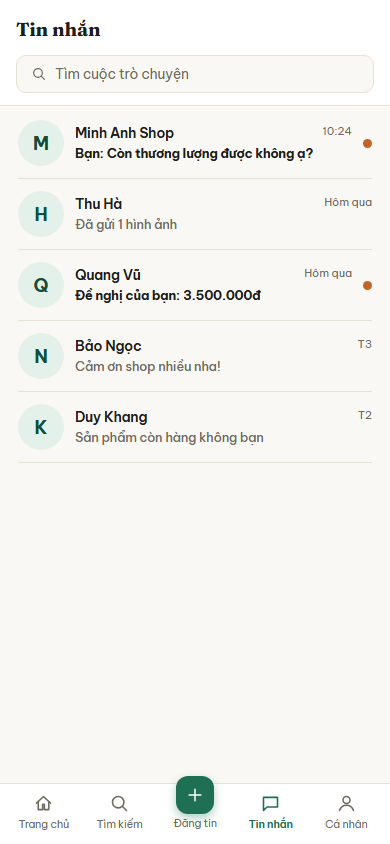
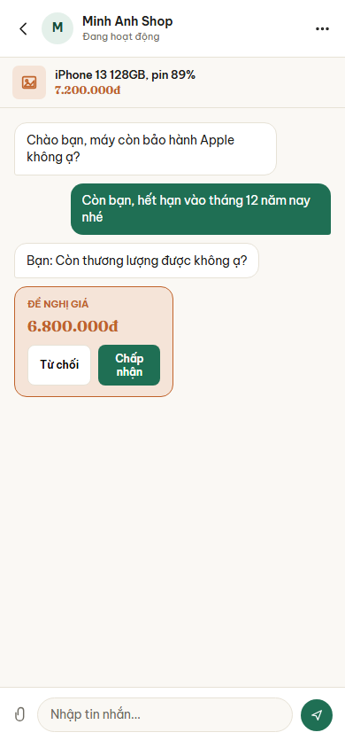
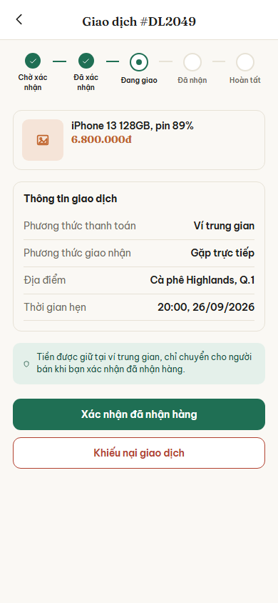
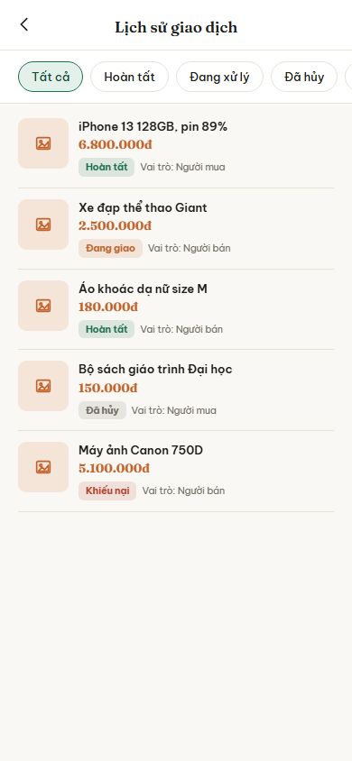
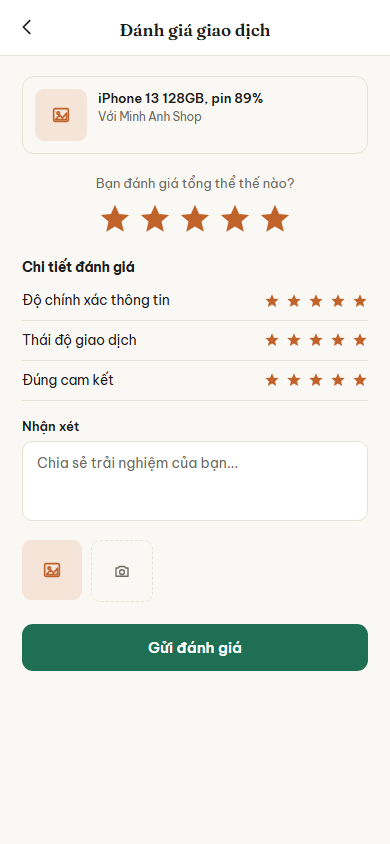
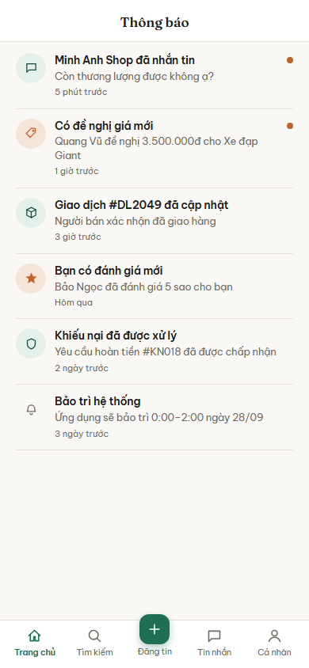

# Nhóm C: Kết nối và giao dịch

7 mã màn hình: 6 màn hình có ảnh (C01 đến C06) nộp theo 3 đợt (đợt 1 một màn C01, đợt 2 hai màn C02 và C03, đợt 3 ba màn C04, C05 và C06), cộng C07 là màn hình bổ sung chưa có ảnh. Số trong tài liệu là STT của [bảng đặc tả chức năng](../../product/dac-ta-chuc-nang.md). Trạng thái giao dịch, offer, thanh toán theo [trang-thai.md](../../architecture/trang-thai.md). Điều hướng chung ở [README giao diện](../README.md#điều-hướng).

## C01. Danh sách tin nhắn

**Ảnh:** 

**Lớp:** `ConversationListFragment` trong `MainActivity`, tab Tin nhắn. Hiện thanh điều hướng dưới.

**Mục đích:** Cho người dùng xem toàn bộ cuộc trò chuyện đang có với người mua hoặc người bán, và biết cuộc nào có tin chưa đọc.

**Thành phần chính:**
- Tiêu đề "Tin nhắn"
- Ô tìm kiếm với gợi ý "Tìm cuộc trò chuyện"
- Danh sách cuộc trò chuyện, mỗi dòng gồm: ảnh đại diện chữ cái đầu, tên người đối thoại, đoạn tin nhắn gần nhất, thời điểm gần nhất
- Chấm tròn màu cam ở cuối dòng khi cuộc trò chuyện đó có tin chưa đọc
- Dòng có đề nghị giá hiển thị nội dung dạng "Đề nghị của bạn: 3.500.000đ"
- Thanh điều hướng dưới cùng 5 tab; tab "Tin nhắn" đang được chọn

**Hành động và điều hướng:**
- Bấm một cuộc trò chuyện: sang C02 Trò chuyện và đề nghị giá
- Gõ vào ô tìm kiếm: lọc danh sách ngay tại màn này, không chuyển màn
- Bấm các tab ở thanh dưới: sang B01, B02, B04, D01

**Chức năng liên quan:** STT 43, 44 (chat gửi chữ, ảnh), STT 47, 48, 49 (offer một chạm).

**Trạng thái đặc biệt:**
- Chưa có cuộc trò chuyện nào: hiện dòng chữ gợi ý người dùng vào xem tin đăng và nhắn cho người bán
- Tin chưa đọc: tên và nội dung in đậm, kèm chấm tròn màu cam
- Mất mạng: hiện lại danh sách đã tải trước đó từ bộ nhớ đệm, kèm dải báo đang xem ngoại tuyến
- Tìm không ra kết quả: hiện dòng báo không có cuộc trò chuyện nào khớp
- Khách chưa đăng nhập: không vào được màn này, bấm tab "Tin nhắn" thì được đưa tới A01 Đăng nhập (`action_global_sign_in`; Khách chỉ xem được trang chủ, tìm kiếm tin đăng và chi tiết tin đăng)
- Tài khoản chưa được duyệt xác thực: vẫn xem danh sách và nhắn tin bình thường

**Khác với ảnh:** không có chỗ khác đáng kể. Cuộc trò chuyện luôn gắn với một tin đăng (mỗi người mua một cuộc cho mỗi tin).

## C02. Trò chuyện và đề nghị giá

**Ảnh:** 

**Lớp:** `ChatFragment` trong `MainActivity`. Màn hình chi tiết: có nút quay lại, ẩn thanh dưới. Mở từ C01, từ B03 (nút "Nhắn tin" hoặc sau khi gửi đề nghị), hoặc từ thông báo. Khách chưa đăng nhập bấm "Nhắn tin" ở B03 thì được đưa tới A01 Đăng nhập (`action_global_sign_in`).

**Mục đích:** Cho phép người dùng trao đổi chi tiết về sản phẩm và thực hiện thương lượng bằng đề nghị một chạm trong khung chat.

**Thành phần chính:**
- Thanh tiêu đề trên cùng: nút quay lại, ảnh đại diện, tên người đối thoại, trạng thái hoạt động ("Đang hoạt động" hoặc thời điểm hoạt động gần nhất), nút tùy chọn (3 chấm)
- Banner sản phẩm đang trao đổi: ảnh thu nhỏ, tên sản phẩm, mức giá
- Khung nội dung chat: các bong bóng tin nhắn của mình và đối phương
- Thẻ "Đề nghị giá" trong luồng chat: hiện loại đề nghị (Tiền, Vật trao đổi, Tiền và vật), số tiền (ví dụ 6.800.000đ), món đồ đem đổi nếu có, và trạng thái (chờ người bán trả lời, đã chấp nhận, đã từ chối). Với người bán, khi còn chờ trả lời, thẻ có hai nút "Từ chối" và "Chấp nhận"
- Thanh nhập liệu dưới cùng: nút đính kèm ảnh, ô nhập tin nhắn, nút gửi

**Hành động và điều hướng:**
- Bấm nút quay lại: về màn đã gọi (thường là C01)
- Bấm tên hoặc ảnh người đối thoại: sang D02 Trang cá nhân của người đó
- Bấm nút menu 3 chấm: mở menu "Xem trang cá nhân" (sang D02) và "Báo cáo người dùng" (sang D04)
- Bấm giữ một tin nhắn của đối phương (chưa có ảnh): "Báo cáo tin nhắn" (sang D04 bằng `action_global_report`, `targetType` là MESSAGE, `targetId` là mã tin nhắn, kèm `conversationId` của cuộc trò chuyện đang mở để Admin đọc được ngữ cảnh)
- Bấm vào banner sản phẩm: sang B03 Chi tiết tin đăng
- Bấm "Chấp nhận" trên thẻ đề nghị: tạo giao dịch ở trạng thái chờ xác nhận, tin chuyển sang đang giữ chỗ, các đề nghị chờ khác của tin đó tự bị từ chối, người mua nhận thông báo. Người bán được đưa sang C03
- Bấm "Từ chối": đề nghị chuyển sang đã từ chối, người mua nhận thông báo
- Bấm nút đính kèm: chọn một ảnh từ máy hoặc chụp ảnh (chỉ ảnh, không video; ảnh được nén trước khi gửi)
- Bấm nút gửi: đẩy tin nhắn chữ mới vào cuộc trò chuyện

**Chức năng liên quan:** STT 43, 44 (gửi chữ, gửi ảnh), 46 (trạng thái hoạt động), 47, 48, 49 (gửi, chấp nhận, từ chối đề nghị).

**Trạng thái đặc biệt:**
- Người gửi đề nghị: thẻ chỉ hiện "Chờ người bán trả lời" (nhãn chuẩn của `OfferStatus.PENDING`, xem `giao-dien.md` mục 4), không có nút nào. Không hủy được đề nghị và không có đề xuất lại; muốn đổi giá thì đợi người bán từ chối rồi gửi đề nghị mới ở B03
- Tin không còn đang bán (đã giữ chỗ, đã bán, bị ẩn): thẻ đề nghị chờ không chấp nhận được, báo lỗi rõ ràng
- Khi mất mạng: nút gửi bị mờ hoặc tin nhắn vừa gửi hiện biểu tượng đang gửi (xoay vòng)
- Tài khoản chưa được duyệt xác thực: vẫn nhắn tin được bình thường. Gửi đề nghị giá (từ B03) bị chặn, và với người bán thì hai nút "Từ chối" và "Chấp nhận" trên thẻ đề nghị bị chặn (chấp nhận là tạo giao dịch). Màn hiện lời giải thích cần được admin duyệt xác thực trước khi mua bán, kèm lối "Đăng ký xác thực" sang D01 (`action_global_my_profile`)

**Khác với ảnh:**
- Ảnh vẽ nút "Hủy đề nghị" cho người gửi; không làm (đề nghị chỉ được chấp nhận hoặc từ chối).
- Ảnh vẽ menu "chặn, báo cáo"; không có chức năng chặn. Có "Báo cáo" và "Xem trang cá nhân".
- Ảnh vẽ "gửi ảnh/video"; chỉ gửi ảnh (STT 45 là phát triển sau).
- Ảnh vẽ thẻ đề nghị chỉ có số tiền; thực tế có thêm loại đề nghị và món đồ trao đổi.
- Ảnh vẽ "Chấp nhận: chốt giao dịch"; thực tế chỉ tạo giao dịch chờ xác nhận, hai bên còn phải xác nhận ở C03.

## C03. Chi tiết giao dịch

**Ảnh:** 

**Lớp:** `DealDetailFragment` trong `MainActivity`. Màn hình chi tiết: có nút quay lại, ẩn thanh dưới. Giao dịch đang đếm ngược được kiểm tra tự động mỗi lần mở ứng dụng. Chỉ dành cho hai bên của giao dịch; admin xem ở `AdminDealDetailFragment` (E06).

**Mục đích:** Quản lý và theo dõi tiến trình của một giao dịch, cung cấp thông tin giao nhận và các hành động theo trạng thái.

**Thành phần chính:**
- Thanh tiêu đề: nút quay lại, mã giao dịch (ví dụ "#DL2049")
- Thanh tiến trình 5 bước: Chờ xác nhận, Đã xác nhận, Đã giao, Đã nhận, Hoàn tất. Bước hiện tại được đánh dấu nổi bật. Giao dịch gặp trực tiếp bỏ qua bước "Đã giao" (hiện mờ). Giao dịch đã hủy hiện nhãn "Đã hủy" kèm lý do; giao dịch đang tranh chấp hiện nhãn "Tranh chấp"
- Thẻ sản phẩm: ảnh thu nhỏ, tên, giá chốt
- Khối "Thông tin giao dịch": phương thức giao nhận (Gặp trực tiếp hoặc Gửi vận chuyển), địa điểm hoặc địa chỉ giao, thời gian hẹn, điều kiện khác hai bên thống nhất, món đồ trao đổi (nếu có). Khi đã giao: đơn vị vận chuyển, mã vận đơn, ảnh vận đơn. Khi đã nhận: ảnh nhận hàng do người mua chụp hoặc chọn lúc xác nhận
- Khối đếm ngược khi đã giao: "Còn N ngày để xác nhận" (7 ngày kể từ lúc giao, sau đó hệ thống tự chuyển sang đã nhận)
- Hộp nhắc giữ tiền: nhắc tiền được hệ thống giữ an toàn dưới dạng khoản thanh toán "đang giữ" (thanh toán mô phỏng, không có tiền thật) cho tới khi người mua xác nhận đã nhận hoặc hết đếm ngược. Ẩn khi giá thống nhất bằng 0 (trao đổi hoặc cho tặng)
- Các nút hành động ở dưới, đổi theo trạng thái và vai trò (bảng dưới)

**Hành động theo trạng thái và vai trò:**

| Trạng thái | Người mua (hoặc người nhận đổi) | Người bán (hoặc người đăng) |
| --- | --- | --- |
| Chờ xác nhận | "Sửa điều khoản", "Xác nhận", "Hủy giao dịch" (bắt buộc lý do) | "Sửa điều khoản", "Xác nhận", "Hủy giao dịch" (bắt buộc lý do) |
| Đã xác nhận, giá lớn hơn 0 | "Thanh toán" (nếu chưa thanh toán), "Hủy giao dịch" | "Hủy giao dịch" |
| Đã xác nhận, gửi vận chuyển | Chờ người bán giao | "Xác nhận đã giao": bắt buộc ảnh vận đơn, tên đơn vị vận chuyển, mã vận đơn; chỉ làm được sau khi người mua đã thanh toán (nếu giá lớn hơn 0) |
| Đã xác nhận, gặp trực tiếp | "Xác nhận đã nhận hàng" kèm một ảnh (sau khi đã thanh toán nếu giá lớn hơn 0), "Khiếu nại giao dịch" | Chờ người mua |
| Đã giao | "Xác nhận đã nhận hàng" kèm một ảnh, "Khiếu nại giao dịch" | Xem đếm ngược, "Khiếu nại giao dịch" |
| Tranh chấp | Xem khiếu nại (sang D07) | Xem khiếu nại (sang D07) |
| Đã nhận | "Viết đánh giá" (sang C05) nếu chưa đánh giá | "Viết đánh giá" nếu chưa đánh giá |
| Hoàn tất | "Viết đánh giá" nếu chưa đánh giá | "Viết đánh giá" nếu chưa đánh giá |
| Đã hủy | Chỉ xem, hiện lý do hủy | Chỉ xem, hiện lý do hủy |

- Không hủy được giao dịch từ "Đã giao" trở đi; có vấn đề thì khiếu nại.
- Sau "Đã nhận" khoản thanh toán đã chuyển sang "đã giải ngân" cho người bán nên không khiếu nại được nữa (vẫn báo cáo được).
- Giao dịch ở "Chờ xác nhận" quá 3 ngày mà hai bên chưa xác nhận thì hệ thống tự hủy.
- "Sửa điều khoản" xóa cả hai xác nhận, hai bên xác nhận lại.

**Hành động và điều hướng:**
- Bấm nút quay lại: về màn đã gọi (C02, C04 hoặc thông báo)
- Bấm "Thanh toán": sang C07 Thanh toán giao dịch bằng `action_global_deal_payment` (tham số `dealId`), luồng thanh toán mô phỏng giống trang thương mại điện tử (chọn phương thức, chọn ngân hàng hoặc ví, cổng thanh toán mô phỏng, OTP thử, biên lai). Không gọi dịch vụ bên ngoài và không có tiền thật; xác nhận xong, hệ thống tạo khoản thanh toán "đang giữ" kèm phương thức đã chọn và thông báo cho người bán
- Bấm "Xác nhận đã nhận hàng": hiện hộp thoại nhắc xác nhận không thể thu hồi và yêu cầu chụp hoặc chọn một ảnh món đồ đã nhận (bắt buộc, chỉ một ảnh, ảnh được nén trước khi lưu). Bấm "Xác nhận" trong hộp thoại: lưu ảnh nhận hàng, giao dịch sang "Đã nhận", hệ thống chuyển khoản thanh toán từ "đang giữ" sang "đã giải ngân" cho người bán
- Bấm "Khiếu nại giao dịch": sang D05 Tạo khiếu nại
- Bấm "Viết đánh giá": sang C05 Viết đánh giá
- Bấm tên người bên kia: sang D02

**Chức năng liên quan:** STT 50 (xem thông tin giao dịch), 51 (sửa điều khoản), 52 (xác nhận giao dịch), 53 (xác nhận đã nhận kèm một ảnh), 54 (xác nhận đã giao), 55 (hủy có lý do), 56 (thanh toán mô phỏng, tiền được giữ trong hệ thống), 64 (khiếu nại), 59 (nút viết đánh giá), 84 (tự giải ngân khi hết đếm ngược: hệ thống tự chuyển khoản thanh toán sang "đã giải ngân" cho người bán).

**Trạng thái đặc biệt:**
- Giá thống nhất bằng 0: không có thanh toán, ẩn hộp nhắc giữ tiền và nút "Thanh toán"
- Thiếu ảnh, tên đơn vị hoặc mã vận đơn: nút "Xác nhận đã giao" chưa bấm được
- Chưa chọn ảnh nhận hàng: nút "Xác nhận" trong hộp thoại xác nhận đã nhận hàng chưa bấm được
- Mất mạng: hiện lại giao dịch đã tải từ bộ nhớ đệm, các nút hành động bị khóa
- Tài khoản chưa được duyệt xác thực: các nút "Sửa điều khoản", "Xác nhận", "Thanh toán", "Xác nhận đã giao" và "Xác nhận đã nhận hàng" bị chặn. Màn hiện lời giải thích cần được admin duyệt xác thực trước khi tạo hoặc tham gia giao dịch, kèm lối "Đăng ký xác thực" sang D01 (`action_global_my_profile`). Hai nút "Hủy giao dịch" và "Khiếu nại giao dịch" không bị chặn: ai đã vào được giao dịch thì phải thoát ra được
- Khách chưa đăng nhập: không vào được màn này (giao dịch chỉ dành cho hai bên đã đăng nhập)

**Khác với ảnh:**
- Ảnh chỉ vẽ hai nút "Xác nhận đã nhận hàng" và "Khiếu nại giao dịch"; thực tế các nút đổi theo trạng thái và vai trò như bảng trên.
- Ảnh vẽ "Phương thức thanh toán (Ví trung gian)" như một dòng thông tin; không có ví trung gian và không có lựa chọn "thanh toán trực tiếp". Thanh toán là mô phỏng và áp dụng cho mọi giao dịch có giá lớn hơn 0, gặp trực tiếp hay gửi vận chuyển: người mua chọn phương thức mô phỏng ở màn thanh toán, tiền được giữ bằng khoản thanh toán "đang giữ" trong hệ thống.
- Ảnh vẽ thanh tiến trình 5 bước đang ở bước "Đã xác nhận"; thực tế còn hai nhãn "Đã hủy" và "Tranh chấp" và đường gặp trực tiếp.
- Ảnh không vẽ khối đếm ngược 7 ngày và form giao hàng (ảnh vận đơn); vẫn phải làm.
- Ảnh ghi nhãn "Đang giao" ở bước thứ ba của thanh tiến trình; chữ đúng theo trạng thái hệ thống là "Đã giao". Giao dịch tranh chấp hiện "Tranh chấp", không phải "Đang khiếu nại".
- Ảnh không vẽ bước chụp hoặc chọn ảnh khi xác nhận đã nhận hàng; vẫn phải làm (ảnh nhận hàng bắt buộc).
- Hộp thông tin trong ảnh ghi "Tiền được giữ tại ví trung gian"; chữ đúng theo mục hộp nhắc giữ tiền ở trên: tiền được hệ thống giữ dưới dạng khoản thanh toán "đang giữ", không có ví trung gian.

## C04. Lịch sử giao dịch và thanh toán

**Ảnh:**  (chỉ vẽ tab "Giao dịch")

**Lớp:** `DealHistoryFragment` trong `MainActivity`. Màn hình chi tiết mở từ D01: có nút quay lại, ẩn thanh dưới.

**Mục đích:** Giúp người dùng xem lại toàn bộ các giao dịch đã thực hiện (cả vai trò người mua và người bán), và xem lịch sử thanh toán (mô phỏng).

**Thành phần chính:**
- Thanh tiêu đề: nút quay lại, tiêu đề "Lịch sử giao dịch"
- Hai tab: "Giao dịch" (như ảnh) và "Thanh toán" (chưa có ảnh)
- Tab "Giao dịch":
  - Thanh bộ lọc trạng thái (dạng chip): Tất cả, Đang xử lý (chờ xác nhận, đã xác nhận, đã giao), Hoàn tất (đã nhận, hoàn tất), Tranh chấp, Đã hủy
  - Thanh bộ lọc loại giao dịch (dạng chip): Tất cả, Mua bán, Trao đổi, Cho tặng
  - Thanh bộ lọc vai trò (dạng chip): Tất cả, Đã mua, Đã bán
  - Danh sách giao dịch: mỗi thẻ hiển thị ảnh sản phẩm, tên sản phẩm, giá tiền (màu cam), nhãn trạng thái (ví dụ "Hoàn tất" xanh lục, "Đã giao" cam, "Đã hủy" xám, "Tranh chấp" đỏ) và dòng "Vai trò: Người mua" hoặc "Người bán"
- Tab "Thanh toán": danh sách khoản thanh toán, mỗi dòng có tên món đồ, số tiền, trạng thái (Đang giữ, Đã giải ngân cho người bán, Đã hoàn cho người mua), thời điểm giữ và giải ngân hoặc hoàn, và vai trò (đã trả hoặc đã nhận)

**Hành động và điều hướng:**
- Bấm nút quay lại: về D01 Hồ sơ cá nhân
- Bấm chọn các chip lọc trạng thái, loại giao dịch hoặc vai trò: lọc danh sách giao dịch ngay trên màn hình; ba bộ lọc dùng cùng lúc, danh sách chỉ giữ giao dịch khớp cả ba
- Bấm vào một thẻ giao dịch hoặc một dòng thanh toán: sang C03 Chi tiết giao dịch đó

**Chức năng liên quan:** STT 57 (xem lịch sử giao dịch), STT 58 (xem lịch sử thanh toán).

**Trạng thái đặc biệt:**
- Danh sách trống: hiện thông báo "Bạn chưa có giao dịch nào" hoặc "Bạn chưa có thanh toán nào"
- Mất mạng: hiện lại danh sách đã tải từ bộ nhớ đệm, kèm dải báo ngoại tuyến
- Khách chưa đăng nhập: không vào được màn này (mở từ D01)

**Khác với ảnh:**
- Ảnh chỉ có 4 chip trạng thái (Tất cả, Hoàn tất, Đang xử lý, Đã hủy); thêm chip "Tranh chấp" vì có giao dịch ở trạng thái tranh chấp.
- Ảnh chưa vẽ bộ lọc loại giao dịch (Mua bán, Trao đổi, Cho tặng) và bộ lọc vai trò (Đã mua, Đã bán); vẫn phải làm (STT 57).
- Ảnh ghi nhãn "Đang giao" và "Khiếu nại" trên thẻ giao dịch; chữ đúng theo trạng thái hệ thống là "Đã giao" và "Tranh chấp".
- Ảnh không vẽ tab "Thanh toán" (STT 58); vẫn phải làm. Các khoản thanh toán chỉ là bản ghi trong hệ thống: "đang giữ" rồi "đã giải ngân" cho người bán hoặc "đã hoàn" cho người mua, không có ngân hàng hay tiền thật.

## C05. Viết đánh giá

**Ảnh:** 

**Lớp:** `WriteReviewFragment` trong `MainActivity`. Màn hình chi tiết: có nút quay lại, ẩn thanh dưới. Chỉ mở từ nút "Viết đánh giá" trên C03 (hành động toàn cục `action_global_write_review`).

**Mục đích:** Cho phép người dùng đánh giá đối tác sau khi đã nhận hàng, nhằm xây dựng điểm uy tín trong cộng đồng. Viết được khi giao dịch ở "Đã nhận" hoặc "Hoàn tất", mỗi bên một lần.

**Thành phần chính:**
- Thanh tiêu đề: nút quay lại, tiêu đề "Đánh giá giao dịch"
- Khối thông tin đối tác: ảnh thu nhỏ, tên sản phẩm, dòng "Với <tên đối tác>"
- Đánh giá tổng thể: tiêu đề "Bạn đánh giá tổng thể thế nào?" kèm dãy 5 ngôi sao lớn
- Chi tiết đánh giá: ba tiêu chí (Độ chính xác thông tin, Thái độ giao dịch, Đúng cam kết) kèm sao riêng
- Ô nhận xét: khung nhập văn bản "Chia sẻ trải nghiệm của bạn..." (không bắt buộc)
- Nút "Gửi đánh giá": nút màu xanh nổi bật ở cuối màn hình

**Hành động và điều hướng:**
- Bấm vào các ngôi sao: chọn số sao (từ 1 đến 5) cho mục tương ứng
- Nhập văn bản vào ô nhận xét
- Bấm "Gửi đánh giá": lưu đánh giá, hiển thị thông báo thành công và quay về C03
- Bấm nút quay lại: hủy viết đánh giá và quay về C03

**Chức năng liên quan:** STT 59 (đánh giá đối tác).

**Trạng thái đặc biệt:**
- Nút "Gửi đánh giá" bị vô hiệu hóa (mờ đi) nếu người dùng chưa chọn đủ sao tổng thể và ba tiêu chí
- Đã đánh giá giao dịch này rồi: không mở lại biểu mẫu, hiện đánh giá đã gửi

**Khác với ảnh:**
- Ảnh có khu vực "Tải ảnh đính kèm" (thư viện, chụp ảnh mới); không làm, đánh giá không có ảnh.
- Ảnh ghi "sau khi giao dịch hoàn tất"; đúng là viết được ngay sau khi đã nhận hàng (trạng thái Đã nhận hoặc Hoàn tất).

## C06. Thông báo

**Ảnh:** 

**Lớp:** `NotificationListFragment` trong `MainActivity`. Màn hình chi tiết mở từ chuông ở B01: có nút quay lại, ẩn thanh dưới.

**Mục đích:** Hiển thị các thông báo cập nhật về tin nhắn, đề nghị giá, giao dịch, đánh giá, khiếu nại, cảnh báo, kết quả xác thực tài khoản và tin bị admin xử lý. Không có thông báo hệ thống do admin gửi hàng loạt (STT 99 là phát triển sau).

**Thành phần chính:**
- Thanh tiêu đề: nút quay lại, tiêu đề "Thông báo"
- Danh sách thông báo: mỗi dòng gồm biểu tượng phân loại, tiêu đề in đậm, nội dung tóm tắt, thời gian nhận (ví dụ "5 phút trước", "Hôm qua")
- Đánh dấu chưa đọc: chấm tròn màu cam ở bên phải các thông báo chưa bấm xem

**Hành động và điều hướng:**
- Bấm vào một thông báo: đánh dấu đã đọc và chuyển đến màn hình tương ứng theo loại:

| Loại thông báo | Màn hình đích |
| --- | --- |
| NEW_MESSAGE (tin nhắn mới) | C02 |
| NEW_OFFER (đề nghị giá mới) | C02 |
| OFFER_RESULT (đề nghị được chấp nhận hoặc từ chối) | C02 |
| DEAL_UPDATE (giao dịch đổi trạng thái) | C03 |
| PAYMENT_UPDATE (tiền được giữ, giải ngân, hoàn) | C03 |
| NEW_REVIEW (có đánh giá mới) | D03 của người được đánh giá (chính mình, chế độ chỉ xem) |
| COMPLAINT_RESULT (kết quả khiếu nại) | D01 (xem Khác với ảnh) |
| WARNING (bị cảnh báo hoặc khóa) | D01 |
| LISTING_MODERATED (tin bị admin ẩn, gỡ hoặc khôi phục) | B05 |
| VERIFICATION_RESULT (kết quả xác thực tài khoản) | D01 |

- Cuộn dọc danh sách: xem thêm các thông báo cũ hơn
- Bấm nút quay lại: về màn đã gọi

**Khác với ảnh:**
- `COMPLAINT_RESULT` đi về **D01**, không về D07. D07 đã bị cắt khỏi phạm vi đợt này (xem `ke-hoach-rut-gon.md`), nên `action_global_my_reports` đã bị gạch khỏi `so-huu.md` mục 4. Hành động hợp lệ còn lại là `action_global_my_profile`.
- `C02` **không có bố cục ngang riêng**. Màn chat là một `RecyclerView` dọc, xoay ngang nó tự giãn và vẫn đọc được. Chỉ B03 bắt buộc có `layout-land` vì có băng chuyền ảnh lớn.

**Chức năng liên quan:** STT 67 (xem thông báo, đánh dấu đã đọc), STT 10 (loại thông báo đã tắt thì không hiện).

**Trạng thái đặc biệt:**
- Trống: hiện hình minh họa "Bạn chưa có thông báo mới" khi không có bất kỳ thông báo nào
- Tải thêm: khi người dùng kéo xuống dưới cùng, ứng dụng tải thêm các thông báo cũ

**Khác với ảnh:**
- Ảnh vẽ thanh điều hướng dưới 5 mục; ở đây thanh dưới không hiện.
- Ảnh vẽ chung "thông báo hệ thống"; không làm thông báo bảo trì hoặc broadcast do admin gửi.

## C07. Thanh toán giao dịch

**Ảnh:** chưa có ảnh

**Lớp:** bốn Fragment trong `MainActivity`, đều là màn hình chi tiết (nút quay lại, ẩn thanh dưới): `DealPaymentFragment` (bước 1), `CheckoutProviderFragment` (bước 2), `CheckoutGatewayFragment` (bước 3 và 4), `CheckoutResultFragment` (bước 5). Chỉ mở từ nút "Thanh toán" trên C03 bằng hành động toàn cục `action_global_deal_payment` (tham số `dealId`), và chỉ dành cho người mua của giao dịch. Các bước sau đi bằng đích `checkoutProviderFragment`, `checkoutGatewayFragment`, `checkoutResultFragment` của `nav_main.xml`.

**Mục đích:** Cho người mua thanh toán cho giao dịch mua bán đã xác nhận bằng một luồng giống trang thương mại điện tử. Đây là thanh toán mô phỏng (issue #391): không có cổng thanh toán thật, không gọi dịch vụ bên ngoài, không có tiền thật. Ngân hàng hoặc ví người mua chọn chỉ để hiển thị, nằm trong tham số điều hướng, không ghi vào Firestore. Đường ghi duy nhất vẫn là `DealViewModel.pay(PaymentMethod)`: hệ thống giữ tiền bằng khoản thanh toán "đang giữ" rồi chuyển "đã giải ngân" cho người bán hoặc "đã hoàn" cho người mua.

**Thành phần chính:**
- Tóm tắt đơn ở mọi bước (`view_checkout_summary.xml`): ảnh thu nhỏ, tên món đồ, người bán, "Tổng thanh toán" bằng giá chốt, không sửa được
- Bước 1, chọn phương thức (`DealPaymentFragment`): ba thẻ lớn có biểu tượng, chọn một: "Thẻ ATM nội địa" (`CARD`), "Ví điện tử" (`E_WALLET`), "Chuyển khoản ngân hàng" (`BANK_TRANSFER`). Nút "Tiếp tục" cố định ở đáy, chưa bấm được khi chưa chọn
- Bước 2, chọn ngân hàng hoặc ví (`CheckoutProviderFragment`): ô tìm theo tên hoặc mã (không phân biệt dấu) và lưới ô chữ viết tắt. Thẻ và chuyển khoản hiện danh sách ngân hàng (tên và mã ngắn như VCB, TCB, MB, BIDV, ACB), ví điện tử hiện danh sách ví đặt tên chung. Danh sách tĩnh trong `strings_trade.xml`; ô tô màu theo màu ứng dụng, không dùng logo hay màu thương hiệu thật. Nút "Tiếp tục" cố định ở đáy, kèm dòng "Đã chọn ..."
- Bước 3, "Cổng thanh toán mô phỏng PUBGApp" (`CheckoutGatewayFragment`): dải báo "Môi trường thử nghiệm, không trừ tiền thật", tóm tắt đơn, tên ngân hàng hoặc ví, đồng hồ đếm ngược 10 phút. Theo phương thức:
  - Thẻ: thẻ thử chỉ đọc (số, tên chủ thẻ, hạn cố định) và lời nhắc không nhập thẻ thật. Không có ô nhập số thẻ. Nút "Thanh toán"
  - Chuyển khoản: mã QR mẫu vẽ ngay trên máy (không gọi mạng, không quét được), tài khoản nhận "PUBGApp giữ hộ (mô phỏng)", nội dung chuyển khoản "PUBG" cộng 8 ký tự đầu của mã giao dịch. Nút "Tôi đã chuyển khoản"
  - Ví điện tử: thẻ xác nhận kiểu "Mở ví" với tên ví. Nút "Mở ví"
  - Nút "Hủy thanh toán" ở mọi phương thức
- Bước 4, OTP (cùng màn bước 3): mã OTP thử hiện ngay trên màn, nút "Điền mã thử" điền bằng một chạm, nút "Xác nhận". Không hỏi mật khẩu, số thẻ hay dữ liệu thanh toán thật
- Bước 5, kết quả (`CheckoutResultFragment`): vòng xoay "Đang xử lý thanh toán..." khoảng 1,5 giây rồi gọi `DealViewModel.pay`. Thành công: biên lai gồm số tiền, phương thức, ngân hàng hoặc ví (chỉ hiển thị), thời gian giữ tiền, mã giao dịch, trạng thái "Đang giữ", nút "Xem giao dịch". Lỗi: câu báo lỗi kèm "Thử lại" và "Chọn phương thức khác"
- Giao dịch đã có khoản thanh toán khi mở C07: bước 1 hiện biên lai cũ (số tiền, phương thức, thời điểm giữ, trạng thái) với nút "Về chi tiết giao dịch"

**Hành động và điều hướng:**
- Bấm nút quay lại ở bước 1: về C03, không tạo khoản thanh toán
- Bước 1 "Tiếp tục": sang bước 2. Bước 2 "Tiếp tục": sang bước 3. Nút quay lại ở bước 2 và 3: về bước trước
- Bấm "Hủy thanh toán" hoặc hết giờ đếm ngược: báo ngắn rồi về bước 1, không tạo khoản thanh toán
- Bước 3 bấm nút chính: hiện bước OTP. Bấm "Xác nhận" với mã sai: báo "Mã OTP không đúng"; với mã đúng: sang bước 5
- Bước 5 lúc đang xử lý: nút quay lại không làm gì, để không bỏ dở giữa chừng
- Bấm "Xem giao dịch" hoặc quay lại trên biên lai: về C03, nơi nút "Thanh toán" không còn
- Bấm "Thử lại" khi lỗi: xử lý và gọi `pay` lại. "Chọn phương thức khác" hoặc quay lại khi lỗi: về bước 1

**Chức năng liên quan:** STT 56 (thanh toán mô phỏng, tiền được giữ trong hệ thống). Khoản thanh toán vừa tạo hiện ở tab "Thanh toán" của C04 (STT 58).

**Trạng thái đặc biệt:**
- Đang tải: mỗi bước đọc lại giao dịch qua `DealViewModel.loadDeal` và hiện vòng xoay
- Rỗng: giao dịch không còn ở trạng thái "Đã xác nhận", không cần thanh toán hoặc người xem không phải người mua: báo "Giao dịch không đủ điều kiện thanh toán hoặc đã được thanh toán". Ô tìm không khớp ngân hàng hoặc ví nào: "Không tìm thấy"
- Lỗi: đọc giao dịch lỗi: câu báo lỗi và "Thử lại". `pay` lỗi (mất mạng, giao dịch bị hủy giữa chừng, đã thanh toán trên thiết bị khác): bước 5 báo lỗi, không tạo khoản thanh toán, cho thử lại
- Mất mạng: dải báo ngoại tuyến ở bước 1 đến 3
- Giá thống nhất bằng 0 (trao đổi hoặc cho tặng), tài khoản chưa được duyệt xác thực, khách chưa đăng nhập: không vào được, vì C03 không có hoặc chặn nút "Thanh toán"
- Xoay màn hình: giữ phương thức, ngân hàng hoặc ví đã chọn, từ khóa tìm, bước OTP và mã đã gõ, thời gian còn lại (tính theo giờ hết hạn, không đếm lại từ đầu) và bước 5 (không gửi `pay` hai lần)

**Khác với ảnh:** màn hình này chưa có ảnh; không có gì để so sánh. Giao diện làm theo hệ thống thiết kế chung như các màn khác. Không có ví trung gian, số dư ví, logo ngân hàng hay dịch vụ thanh toán bên ngoài. Ghi chú STT 56 trước đây ghi "không có ngân hàng"; leader duyệt thêm bước chọn ngân hàng chỉ để hiển thị (quyết định 2026-10-29 trong `workflow/memory/decisions.md`).
