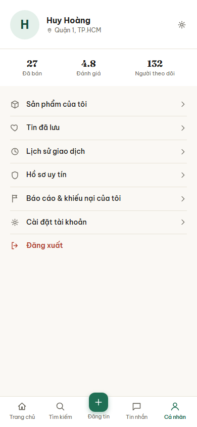
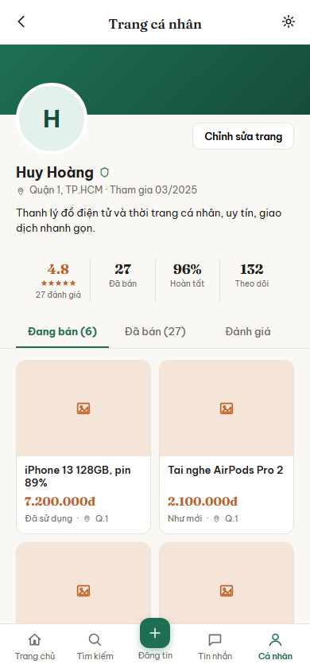
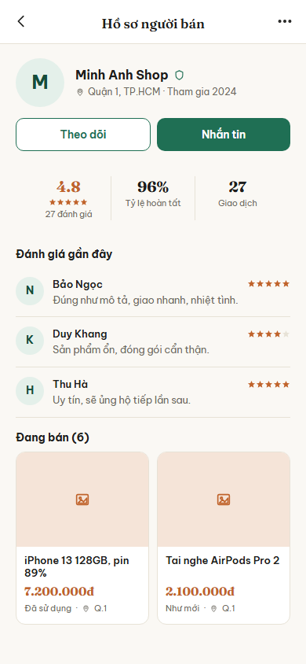
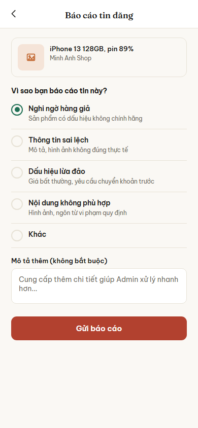
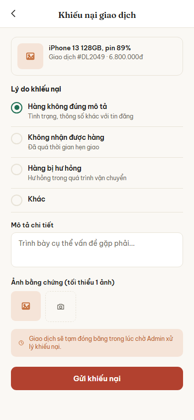
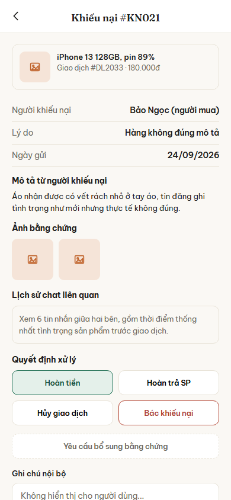

# Nhóm D: Hồ sơ và tin cậy

7 mã màn hình: 6 màn hình có ảnh (D01 đến D06) nộp theo 3 đợt (đợt 1 một màn D01, đợt 2 hai màn D02 và D03, đợt 3 ba màn D04, D05 và D06), cộng D07 là màn hình bổ sung chưa có ảnh. Số trong tài liệu là STT của [bảng đặc tả chức năng](../../product/dac-ta-chuc-nang.md). Điều hướng chung ở [README giao diện](../README.md#điều-hướng).

## D01. Hồ sơ cá nhân

**Ảnh:** 

**Lớp:** `MyProfileFragment` trong `MainActivity`, tab Cá nhân. Hiện thanh điều hướng dưới.

**Mục đích:** Trang cá nhân của chính người đang đăng nhập, là lối vào mọi mục quản lý liên quan tới bản thân: hàng đã bán, tin đã lưu, lịch sử giao dịch, uy tín, báo cáo và khiếu nại, cài đặt, và khu vực quản trị nếu là admin.

**Thành phần chính:**
- Đầu trang: ảnh đại diện chữ cái đầu, tên người dùng, khu vực (ví dụ Quận 1, TP.HCM), nút cài đặt ở góc phải
- Hàng ba số liệu: số món đã bán, điểm đánh giá trung bình, số người theo dõi
- Danh sách lối vào, mỗi dòng có biểu tượng và mũi tên sang phải: Sản phẩm của tôi, Tin đã lưu, Lịch sử giao dịch, Hồ sơ uy tín, Báo cáo và khiếu nại của tôi, Cài đặt tài khoản
- Nút "Khu vực quản trị" (chưa có ảnh), chỉ hiện khi tài khoản là admin
- Mục "Đăng xuất" màu đỏ, tách riêng ở cuối danh sách
- Thanh điều hướng dưới cùng 5 tab; tab "Cá nhân" đang được chọn

**Hành động và điều hướng:**
- Bấm "Sản phẩm của tôi": sang B05 Kệ hàng của tôi
- Bấm "Tin đã lưu": sang B06 Tin đã lưu
- Bấm "Lịch sử giao dịch": sang C04 Lịch sử giao dịch
- Bấm "Hồ sơ uy tín": sang D03 của chính mình (chế độ chỉ xem)
- Bấm "Báo cáo và khiếu nại của tôi": sang D07
- Bấm "Cài đặt tài khoản" hoặc nút cài đặt ở góc phải: sang A04 Quản lý thông tin cá nhân
- Bấm ảnh đại diện hoặc tên: sang D02 Trang cá nhân của chính mình
- Bấm "Khu vực quản trị": mở `AdminActivity`, màn E01
- Bấm "Đăng xuất": hỏi xác nhận, đồng ý thì về A01 Đăng nhập
- Bấm các tab ở thanh dưới: sang B01, B02, B04, C01
- Bấm dải nhắc xác minh: hộp thoại xác nhận gửi yêu cầu xác minh người bán

**Chức năng liên quan:** STT 4, 5, 6 (qua A04, A05, A06), STT 7 (xem đánh giá cá nhân), STT 8 (số liệu hồ sơ), STT 13, 14 (kệ hàng, qua B05), STT 41 (qua B06), STT 57 (lịch sử giao dịch), STT 63, 65 (lịch sử báo cáo, theo dõi khiếu nại, qua D07), STT 73 (gửi yêu cầu xác minh người bán, phía người dùng).

**Trạng thái đặc biệt:**
- Người dùng chưa bán món nào: số liệu hiện 0, mục "Sản phẩm của tôi" gợi ý đăng tin đầu tiên
- Chưa có đánh giá nào: ô điểm đánh giá hiện dấu gạch thay cho số
- Tài khoản chưa xác minh người bán: hiện thêm một dải nhắc gửi yêu cầu xác minh (cần đã xác thực email). Đang chờ duyệt: dải ghi "Đang chờ duyệt". Bị từ chối: hiện lý do admin ghi và cho gửi lại. Đã duyệt: có huy hiệu đã xác minh. Xác minh không bắt buộc để đăng tin
- Mất mạng: vẫn hiện thông tin đã tải trước đó từ bộ nhớ đệm, kèm dải báo đang xem ngoại tuyến

**Khác với ảnh:**
- Ảnh vẽ "Báo cáo & khiếu nại của tôi" dẫn tới D05; đúng là dẫn tới D07 (D05 chỉ mở từ C03).
- Ảnh không vẽ nút "Khu vực quản trị" cho admin.
- Ảnh vẽ nút cài đặt không rõ đích; đích là A04.
- Ảnh vẽ "Hồ sơ uy tín" dẫn tới D03; D03 ở chế độ chỉ xem của chính mình, không có nút Theo dõi.

## D02. Trang cá nhân

**Ảnh:** 

**Lớp:** `UserProfileFragment` trong `MainActivity`, nhận `userId`. Màn hình chi tiết: có nút quay lại, ẩn thanh dưới. Mở từ D01 (trang của chính mình), từ B03 (thẻ người bán), từ C02, C03.

**Mục đích:** Trang công khai của một người dùng, cho thấy thông tin giới thiệu, số liệu uy tín và các món đang bán, đã bán, đánh giá. Xem trang của chính mình thì thấy người khác nhìn hồ sơ của mình ra sao.

**Thành phần chính:**
- Thanh trên: nút quay lại, tiêu đề "Trang cá nhân", nút cài đặt ở góc phải (chỉ trang của chính mình)
- Ảnh bìa màu xanh, ảnh đại diện chữ cái đầu đè lên mép ảnh bìa, nút "Chỉnh sửa trang" bên phải (chỉ trang của chính mình). Trang người khác có nút "Theo dõi" thay vào đó, và nút ba chấm có "Báo cáo người dùng" (sang D04)
- Tên người dùng kèm biểu tượng khiên (khi đã xác minh), dòng khu vực và ngày tham gia (ví dụ Quận 1, TP.HCM, tham gia 03/2025), đoạn giới thiệu ngắn
- Hàng bốn số liệu: điểm đánh giá kèm năm sao và số lượt đánh giá, số món đã bán, tỉ lệ hoàn tất, số người theo dõi
- Ba tab: "Đang bán (6)", "Đã bán (27)", "Đánh giá"; tab "Đang bán" đang được chọn
- Tab "Đánh giá" có hai danh sách: "Đã nhận" (ai đã đánh giá người này) và "Đã gửi" (người này đã đánh giá ai; chỉ hiện ở trang của chính mình) (chưa có ảnh)
- Lưới tin đăng hai cột, mỗi thẻ có ảnh, tên món, giá, tình trạng và khu vực

**Hành động và điều hướng:**
- Bấm nút quay lại: về màn đã gọi (D01 với trang của chính mình)
- Bấm nút cài đặt: sang A04
- Bấm "Chỉnh sửa trang": sang A05 Chỉnh sửa hồ sơ
- Bấm "Theo dõi": theo dõi hoặc bỏ theo dõi
- Bấm tab "Đang bán", "Đã bán" hoặc "Đánh giá": đổi nội dung bên dưới ngay trên màn này
- Bấm một thẻ tin đăng: sang B03 Chi tiết tin đăng
- Bấm số điểm đánh giá: sang D03 của người này

**Chức năng liên quan:** STT 7 (xem đánh giá), 8 (số liệu hồ sơ), 4 và 5 (qua "Chỉnh sửa trang"), 13 (món đang bán, đã bán), 39 (theo dõi, số người theo dõi), 60 (xem lịch sử đánh giá, tab "Đánh giá").

**Trạng thái đặc biệt:**
- Chưa có món đang bán hoặc đã bán: tab tương ứng hiện dòng báo trống thay cho lưới tin đăng
- Chưa có đánh giá nào: ô điểm đánh giá hiện dấu gạch, tab "Đánh giá" hiện dòng báo trống
- Mất mạng: vẫn hiện thông tin và tin đăng đã tải trước đó từ bộ nhớ đệm, kèm dải báo đang xem ngoại tuyến

**Khác với ảnh:**
- Ảnh chỉ vẽ trang của chính mình. Trang của người khác (nút Theo dõi, Báo cáo, không có Chỉnh sửa) vẫn phải làm.
- Ảnh vẽ tab "Đánh giá" chỉ có đánh giá nhận được; còn danh sách "Đã gửi" (STT 60).
- Ảnh vẽ thanh dưới 5 mục; ở đây thanh dưới không hiện.
- Ảnh vẽ nút cài đặt không rõ đích; đích là A04.

## D03. Hồ sơ uy tín người bán

**Ảnh:** 

**Lớp:** `SellerTrustFragment` trong `MainActivity`, nhận `userId`. Màn hình chi tiết: có nút quay lại, ẩn thanh dưới. Mở từ liên kết "Xem đánh giá" trên B03, từ D01 (chế độ chỉ xem của chính mình), từ D02 và từ thông báo đánh giá mới.

**Mục đích:** Trang người mua xem khi muốn biết một người bán có đáng tin không: số liệu uy tín, đánh giá gần đây của người đã giao dịch, và các món người đó đang bán.

**Thành phần chính:**
- Thanh trên: nút quay lại, tiêu đề "Hồ sơ người bán", nút ba chấm ở góc phải (có "Báo cáo người dùng", sang D04; ẩn với chính mình)
- Ảnh đại diện chữ cái đầu, tên người bán kèm biểu tượng khiên (khi đã xác minh), dòng khu vực và năm tham gia (ví dụ Quận 1, TP.HCM, tham gia 2024)
- Nút "Theo dõi" (viền); ẩn khi xem hồ sơ của chính mình
- Hàng ba số liệu: điểm đánh giá kèm năm sao và số lượt đánh giá, tỷ lệ hoàn tất, số giao dịch
- Mục "Đánh giá gần đây": mỗi dòng có ảnh đại diện chữ cái đầu, tên người đánh giá, số sao và lời nhận xét
- Mục "Đang bán (6)": lưới tin đăng hai cột, mỗi thẻ có ảnh, tên món, giá, tình trạng và khu vực

**Hành động và điều hướng:**
- Bấm nút quay lại: về màn trước đó
- Bấm "Theo dõi": theo dõi người bán ngay trên màn này
- Bấm một thẻ tin đăng: sang B03 Chi tiết tin đăng
- Bấm tên hoặc ảnh người bán: sang D02

**Chức năng liên quan:** STT 7 (xem công khai điểm đánh giá), 8 (số liệu), 39 (theo dõi người dùng khác).

**Trạng thái đặc biệt:**
- Đã theo dõi người bán này: nút "Theo dõi" đổi thành trạng thái đang theo dõi, bấm lại để bỏ theo dõi
- Người bán chưa có đánh giá: mục "Đánh giá gần đây" hiện dòng báo trống, ô điểm hiện dấu gạch
- Người bán không còn món nào đang bán: mục "Đang bán (0)" hiện dòng báo trống
- Mất mạng: vẫn hiện thông tin đã tải trước đó từ bộ nhớ đệm, kèm dải báo đang xem ngoại tuyến

**Khác với ảnh:**
- Ảnh vẽ nút "Nhắn tin"; không làm. Cuộc trò chuyện chỉ bắt đầu từ một tin đăng (B03), vì mỗi cuộc gắn với một tin.
- Ảnh không vẽ chế độ chỉ xem của chính mình (không có nút Theo dõi).

## D04. Báo cáo

**Ảnh:**  (chỉ vẽ trường hợp báo cáo tin đăng)

**Lớp:** `ReportFragment` trong `MainActivity`, nhận `targetType` (tin đăng, người dùng, tin nhắn) và `targetId`. Màn hình chi tiết: có nút quay lại, ẩn thanh dưới. Mở từ menu ba chấm của B03 ("Báo cáo tin"), từ C02 (báo cáo người dùng hoặc tin nhắn), từ D02 và D03 (báo cáo người dùng).

**Mục đích:** Cho người dùng báo cáo một tin đăng, người dùng hoặc tin nhắn có dấu hiệu vi phạm, chọn lý do và mô tả thêm để Admin xử lý.

**Thành phần chính:**
- Thanh trên: nút quay lại, tiêu đề "Báo cáo tin đăng" (với người dùng: "Báo cáo người dùng"; với tin nhắn: "Báo cáo tin nhắn")
- Thẻ đối tượng bị báo cáo: với tin đăng là ảnh, tên món và tên người bán; với người dùng là ảnh đại diện và tên; với tin nhắn là nội dung tin nhắn
- Câu hỏi "Vì sao bạn báo cáo?" với năm lựa chọn chọn một, mỗi lựa chọn có dòng giải thích: Nghi ngờ hàng giả, Thông tin sai lệch, Dấu hiệu lừa đảo, Nội dung không phù hợp, Khác
- Ô "Mô tả thêm (không bắt buộc)"
- Nút "Gửi báo cáo" màu đỏ ở cuối

**Hành động và điều hướng:**
- Bấm nút quay lại: về màn trước đó, không gửi báo cáo
- Bấm một lý do: chọn lý do đó, bỏ chọn lý do trước
- Bấm "Gửi báo cáo": gửi báo cáo kèm lý do và mô tả tới Admin, quay về màn trước kèm thông báo đã gửi. Theo dõi, hủy hoặc xuất báo cáo ở D07

**Chức năng liên quan:** STT 61 (tạo báo cáo).

**Trạng thái đặc biệt:**
- Chưa chọn lý do nào: nút "Gửi báo cáo" chưa bấm được
- Mất mạng: báo gửi không thành công, giữ nguyên lý do và mô tả đã nhập

**Khác với ảnh:**
- Ảnh chỉ vẽ báo cáo tin đăng. Báo cáo người dùng và tin nhắn dùng cùng biểu mẫu, chỉ đổi thẻ đối tượng; vẫn phải làm.

## D05. Tạo khiếu nại

**Ảnh:** 

**Lớp:** `CreateComplaintFragment` trong `MainActivity`, nhận `dealId`. Màn hình chi tiết: có nút quay lại, ẩn thanh dưới. Chỉ mở từ nút "Khiếu nại giao dịch" trên C03.

**Mục đích:** Cho người dùng gửi khiếu nại về một giao dịch có vấn đề, kèm lý do, mô tả chi tiết và ảnh bằng chứng để Admin xử lý. Chỉ khiếu nại được khi giao dịch đang giao, hoặc đã xác nhận với giao dịch gặp trực tiếp; mỗi giao dịch có một khiếu nại.

**Thành phần chính:**
- Thanh trên: nút quay lại, tiêu đề "Khiếu nại giao dịch"
- Thẻ giao dịch bị khiếu nại: ảnh, tên món, mã giao dịch và số tiền (ví dụ Giao dịch #DL2049, 6.800.000đ)
- Mục "Lý do khiếu nại" với bốn lựa chọn chọn một, mỗi lựa chọn có dòng giải thích: Hàng không đúng mô tả, Không nhận được hàng, Hàng bị hư hỏng, Khác
- Ô "Mô tả chi tiết"
- Mục "Ảnh bằng chứng (tối thiểu 1 ảnh, tối đa 5)": ô ảnh đã thêm và ô có biểu tượng máy ảnh để thêm ảnh (ảnh được nén trước khi lưu)
- Dải cảnh báo: giao dịch sẽ tạm đóng băng và dừng đếm ngược tự giải ngân trong lúc chờ Admin xử lý khiếu nại
- Nút "Gửi khiếu nại" màu đỏ ở cuối

**Hành động và điều hướng:**
- Bấm nút quay lại: về màn trước đó, không gửi khiếu nại
- Bấm một lý do: chọn lý do đó, bỏ chọn lý do trước
- Bấm ô máy ảnh: thêm ảnh bằng chứng
- Bấm "Gửi khiếu nại": gửi khiếu nại tới Admin, giao dịch chuyển sang tạm đóng băng, quay về C03 (nay hiện "Đang khiếu nại"). Theo dõi khiếu nại ở D07

**Chức năng liên quan:** STT 64 (tạo đơn khiếu nại, gồm thông tin và bằng chứng).

**Trạng thái đặc biệt:**
- Chưa có ảnh bằng chứng nào: nút "Gửi khiếu nại" chưa bấm được, vì cần tối thiểu 1 ảnh
- Giao dịch không còn khiếu nại được (đã nhận hàng, đã hết hạn đếm ngược, đã có khiếu nại): báo rõ lý do, không cho gửi
- Mất mạng: báo gửi không thành công, giữ nguyên lý do, mô tả và ảnh đã chọn

**Khác với ảnh:**
- Ảnh vẽ "Ảnh bằng chứng (tối thiểu 1 ảnh)"; thêm giới hạn tối đa 5 ảnh.
- Ảnh vẽ D01 dẫn tới D05 qua "Báo cáo & khiếu nại của tôi"; không đúng, D05 chỉ mở từ C03.

## D06. Admin: Xử lý khiếu nại

**Ảnh:**  (chỉ vẽ màn chi tiết)

**Lớp:** `AdminComplaintListFragment` (danh sách, chưa có ảnh) và `AdminComplaintDetailFragment` (chi tiết, như ảnh), trong `AdminActivity`. Mở từ nút "Khiếu nại" và dòng "Cần xử lý" của E01.

**Mục đích:** Cho Admin xem danh sách khiếu nại, xem đầy đủ hồ sơ một khiếu nại và ra quyết định xử lý.

**Thành phần chính của danh sách (chưa có ảnh):**
- Chip lọc: Chờ xử lý (đang mở, chờ bổ sung bằng chứng), Đã xử lý (có quyết định, đã rút)
- Chip lọc mức ưu tiên: Thấp, Trung bình, Cao
- Mỗi dòng: mã khiếu nại, tên món, lý do, nhãn mức ưu tiên, ngày gửi

**Thành phần chính của chi tiết:**
- Thanh trên: nút quay lại, tiêu đề là mã khiếu nại (ví dụ Khiếu nại #KN021)
- Thẻ giao dịch liên quan: ảnh, tên món, mã giao dịch và số tiền
- Ba dòng thông tin: người khiếu nại (kèm vai trò, ví dụ người mua), lý do, ngày gửi
- Bộ chọn "Mức ưu tiên": Thấp, Trung bình (mặc định), Cao (chưa có ảnh)
- Mục "Mô tả từ người khiếu nại"
- Mục "Ảnh bằng chứng": các ảnh người khiếu nại đã gửi
- Mục "Lịch sử chat liên quan": ô tóm tắt số tin nhắn giữa hai bên
- Mục "Quyết định xử lý": bốn nút Hoàn tiền, Hoàn trả SP, Hủy giao dịch, Bác khiếu nại, và nút "Yêu cầu bổ sung bằng chứng" viền nét đứt
- Ô "Lời giải thích gửi hai bên" (chưa có ảnh): nội dung hiện cho cả người mua và người bán trong thông báo kết quả; khi yêu cầu bổ sung bằng chứng thì đây là nội dung yêu cầu
- Ô "Ghi chú nội bộ", không hiển thị cho người dùng

**Hành động và điều hướng:**
- Bấm nút quay lại: về màn trước đó
- Bấm một dòng trong danh sách: sang chi tiết
- Chọn mức ưu tiên: lưu ngay
- Bấm ô "Lịch sử chat liên quan": xem các tin nhắn giữa hai bên (chỉ đọc)
- Bấm một trong bốn nút quyết định: hộp thoại xác nhận, đồng ý thì áp dụng:
  - Hoàn tiền, Hoàn trả SP, Hủy giao dịch: giao dịch sang đã hủy, tiền ký quỹ hoàn cho người mua, tin về đang bán
  - Bác khiếu nại: giao dịch sang đã nhận, tiền giải ngân cho người bán
- Bấm "Yêu cầu bổ sung bằng chứng": khiếu nại sang chờ bổ sung; người khiếu nại bổ sung ở D07
- Nhập "Ghi chú nội bộ": lưu ghi chú chỉ Admin thấy
- Sau khi quyết định, hệ thống tự gửi thông báo kết quả cho hai bên; không có nút gửi riêng

**Chức năng liên quan:** STT 87 (danh sách khiếu nại, mức ưu tiên), 88 (xem chi tiết hồ sơ khiếu nại: lịch sử chat, ảnh bằng chứng, thông tin giao dịch), 89 (ra quyết định xử lý), 90 (ghi chú nội bộ), 91 (gửi thông báo kết quả).

**Trạng thái đặc biệt:**
- Khiếu nại đã có quyết định hoặc đã rút: các nút quyết định bị khóa, chỉ hiện quyết định đã chọn
- Chờ bổ sung bằng chứng: các nút quyết định vẫn dùng được, hiện yêu cầu đã gửi
- Mất mạng: báo lưu quyết định không thành công, giữ nguyên lựa chọn và ghi chú đã nhập

**Khác với ảnh:**
- Ảnh không vẽ màn danh sách khiếu nại (STT 87), bộ chọn mức ưu tiên và ô "Lời giải thích gửi hai bên"; vẫn phải làm.
- Ghi chú nội bộ và lời giải thích gửi hai bên là hai ô khác nhau: ghi chú không ai ngoài admin thấy, lời giải thích thì hai bên đều thấy.
- Màn này thuộc `AdminActivity`, không có thanh dưới.

## D07. Báo cáo và khiếu nại của tôi

**Ảnh:** chưa có ảnh

**Lớp:** `MyReportsFragment` trong `MainActivity`. Màn hình chi tiết mở từ D01 (hành động toàn cục `action_global_my_reports`) và từ thông báo kết quả khiếu nại: có nút quay lại, ẩn thanh dưới.

**Mục đích:** Cho người dùng theo dõi các báo cáo và khiếu nại mình đã gửi, hủy báo cáo, rút khiếu nại và bổ sung bằng chứng.

**Thành phần chính:**
- Thanh trên: nút quay lại, tiêu đề "Báo cáo và khiếu nại của tôi"
- Hai tab: "Báo cáo của tôi" và "Khiếu nại của tôi"
- Tab "Báo cáo của tôi": danh sách báo cáo đã gửi, mỗi dòng có đối tượng (tin, người dùng, tin nhắn), lý do, ngày gửi, trạng thái (Chờ xử lý, Đã xử lý, Không vi phạm, Đã hủy); nút "Hủy báo cáo" ở báo cáo còn chờ xử lý; nút "Xuất danh sách" (tệp CSV, mở hộp chia sẻ)
- Tab "Khiếu nại của tôi": danh sách khiếu nại, mỗi dòng có mã giao dịch, tên món, lý do, ngày gửi, trạng thái (Chờ xử lý, Chờ bổ sung bằng chứng, Đã có quyết định, Đã rút). Khi đã có quyết định: hiện quyết định và lời giải thích của admin. Khi chờ bổ sung bằng chứng: hiện yêu cầu của admin và nút "Bổ sung bằng chứng". Nút "Rút khiếu nại" ở khiếu nại còn chờ xử lý hoặc chờ bổ sung

**Hành động và điều hướng:**
- Bấm nút quay lại: về D01 (hoặc màn đã gọi)
- Bấm "Hủy báo cáo": hộp thoại xác nhận, đồng ý thì báo cáo sang Đã hủy
- Bấm "Xuất danh sách": tạo tệp CSV và mở hộp chia sẻ
- Bấm "Bổ sung bằng chứng": chọn thêm ảnh (tổng cộng tối đa 5 ảnh), gửi xong khiếu nại về trạng thái chờ xử lý
- Bấm "Rút khiếu nại": hộp thoại xác nhận. Rút xong giao dịch trở lại trạng thái trước khi khiếu nại và không khiếu nại lại được
- Bấm một khiếu nại: sang C03 của giao dịch đó

**Chức năng liên quan:** STT 62 (hủy báo cáo), 63 (xem và xuất lịch sử báo cáo), 65 (theo dõi tình trạng khiếu nại), 66 (gỡ bỏ, tức rút, đơn khiếu nại).

**Trạng thái đặc biệt:**
- Danh sách trống: hiện dòng báo trống ở từng tab
- Mất mạng: hiện lại danh sách đã tải, các nút hành động bị khóa

**Khác với ảnh:** màn hình này chưa có ảnh; không có gì để so sánh.
