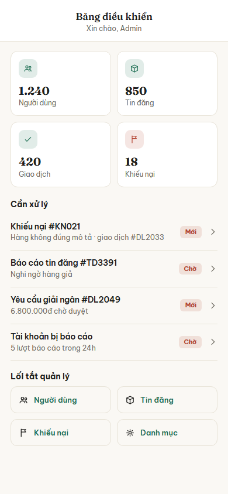
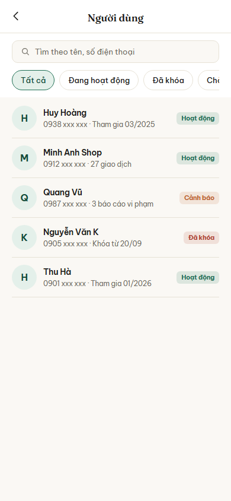
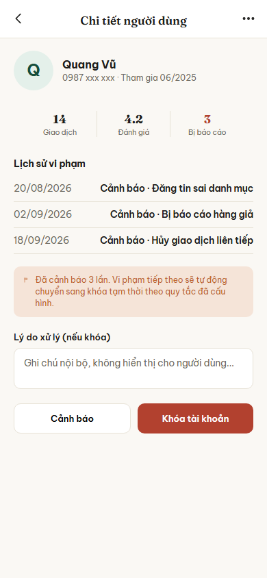
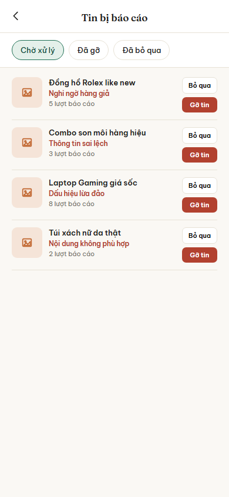
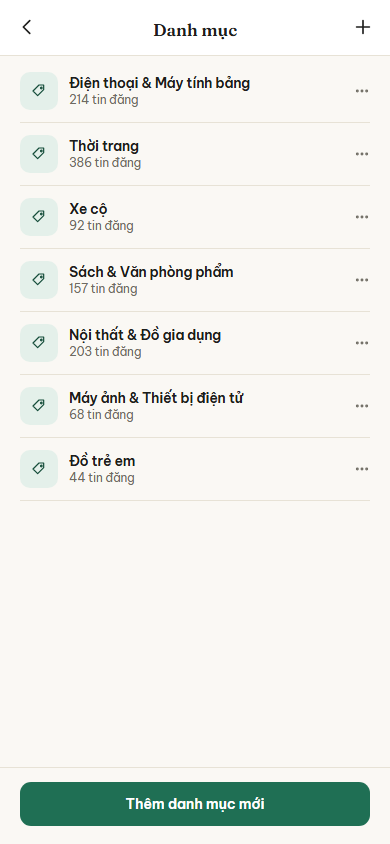
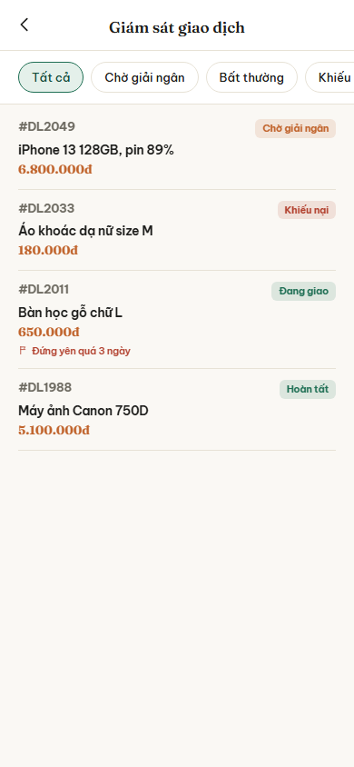

# Nhóm E: Quản trị

6 màn hình có ảnh, nộp theo 3 đợt: đợt 1 một màn (E01), đợt 2 hai màn (E02, E03), đợt 3 ba màn (E04, E05, E06). Cộng hai màn hình phụ chưa có ảnh (`AdminListingDetailFragment`, `AdminDealDetailFragment`) và màn D06 (xử lý khiếu nại, ở [nhóm D](../d-ho-so-tin-cay/README.md)). Số trong tài liệu là STT của [bảng đặc tả chức năng](../../product/dac-ta-chuc-nang.md). Điều hướng chung ở [README giao diện](../README.md#điều-hướng).

Toàn bộ nhóm này chạy trong `AdminActivity`, có đồ thị điều hướng riêng, không có thanh điều hướng dưới. Admin đăng nhập ở A01 như mọi người (vào B01) rồi bấm "Khu vực quản trị" trên D01. Mọi màn hình quản trị chỉ dùng để xem và xử lý; phía admin không có nút duyệt giải ngân tay (STT 86 là phát triển sau).

## E01. Admin: Bảng điều khiển

**Ảnh:** 

**Lớp:** `AdminDashboardFragment` trong `AdminActivity`. Màn hình gốc của khu vực quản trị.

**Mục đích:** Màn hình đầu tiên admin thấy khi vào khu vực quản trị: liệt kê những việc đang chờ xử lý và dẫn sang các mục quản trị chi tiết.

**Thành phần chính:**
- Tiêu đề "Bảng điều khiển" và dòng chào "Xin chào, Admin"
- Danh sách "Cần xử lý": mỗi dòng là một việc cụ thể (khiếu nại mới, báo cáo mới, yêu cầu xác minh chờ duyệt), kèm nhãn trạng thái "Mới" hoặc "Chờ" và mũi tên điều hướng
- Lưới "Lối tắt quản lý" 5 nút: Người dùng, Tin bị báo cáo, Khiếu nại, Giao dịch, Danh mục
- Nút "Về ứng dụng" để quay lại `MainActivity`

**Hành động và điều hướng:**
- Bấm một dòng khiếu nại trong "Cần xử lý": sang chi tiết khiếu nại D06 (`AdminComplaintDetailFragment`)
- Bấm một dòng báo cáo: sang E04 Admin: Kiểm duyệt nội dung
- Bấm một dòng yêu cầu xác minh: sang E02 với bộ lọc "Chờ xác minh"
- Bấm nút "Người dùng": sang E02 Admin: Danh sách người dùng
- Bấm nút "Tin bị báo cáo": sang E04 Admin: Kiểm duyệt nội dung
- Bấm nút "Khiếu nại": sang D06 danh sách khiếu nại (`AdminComplaintListFragment`)
- Bấm nút "Giao dịch": sang E06 Admin: Giám sát giao dịch
- Bấm nút "Danh mục": sang E05 Admin: Quản lý danh mục
- Bấm "Về ứng dụng": đóng `AdminActivity`, quay về `MainActivity`

**Chức năng liên quan:** STT 68 (danh sách và lọc người dùng), STT 73 (yêu cầu xác minh), STT 75 (danh sách tin bị báo cáo), STT 87 (danh sách khiếu nại), STT 81 (danh sách giao dịch), STT 79 (danh mục).

**Trạng thái đặc biệt:**
- Không có việc nào cần xử lý: hiện dòng chữ báo đã xử lý hết, vẫn giữ lưới lối tắt
- Mất mạng: hiện danh sách đã tải trước đó từ bộ nhớ đệm, kèm dải báo đang xem ngoại tuyến

**Khác với ảnh:**
- Ảnh có 4 ô số liệu tổng (1.240 người dùng, 850 tin đăng, 420 giao dịch, 18 khiếu nại). Đó là chức năng "Số liệu tổng quan" (STT 92), là **phát triển sau**, chưa làm.
- Ảnh có dòng "Yêu cầu giải ngân, chờ duyệt". Không làm: giải ngân đã đổi sang tự động, admin không duyệt tay (STT 84).
- Ảnh có dòng "tài khoản bị báo cáo" trong "Cần xử lý". Không làm riêng: báo cáo người dùng và tin nhắn hiện chung trong E04.
- Ảnh vẽ lưới 4 nút (Người dùng, Tin đăng, Khiếu nại, Danh mục). Đúng là 5 nút: nút "Tin đăng" đổi tên thành "Tin bị báo cáo" (vì E04 chỉ có tin bị báo cáo), thêm nút "Giao dịch" dẫn tới E06 (ảnh không có đường vào E06). Có thêm nút "Về ứng dụng".
- Ảnh giả định admin vào E01 ngay sau khi đăng nhập; đúng là vào qua nút "Khu vực quản trị" ở D01.

## E02. Admin: Danh sách người dùng

**Ảnh:** 

**Lớp:** `AdminUserListFragment` trong `AdminActivity`.

**Mục đích:** Cho admin xem toàn bộ người dùng của hệ thống, lọc theo trạng thái tài khoản, ngày tham gia và khu vực để tìm nhanh người cần xử lý.

**Thành phần chính:**
- Hàng lọc theo trạng thái tài khoản: Tất cả, Đang hoạt động, Khóa tạm, Khóa vĩnh viễn, Đã xóa
- Bộ lọc "Ngày tham gia" (từ ngày, đến ngày) và "Tỉnh hoặc thành phố" (chưa có ảnh)
- Công tắc riêng "Chờ xác minh": chỉ hiện người có yêu cầu xác minh người bán đang chờ duyệt. Dùng được cùng các bộ lọc khác
- Danh sách người dùng, mỗi dòng có ảnh đại diện chữ cái đầu, tên, số điện thoại (che một phần), thông tin phụ (ngày tham gia hoặc số giao dịch), nhãn trạng thái màu theo tình trạng tài khoản

**Hành động và điều hướng:**
- Bấm một người dùng: sang E03 Admin: Chi tiết người dùng
- Bấm một nút lọc hoặc đổi ngày, tỉnh: lọc lại danh sách ngay tại màn này

**Chức năng liên quan:** STT 68 (tìm kiếm, lọc người dùng theo trạng thái, ngày tham gia, khu vực), STT 70, 71 (khóa, mở khóa, qua E03), STT 73 (duyệt yêu cầu xác minh, qua E03).

**Trạng thái đặc biệt:**
- Không có kết quả: hiện dòng báo không có người dùng nào khớp
- Tài khoản bị khóa: nhãn màu đỏ ghi "Khóa tạm" hoặc "Khóa vĩnh viễn"
- Tài khoản đã từng bị cảnh báo: nhãn màu cam ghi "Cảnh báo" bên cạnh nhãn trạng thái
- Mất mạng: hiện lại danh sách đã tải trước đó từ bộ nhớ đệm, kèm dải báo đang xem ngoại tuyến

**Khác với ảnh:**
- Ảnh vẽ ô "Tìm theo tên, số điện thoại"; không làm. Mô hình chỉ lọc theo trạng thái, ngày tham gia và khu vực.
- Ảnh vẽ chip "Đã khóa" gộp; đúng là hai trạng thái Khóa tạm và Khóa vĩnh viễn, thêm "Đã xóa".
- Ảnh vẽ chip "Chờ (xác minh)" ngang hàng với trạng thái tài khoản; đúng là một bộ lọc riêng vì đây là trạng thái xác minh, không phải trạng thái tài khoản.
- Ảnh không vẽ lọc theo ngày tham gia và khu vực; vẫn phải làm (STT 68).

## E03. Admin: Chi tiết người dùng

**Ảnh:** 

**Lớp:** `AdminUserDetailFragment` trong `AdminActivity`.

**Mục đích:** Cho admin xem đầy đủ thông tin và lịch sử của một người dùng, duyệt xác minh, rồi cảnh báo hoặc khóa tài khoản khi cần.

**Thành phần chính:**
- Đầu trang: ảnh đại diện chữ cái đầu, tên, số điện thoại (che một phần), ngày tham gia, trạng thái tài khoản và trạng thái xác minh
- Ba số liệu: số giao dịch, điểm đánh giá trung bình, số lần bị báo cáo
- Khối "Thông tin định danh" (chưa có ảnh): số CCCD, ngày sinh, giới tính, địa chỉ thường trú. Chỉ admin thấy
- Khối "Yêu cầu xác minh" (chưa có ảnh), hiện khi có yêu cầu chờ duyệt: nút "Duyệt" và nút "Từ chối" kèm ô lý do từ chối
- Các tab lịch sử (chỉ phần "Lịch sử vi phạm" có trong ảnh): "Tin đăng", "Giao dịch", "Đánh giá", "Lịch sử vi phạm", "Nhật ký hoạt động"
- Danh sách "Lịch sử vi phạm": mỗi dòng có ngày, loại xử lý (cảnh báo) và lý do
- Dải cảnh báo màu cam khi đã cảnh báo đủ số lần, nêu rõ quy tắc khóa nếu vi phạm tiếp
- Ô nhập "Lý do" (bắt buộc khi cảnh báo hoặc khóa), chỉ admin thấy, không hiện cho người dùng
- Bộ chọn "Thời hạn khóa" (chưa có ảnh): số ngày hoặc ngày hết hạn, dùng khi khóa tạm và khi cảnh báo bậc 2
- Các nút cuối trang: "Cảnh báo" (nút phụ), "Khóa tài khoản" (nút chính, màu đỏ), "Mở khóa" (khi tài khoản đang bị khóa), "Gỡ toàn bộ tin" (khi tài khoản đang bị khóa)

**Hành động và điều hướng:**
- Bấm nút "quay lại" ở đầu trang: về màn đã gọi (E02 hoặc E01)
- Bấm "Duyệt" hoặc "Từ chối" ở khối yêu cầu xác minh: ghi kết quả, người dùng nhận thông báo; "Từ chối" bắt buộc nhập lý do
- Bấm "Cảnh báo": bắt buộc nhập lý do, ghi thêm một dòng vào lịch sử vi phạm với bậc tăng dần, vẫn ở màn này
- Bấm "Khóa tài khoản": bắt buộc nhập lý do và chọn thời hạn (hoặc khóa vĩnh viễn), sau đó khóa tài khoản, vẫn ở màn này với trạng thái cập nhật
- Bấm "Mở khóa": mở khóa tài khoản đang bị khóa tạm hoặc khóa vĩnh viễn, đưa về đang hoạt động
- Bấm "Gỡ toàn bộ tin": gỡ mọi tin của tài khoản đang bị khóa (hộp thoại xác nhận)
- Bấm một dòng tab Tin đăng hoặc Giao dịch: xem chi tiết (tin: `AdminListingDetailFragment`, giao dịch: `AdminDealDetailFragment`)

**Chức năng liên quan:** STT 69 (xem chi tiết hồ sơ: tin đăng, giao dịch, đánh giá, vi phạm), STT 70, 71 (khóa, mở khóa), STT 72 (cảnh báo theo bậc), STT 73 (duyệt yêu cầu xác minh), STT 74 (nhật ký hoạt động), STT 77 (gỡ hàng loạt tin của tài khoản bị khóa).

**Trạng thái đặc biệt:**
- Cảnh báo lần 1: chỉ cảnh báo, tài khoản vẫn hoạt động bình thường
- Cảnh báo lần 2: tự động khóa tạm theo quy tắc ba bậc, thời hạn do admin chọn khi cảnh báo
- Cảnh báo lần 3: khóa vĩnh viễn và gỡ toàn bộ tin
- Tài khoản đang bị khóa (tạm hoặc vĩnh viễn): nút chính đổi thành "Mở khóa", cả hai loại khóa đều mở khóa được. Mở khóa không đặt lại số lần cảnh báo
- Tài khoản đã xóa: chỉ xem
- Mất mạng: hiện lại thông tin đã tải, các nút hành động bị khóa

**Khác với ảnh:**
- Ảnh chỉ vẽ phần "Lịch sử vi phạm". Các tab Tin đăng, Giao dịch, Đánh giá, Nhật ký hoạt động (STT 69, 74), khối định danh, khối yêu cầu xác minh (STT 73) vẫn phải làm.
- Ảnh vẽ "Lý do xử lý (nếu khóa)"; lý do bắt buộc cả khi cảnh báo, và cần thêm thời hạn khóa.
- Ảnh vẽ "Cảnh báo lần 3: không còn nút mở khóa" và "Mở khóa tạm" ở lần 2; đúng là có nút "Mở khóa" cho cả khóa tạm và khóa vĩnh viễn.

## E04. Admin: Kiểm duyệt nội dung

**Ảnh:**  (chỉ vẽ tab báo cáo tin đăng)

**Lớp:** `AdminModerationFragment` và `AdminListingDetailFragment` (chi tiết tin cho admin, chưa có ảnh), trong `AdminActivity`.

**Mục đích:** Cho admin xem các báo cáo của người dùng, các tin bị gắn cờ và danh sách từ khóa cấm, rồi quyết định ẩn tin hay bỏ qua báo cáo.

**Thành phần chính:**
- Tiêu đề "Kiểm duyệt nội dung" với ba tab: "Báo cáo" (như ảnh), "Tin bị gắn cờ" và "Từ khóa cấm" (hai tab sau chưa có ảnh)
- Tab "Báo cáo":
  - Bộ lọc loại đối tượng: Tin đăng, Người dùng, Tin nhắn (chưa có ảnh)
  - Ba nút lọc theo trạng thái xử lý: Chờ xử lý, Đã ẩn (đã xử lý có vi phạm), Đã bỏ qua
  - Danh sách báo cáo gom theo đối tượng, mỗi dòng có ảnh thu nhỏ, tên tin (hoặc tên người dùng, nội dung tin nhắn), lý do báo cáo (màu đỏ), số lượt báo cáo, hai nút "Bỏ qua" và "Ẩn tin" (với người dùng và tin nhắn: "Bỏ qua" và "Xem người dùng")
- Tab "Tin bị gắn cờ": danh sách tin chứa từ khóa cấm (tin vẫn đang đăng), mỗi dòng có hai nút "Ẩn tin" và "Bỏ cờ"
- Tab "Từ khóa cấm": danh sách từ khóa, ô thêm từ khóa mới và nút xóa trên từng dòng. So khớp theo chuỗi, không phân biệt hoa thường và dấu

**Hành động và điều hướng:**
- Bấm "Bỏ qua": đóng mọi báo cáo còn chờ của đối tượng đó với trạng thái Đã bỏ qua, vẫn ở màn này
- Bấm "Ẩn tin": bắt buộc nhập lý do. Tin chuyển sang đã ẩn, người đăng thấy lý do; mọi báo cáo còn chờ của tin chuyển sang đã xử lý có vi phạm
- Bấm "Xem người dùng" (báo cáo về người dùng hoặc tin nhắn): sang E03 của người bị báo cáo, để cảnh báo hoặc khóa
- Bấm một dòng tin (ngoài hai nút): sang `AdminListingDetailFragment` để xem đầy đủ trước khi quyết định, có các nút "Ẩn tin" hoặc "Khôi phục"
- Bấm một nút lọc: lọc lại danh sách ngay tại màn này
- Thêm hoặc xóa từ khóa ở tab "Từ khóa cấm": lưu ngay

**Chức năng liên quan:** STT 75 (danh sách tin bị báo cáo, số lượt và lý do), STT 76 (ẩn tin có lý do, khôi phục khi duyệt oan), STT 77 (gỡ hàng loạt tin của tài khoản bị khóa, qua E03), STT 78 (từ khóa cấm và gắn cờ).

**Trạng thái đặc biệt:**
- Không có báo cáo nào đang chờ xử lý: hiện dòng chữ báo trống
- Tin đã ẩn bởi admin: nút "Ẩn tin" đổi thành "Khôi phục" (đưa tin về đang bán, xóa lý do). Tin do hệ thống gỡ hàng loạt (đã gỡ) thì không khôi phục được
- Thêm từ khóa đã có: báo lỗi, không thêm
- Mất mạng: hiện lại danh sách đã tải trước đó từ bộ nhớ đệm, kèm dải báo đang xem ngoại tuyến

**Khác với ảnh:**
- Ảnh vẽ nhãn "Đã gỡ" và nút "Gỡ tin"; đúng là "Đã ẩn" và "Ẩn tin" kèm lý do bắt buộc (trạng thái "Đã gỡ" chỉ dành cho gỡ hàng loạt của tài khoản bị khóa và không khôi phục được).
- Ảnh vẽ "Bỏ qua: tin chuyển sang Đã bỏ qua"; thực tế là các báo cáo còn chờ về tin đó được đóng, không đổi trạng thái tin.
- Ảnh chỉ vẽ báo cáo về tin đăng. Báo cáo về người dùng và tin nhắn, tab "Tin bị gắn cờ" và "Từ khóa cấm" vẫn phải làm.
- Màn chi tiết tin cho admin (`AdminListingDetailFragment`) chưa có ảnh; không dùng B03 vì B03 là màn của người mua.

## E05. Admin: Quản lý danh mục

**Ảnh:** 

**Lớp:** `AdminCategoryFragment` trong `AdminActivity`.

**Mục đích:** Cho admin thêm, sửa, ẩn, xóa danh mục sản phẩm và danh mục con dùng chung cho toàn ứng dụng, và cấu hình thuộc tính tình trạng riêng của từng danh mục.

**Thành phần chính:**
- Tiêu đề "Danh mục" và nút "+" ở góc phải để thêm danh mục mới
- Danh sách danh mục, danh mục con thụt vào dưới danh mục cha. Mỗi dòng có biểu tượng nhãn, tên danh mục, số tin đăng thuộc danh mục đó, công tắc "Đang dùng", nút "..." để sửa hoặc xóa
- Nút "Thêm danh mục mới" cố định ở cuối màn hình
- Hộp "Thêm hoặc sửa danh mục" (chưa có ảnh): ô tên, bộ chọn "Danh mục cha" (để trống là danh mục gốc; chỉ có hai cấp), công tắc "Đang dùng"
- Màn cấu hình thuộc tính tình trạng của một danh mục: danh sách tên thuộc tính (ví dụ Dung lượng pin, Bảo hành), thêm hoặc xóa từng thuộc tính

**Hành động và điều hướng:**
- Bấm "+" hoặc "Thêm danh mục mới": mở hộp thêm danh mục, vẫn ở màn này sau khi lưu
- Bấm "...": mở menu Sửa hoặc Xóa cho danh mục đó
- Bấm công tắc "Đang dùng": tắt thì danh mục ẩn khỏi lựa chọn khi đăng tin
- Bấm một danh mục (ngoài nút "..."): mở màn cấu hình thuộc tính tình trạng riêng cho danh mục đó (chưa có mã màn hình riêng, coi như một lớp phủ trên chính màn E05)

**Chức năng liên quan:** STT 79 (thêm, sửa, xóa danh mục, gồm danh mục con; hiển thị số tin đăng), STT 80 (cấu hình thuộc tính tình trạng theo danh mục).

**Trạng thái đặc biệt:**
- Xóa danh mục đang có tin đăng hoặc đang có danh mục con: không cho xóa, thông báo nêu số tin hoặc số danh mục con và gợi ý tắt "Đang dùng" để ẩn
- Đặt tên trùng danh mục đã có: báo lỗi ngay dưới ô nhập, không cho lưu

**Khác với ảnh:**
- Ảnh vẽ cảnh báo khi xóa danh mục đang có tin ("số tin đăng sẽ mất danh mục"); không làm, thay bằng chặn xóa và ẩn danh mục.
- Ảnh không vẽ bộ chọn danh mục cha và công tắc "Đang dùng"; vẫn phải làm (STT 79).

## E06. Admin: Giám sát giao dịch

**Ảnh:** 

**Lớp:** `AdminDealMonitorFragment` và `AdminDealDetailFragment` (chi tiết giao dịch cho admin, chưa có ảnh), trong `AdminActivity`.

**Mục đích:** Cho admin theo dõi tình trạng mọi giao dịch trong hệ thống và những giao dịch đang có khiếu nại.

**Thành phần chính:**
- Tiêu đề "Giám sát giao dịch"
- Hàng lọc theo trạng thái giao dịch: Tất cả, Chờ xác nhận, Đã xác nhận, Đang giao (kèm đếm ngược giải ngân), Đã nhận, Hoàn tất, Đã hủy, Khiếu nại
- Danh sách giao dịch, mỗi dòng có mã giao dịch, tên món đồ, giá và nhãn trạng thái màu
- Màn chi tiết `AdminDealDetailFragment` (chưa có ảnh), chỉ xem: thông tin giao dịch, hai bên, khoản ký quỹ và trạng thái, thời hạn tự giải ngân, và dòng thời gian toàn bộ lịch sử chuyển trạng thái (người đổi, lý do, thời điểm)

**Hành động và điều hướng:**
- Bấm một giao dịch: sang `AdminDealDetailFragment` để xem đầy đủ lịch sử chuyển trạng thái
- Bấm một nút lọc trạng thái: lọc lại danh sách theo trạng thái đã chọn
- Trong chi tiết, giao dịch đang khiếu nại có liên kết sang D06 chi tiết khiếu nại

**Chức năng liên quan:** STT 81 (danh sách giao dịch, lọc theo trạng thái), STT 82 (chi tiết giao dịch gồm lịch sử trạng thái), STT 84 (theo dõi giải ngân tự động).

**Trạng thái đặc biệt:**
- Giao dịch "Đang giao" chỉ hiển thị thông tin ký quỹ và đếm ngược, không có nút duyệt tay: giải ngân diễn ra tự động khi người mua xác nhận đã nhận hoặc khi hết thời hạn đếm ngược
- Mất mạng: hiện lại danh sách đã tải trước đó từ bộ nhớ đệm, kèm dải báo đang xem ngoại tuyến

**Khác với ảnh:**
- Ảnh có chip "Chờ giải ngân" và "Khiếu nại". Đúng là các chip ứng với trạng thái giao dịch; "Chờ giải ngân" là giao dịch "Đang giao" có khoản ký quỹ đang giữ.
- Nút lọc "Bất thường" và dòng cảnh báo "Đứng yên quá 3 ngày" trong ảnh thuộc chức năng "Cảnh báo giao dịch bất thường" (STT 83), là **phát triển sau**, chưa làm.
- Ảnh không có màn chi tiết cho admin; bấm giao dịch mở `AdminDealDetailFragment` trong `AdminActivity`, không mở C03 (C03 là màn của người mua và người bán).
